# 加餐：使用AutoDL快速部署模型

你好，我是邢云阳。

课程上线后，我看到了很多同学都在积极进行测试和留言，学习热情非常高涨，在这些问题中，我也看到了很多共性的问题，因此我抽时间专门做了一些加餐课来深度解答。

今天这节课，要讲的是如何使用 AutoDL 上的 GPU 算力资源快速部署一个模型。

## AutoDL 是什么？

先来说说 AutoDL 是啥。AutoDL 是一个算力租用平台，我们可以如下图所示在算力市场按量、按天等租用某种规格的 GPU 卡，或者是在 AI 服务器页面整租一台服务器。

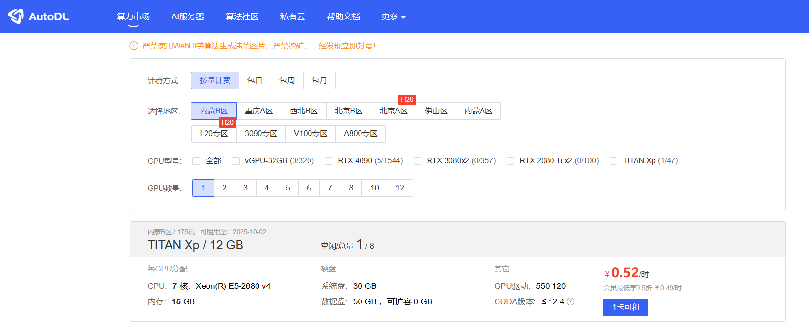

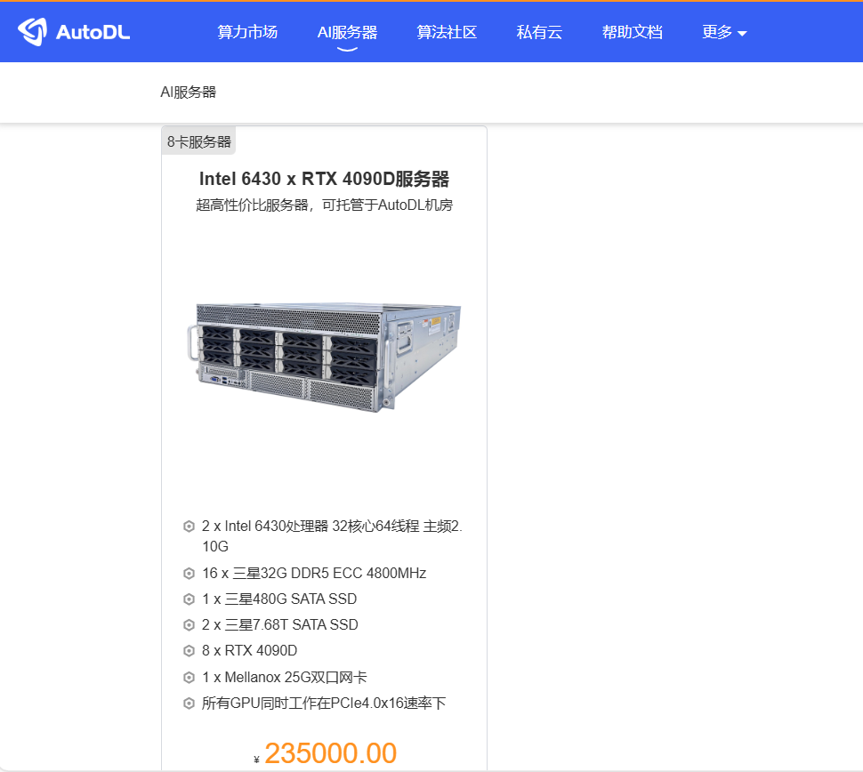

通常我们会使用第一种在算力市场按量付费去租 GPU 卡的模式，来完成一些快速简单的测试。这样用完既可以释放，整体消费会比较低。

## AutoDL 租用 GPU 算力演示

接下来，我就充值上 3 块钱的，以租用一个 4090 卡为例，为大家演示一下如何租用 GPU 算力。

首先，我们要在各个区来回的切换，去看看哪个区还有空闲的算力。因为 AutoDL 实在是太火了，价格也便宜，所以算力非常抢手。

如果刷到了有卡出现可租用状态，赶紧点进去，选择按量付费，然后迅速配置镜像。

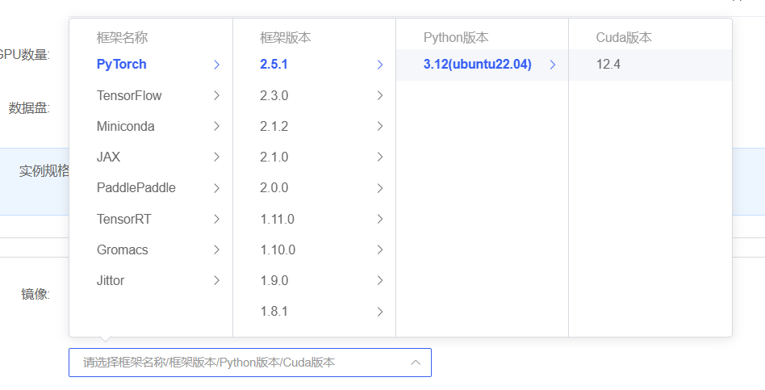

由于我今天会用 ollama 来部署模型，所以我就随便选一个 ubuntu22.04 的镜像就可以了（如上图所示）。选好后点击创建并开机，即可在控制台看到算力实例，截图如下。

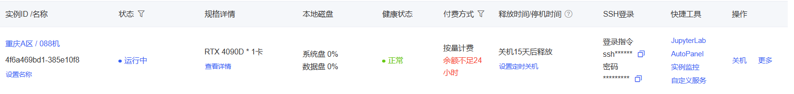

算力实例图

看到这里的话，有容器研发或使用经验的同学可能大概就猜出了 AutoDL 的运行机制了。实际，上我们创建出的算力实例就是一个独占了 GPU 卡的 docker 容器。容器的镜像就是刚才我们所选的镜像。我用一张图，为大家画一下大概的原理。大概的意思就是基本原理，不排除AutoDL 还做了一些更好的机制，去优化用户体验。

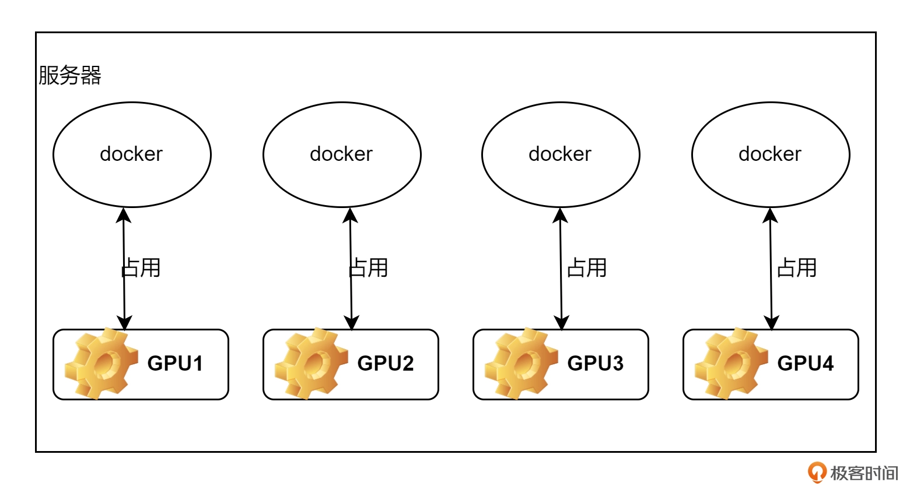

如图所示，现在有一台服务器上面有 4 张 GPU 卡。当用户创建一个算力实例时，我就根据用户选的镜像创建出一个容器，并纳管一张 GPU 卡。当用户释放实例时，我就把容器删掉。实际上这个过程，我们在前面第 3、4 节课已经实践过了，并不神秘。

再回到上面的算力实例图，可以看到倒数第三列有一个 SSH 登录，我们可以找一台本地的linux 服务器或者 windows 的 powershell，然后先粘贴第一行的登录指令，点回车，此时会让我们输入密码，然后把第二行的密码粘上，就可以如下图所示进入到算力实例（容器）内部了。

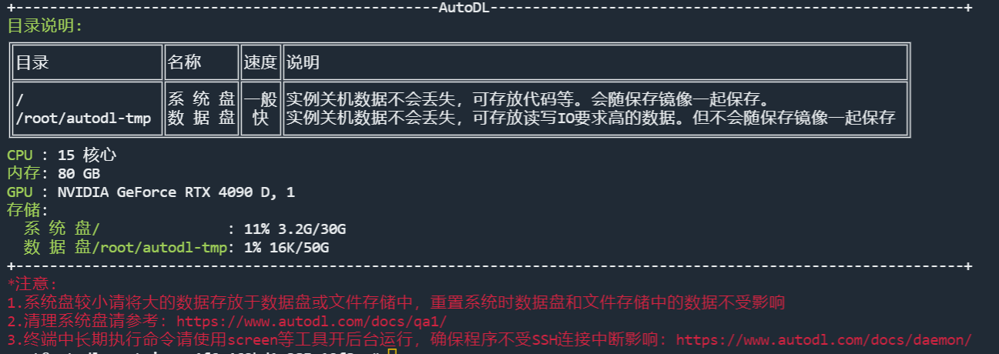

这样我们就租用了算力实例，可以开始使用了。

## 在算力实例上部署模型

接下来，我以 ollama 为例，为你演示一下如何在算力实例上部署模型。首先安装 ollama，命令是：

```bash
curl -fsSL https://ollama.com/install.sh | sh
```

效果为：

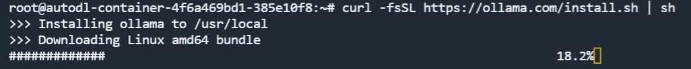

安装完成后，需要执行一下 ollama serve 命令，将 ollama 服务启动起来，否则无法使用ollama run 命令部署模型。

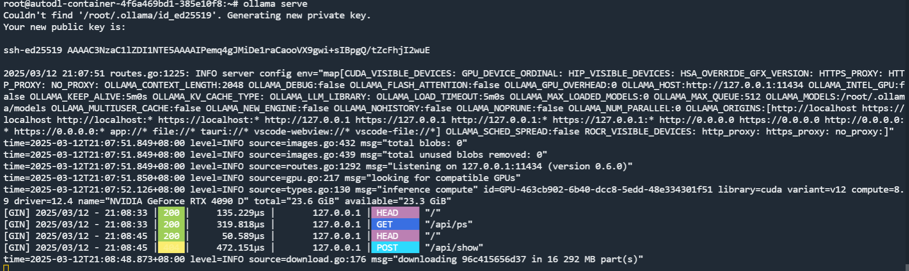

启动起来之后，我们再开一个 linux 或者 PowerShell 终端，再次使用算力实例为我们提供的SSH 命令，登录上实例。然后执行 ollama run 命令，就可以下载并运行模型了。

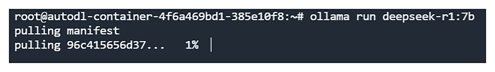

一段时间后，模型下载完毕，并运行起来了，我们可以测试一下，比如我输入的是 1+1=？

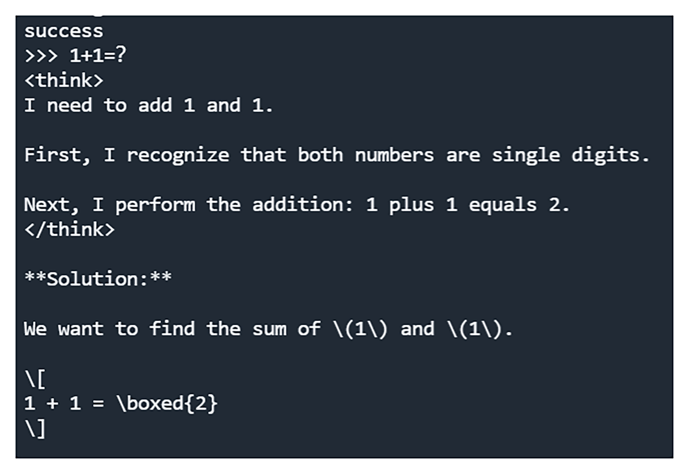

至此，模型就可以在本地用了。

## 暴露端口

如果我们想将 ollama 端口对外暴露，使得外部用户也能访问，怎么办呢？

AutoDL 提供了一种 SSH 隧道的方式，即 AutoDL 为每个实例的 6006 端口都映射了一个可公网访问的地址，也就是将实例中的 6006 端口映射到公网可供访问的 ip:port 上。

我们知道 ollama 默认的运行端口是 11434，因此我们需要改一下，让 ollama 在 6006 端口上运行。

我们首先把模型以及 ollama serve 停掉。然后执行如下命令：

```bash
export OLLAMA_HOST="0.0.0.0:6006"
```

注意两个终端都要执行。因为 export 是一种临时生效方式，只在本终端生效。执行完成后，再次将 ollama 服务运行起来即可。

接下来就要进行隧道打通。

如下图所示，我们在算力实例页面，点击红框中的自定义服务。

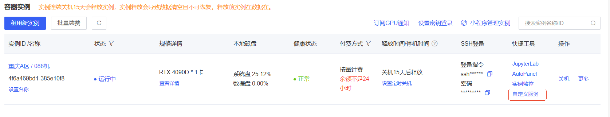

这时会弹出来如何进行隧道连接的教程。

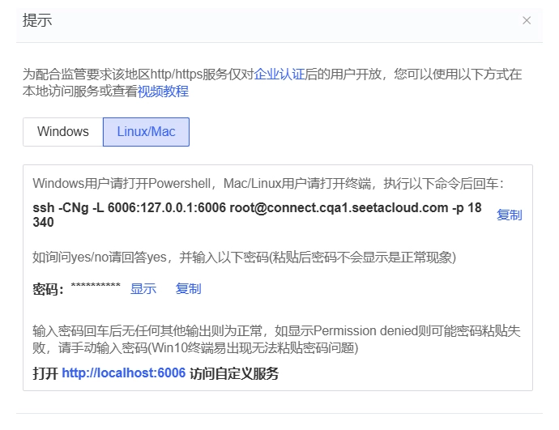

注意，重点来了！！！ 我们要先复制 ssh 那行命令，然后在我们自己的 linux 服务器或者Windows PowerShell 上，粘贴并回车执行，然后再把密码粘过来。一定要注意的是，这个命令是在我们自己的服务器上执行的，不是在 AutoDL 容器内执行的！！！

命令执行的效果如下图所示：

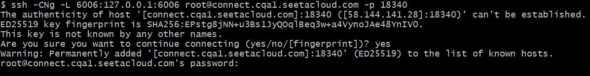

如果一切正常，此时光标会卡在这闪烁，这说明隧道建立了。

然后我们重新开一个终端，curl 一下 localhost:6006 端口测试一下，如果出现下面的效果，就说明 ollama 服务可以在外部访问了。

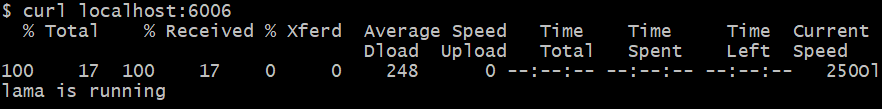

## 思考题

利用这种方式将大模型运行起来后，我们如何测试第四节课讲的高可用集群的方案呢？

欢迎你在留言区展示你的思考过程，我们一起探讨。如果你觉得这节课的内容对你有帮助的话，也欢迎你分享给其他朋友，我们下节课再见！
