# 加餐 | 前沿速递：如何学习与理解Google智能体协议A2A？

你好，我是邢云阳。

上周三（2025 年 4 月 9 日），Google 发布了一个名为 Agent To Agent 的协议，简称 A2A，在业界引起了不小的讨论。作为一门走在技术前沿的课程，我觉得很有必要及时和大家一起讨论和学习一下新的热点与发展方向，于是特别安排了今天的内容。今天我会从原理开始讲，最后带你自己动手写代码体验一下 A2A。

看名称就知道，A2A 是一个与 Agent 有关的协议，对于各路人马创建的 Agent，A2A 提供了一种统一的封装方式。这样一来，不同来源的 Agent 能够实现互相调用，从而打破彼此之间的隔阂，避免 Agent 成为孤立的“信息孤岛”，这对推动 Agent 之间的协同合作与生态发展很有价值。

类似的这种协议，之前有没有？当然有。最近比较火的 MCP 就是这种大一统标准化的思路。像这样的协议，我提出来没有用，没人买我的账，只有大佬公司才能够做到“一支穿云箭，千军万马来相见”。


这不 A2A 刚推出，就得到了超 50 家知名服务商的支持，比如 LangChain、MongoDB 等等。

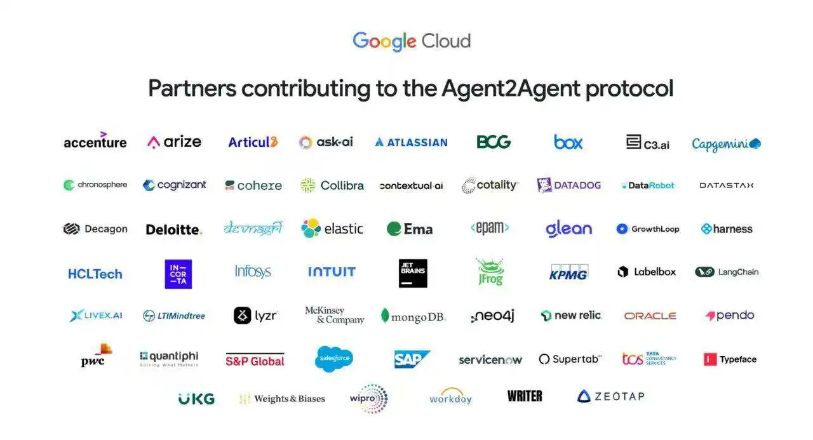

## A2A & MCP

有同学可能会认为 A2A 和 MCP 是竞争者，是两家大公司在争抢市场话语权，但我认为不是，我认为它们是不同层面的协议，解决的问题也不同，因此可以做到互补。

### MCP

我们先来看 MCP，既可以结合下面的示意图理解。

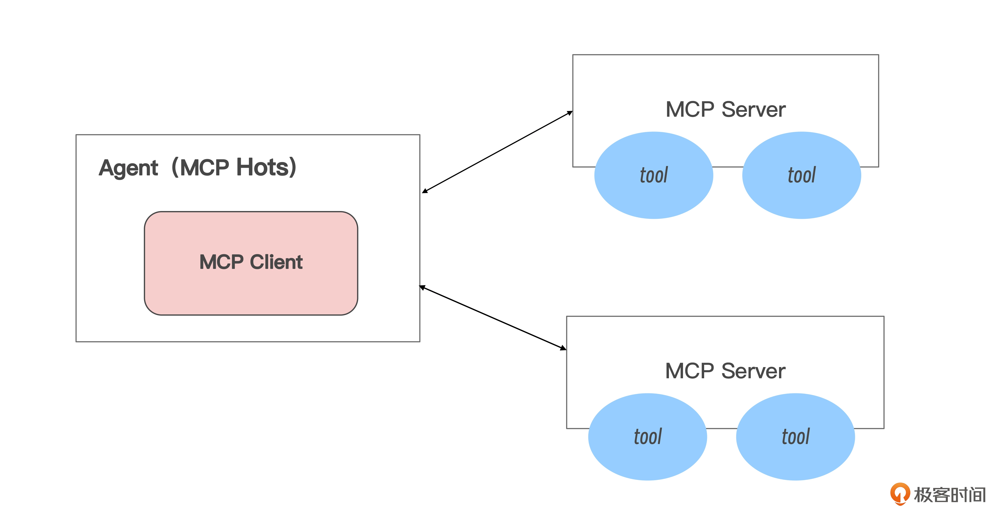

之前讲 MCP 时，有好几位同学留言，表示不理解 MCP Client 如何与大模型进行结合，或者说如何自己开发一个 MCP Hosts。

其实非常简单。我们在讲 MCP Client 时，提过它与 MCP Server 交互时有两个方法，一个是list_tool，一个是 call_tool。这两个方法一个是列出所有支持的工具的名称、描述、参数等，另一个则是调用工具。那这是不是就与我们之前讲 Agent 和 Function Calling 时很类似了呢？

我们使用 Agent 时，也需要先手工撸代码做与 list_tool 同样的事情，然后将结果当作 prompt喂给大模型，这样大模型才能知道遇到问题时，有什么工具能够解决问题。call_tool 就不说了，属于 Agent 与 Function Calling 的基础操作。

由此，我们很容易就能理解 MCP Host 是什么了。其实它就是一个 Agent 程序。所以如果不考虑 MCP 的 resource 与 prompt 能力，MCP 解决了什么问题呢？解决的是如何标准化封装与发布工具的问题。

### A2A

我们再来看另一幅图。

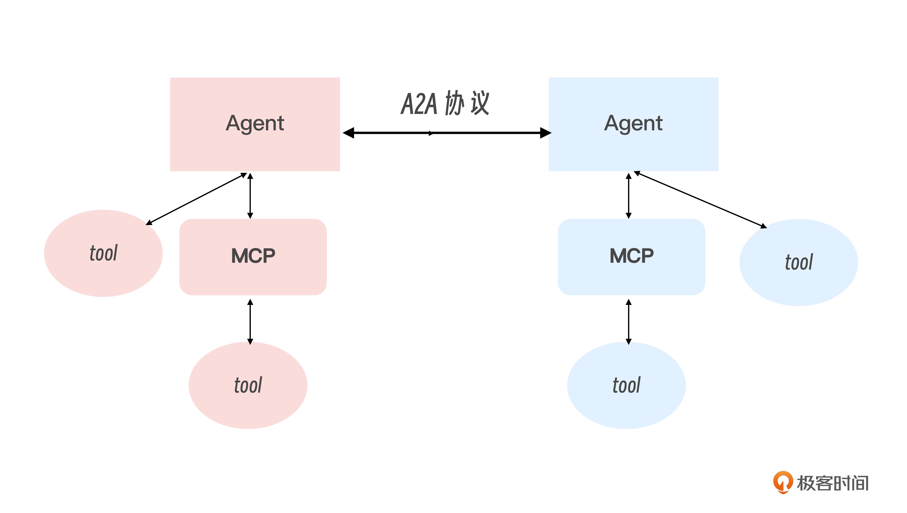

这幅图直观描述了 A2A 协议。首先，每一个独立的 Agent 都可以去调用自身的工具，调用工具的方法可以是传统的调用方式，也可以是 MCP。而 Agent 与 Agent 之间，还可以通过Agent 之间进行互相调用。

为什么要互相调用呢？其实之前有几个同学也问过我一个问题，那就是如果有 1 万个工具发给Agent，Agent 如何选择呢？我的回答是不可能。

在互联网时代，我们做 API 时，也会去分组，比如 /v1/user/xxx 和 /v1/prod/xxx 等。因此到了AI 时代，我们不能让 Agent 当一个混合大管家，而是要让其专注于某一领域能力，因此赋给Agent 的工具，也必然是某一领域的几个或者几十个工具。

比如上图中，左边的 Agent 可以是一个体育助手，调用的“懂球帝”工具，右侧的 Agent 可以是一个地图助手，具备高德地图的功能。如果没有 A2A，则它们都是独立的。但有了 A2A，此时我向左边的 Agent 询问“北京鼓楼附近哪有烤鸭店？”，左边的 Agent 就会把问题转到右边的Agent 的去完成。这便是大家都遵循协议、形成标准化的好处。

因此，A2A 解决的是什么问题？是 Agent 间互相通信，形成多 Agent 的问题，这比 MCP 的维度更高。因此它们是互补的协议。

## 如何学习 A2A

接下来，我们详细的学习一下 A2A。首先，打开 A2A 的官方 GitHub 地址：google/A2A:An open protocol enabling communication and interoperability between opaque agenticapplications.

要重点关注的是 Getting Start 部分：

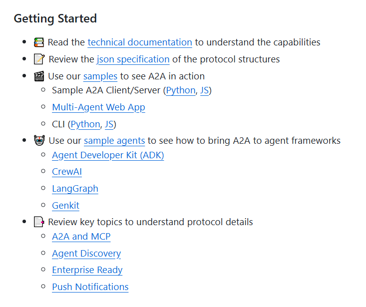

这一部分是我们快速入门的指引。其中第一行给出了 A2A 的文档链接，从第三行开始给出了示例代码 samples 的链接，并说明了支持两种语言（Python 和 JS）。此外写代码时，还可以用四种脚手架，比如 ADK、LangGraph 等，这些是一会我们自己写代码的重要参考。

文档里有几个概念，是我们要重点关注的。

第一个是 Agent Card，可以理解为是 Agent 的名片。也就是说一个 Agent 想要让另一个Agent 了解自己的名称、能力等，就需要在名片上写清楚。大家可以点击这个链接：Technical Documentation，看到 Agent Card 的格式和内容。

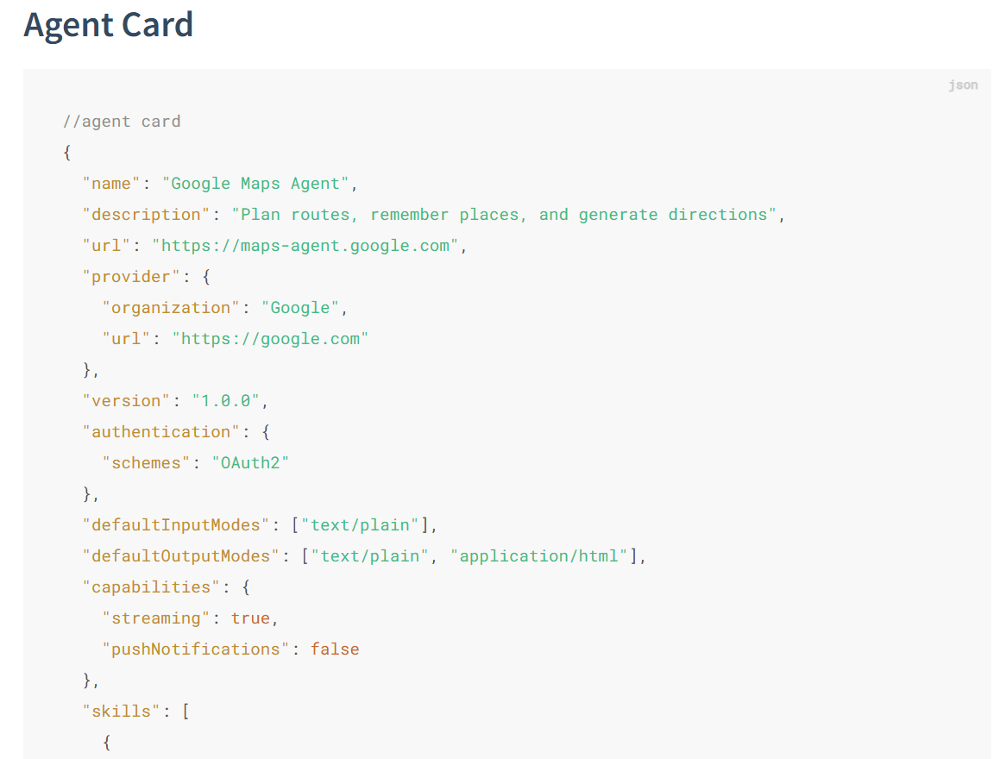

可以看到，其就是一个很简单的 JSON 格式。当 Agent 之间做 HTTP 交互时，使用 JSON 会非常方便。

接下来是 Task 的概念，链接在这：Technical Documentation。Task 可以理解为是一间洽谈室，由乙方（发起调用请求的 Agent）邀请甲方（接收调用请求的 Agent）进行会晤。但是会晤的结果（状态）是什么，是甲方立马执行，还是拒绝，还是安排到以后执行等等，这些细节都是由甲方说了算的。

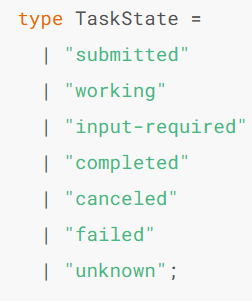

文档给出了 Task 的所有状态集合。至于前面所说的，乙方如何邀请甲方等等动作，则是一个个的接口，需要我们继承实现。发现了没，文档里已经开始上代码了，这时候就需要我们直接看源码，并且上手写 Demo 进行测试来加深理解了。

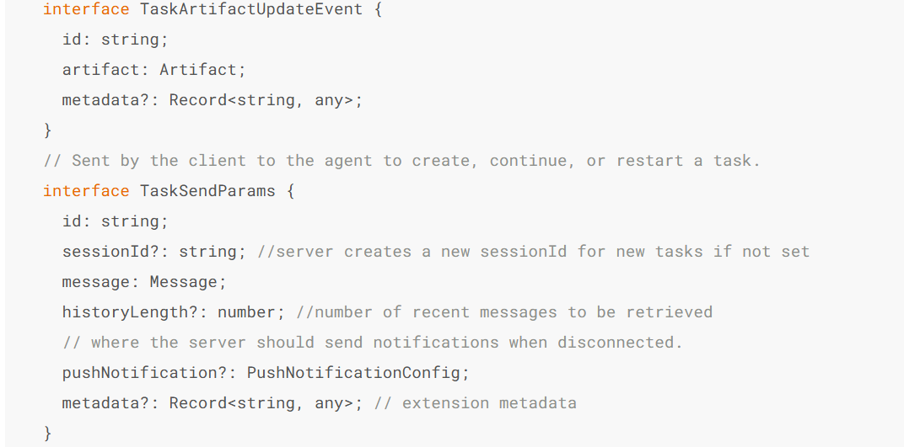

## 编写代码体验 A2A

接下来，我们开始先简单阅读源码，了解一下大致的运行逻辑，然后自己动手用用看。

### 源码解析

前面提到示例代码在 samples 文件夹中，有好几种脚手架实现版本。我阅读的是 LangGraph版本的，因为后续课程里我们还要讲到 LangGraph，这里不妨先“混个脸熟”，链接在这：A2A/samples/python/agents/langgraph/README.md at main · google/A2A。当然了，你也可以选择自己熟悉的版本阅读，思路都是一样的。

可以先看 README，了解一下源码的原理。根据 README 我们就会知道，这个代码就是用LangGraph 实现了一个 ReAct Agent，该 Agent 能调用一个计算汇率的工具。之后允许客户端使用 A2A 协议调用这个 Agent。他还画了一张时序图，我们来看一下：

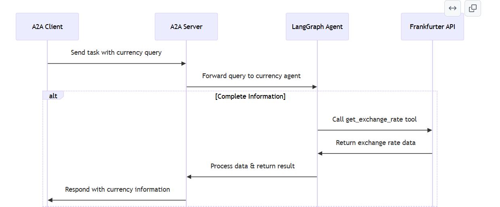

由于图很长，我们就先截第一部分，弄明白交互原理就可以。

可以看到 A2A 实际上类似 MCP，也是一个 C-S 架构。如果想通过 A2A 去调用另一个Agent，则首先需要实现一个 A2A 客户端。而被调用的 Agent 呢，则需要实现一个 A2AServer，才能与客户端建立连接。

整个消息流转的流程是这样的。先由 A2A Client 向 A2A Server 发送消息，比如用户的query。Server 收到消息后就会发送给 Agent，由 Agent 执行选择工具，调用工具的流程。之后将工具执行结果返给 Server，由 Server 再返给 Client。

看完了原理图，我们再去简单浏览一下代码，印证一下是不是这个流程，加深理解。先看示例代码的目录结构：

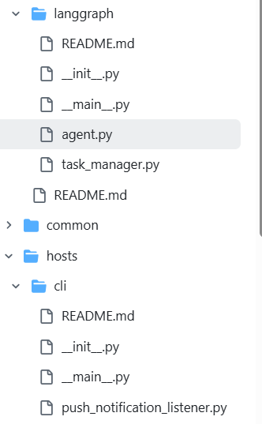

代码分为几个文件夹，langgraph 实现了 Agent 与 A2A Server 的代码。common 是 A2A 协议的 SDK，或许是因为刚出的缘故，Google 甚至还没来得及将其封装成一个 python 库，而是直接以源码的形式就放出来了。因此如果我们写代码，就需要把 common 包的源码下载下来，放到我们的工程中。hosts 文件夹下的 cli 就是 A2A Client 了。我们一个个来看。

首先是 langgraph 目录下的 https://A2A/samples/python/agents/langgraph/main.py at main· google/A2A">main 文件，这是 A2A Server 的实现代码，代码如下：

```python
from common.server import A2AServer
from common.types import AgentCard, AgentCapabilities, AgentSkill, MissingAPIKeyE
from common.utils.push_notification_auth import PushNotificationSenderAuth
from agents.langgraph.task_manager import AgentTaskManager
from agents.langgraph.agent import CurrencyAgent
import click
import os
import logging
from dotenv import load_dotenv
load_dotenv()
logging.basicConfig(level=logging.INFO)
logger = logging.getLogger(__name__)
@click.command()
@click.option("--host", "host", default="localhost")
@click.option("--port", "port", default=10000)
def main(host, port):
   """Starts the Currency Agent server."""
   try:
       if not os.getenv("GOOGLE_API_KEY"):
           raise MissingAPIKeyError("GOOGLE_API_KEY environment variable not set
       capabilities = AgentCapabilities(streaming=True, pushNotifications=True)
       skill = AgentSkill(
           id="convert_currency",
           name="Currency Exchange Rates Tool",
           description="Helps with exchange values between various currencies",
           tags=["currency conversion", "currency exchange"],
           examples=["What is exchange rate between USD and GBP?"],
       )
       agent_card = AgentCard(
           name="Currency Agent",
           description="Helps with exchange rates for currencies",
           url=f"http://{host}:{port}/",
           version="1.0.0",
           defaultInputModes=CurrencyAgent.SUPPORTED_CONTENT_TYPES,
           defaultOutputModes=CurrencyAgent.SUPPORTED_CONTENT_TYPES,
           capabilities=capabilities,
           skills=[skill],
       )
       notification_sender_auth = PushNotificationSenderAuth()
       notification_sender_auth.generate_jwk()
       server = A2AServer(
           agent_card=agent_card,
           task_manager=AgentTaskManager(agent=CurrencyAgent(), notification_sen
           host=host,
           port=port,
       )
       server.app.add_route(
           "/.well-known/jwks.json", notification_sender_auth.handle_jwks_endpoi
       )
       logger.info(f"Starting server on {host}:{port}")
       server.start()
   except MissingAPIKeyError as e:
       logger.error(f"Error: {e}")
       exit(1)
   except Exception as e:
       logger.error(f"An error occurred during server startup: {e}")
       exit(1)
if __name__ == "__main__":
   main()
```

从包的的引用来看，A2A 相关的接口都是在 common 包实现的，比如 A2A Server、AgentCard 等。而 Agent 相关的代码都是由 LangGraph 包实现的。因此实际上使用 A2A 与LangGragh 有没有关系？并没有。我们不使用 LangGragh 构建 Agent，自己手写一个Agent，也能封装成 A2A。

搞清楚这一点后，我们再来看 main 方法的实现。main 方法的开头有三行 click 的装饰器代码，click 是 python 自带的用于实现控制台命令行的包。啥叫控制台命令行？比如我们使用linux 系统时输入的 ls 等命令行就属于控制台命令行。

main 方法的主要工作呢，就是在 25 ～ 42 行代码填充了 AgentCard，然后在第 46 ～ 58 行代码启动了一个 A2AServer。在 A2AServer 中还有一个参数是 task_manager，这就是我们理论部分中说到的 Task。

task_manager 的主要作用是实现调用 Agent 获取 Agent 输出的过程，示例代码在这里（200多行，所以建议你跳转查看）：A2A/samples/python/agents/langgraph/task_manager.py atmain · google/A2A。

看起来挺复杂，但实际上我们一行代码都不需要动，写代码时直接抄过来就可以。

我们要重点实现的是 task_manager 所需要传入的 Agent 类。参考 LangGraph 的 Agent 的代码实现，该类需要编写两个方法和一个常量，这两个方法分别是以非流式模式与 Agent 对话的invoke 方法以及以流式模式与 Agent 对话的 stream 方法。常量则是SUPPORTED_CONTENT_TYPES，表示支持的对话类型，比如文本、语音等等。

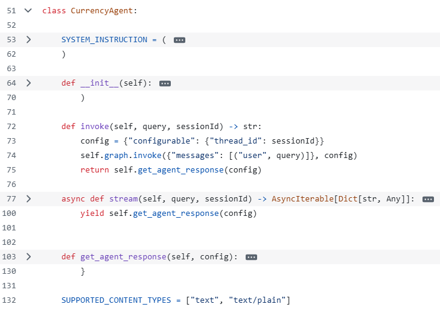

这段代码的完整版本在https://A2A/samples/python/agents/langgraph/agent.py at main ·google/A2A"> 这里，为了帮你抓住重点，我只展示了关键内容。

这基本就是 A2A Server 的大概逻辑，我们再来简单看一下 hosts 目录下的 A2A Client。代码在 _main_.py 中，其实也非常简单，同样是调用 common 包的 A2AClient 等接口去实现与A2A Server 端的通信。

那最后呢，我就画一张图总结一下上面所讲的内容。

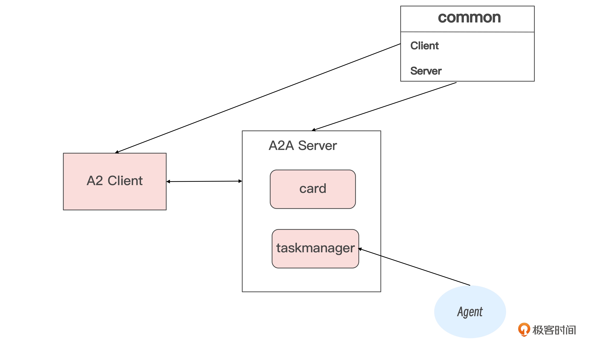

### 代码编写

光阅读代码不动手，还是不能完全理解。因此接下来，我们使用 A2A 协议来自己实现从客户端调用 Server 端 Agent 的过程。需要注意的是，今天的代，需要在 Linux 上运行，在Windows 上会有兼容性问题，运行不起来。我的代码会放到 GitHub 上，大家拿到我的代码后，会看到目录结构是这样的：

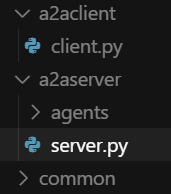

包含三个文件夹，其中 common 就是 A2A 的 SDK，a2aclient 是 client 端的代码，a2aserver是服务端的代码，其中包含了 A2A Server 以及 agent。

由于 LangGraph 相关的课程现在还没更新，考虑到大家的学习进度，因此这节课的 Agent，我就还是沿用员工绩效管理的 ReAct Agent 为大家做演示。看到这的同学可以点击链接，将之前的 Agent 代码下载下来，回顾一下实现逻辑，然后打开 agent.py， 再继续看我后面的讲解。

### Server 端实现

我在之前的 agent.py 代码中，有一个测试用的 main 函数，这其实就实现了在非流式模式下，如何通过多轮对话与 Agent 进行交互。所以我们只需稍作改造，就能把它变成 task_manager中的 invoke 函数。代码如下：

```python
def invoke(self, query, session_id=None):
       prompt = REACT_PROMPT.replace("{tools}", json.dumps(tools)).replace("{inp
       messages = [{"role": "user", "content": prompt}]
       while True:
           response = send_messages(messages)
           response_text = response.choices[0].message.content
.
           ...以前的main中的老代码
       return {
           "is_task_complete": True,
           "require_user_input": False,
           "content": final_answer
       }
```

可以看到几乎与老代码没什么区别，只是做了函数封装，唯一差异就是返回值是一个 JSON，这是 task_manager 规定的返回格式，我们遵守就可以。

接下来实现 A2A Server。先上代码：

```python
@click.command()
@click.option("--host", "host", default="localhost")
@click.option("--port", "port", default=10000)
def main(host, port):
   """Starts the Currency Agent server."""
   try:
       capabilities = AgentCapabilities(streaming=True, pushNotifications=True)
       skill1 = AgentSkill(
           id="skill1",
           name="员工绩效工具",
           description="查询员工的绩效评分",
           tags=["查询员工的绩效评分"],
           examples=["张三的绩效是多少分"],
       )
       skill2 = AgentSkill(
           id="skill2",
           name="员工绩效评语生成工具",
           description="生成绩效评语",
           tags=["生成绩效评语"],
           examples=["请帮我写一段张三的绩效评语"],
       )
       agent_card = AgentCard(
           name="员工绩效管理系统",
           description="查询员工的绩效评分，生成绩效评语",
           url=f"http://{host}:{port}/",
           version="1.0.0",
           defaultInputModes=AgentAdapter.SUPPORTED_CONTENT_TYPES,
           defaultOutputModes=AgentAdapter.SUPPORTED_CONTENT_TYPES,
           capabilities=capabilities,
           skills=[skill1, skill2],
       )
       notification_sender_auth = PushNotificationSenderAuth()
       notification_sender_auth.generate_jwk()
       server = A2AServer(
           agent_card=agent_card,
           task_manager=AgentTaskManager(agent=AgentAdapter(), notification_send
           host=host,
           port=port,
       )
       server.app.add_route(
           "/.well-known/jwks.json", notification_sender_auth.handle_jwks_endpoi
       )
       logger.info(f"Starting server on {host}:{port}")
       server.start()
   except MissingAPIKeyError as e:
       logger.error(f"Error: {e}")
       exit(1)
   except Exception as e:
       logger.error(f"An error occurred during server startup: {e}")
       exit(1)
if __name__ == "__main__":
   main()
```

可以看到我几乎就是照抄了官方的示例代码，唯一的区别就是 Agent Card 的描述，我是根据我 Agent 的实际情况进行描述的。那我的 Agent 呢，是有两个能力，一个能力是能查绩效，一个能力是能写绩效评语，请注意的是这是能力描述，而非工具描述，因此没有参数等描述。

这个代码写好后，我们就可以执行命令：

```
python server.py
```

我们将代码运行起来，如果一切正常，则会出现如下效果。

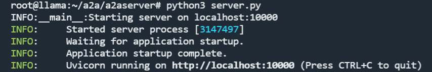

此时我们可以直接 curl 一下这个地址，测试一下基本功能是否正常，命令为：

```bash
curl localhost:10000/.well-known/agent.json
```

正常效果为：

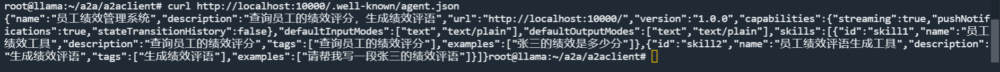

### client 端

接下来实现 client 端的代码。这个非常简单，还是先上代码：

```
async def main():
   try:
       card_resolver = A2ACardResolver("http://localhost:10000")
       card = card_resolver.get_agent_card()
       print("======= Agent Card ========")
       print(card.model_dump_json(exclude_none=True))
       client = A2AClient(agent_card=card)
       payload = {
           "id": uuid4().hex,
           "sessionId": uuid4().hex,
           "acceptedOutputModes": ["text"],
           "message": {
           "role": "user",
           "parts": [
               {
                   "type": "text",
                   "text": "张三的绩效是多少分？",
               }
           ],
           },
       }
       ret=await client.send_task(payload=payload)
       print(ret.model_dump_json())
   except Exception as e:
       print(f"Error occurred: {str(e)}")
if __name__ == "__main__":
   asyncio.run(main())
```

我就是把官方代码抄过来了，没有添加我自己的新代码。代码的第 3 ~7 行实现的就是刚才curl 测试的同款效果。这相当于拿到了 Server 端的 Agent 的名片。第 9 行代码就是把名片收好了，准备使用名片上标注的能力了。第 11 行的 payload 就是组织一下请求 Server 的数据格式，其实与之前直接写一行 query 请求 Agent 是差不多的。第 26 行呢，就是向服务端发送消息，并接收返回了。

将客户端运行起来后，效果为：

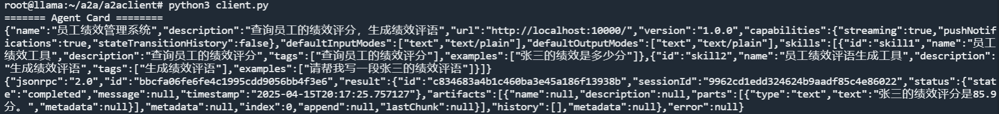

这一段打印分为两个部分，第一部分就是打印出了名片的内容，第二部分则是打印出了请求服务端 Agent 的结果，可以看到输出为“张三的绩效评分是 85.9”，与预期是一致的。

这就说明我们已经成功使用了 A2A 协议。

## 总结

其实学习了这两个协议后呢，不知道为什么，我脑子里就冒出了东北王张作霖的家训，“江湖不是打打杀杀，江湖是人情世故”，或许 AI 界也是江湖吧。我的代码已经上传到 GitHub，链接是：Geek02/a2aTest at main · xingyunyang01/Geek02

今天呢，我想和你分享我的两个思考，再对未来 Agent 的发展做一点个人展望。

第一个是 A2A 到底是什么？我们通过查阅文档、分析源码，最后自己写代码实现的三部曲知道了， A2A 实际上就是一个 C-S 架构的 HTTP 协议。在 Agent 端用一个 HTTP Server 封装一下，然后在请求端通过规定的协议进行 HTTP Client 请求，就这么简单。

第二就是如何学习这类协议。首先我们要明确的是，我们的重心是 AI 应用开发，所以始终是要跟着组织走的，组织出了协议，并且有热度、被认可，我们就要学，就要用。但我们要学习的是协议调用的套路，而不是源码和底层原理本身。因为协议是不断变化的，或许新的协议出来，旧的协议就废弃了。因此切记，不必深究底层原理，不必深究源码实现。

最后呢，我觉得 MCP 和 A2A 这协议出来之后，后续基础通用的 Agent 和工具会越来越不值钱了。因为开源的会越来越多，以后需要什么通用 Agent ，比如查数据库的、查天气、运维K8s 的，不需要自己写，在社区搜一搜就有了。大家觉得这是好事还是坏事呢？

欢迎你在留言区和我交流互动，如果这节课对你有启发，别忘了转发给身边的朋友。
