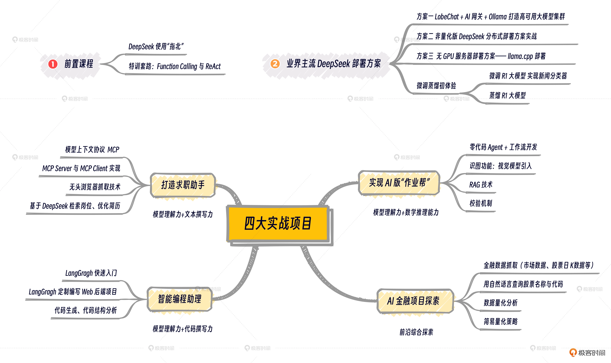
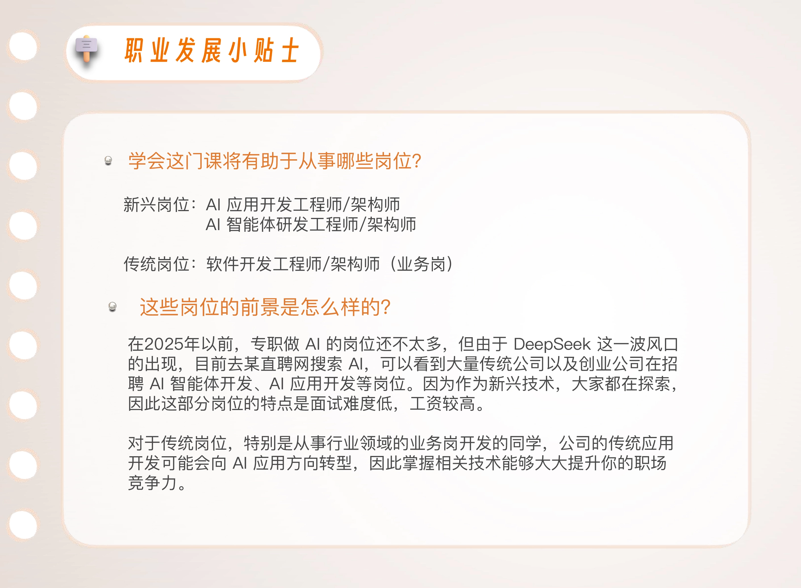

# 开篇词 | 借DeepSeek东风，开启AI应用开发之旅

你好，我是邢云阳。

不知道大家 2025 年过得怎么样？反正我是没怎么过好，春节开始就忙得很。起因就是DeepSeek 这货在春节前突然就成了网红了。红到什么程度呢？过年走亲戚，听到最多的就是俩词——哪吒和 DeepSeek。连我 58 岁的大爷都在问我，小邢啊，你说抖音剪视频是不是也能用 “第普谁课” 啊？听得我人都麻了。

这热度，你说领导能坐得住？于是整个春节，都在忙着做规划，布局 DeepSeek。然后春节之后，各云厂商就纷纷宣布自己的平台支持 DeepSeek 了，而且我的老东家“浪潮”和现任东家都先后推出了 DeepSeek 一体机，很受政企客户欢迎。这让我想起了《飞驰人生 2》里贾冰的一句台词，“过年的时候啊，像什么法拉顺利啊，保时敏捷啊，黄博基尼啊，哎呀，疯抢啊”。

这热度，你还坐得住吗？是不是也想跑步入场，学习一下 AI ，拥抱一下 DeepSeek 呢？然而我们自己去摸索相关资料时，可能很快就会被一堆专业名词、机器学习算法的深奥知识劝退。看着 AIGC 一浪高过一浪的新技术涌现，就是不知道自己如何投身其中。

对于这个问题，这里我想给你分享一下我的一些经历。

## 一点感悟

事实上，我们知道，DeepSeek 爆火是今年春节前后的事情，DeepSeek 模型能力强，还开源，直接让国人的 AI 热情空前高涨，极大推动了国内应用 AI 化的发展进程。2025 年，绝对将会是 AI 应用发展的革命年，用不了多久，AI 旋风就会席卷到各个行业。

我在差不多两年前，GPT 模型刚刚发布时，就开始投身到 AI 应用开发的实践中，那个时候，没有 LangChain，没有 Agent，也没有 RAG，大家就是琢磨着如何在提示词上做文章，去完成传统应用做不到的事情。

比如，在当时，我就考虑如何用 AI 重塑 K8s 管理系统，让用户可以用自然语言去操作 K8s 资源，而不是在传统 UI 上点点点。我的思路是在模板中预置了一些规则以及挖了空的 API，比如 GET /v1/{resourceName}/{Namespace}，之后让大模型根据用户输入的 prompt 去填空，比如用户说：帮我查询 default 命名空间下的 pod，大模型就会把上面的 API 组装成 GET/v1/pods/default，此时后端便可以调用这条 API，拿到资源了。

这种方法在当时很新鲜，但在出了 Function Calling 以及 Agent 技术后，便迅速被淘汰了。像这样的案例还有很多，很多 AI 开发者都是在技术不断地发展中，摸爬滚打前行。

直到去年中旬之后，基本上 AI 应用开发的路线开始进入了一个相对稳定的阶段，核心的两大技术就是 Agent 与 RAG，具体实现方式则有很多框架做支撑，但其实都是殊途同归。此时制约应用实现效果的瓶颈便是大模型的能力了，作为国内开发者，除了部分出海项目可以使用GPT 模型外，大多数项目受制于国内大模型的能力问题，只能做的差强人意。

但随着 DeepSeek 系列模型的发布，国内终于有了一款能够比肩 GPT 的模型，这使得很多优秀的开发框架和技术也能够站在巨人的肩膀上，发挥出更好的作用。

因此，我希望出一套课程，深刻挖掘一下 DeepSeek 在应用开发中的能力，同时在课程中使用目前最主流的 AI 应用开发思想、套路、工具以及框架。对于 AI 开发老鸟，可以与时俱进，查漏补缺，掌握业界前沿的开发思想和工具；而对于 AI 开发新手，则可以绕过过去几年我摸爬滚打的弯路，借力 DeepSeek，快速入门 AI 应用开发领域。

## 课程设计

为此，我将课程划分成了一个前置章节和五个正式章节。

前置课程里，我想和绝大多数像我一样的“民用级”程序员聊聊天，一起探讨一下在 DeepSeek如此火爆的背景下，应该如何入场，以及入场上有哪些可探索的方向。之后还会学习做 AI 应用开发不可或缺的 Agent 技术。

第一章，我会为揭秘云厂商针对不同的客户群体，私有化部署 DeepSeek 的几种不同方案。包括单卡的量化版部署、多卡的高可用负载均衡方案、多卡的分布式部署方案以及在消费级硬件，比如纯 CPU 上部署 DeepSeek 的方案等等。最后我们还会体验一下如何微调和蒸馏 R1大模型。

第二章我们将会一起打造一个求职助手。求职找工作写简历，是我们每个职场人都经历过的事情。那我们是否可以告别传统肉眼搜索职位，手工写简历的方式呢？

DeepSeek 的深度思考能力以及超强的写作能力，给了我们启发。这个项目不使用 Agent，而是会采用去年 9 月份，Anthropic 公司（Claude 模型的母公司）推出的模型上下文协议（MCP）来实现。通过 MCP，可以让大模型连接本地文件系统、数据库、调用工具等等。

第三章我们来实现一个 AI 版的“作业帮”，这个项目是聚焦 DeepSeek 的又一大出色能力——数学理解力。我们从“作业帮”项目切入，一起学习多模态、RAG 等热点技术。除此之外，这个项目采用了 AI 开发的另一种思想——平台化开发，可以零代码构建出 Agent 与工作流。搭配平台的 API，实现自然语言前端、Agent 和工具的分离。

第四章我们来实现一个智能编程助手。代码能力是 DeepSeek 的亮点之一，目前已经有多个智能编程软件宣布接入了 DeepSeek。所以这个项目我们不打算重复造轮子，而是要以构建Golang 的 Web 后端项目为例，带你掌握如何让 AI 稳定生成固定项目代码风格的代码。这个项目会使用目前非常热门的 LangGraph 框架完成。

第五章我们来探索一下 AI 与金融领域的结合。DeepSeek 的母公司幻方量化是一家著名金融量化公司。因此 DeepSeek 在训练数据集上必然也会有很多的金融领域相关数据做支撑，所以用 DeepSeek 做金融项目，会有先天优势。

此外，最近一年内，好几个知名大模型厂商和平台都举办了以金融为主题的 AI 大赛，旨在探索行业解决方案以及挖掘既懂业务又懂技术的人才。所以这一章我们就以 A 股市场为主题，做一下探索性的开发，包括股票名称代码查询、数据分析统计、简单量化策略等。

你会发现，整个课程几乎都是以内容紧凑的实践课程组成的，且每个项目都聚焦了 DeepSeek模型的某个特点。整门课程的交付目标就是，为你提炼 DeepSeek 应用开发的核心经验，帮助你提升 AI 应用开发的工程化能力。

欢迎你和我一起学习讨论，让我们开始行动起来吧！

课程代码库（随上线进度动态更新）：https://github.com/xingyunyang01/Geek02

课程目录

