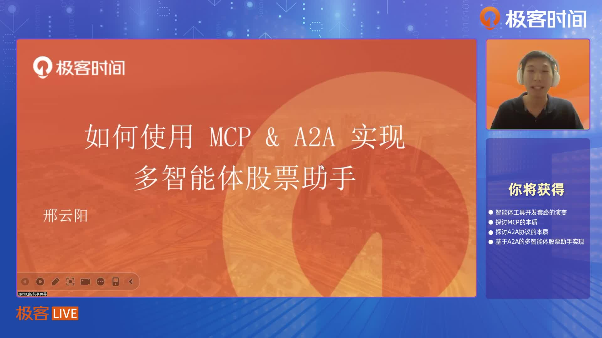

# 直播加餐 | 如何使用MCP&A2A实现多智能体股票助手

想知道如何借助 MCP 与 A2A 打造多智能体股票助手吗？

在 1 小时的直播时间里，我们将直击智能体开发实战。你会了解到智能体工具开发套路的演变历程，探寻 MCP 的本质以及 A2A 协议的本质。更重要的是，我们会深入讲解基于 A2A 的多智能体股票助手实现方式。

无论你是对智能体开发感兴趣的新手，还是有一定经验想进一步提升的开发者，这场直播都能为你提供实用的知识和技巧，助力你在智能体开发的道路上更进一步。

你将获得⬇️

1. 智能体工具开发套路的演变

2. 探讨 MCP 的本质

3. 探讨 A2A 协议的本质4. 基于 A2A 的多智能体股票助手实现
