# 特别放送 | Dubbo基础特性：视频带学，助你巩固基础

你好，我是何辉。

今天我们用视频形式，统一梳理 Dubbo 日常开发必须掌握的基础特性，帮你查漏补缺。

视频是我之前录的，在网上发布过，这次统一整理了一下，你可以按需学习。之后遇到类似实现需要，你也可以回来复习。主要会涉及这几个知识点：

- XML 配置发布与服务调用

- Java 代码发布与服务调用

- 服务提供方异步化实践：AsyncContext#startAsync、返回 CompletableFuture

- 服务消费方异步化实践：getFuture 方式、setCallback 方式、getCompletableFuture 方式

- 常用配置参数：启动时服务依赖检查参数、读写请求重试次数设置参数、调用失败时的容错设置、负载均衡策略设置、线程模型设置、服务提供方超时中断流程设置、导出线程堆栈设置。

好，我们直接开始吧。

## XML 配置发布与服务调用

1. 服务提供方 provider 的样例代码开发

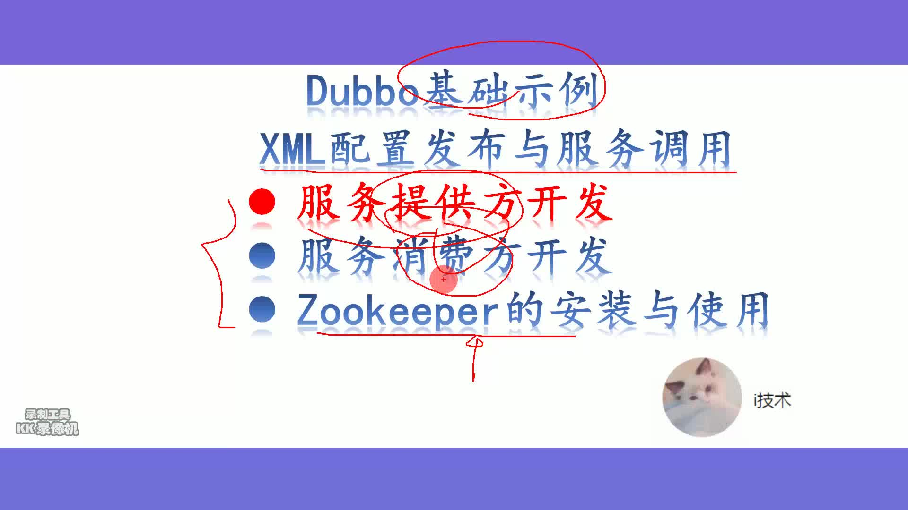

2. 服务消费方 consumer 的样例代码开发

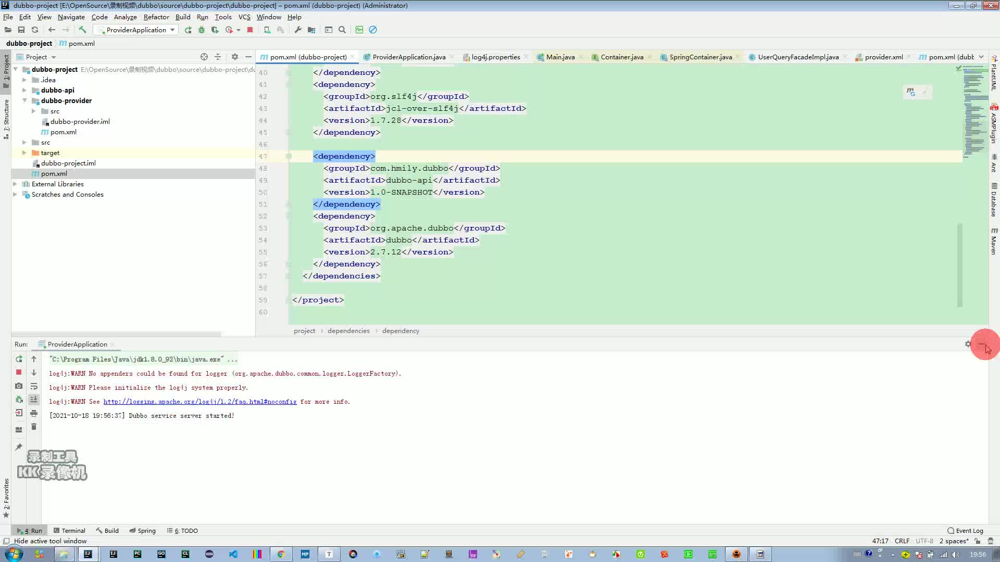

3. 服务消费方从 Zookeeper 获取地址调用提供方

## Java 代码发布与服务调用

1. 启动服务提供方 provider

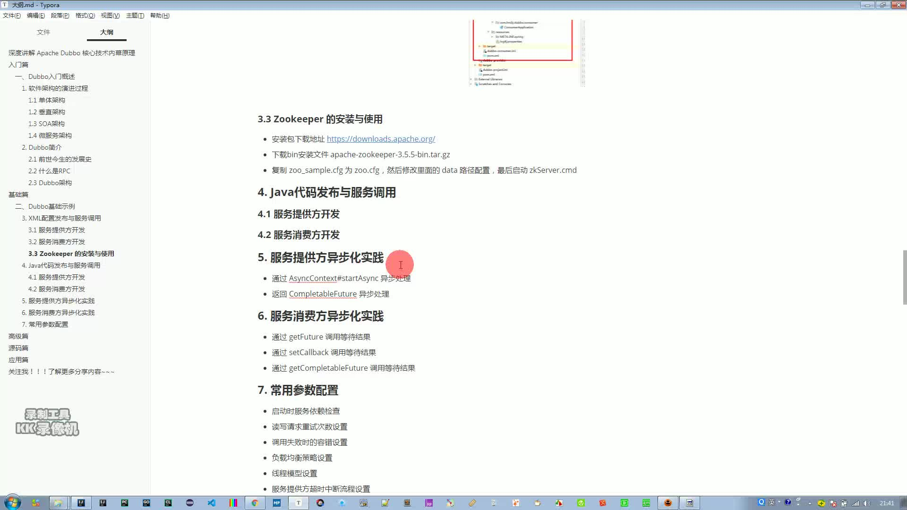

2. 启动服务消费方 consumer

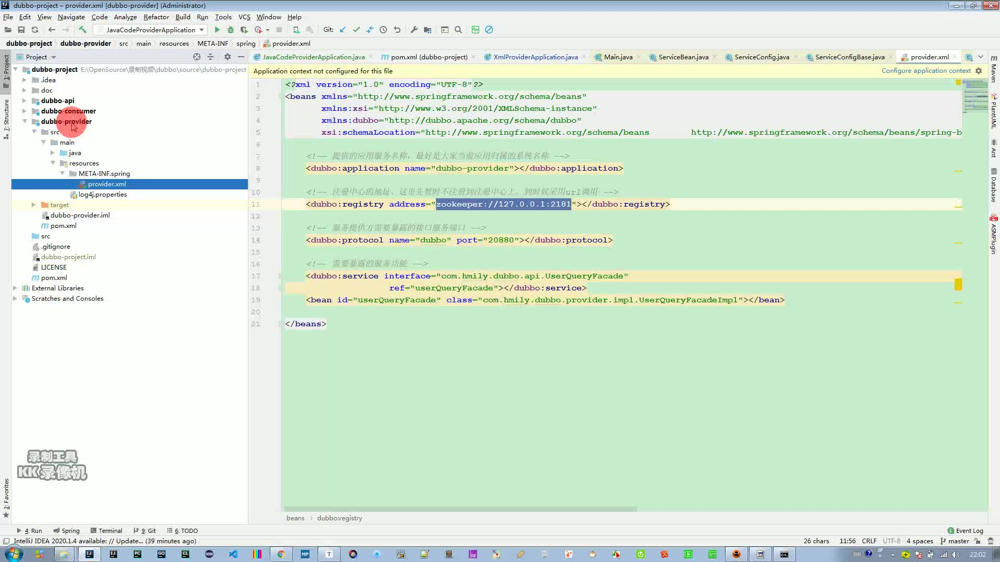

## 服务提供方异步化实践

1. 通过 AsyncContext#startAsync 实现提供方

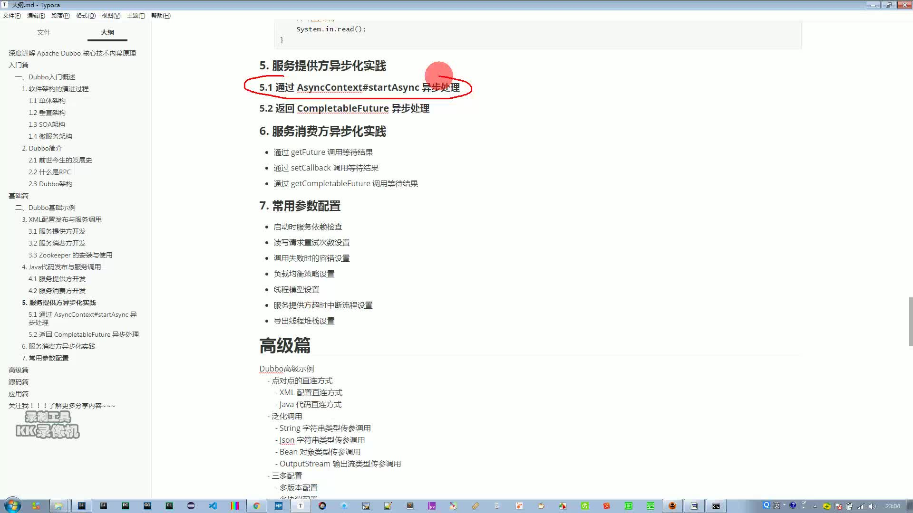

2. 通过返回 CompletableFuture 实现提供方

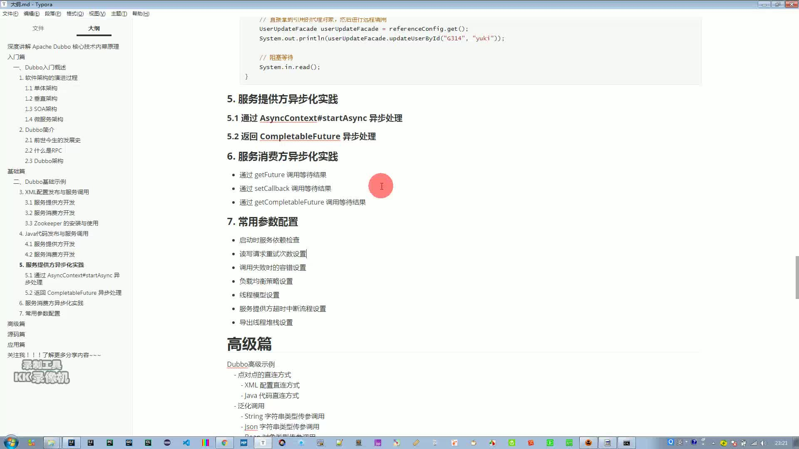

## 服务消费方异步化实践

1. 通过 getFuture 方式从 provider 拿到结果

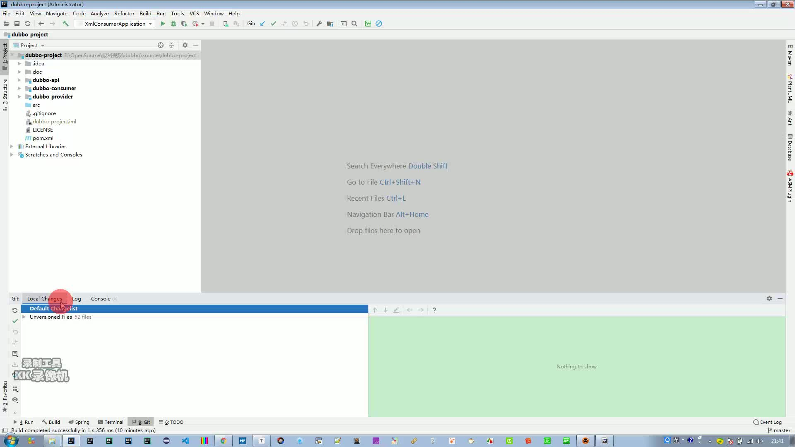

2. 通过 setCallback 方式从 provider 拿到结果

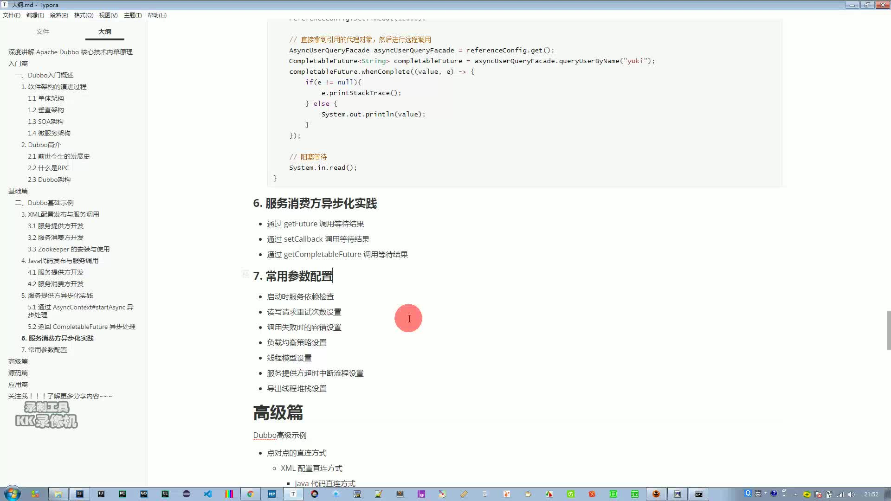

3. 通过 getCompletableFuture 方式从 provider 拿到结果

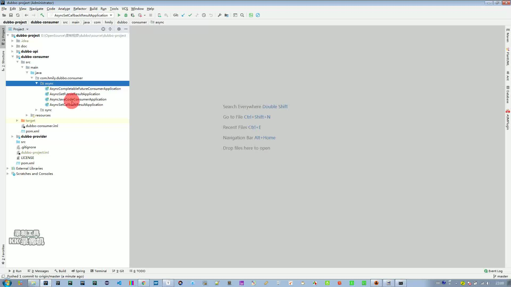

## 常用配置参数

1. 启动时服务依赖检查参数 check=false

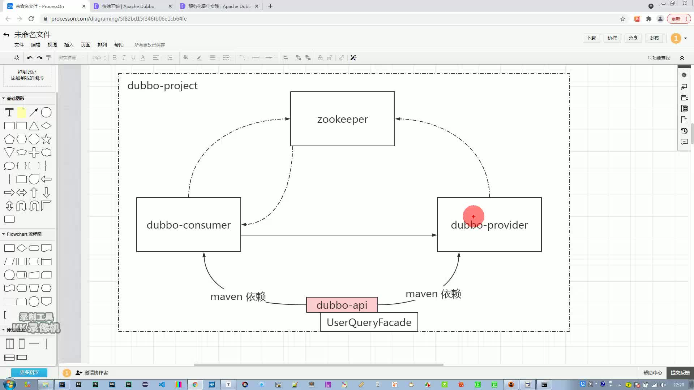

2. 读写请求重试次数设置参数 retries=2

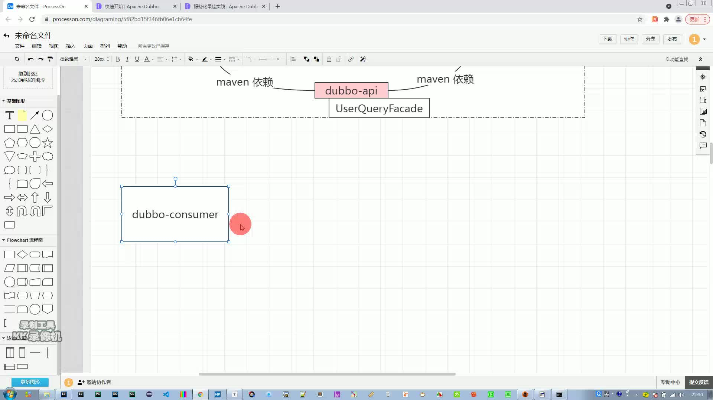

3. 调用失败时的容错设置 cluster=failover

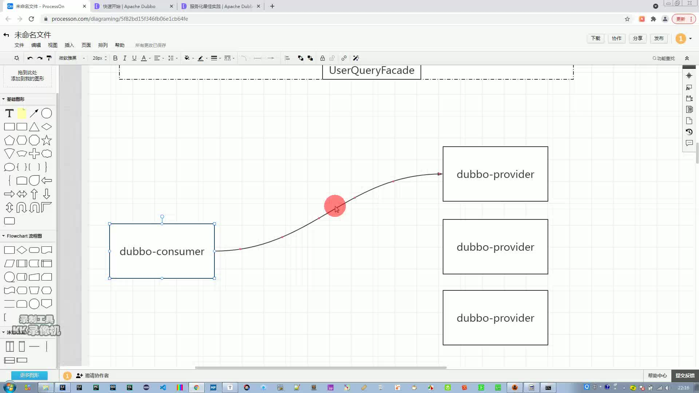

4. 负载均衡策略设置 loadbalance=random

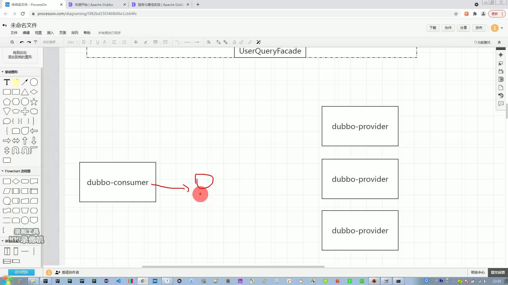

5. 线程模型设置 dispatcher=all

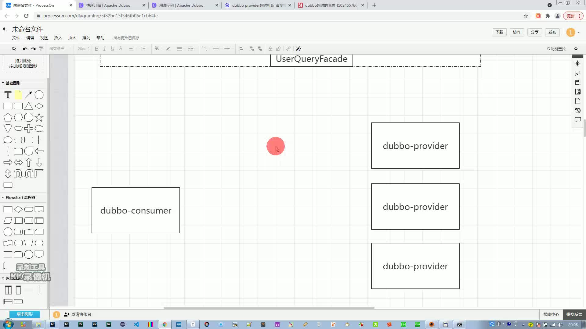

6. 服务提供方超时中断流程设置 all2

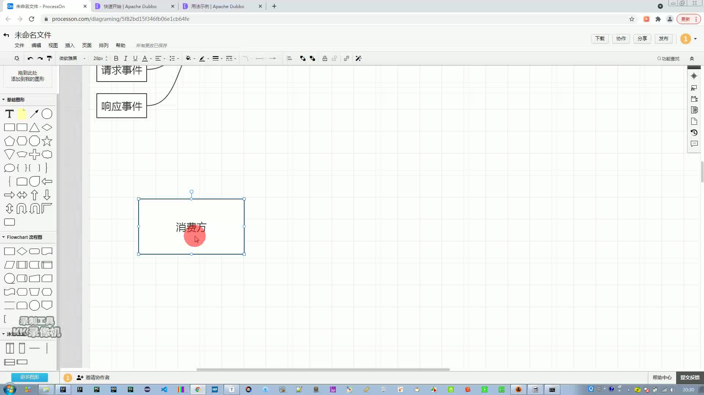

7. 导出线程堆栈设置 dump.directory=path

下一讲我们回归正文，应用框架中的高级特性，解决实际问题。下一讲见。
