# 03 | 单机吞吐优化（一）：无需硬件升级也能提升吞吐

你好，我是徐逸。

通过前面的学习，我们了解了性能优化的流程和 Golang 性能优化工具。

这节课开始我将带你掌握工作中常见的性能优化技巧，这也是服务性能优化流程第四步——性能调优的基础。只有掌握了一定的技巧，当我们定位到瓶颈原因时，才能更快地想出性能优化方案，轻松应对常见的性能问题。

在介绍具体的优化技巧之前，先让我们想一想，当你需要提升单机吞吐时，你会怎么办呢？

我们通常的思路是定位到单机瓶颈资源。对于瓶颈资源有两种处理方法，一是增加资源，比如提升单机 CPU、内存等资源的规格；二是减少单个请求对瓶颈资源的消耗，让相同的资源可以处理更多的请求。

在服务器数目比较多时，需要增加很多机器成本，所以我们今天就来看看不提升单机 CPU 和内存规格的前提下，有哪些常用的高性能技巧。因为在 Golang 里容器类型比较常用，所以后面课程里我们就把它作为研究对象。

## 实验设计

为了模拟线上的性能优化过程。我们先构造一个 http 服务。这个服务包含一个请求处理方法Handler。方法里有两个逻辑，一个是循环往切片 append 数据，另一个是用 map 类型构造一个集合。

接下来，我们就基于这个接口的性能优化过程，带你学习一些实用的高性能技巧。

```go
package main
import (
   "fmt"
   "net/http"
   _ "net/http/pprof"
)
func Handler(w http.ResponseWriter, r *http.Request) {
   slices := getRawSlices()
   getRawSet(slices)
   // 设置响应头，这里设置Content-Type为text/plain，表示返回纯文本内容
   w.Header().Set("Content-Type", "text/plain")
   // 向客户端写入响应内容
   fmt.Fprintln(w, "hh")
}
func main() {
   // 注册路由，当客户端访问根路径"/"时，会调用Handler函数进行处理
   http.HandleFunc("/", Handler)
   err := http.ListenAndServe(":8888", nil)
   if err != nil {
       panic(err)
   }
}
// getRawSlices 循环往切片append数据
func getRawSlices() []int {
   n := 10000
   slices := make([]int, 0)
   for i := 0; i < n; i++ {
       slices = append(slices, i)
   }
   return slices
}
// 构造集合
func getRawSet(slices []int) map[int]bool {
   set := make(map[int]bool, 0)
   for _, item := range slices {
       set[item] = true
   }
   return set
}
```

现在让我们用 ab 工具（Apache Bench）模拟线上用户，对这个 http 服务发起请求压测。

```
-n 请求数量
-c 并发数量
ab -n 30000 -c 2 http://127.0.0.1:8888/
```

假如在 ab 工具压测的过程中，我们发现内存资源占用比较高，可以用上节课学习到的pprof 工具，采集单机内存性能报告并生成下面的内存火焰图。

```bash
curl "http://127.0.0.1:8888/debug/pprof/heap?seconds=30" > heap.pprof
go tool pprof -http :8889 heap.pprof
```

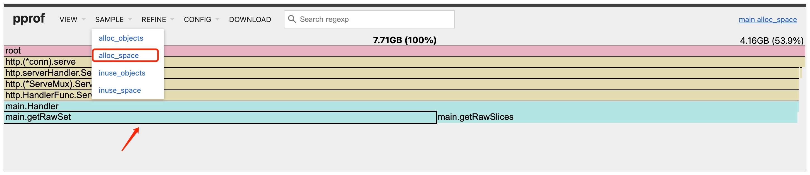

- 图1 原始函数内存火焰图

从火焰图中我们可以看出来，在应用内部的处理逻辑，也就是 Handler 方法里，getRawSet函数是内存消耗最大的函数。接着，我们点击火焰图的最后一行进入 getRawSet 函数内部查看，可以看到下面的图，消耗内存资源的热点代码是 map 赋值这行代码。

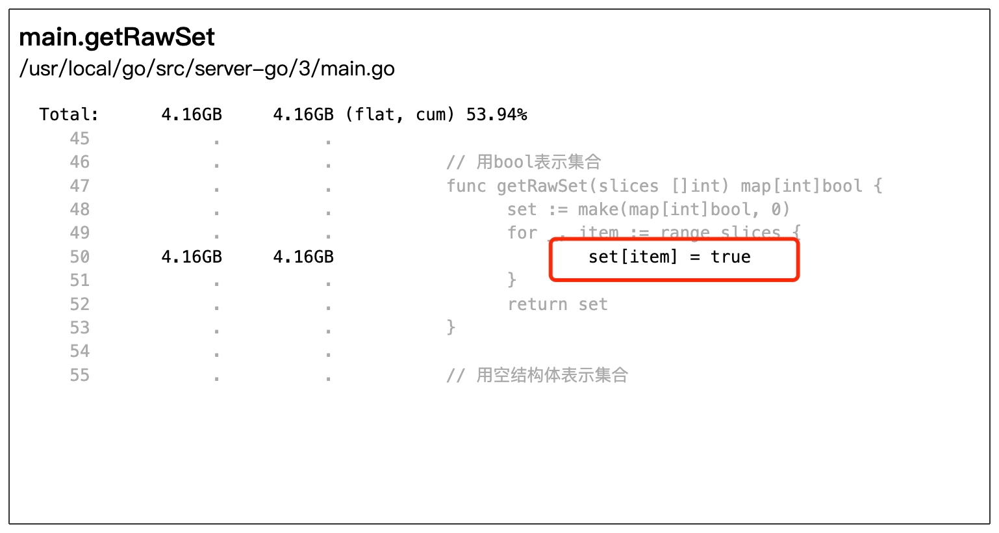

- 图2 内存分配热点代码

结合这行代码的上下文，可知这段代码逻辑的目的是用 map 构造一个集合。那这里面有没有什么优化空间呢？

我们可以从两个方向寻找答案：

- 先考虑存入 map 的数据能不能尽量少。

- 除了我们存入的数据之外，map 赋值操作是如何实现的，里面是否存在耗内存的动作，有的话能否减少甚至规避掉？

先让我们来看看第一个方向。

## 空结构体：集合表示如何省内存？

从集合的使用场景来看，我们要么判断一个 key 是不是在 map 中，要么获取 map 里面的所有key，而 map 里面的 value 值，在集合的使用场景中并不需要。那有没有办法消除 map 里面的 value 所占的内存空间呢？

在 Go 语言里，提供了空结构体类型 struct{}，而空结构体对象所占的空间大小为 0。咱们可以写个小测试来看看：

```go
func TestSize(t *testing.T) {
   fmt.Printf("struct {} size: %d byte\n", unsafe.Sizeof(struct{}{}))
}
```

运行这个测试函数，可以看到空结构体类型的确不占内存空间。

```
=== RUN   TestSize
struct {} size: 0 byte
```

因此咱们可以把 map 的 value 类型，从 bool 类型改为空结构体类型，就像下面的代码一样。

```go
// value用空结构体类型
func getEmptyStructSet(slices []int) map[int]struct{} {
   set := make(map[int]struct{}, 0)
   for _, item := range slices {
       set[item] = struct{}{}
   }
   return set
}
```

那么使用空结构体类型，能给我们带来多大的性能提升呢？我们用 Benchmark 来测一测。Benchmark 脚本如下所示：

```go
var slices []int
func init() {
   slices = getRawSlices()
}
func BenchmarkGetRawSet(b *testing.B) {
   for n := 0; n < b.N; n++ {
       getRawSet(slices)
   }
}
func BenchmarkGetEmptyStructSet(b *testing.B) {
   for n := 0; n < b.N; n++ {
       getEmptyStructSet(slices)
   }
}
```

测试结果出来了，我们可以看到 value 用空结构体类型，性能有了一定程度的提升。从内存消耗来看，value 用 bool 类型，单次函数调用要 427596 字节内存，而用空结构体类型，每次函数调用只要 389449 字节内存，节约了 9% 左右的内存资源。

```
killianxu@KILLIANXU-MB0 3 % go test -bench='.' -benchmem -benchtime=10s
warning: GOPATH set to GOROOT (/usr/local/go) has no effect
goos: darwin
goarch: amd64
pkg: server-go/3
cpu: Intel(R) Core(TM) i5-7360U CPU @ 2.30GHz
BenchmarkGetRawSet-4               17214            608437 ns/op          427596
BenchmarkGetEmptyStructSet-4       19430            563814 ns/op          389449
```

现在让我们再看一下内存火焰图，看看经过空结构体类型的优化后，我们的代码是否还有优化空间。

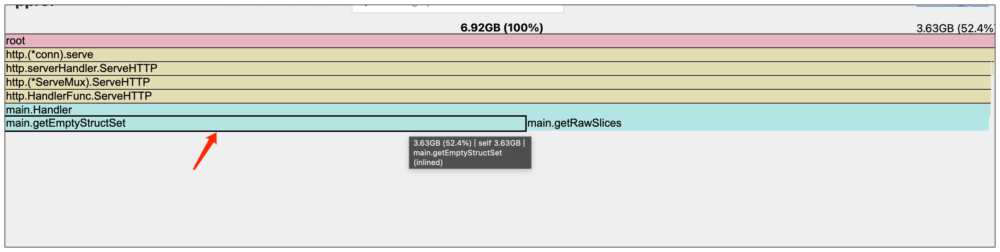

- 图3 空结构体优化后内存火焰图

从火焰图中我们可以看到，用空结构体优化后，构造集合的 getEmptyStructSet 函数，依然是最消耗内存的函数。

前面我提到可以从两个方向找答案，并且通过将 value 的类型，从 bool 改为空结构体，减少了存入 map 的数据大小。为了继续降低 map 的内存资源消耗，现在让我们从第二个方向——map 赋值操作的方向找答案。

## 指定容量：容器操作如何避免扩容迁移？

在搞明白 map 赋值操作的逻辑之前，我们需要先了解 map 的数据结构。就像下面的图展示的一样，map 底层其实是以数组 + 链表的数据结构存储 key-value 对的。为了描述方便，数组的每一个位置，通常我们称它为桶。

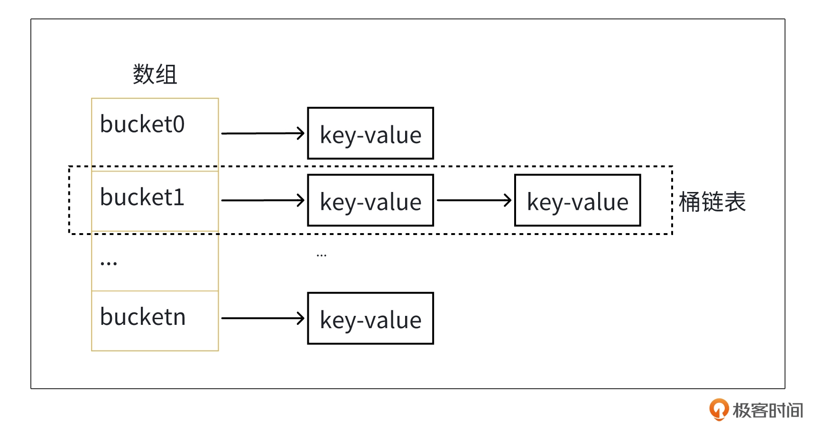

- 图4 map 内部数据结构

正常情况下，当往 map 中写入 ket-value 对时，Go 底层会根据 key 做 hash，定位到需要写入 key-value 对的桶，并插入桶对应的链表中。

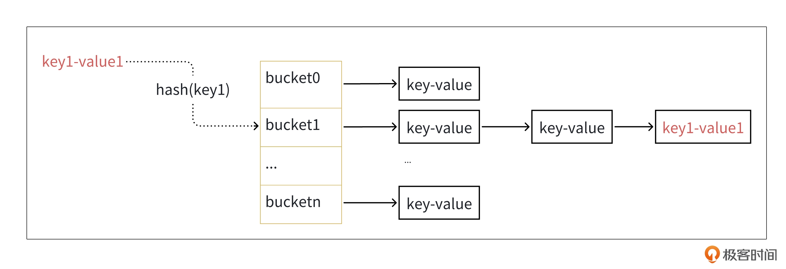

- 图5 map 写入操作

但是当 map 里面写入的数据过多时，数组里面的桶链表会越来越长。而 map 的写入和读取，都需要遍历桶链表，因此过长的桶链表会影响 map 的读写性能。

为了缓解这种情况，在往 map 写入数据时，如果 map 中的数据量已经比较多了，Go 底层还有个扩容迁徙的分支逻辑，这个扩容迁移的分支逻辑是怎么样的呢？

扩容迁移的逻辑分成 2 步，我们结合后面这张图来理解更直观一些。

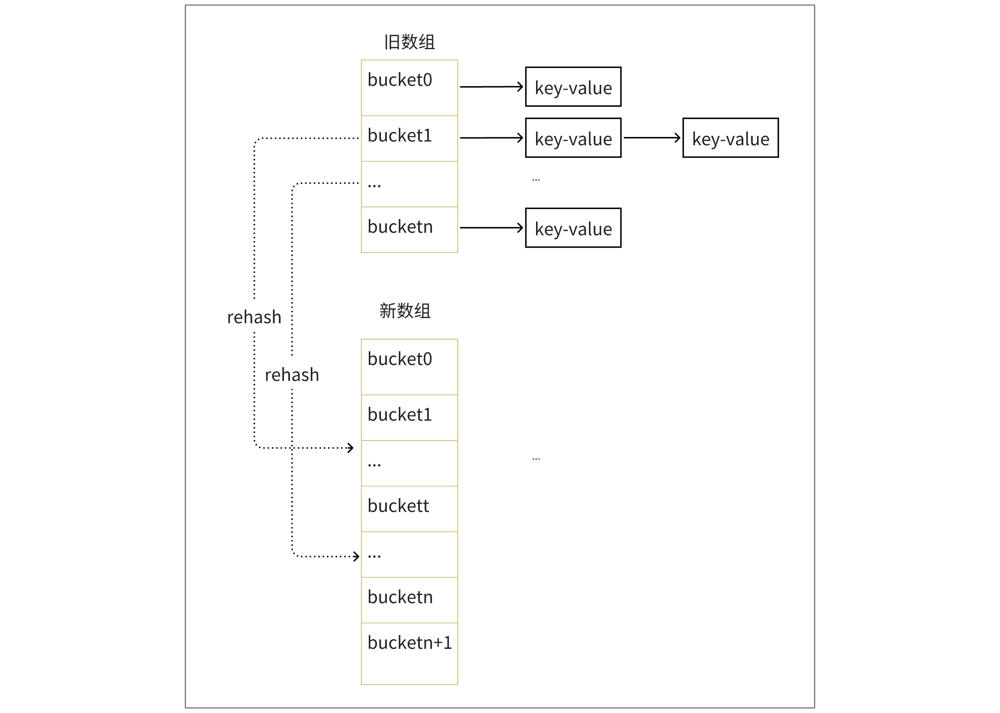

- 图6 map 写入触发扩容迁移

首先申请更大的数组空间。

然后将旧数组空间数据迁移到新数组空间。Go 采取了渐进式 hash 的思想，每次往 map 写入数据时，会触发从旧数组空间往新数组空间迁移两个桶链表数据，从而避免一次迁移全量数据导致 map 写请求延时抖动，直到旧数组空间的所有桶链表迁移完为止。

虽然通过扩容迁移，将原先在同一个桶链表里的数据，重新 hash 到新数组不同的桶链表中，可以减少桶链表长度，避免 map 读写性能大幅度裂化。但是扩容迁移属于消耗内存和 CPU 资源的操作，如果循环往 map 写入，可能会触发多次扩容迁移，消耗大量内存和 CPU 资源。

那有没有办法避免写入过程触发扩容迁移呢？

实际上，创建 map 的 make 函数提供了一个 size 参数。Go 底层在创建 map 对象时，会根据传入的 size 参数申请数组空间。因此只要我们能提前知道 map 要存储的数据量，就能传入这个 size 参数，从而避免写入过程频繁扩容。

就像下面的代码一样，由于我们的切片里没有重复数据，因此当我们用 make 函数构造 map时，可以将切片长度作为 size 参数传入。

```go
// 提前指定容量
func getCapacitySet(slices []int) map[int]struct{} {
   set := make(map[int]struct{}, len(slices))
   for _, item := range slices {
       set[item] = struct{}{}
   }
   return set
}
```

那么构造 map 时，指定 size 的方式，又能给咱们带来多大的性能提升呢？咱们继续用Benchmark 来测一测。

下面是 Benchmark 脚本：

```go
func BenchmarkGetEmptyStructSet(b *testing.B) {
   for n := 0; n < b.N; n++ {
       getEmptyStructSet(slices)
   }
}
func BenchmarkGetCapacitySet(b *testing.B) {
   for n := 0; n < b.N; n++ {
       getCapacitySet(slices)
   }
}
```

然后你会发现，指定 map 容量的方式，性能提升很明显。我们依然用数据说话。

```
killianxu@KILLIANXU-MB0 3 % go test -bench='.' -benchmem -benchtime=10s
warning: GOPATH set to GOROOT (/usr/local/go) has no effect
goos: darwin
goarch: amd64
pkg: server-go/3
cpu: Intel(R) Core(TM) i5-7360U CPU @ 2.30GHz
BenchmarkGetEmptyStructSet-4       21218            563814 ns/op          389461
BenchmarkGetCapacitySet-4          41742            287038 ns/op          182480
```

- 从内存消耗来看，不指定 map 容量的方式，单次函数调用要 389461 字节内存，而指定容量的方式，每次函数调用只要 182480 字节内存，节约了 53% 左右的内存资源。

- 从 CPU 资源消耗来看，不指定 map 容量的方式，单次函数调用要 563814ns，而指定容量的方式只要 287038ns，节约了 49% 左右的 CPU 资源。

现在让我们再看一下内存火焰图，看看我们的代码是否还有进一步优化空间。

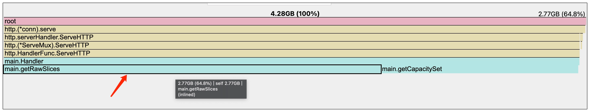

- 图7 指定 map 容量优化后的火焰图

从内存火焰图中我们可以看出，除了已经优化后的集合构造函数 getCapacitySet，现在最消耗内存的是切片生成函数 getRawSlice。

现在我们从火焰图进入 getRawSlice 函数内部，就会看到下面的图，消耗内存资源的热点代码是切片 append 这行代码。

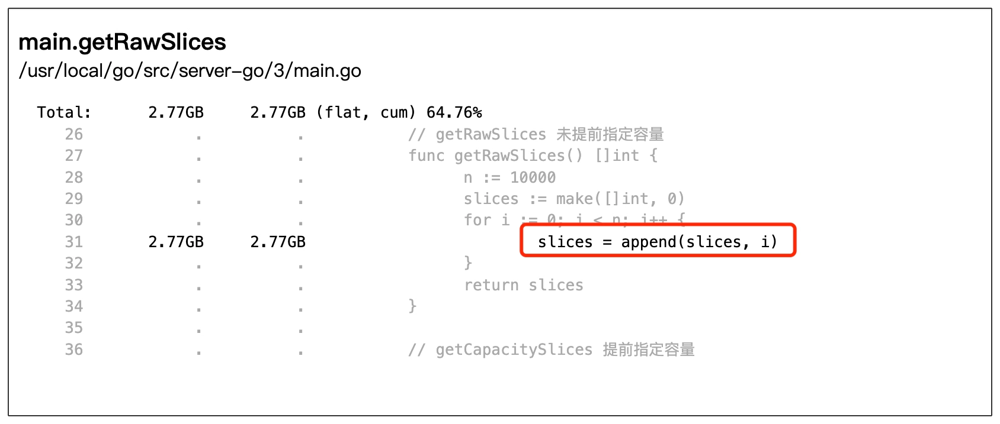

- 图8 getRawSlice 函数内部热点代码

结合这行代码的上下文，可以知道这段代码逻辑是在循环地往切片里面做 append 操作。那么我们自然会想到，可以去看看切片的 append 操作是如何实现的，这里面有没有啥优化空间呢？

切片底层数据结构是用一个数组存储数据的，通常进行 append 操作时，会往数组末尾插入数据。

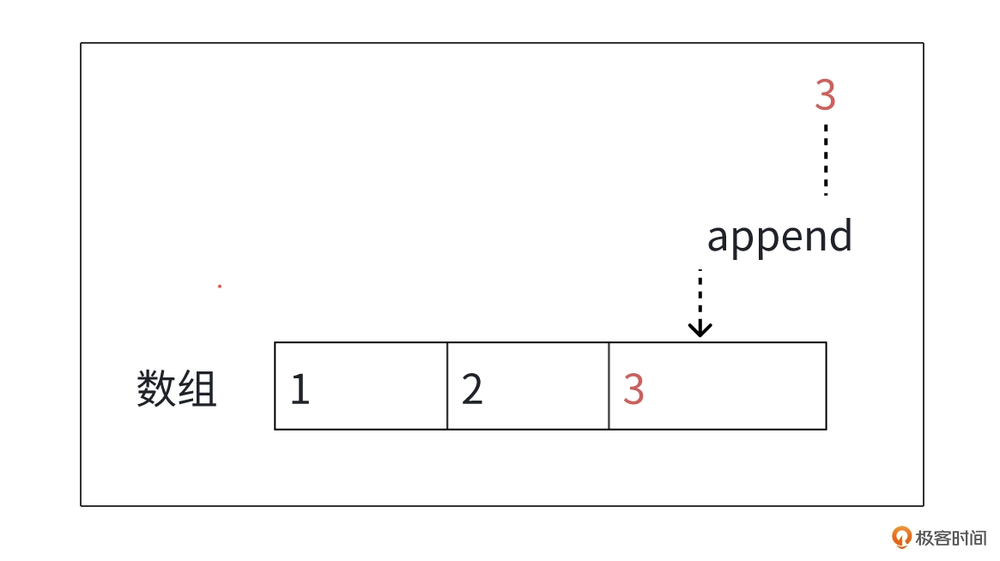

- 图9 append 操作

但是当数组空间不够时，append 操作会触发扩容迁移，申请更大的数组空间，并将旧数组数据拷贝到新数组，以便存放更多的数据。

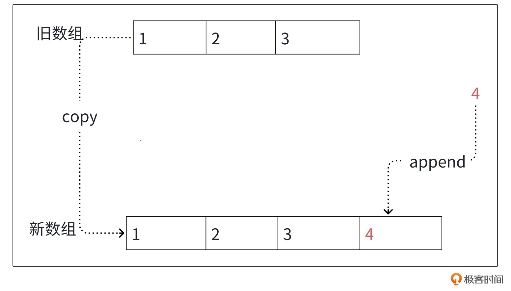

- 图10 append 触发扩容

我们从扩容迁移的过程可以看出来，扩容迁移存在内存分配和数据拷贝操作，需要消耗内存和CPU 资源。当循环做切片 append 操作时，可能会触发频繁扩容迁移，消耗大量的内存和CPU 资源。

那切片 append 操作有没有办法避免扩容迁移呢？

实际上，和 map 一样，我们在创建切片对象时，也可以传入容量字段。就像下面的代码一样，这样切片就会一次性申请足够数组空间，从而避免后续写入过程发生扩容迁移。

```go
// getCapacitySlices 提前指定容量
func getCapacitySlices() []int {
   n := 10000
   slices := make([]int, 0, n)
   for i := 0; i < n; i++ {
       slices = append(slices, i)
   }
   return slices
}
```

切片创建时指定容量的方式，又能给咱们带来多大的性能提升呢？Benchmark 脚本如下，我们再来测试一下。

```go
func BenchmarkGetRawSlices(b *testing.B) {
   for n := 0; n < b.N; n++ {
       getRawSlices()
   }
}
func BenchmarkGetCapacitySlices(b *testing.B) {
   for n := 0; n < b.N; n++ {
       getCapacitySlices()
   }
}
```

果然，指定切片容量的方式，性能提升非常明显。

```
killianxu@KILLIANXU-MB0 3 % go test -bench='.' -benchmem -benchtime=10s
warning: GOPATH set to GOROOT (/usr/local/go) has no effect
goos: darwin
goarch: amd64
pkg: server-go/3
cpu: Intel(R) Core(TM) i5-7360U CPU @ 2.30GHz
BenchmarkGetRawSlices-4           209412             55297 ns/op          357626
BenchmarkGetCapacitySlices-4      844266             13318 ns/op           81920
```

- 从内存消耗来看，不指定切片容量的方式，单次函数调用要 357626 字节内存，而指定容量的方式，每次函数调用只要 81920 字节内存，节约了 77% 左右的内存资源。

- 从 CPU 资源消耗来看，不指定切片容量的方式，单次函数调用要 55297ns，而指定容量的方式，只要 13318ns，节约了 76% 左右的 CPU 资源。

让我们用火焰图再看看我们的函数是否还有优化空间。

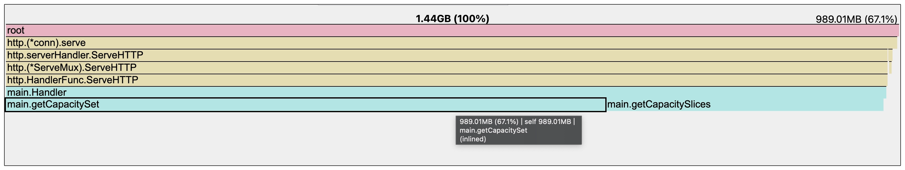

- 图11 指定容量优化后内存火焰图

从火焰图上我们可以看出来，经过前面几次的优化，应用内部最耗时的函数就只剩下已经优化过之后的 getCapacitySet 和 getCapacitySlices 函数，没有进一步优化的空间了。

## 小结

今天这节课，我以一段待优化的 http 服务接口为例，在逐步优化其对内存资源的消耗过程中，向你展示了能降低内存和 CPU 资源消耗的 2 个高性能容器类型的使用技巧。

- 当用 map 构造集合时，我们可以将 value 类型设置为空结构体类型，空结构体类型不占用内存空间，这样就能帮我们降低内存资源消耗。

- 当创建 map 和切片对象时，如果我们可以提前确定容器容量，就可以传入 make 函数中，从而避免往集合中添加数据时触发扩容迁移，达到降低内存和 CPU 资源消耗的目的。

希望你好好体会这个从线上服务获取内存火焰图寻找瓶颈，再结合 Go 语言底层实现分析寻找更优方案的过程。在遇到内存和 CPU 瓶颈时，别忘了尝试运用这两个容器类型的使用技巧，帮你节约更多内存和 CPU 资源，提升单机吞吐。

## 思考题

对于容器类型，除了这节课讲到的 2 种高性能使用技巧，你还知道哪些高性能的使用技巧呢？

欢迎你把你的答案分享在评论区，也欢迎你把这节课的内容分享给需要的朋友，我们下节课再见！
