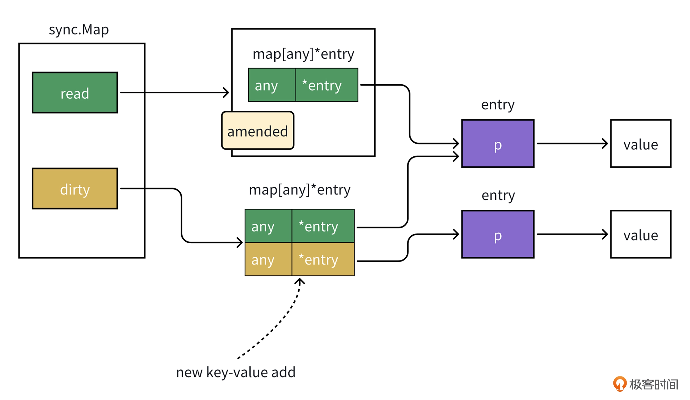
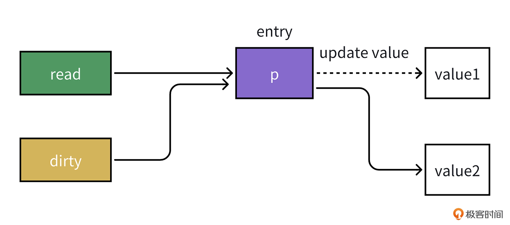
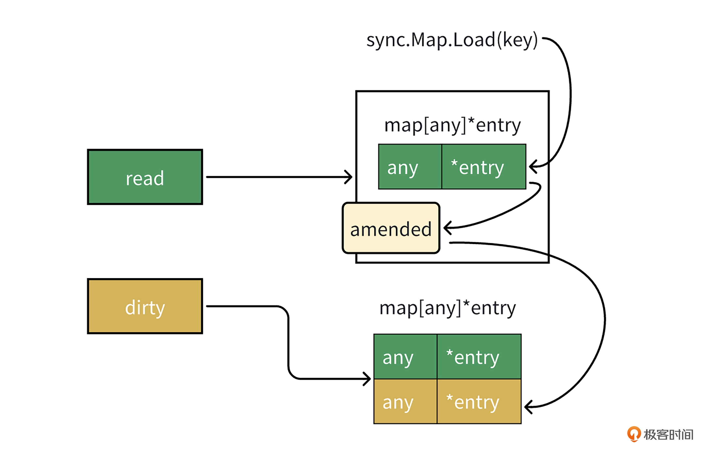
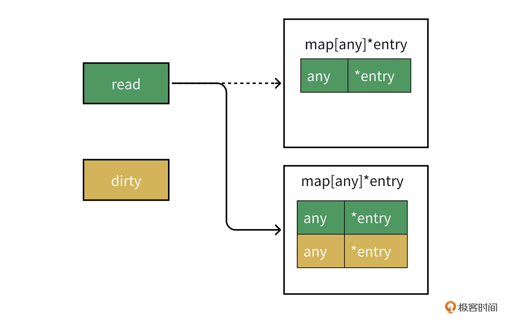

# 08 | 并发map：百万数据本地缓存，如何降延时减毛刺？

你好，我是徐逸。

在上节课的内容中，我们一起学习了锁和无锁编程技术，还使用分段锁和 map 类型，实现了一个缓存结构。不过，值得留意的是，其实 Go 语言的 sync 包已经提供了一种并发安全的Map 类型。

今天，我就以大规模数据缓存的数据结构设计要点为例，带你掌握 sync.Map 类型以及针对map 的 GC 优化技巧。

假如我们现在需要实现一个 key-value 类型的本地缓存，且缓存的 key 特别多，达到百万甚至千万级别，那么我们该怎么设计，才能在并发环境下高性能、安全地访问这个缓存呢？

针对大规模数据缓存的场景，我们在数据结构设计上要考虑的技术点有两个。

1. 如何实现并发安全的 map 类型。

2. 如何减少甚至避免因大规模数据缓存导致的 GC 开销。

## 并发 map 选择

实际上，大规模且有读写操作的数据缓存，咱们可以考虑的 map 类型有两种，一个是分段锁实现的 map 类型，另一个是 sync 包提供的 Map 类型。

那么我们到底该选择哪个呢？

在选型之前，我们需要先掌握 sync.Map 类型的基础知识和原理。

sync.Map 是 Go 语言 sync 包中提供的一个内置的并发安全的 map 类型。它在设计上考虑了高并发场景，尽量避免加锁操作从而提升读写性能。

sync.Map 该如何使用呢？下面我给了一段简单的代码，这段代码使用了 sync.Map 提供的Store、Load 和 Delete 方法，分别用于写、读和删除操作。

```go
package main
import (
   "fmt"
   "sync"
)
func main() {
   var m sync.Map
   m.Store("key1", "value1")
   m.Store("key2", 2)
   value, ok := m.Load("key1")
   if ok {
       fmt.Println("Value:", value)
   }
   m.Delete("key1")
   value, ok = m.Load("key1")
   if ok {
       fmt.Println("Value:", value)
   } else {
       fmt.Println("Key not found")
   }
}
```

sync.Map 是如何实现并发高性能操作的呢？

首先，我们来看下 sync.Map 的底层数据结构，它的核心是 read 和 dirty 两个 map 结构。read 存储了部分写入 Map 的内容，用来加速读操作。而 dirty 存储了全量内容，需要加锁才能读写数据。

```
type Map struct {
   mu Mutex
   read atomic.Pointer[readOnly] // 无锁读map
   dirty map[any]*entry // 加锁读写map
   misses int
}
// readOnly is an immutable struct stored atomically in the Map.read field.
type readOnly struct {
   m       map[any]*entry
   amended bool // true if the dirty map contains some key not in m.
}
```

接着，让我们来看下写入操作。当有 key-value 值写入时，如果这个 key 在 read 中不存在，接下来就要做新增操作，它会加锁写入 dirty map 中，并且将 amended 标记设置为 true。而amended 标记用于表示 dirty 中是否有不在 read 中的 key-value 值。

这个操作过程你可以结合后面的示意图看一下，这样理解起来更直观。



- 图1 key-value 写入

如果这个 key 在 read 中存在，则会进行更新操作，由于 read map 和 dirty map 里面存储的值是 entry 类型的指针，且 entry 类型的成员变量也是 atomic.Pointer 类型（如后面代码所示）。

```
// An entry is a slot in the map corresponding to a particular key.
type entry struct {
   p atomic.Pointer[any]
}
```

因此在更新时就像下面的图那样，可以直接用 CAS 无锁操作替换指针 p 指向的变量，而无需做加锁操作。



- 图2 value 更新

然后，让我们来看看读取操作，我们还是结合具体代码来理解。

```go
// Load returns the value stored in the map for a key, or nil if no
// value is present.
// The ok result indicates whether value was found in the map.
func (m *Map) Load(key any) (value any, ok bool) {
   read := m.loadReadOnly()
   e, ok := read.m[key]
   if !ok && read.amended {
       m.mu.Lock()
       // Avoid reporting a spurious miss if m.dirty got promoted while we were
       // blocked on m.mu. (If further loads of the same key will not miss, it's
       // not worth copying the dirty map for this key.)
       read = m.loadReadOnly()
       e, ok = read.m[key]
       if !ok && read.amended {
           e, ok = m.dirty[key]
           // Regardless of whether the entry was present, record a miss: this k
           // will take the slow path until the dirty map is promoted to the rea
           // map.
           m.missLocked()
       }
       m.mu.Unlock()
   }
   if !ok {
       return nil, false
   }
   return e.load()
}
```

当读取 key 对应的值时，会先从 read 中读取，当 read 中读不到，并且 amended 为 true时，则会加锁从 dirty map 中读。这里可能导致从 sync.Map 读取的性能劣化，因为它既要从read 中读一遍，又要加锁从 dirty map 中读一遍。



- 图3 读 Key 数据

同时，每次 read 读不到，从 dirty map 中读时，它会调用 missLocked 方法，这个方法用于将map 的 misses 字段加 1，misses 字段用于表示 read 读未命中次数，如果 misses 值比较大，说明 read map 的数据可能比 dirty map 少了很多。为了提升读性能，missLocked 方法里会将 dirty map 变成新的 read map，代码如下。

```
func (m *Map) missLocked() {
   m.misses++
   if m.misses < len(m.dirty) {
       return
   }
   m.read.Store(&readOnly{m: m.dirty})
   m.dirty = nil
   m.misses = 0
}
```



- 图4 dirty 切换为 read

最后，让我们来看看另一个可能导致写入 sync.Map 的性能劣化的点。上面的 missLocked 方法，会将 dirty map 置为 nil，当有新的 key-value 值写入时，为了能保持 dirty map 有全量数据，就像下面代码的 swap 方法，它会加锁并且调用 dirtyLocked 方法，遍历 read map 并全量赋值拷贝给 dirty map。

你可以看看后面的代码，再想想这样写会不会有什么问题？

```go
// Swap swaps the value for a key and returns the previous value if any.
// The loaded result reports whether the key was present.
func (m *Map) Swap(key, value any) (previous any, loaded bool) {
   ...
   m.mu.Lock()
   if !read.amended {
       // We're adding the first new key to the dirty map.
       // Make sure it is allocated and mark the read-only map as incomplete.
       m.dirtyLocked()
       m.read.Store(&readOnly{m: read.m, amended: true})
   }
   m.dirty[key] = newEntry(value)
   m.mu.Unlock()
   return previous, loaded
}
func (m *Map) dirtyLocked() {
   if m.dirty != nil {
       return
   }
   // read map全量复制到dirty
   read := m.loadReadOnly()
   m.dirty = make(map[any]*entry, len(read.m))
   for k, e := range read.m {
       if !e.tryExpungeLocked() {
           m.dirty[k] = e
       }
   }
}
```

不知道你有没有发现？当数据量比较大时，这样会导致大量数据的拷贝，性能会劣化严重。比如我们缓存几百万条数据，就存在几百万条数据的赋值拷贝。

通过上面 sync.Map 的原理分析，我们可以看出，sync.Map 是通过两个 map 来实现读写分离，从而达到高性能读的目的。不过它存在下面几个缺点。

1. 由于有两个 map，因此占用内存会比较高。

2. 更适用于读多写少的场景，当由于写比较多或者本地缓存没有全量数据时，会导致读 map经常读不到数据，而需要加锁再读一次，从而导致读性能退化。

3. 当数据量比较大时，如果写入触发读 map 向写 map 拷贝，会导致较大的性能开销。

可以看出来，sync.Map 的使用场景还是比较苛刻的。

那回到刚开始的问题，在大规模数据缓存时，我们是该选择分段锁实现的 map 还是 sync.Map类型来缓存数据呢？

答案是分段锁 map。原因是我们很难准确地预估读写比例，而且读写比例也会随着业务的发展变化。此外，在大规模数据缓存时，两个 map 的内存和拷贝开销也是不得不考虑的稳定性风险点，因此在大规模数据缓存时，我们一般使用分段锁实现的 map 来缓存数据。

## map gc 优化

在做了并发 map 的选型之后，我们还需要考虑的一点是在缓存大量数据时，如何避免 GC 导致的性能开销。

我以下面的代码为例，分别测试 key、value 为 string 类型的 map 在不同数据规模下的 GC 开销。

```go
import (
   "fmt"
   "runtime"
   "testing"
   "time"
)
// Test1kGCDuration 测试小规模数据gc时长
func Test1kGCDuration(t *testing.T) {
   size := 1000
   m := GenerateStringMap(size)
   runtime.GC()
   gcCost := timeGC()
   t.Logf("size %d GC duration: %v\n", size, gcCost)
   _ = m["1"]
}
// 测试大规模数据gc时长
func Test500wGCDuration(t *testing.T) {
   size := 5000000
   m := GenerateStringMap(size)
   runtime.GC()
   gcCost := timeGC()
   t.Logf("size %d GC duration: %v\n", size, gcCost)
   _ = m["1"]
}
func GenerateStringMap(size int) map[string]string {
   // 在这里执行一些可能会触发GC的操作，例如创建大量对象等
   // 以下示例创建一个较大的map并填充数据
   m := make(map[string]string)
   for i := 0; i < size; i++ {
       key := fmt.Sprintf("key_%d", i)
       value := fmt.Sprintf("val_%d", i)
       m[key] = value
   }
   return m
}
func timeGC() time.Duration {
   // 记录GC开始时间
   gcStartTime := time.Now()
   // 手动触发GC，以便更准确地测量此次操作相关的GC时长
   runtime.GC()
   // 计算总的GC时长
   gcCost := time.Since(gcStartTime)
   return gcCost
}
```

测试结果出来了，map 中储存 1k 条数据和 500w 条数据的 GC 耗时差异巨大。500w 条数据，GC 耗时 290ms，而 1k 条数据耗时只需要 480µs，有 600 倍的性能差异。

```
killianxu@KILLIANXU-MB0 8 % go test -gcflags=all=-l gc_size_test.go -v
=== RUN   Test1kGCDuration
   gc_size_test.go:16: size 1000 GC duration: 480.718µs
--- PASS: Test1kGCDuration (0.00s)
=== RUN   Test500wGCDuration
   gc_size_test.go:26: size 5000000 GC duration: 290.422382ms
--- PASS: Test500wGCDuration (5.12s)
```

那么在大规模数据缓存下，GC 为什么耗时会这么长呢？

这是因为 GC 在做对象扫描标记时，需要扫描标记 map 里面的全量 key-value 对象，数据越多，需要扫描的对象越多，GC 时间也就越长。

扫描标记的耗时过长，会引发一系列不良影响。它不仅会大量消耗 CPU 资源，降低服务吞吐，而且在标记工作未能及时完成的情况下，GC 会要求处理请求的协程暂停手头的业务逻辑处理流程，转而协助 GC 开展标记任务。这样一来，部分请求的响应延时将会不可避免地大幅升高，严重影响系统的响应效率与性能表现。

为了避免 GC 对程序性能造成影响，对于 map 类型，Golang 在 1.5 版本提供了一种绕过GC 扫描的方法。绕过 GC 要满足下面两个条件。

第一，map 的 key-value 类型不能是指针类型且内部不能包含指针。比如 string 类型，它的底层数据结构中有指向数组的指针，因此不满足这个条件。

```
// 字符串数据结构
type stringStruct struct {
   str unsafe.Pointer //指针类型，指向字节数组
   len int
}
```

那到底不含指针类型，能不能缩短 GC 开销呢？咱们将代码里 map 的 key-value 类型换成 int类型再试一下。

```go
// 测试key-value非指针类型,int的gc开销
func Test500wIntGCDuration(t *testing.T) {
   size := 5000000
   m := GenerateIntMap(size)
   runtime.GC()
   gcCost := timeGC()
   t.Logf("size %d GC duration: %v\n", size, gcCost)
   _ = m[1]
}
func GenerateIntMap(size int) map[int]int {
   // 在这里执行一些可能会触发GC的操作，例如创建大量对象等
   // 以下示例创建一个较大的map并填充数据
   m := make(map[int]int)
   for i := 0; i < size; i++ {
       m[i] = i
   }
   return m
}
```

你会发现，key-value 换成 int 类型的 map，gc 性能提升非常明显，gc 时间从 290ms 变成了 2.3ms，提升了几百倍。

```
killianxu@KILLIANXU-MB0 8 % go test -gcflags=all=-l -run Test500wIntGCDuration -v
=== RUN   Test500wIntGCDuration
   gc_type_test.go:14: size 5000000 GC duration: 2.29631ms
--- PASS: Test500wIntGCDuration (1.33s)
```

第二，key-value 除了需要满足非指针这个条件，key/value 的大小也不能超过 128 字节，如果超过 128 字节，key-value 就会退化成指针，导致被 GC 扫描。

我们用 value 大小分别是 128、129 字节的结构体测试一下，测试代码如下。

```go
func TestSmallStruct(t *testing.T) {
   type SmallStruct struct {
       data [128]byte
   }
   m := make(map[int]SmallStruct)
   size := 5000000
   for i := 0; i < size; i++ {
       m[i] = SmallStruct{}
   }
   runtime.GC()
   gcCost := timeGC()
   t.Logf("size %d GC duration: %v\n", size, gcCost)
   _ = m[1]
}
func TestBigStruct(t *testing.T) {
   type BigStruct struct {
       data [129]byte
   }
   m := make(map[int]BigStruct)
   size := 5000000
   for i := 0; i < size; i++ {
       m[i] = BigStruct{}
   }
   runtime.GC()
   gcCost := timeGC()
   t.Logf("size %d GC duration: %v\n", size, gcCost)
   _ = m[1]
}
```

果然，key-value 的大小超过 128 字节会导致 GC 性能开销变大。对于 129 字节的结构体，GC 耗时 264ms，而 128 字节，只需要 2.4ms，性能差距高达百倍。

```
killianxu@KILLIANXU-MB0 8 % go test -gcflags=all=-l -run "TestSmallStruct|TestBig
=== RUN   TestSmallStruct
   gc_type_test.go:39: size 5000000 GC duration: 2.444276ms
--- PASS: TestSmallStruct (4.13s)
=== RUN   TestBigStruct
   gc_type_test.go:53: size 5000000 GC duration: 264.834283ms
--- PASS: TestBigStruct (2.07s)
```

通过前面的测试，我们知道了，在缓存大规模数据时，为了避免 GC 开销，key-value 不能含指针类型且 key-value 的大小不能超过 128 字节。

实际上，咱们在缓存大规模数据时，可以使用成熟的开源库来实现，比如 bigcache、freecache 等。它们的底层就是使用分段锁加 map 类型来实现数据存储的，同时，它们也利用了刚刚讲过的 map 的 key-value 特性，来避免 GC 扫描。

以 bigcache 为例，它的使用比较简单。通过 Get 和 Set 方法就可以实现读写操作。

```go
import (
    "fmt""context""github.com/allegro/bigcache/v3"
)
cache, _ := bigcache.New(context.Background(), bigcache.DefaultConfig(10 * time.M
cache.Set("my-unique-key", []byte("value"))
entry, _ := cache.Get("my-unique-key")
fmt.Println(string(entry))
```

## 小结

今天这节课，我以大规模数据缓存的场景为例，带你学习了 golang sync 包的 Map 类型以及map 的 gc 优化技巧。

现在让我们回顾一下 sync.Map 的知识以及 map 的 zero gc 特性。

sync.Map 在底层巧妙地借助两个 map 来达成读写分离的设计架构，以此实现高性能的读取操作。然而，这种设计并非毫无瑕疵，它存在着一些不容忽视的问题。

一方面，其内存占用相对较高；另一方面，当写入操作较为频繁时，读取性能会出现明显的退化现象。

此外，由于其基于两个 map 的架构特性，在数据处理过程中还会产生两个 map 之间的数据拷贝开销，这在一定程度上影响了整体的性能表现与资源利用效率。正因为 sync.Map 的使用场景较为严苛，在实际的编程实践中，使用这个方法的频率反倒比较低。

当 map 中缓存的数据比较多时，为了避免 GC 开销，我们可以将 map 中的 key-value 类型设计成非指针类型且大小不超过 128 字节，从而避免 GC 扫描。

希望你能够用心去体会 map gc 的优化技巧。在今后遇到大规模数据缓存的场景，别忘了用上学到的技巧去做 GC 优化。

## 思考题

在大规模数据缓存时，我们虽然可以用 bigcache 来避免 gc，但是却会引起其它开销，那么是哪些开销呢？

欢迎你把你的答案分享在评论区，也欢迎你把这节课的内容分享给需要的朋友，我们下节课再见！
