# 10 | 网络通信：不改业务代码，如何降低延时？

你好，我是徐逸。

在上节课的内容中，我们一起学习了网络编程技术，并了解了框架底层不同的网络 IO 模型是如何影响到服务性能的。

不过呢，当服务调用的 IO 延时比较长时，除了框架本身网络 IO 模型的优化之外，我们还可以使用其它方式，来降低服务调用的网络 IO 延时。今天我就来聊聊如何在不改业务代码的情况下，降低服务调用的 IO 延时。

## 跨机通信优化

就像下面的图展示的一样，两个服务之间的请求调用会经过网络上的很多节点。服务之间的物理距离越远，经过的网络节点越多，两个服务之间的网络通信延时就会越高。

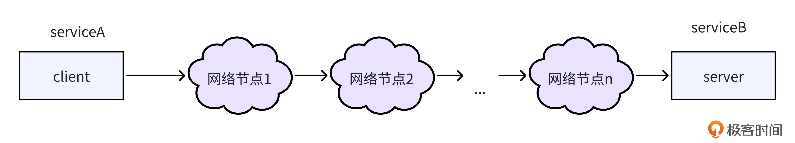

- 图1 服务调用网络链路

因此，为了降低网络 IO 的延时，咱们的第一个优化思路是——让通信的 Client 和 Server 物理距离尽可能近一点。怎么才能达到这一目标呢？

为了让进行通信的 Client 和 Server 尽可能近，在流量调度上，我们可以采取下面两个优化策略。

第一个策略是，当两个服务在多地域有部署时，Client 和 Server不进行跨地域调用。比如，以下面的图为例，服务 A 在华北区域的服务器，只调用服务 B 在华北区域部署的服务器，尽量不要跨地域去调用服务 B 在华东区域部署的服务器。

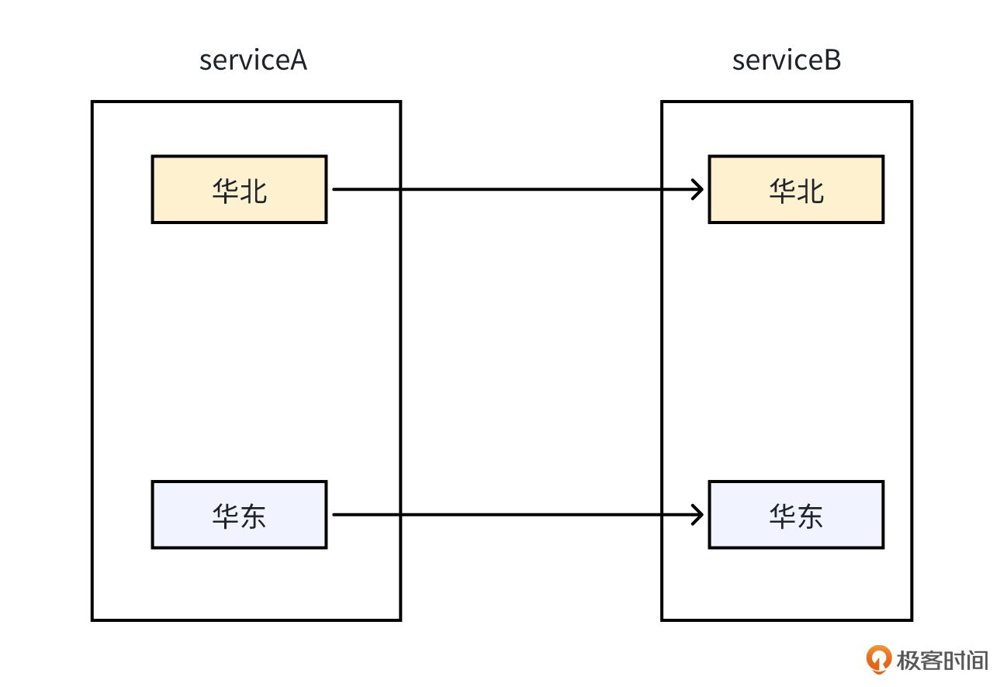

- 图2 同地域调用

当然，如果同地域内的下游服务出现故障或不可用时，在延时满足要求的情况下，出于容灾上的考虑，我们可以允许短期的跨地域调用。

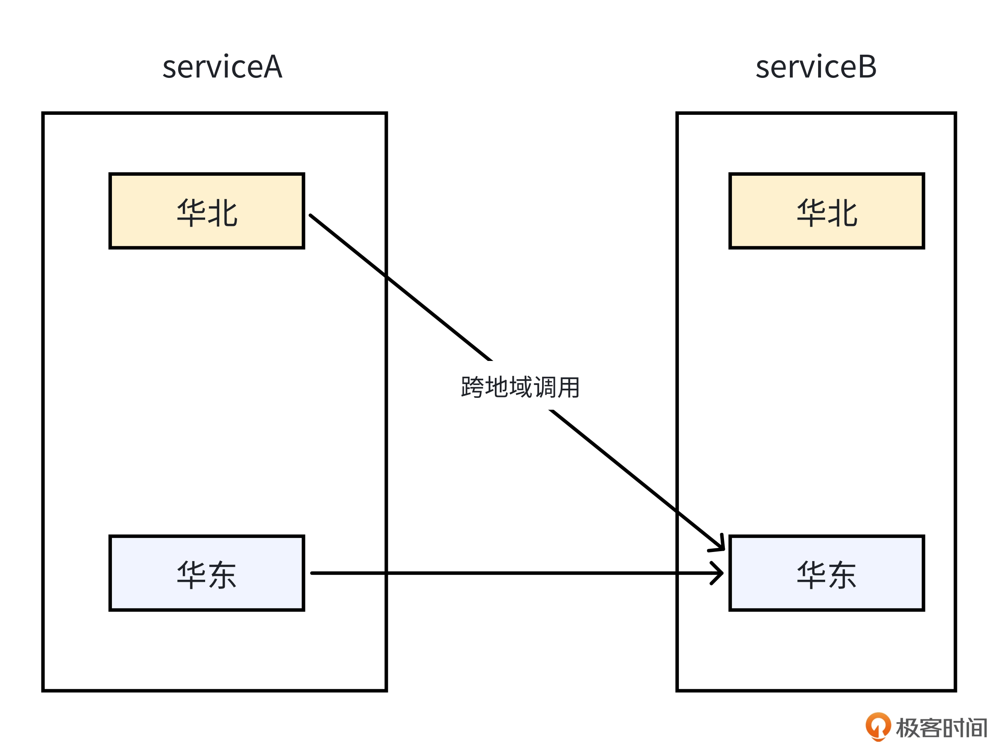

- 图3 跨地域容灾调用

第二个优化策略是，当两个服务在同地域多机房有部署时，Client 和 Server不进行跨机房调用。

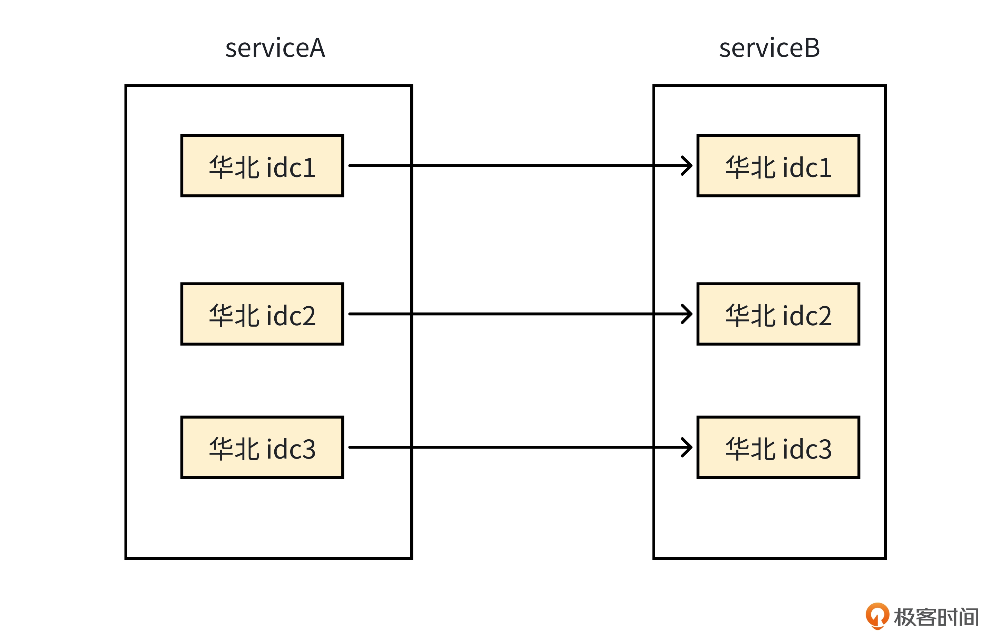

- 图4 同机房调用

和跨区域容灾调用类似，如果同机房内的服务出现故障或不可用时，在延时满足要求的情况下，我们也可以允许短期的跨机房调用。

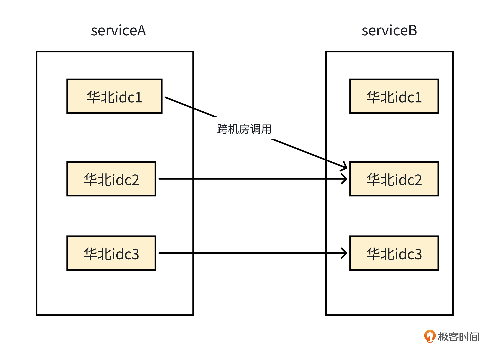

- 图5 容灾跨机房调用

## 亲和性部署

除了同地域、同机房调用外，我们还有没有办法让 Client 和 Server 的物理距离更近呢？

就像下面的图展示的一样，你还可以将两个服务，尽可能地部署到一台物理机上，这样当Client 发起请求调用时，可以优先调用同一个物理机上的 Server，从而达到完全消除网络传输开销的目的，这就是亲和性部署策略。

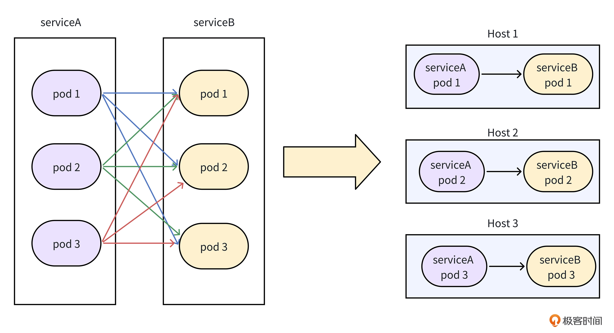

- 图6 同节点调用

亲和性部署策略除了将服务之间的远程通信变成同机通信之外，为了减少复杂 TCP 协议通信所产生的开销，它还会将通信方式换成 IPC 通信（也就是进程间通信），比如共享内存通信，从而使两个服务之间的数据传输更为高效，数据传输的资源消耗也更低。

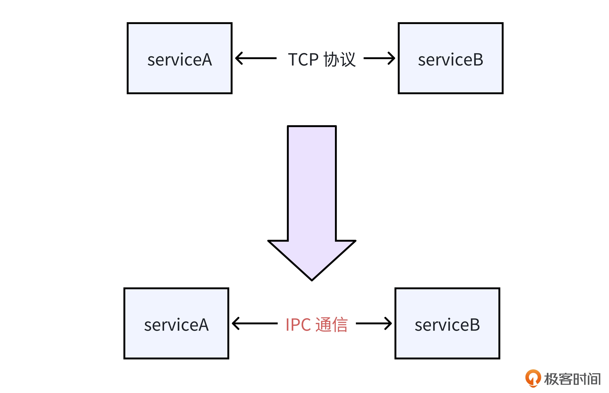

- 图7 TCP 通信转 IPC 通信

当然，如果我们要使用亲和性部署策略，达到降低网络 IO 延时的目的，公司的多个组件都需要进行一定的改造才能支持。

改造主要包括以下三个层次。

1. 首先，容器调度系统需要基于我们配置的服务合并关系以及上下游服务的实例情况，进行亲和性调度，将上下游的实例尽可能部署到同一个物理机上。

2. 接着，流量调度层需要识别上游服务实例有哪些同机下游，并根据下游服务的全局负载，计算单个上游实例访问下游实例的动态权重。值得注意的是，在权重计算的具体流程中，流量调度层对下游同机实例所赋予的权重，相较其它实例而言会适当增大，从而尽可能让更多的流量可以进行本地通信。

3. 最后，服务框架需要扩展定制支持亲和性部署的 IPC 通信方式，这样基于流量调度层的计算结果将请求发给同机实例时，通信效率会更高。当然，由于物理机容量的限制，对于单个物理机上的服务调用，同机的下游实例未必能承受住所有流量，所以还是会有部分跨机调用流量，因此框架层面仍需要保留采用 TCP 协议的远程通信方式。

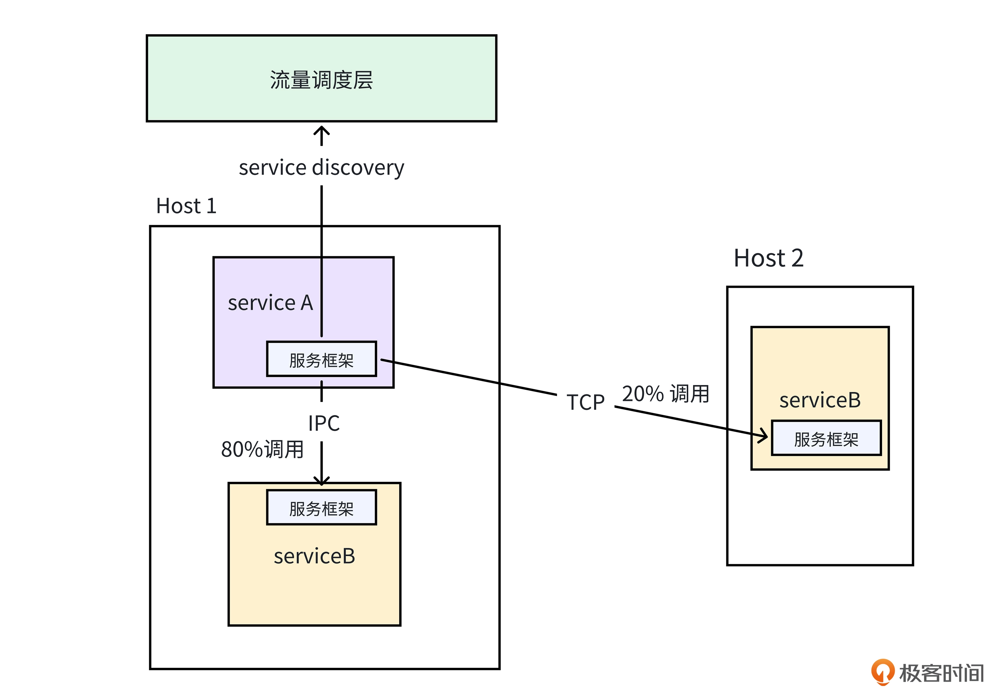

- 图8 亲和性部署

## 合并编译

通过亲和性部署，我们将两个服务之间的调用，变成了同机调用。那同机调用的两个服务，还有没有办法继续降低通信延时呢？

我们先来梳理一下同机服务进行 RPC 调用的过程，看看里面还有什么可以优化的地方。就像下面的图展示的一样，同机 RPC 调用的过程分为下面几个核心环节。

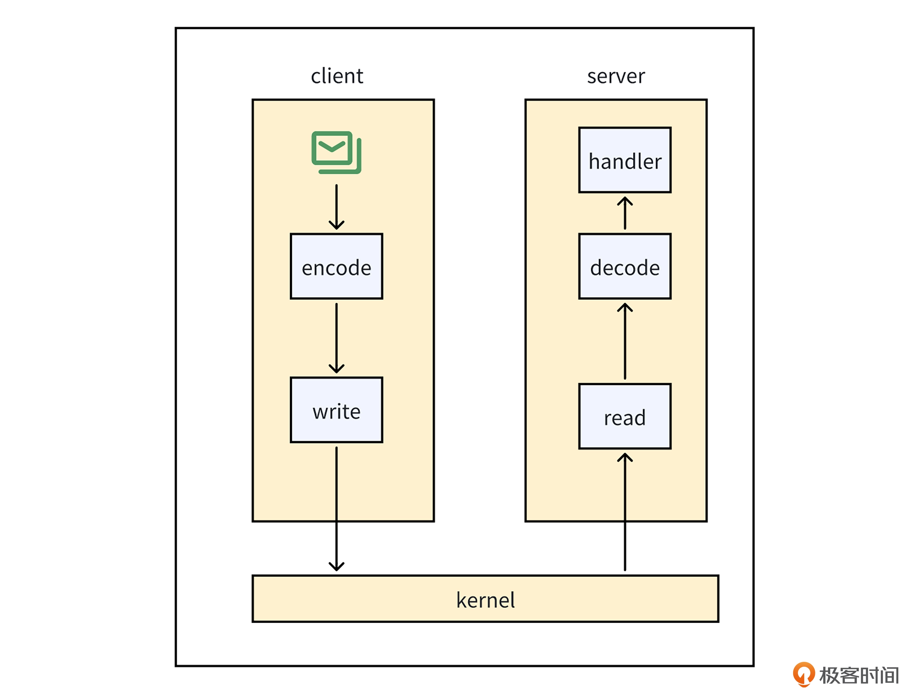

- 图9 client-server 同机通信过程

1. 首先，Client 需要用 Protobuf 等协议将数据编码。

2. 接着，Client 要做系统调用，将数据写入内核缓冲区。

3. 然后，Server 通过系统调用，从内核缓冲区读取数据。

4. 之后，Server 需要通过 Protobuf 等协议，将数据解码成请求对象。

5. 最后，Server 调用业务逻辑代码处理请求。

实际上，编解码操作和操作系统调用，属于性能开销比较大的操作，特别是请求或响应的包比较大时。如果我们有办法去除这两类操作，服务调用性能会进一步提升。

那在实践中，有没有办法去除这两类操作呢？

业界的前沿实践中有一种叫做合并编译的方案。就像下面的图展示的一样，合并编译将下游服务编译成 SDK，并将上游服务对下游服务的 RPC 调用，替换成本地 SDK 的函数调用，从而完全消除 RPC 调用的编解码操作和系统调用开销 **。

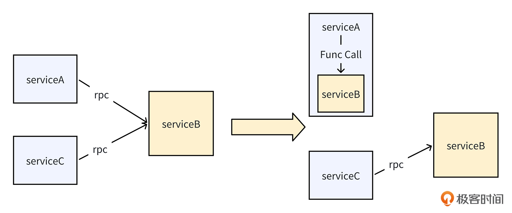

- 图10 合并编译

当然，合并编译对服务调用极致的性能优化，核心目标是解决微服务过微导致的整体 CPU 资源成本过高的问题。为了能拿到较大的资源成本收益，只有当两个服务之间的调用 QPS 比较高，编解码操作消耗的 CPU 比较多时，才适合用合并编译方案。

除了资源成本收益之外，当我们采用合并编译方案时，还需要考虑合并之后的服务稳定性问题。由于合并编译是把两个服务打包编译，部署到一个 Pod 里面，所以两个服务会共用一个Pod 的资源。因此，如果服务本身的 CPU 或内存负载比较高，由于容器规格是有上限的，对于这样的服务就不太适合采用合并编译方案。

合并编译既能满足服务各自迭代的优点，又能消除服务拆分所增加的性能损耗，那它到底是怎么实现把两个服务的代码编译成一个二进制文件的呢？

以字节合并编译的实现方案为例，在实现合并编译方案时，需要解决两个基本的挑战。

第一个挑战是，当两个服务需要依赖相同的包且版本不一样时，如何保证两个服务的依赖不冲突？

为了保证依赖不冲突，在编译时，我们可以按下面的步骤实现依赖隔离。首先，我们可以将两个服务的依赖下载到本地各自不同的目录。

```
tmp
├── servicea
│   └── github.com
│       └── kitex
└── serviceb
   └── github.com
       └── kitex
```

接着，就像下面的图展示的一样，我们需要给两个服务代码里的 import path，加个不同的前缀方便区分。

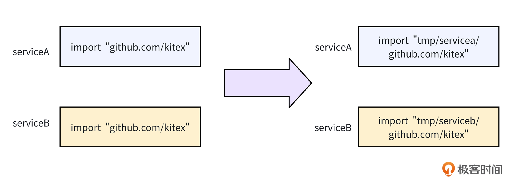

- 图11 import 加前缀

最后，我们需要在 go.mod 文件里，将远程 tmp 目录替换成本地目录，从而将代码里各个文件import 的远程依赖，改成本地文件依赖。

```
replace tmp => ./tmp
```

通过这三个步骤，我们就可以实现两个服务的依赖隔离。

除了依赖冲突问题，我们需要应对的第二个挑战是，如何将 Client 对 Server 的 RPC 调用，替换成本地函数调用？

为了将 RPC 调用，替换成本地 SDK 函数调用，我们的编译脚本可以按下面的步骤实现调用替换。

首先，我们需要改写 server 端的 main 函数，将它变成 export 函数，并去除服务启动逻辑，返回服务端的请求处理对象。

```go
// 改写前
func main(){
   mysql.init()
   server := kitex.NewServer(handler)
   server.run() // 服务启动
}
// 改写后
func Main() kitex.ServerInfo{
   mysql.init()
   server := kitex.NewServer(handler)
   return server.ServiceInfo()
   //server.run() // 服务启动
}
```

接着，在 Client 端，我们需要定义一个实现了 rpc 调用接口 Client 的 ServerServiceClient 结构体，它的底层会直接调用 server 端的函数。

```go
// client rpc调用抽象接口
type Client interface {
   Call(ctx context.Context, method string, request, response interface{}) error
}
type ServerServiceClient struct{
   serverInfo *kitex.ServerInfo
}
// 传入的是server请求处理对象
func NewServerServiceClient(serverInfo *kitex.ServerInfo) *Client{
   return &ServerServiceClient{serverInfo:serverInfo}
}
func (impl *ServerServiceClient) Call(ctx context.Context, method string, request
   // 直接调用server端的函数
   return impl.serverInfo.handler(ctx,method,request,response)
}
```

最后，在之前实例化 Client 对象的地方，我们需要替换成实例化 ServerServiceClient 对象，这样替换之后，咱们所有调用 Call 方法的地方，底层都从原先的 RPC 调用，变成了本地函数调用。

```go
// client:=NewClient() 原先的生成Client的方法
// 替换之后生成Client的方法
serverInfo:=server.Main()
client:=NewServerServiceClient(serverInfo)
```

## 小结

今天这节课，我们一起学习了在不改业务代码的情况下，降低服务调用 IO 延时的方法。现在让我们来回顾一下今天学到的知识。

首先是跨机通信优化。为了降低网络传输延时，我们需要让服务调用的物理距离更近一点，尽量不跨地域、不跨机房调用。

其次是跨机转同机的调整，为了进一步降低网络传输延时，我们可以采用亲和性部署方案。把上下游服务部署到一台物理机里，优先进行同机调用，从而消除网络传输开销。

最后，我们探讨了从 RPC 调用转为函数调用的极致性能优化。为了消除服务调用的编解码开销，我们可以采用合并编译方案。将 Server 编译成 SDK，并将 Client 对 Server 的 RPC 调用，变成本地 SDK 的函数调用，从而消除服务调用的编解码开销。

希望你好好体会这些策略的应用。当遇到服务调用 IO 瓶颈时，在公司基建满足的条件下，别忘了尝试这些策略，降低网络 IO 延时。

## 思考题

在实践中，如果单纯为了降低延时，很少使用合并编译的方案，这是为什么呢？

欢迎你把你的答案分享在评论区，也欢迎你把这节课的内容分享给需要的朋友，我们下节课再见！
