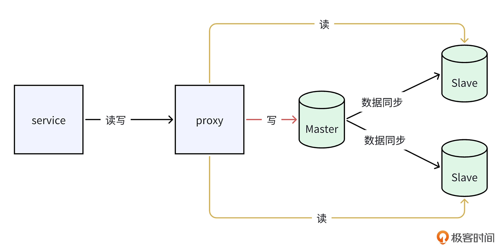
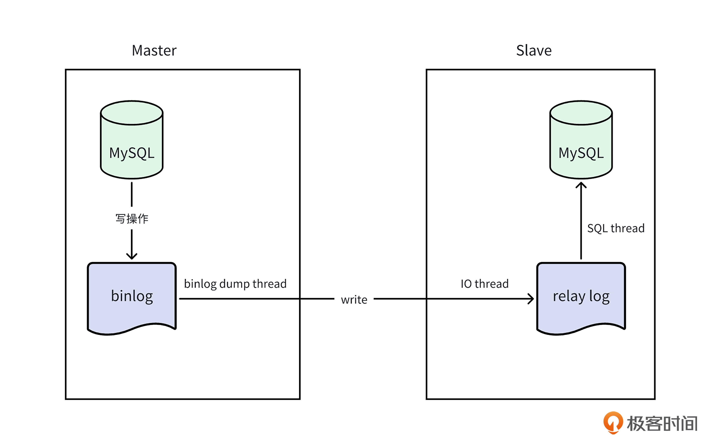
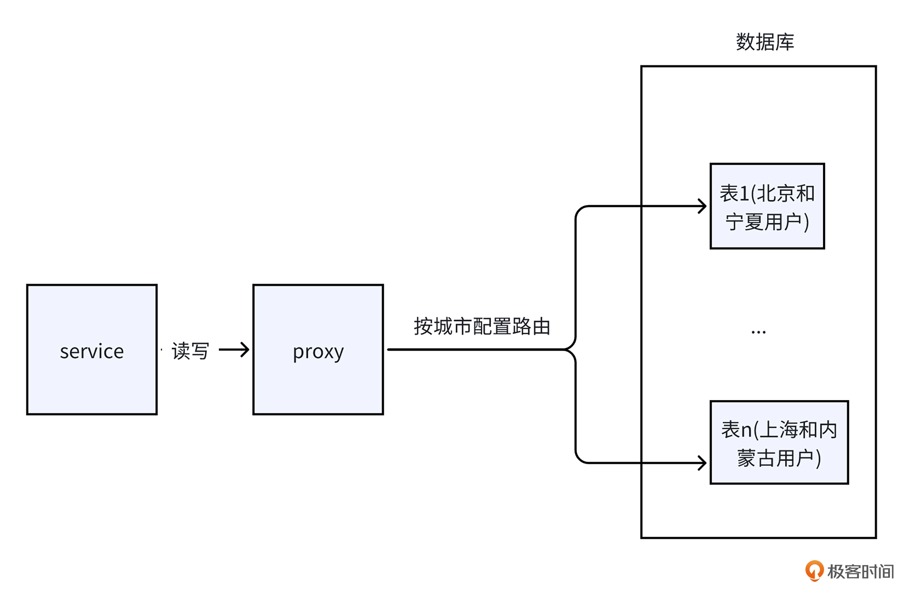
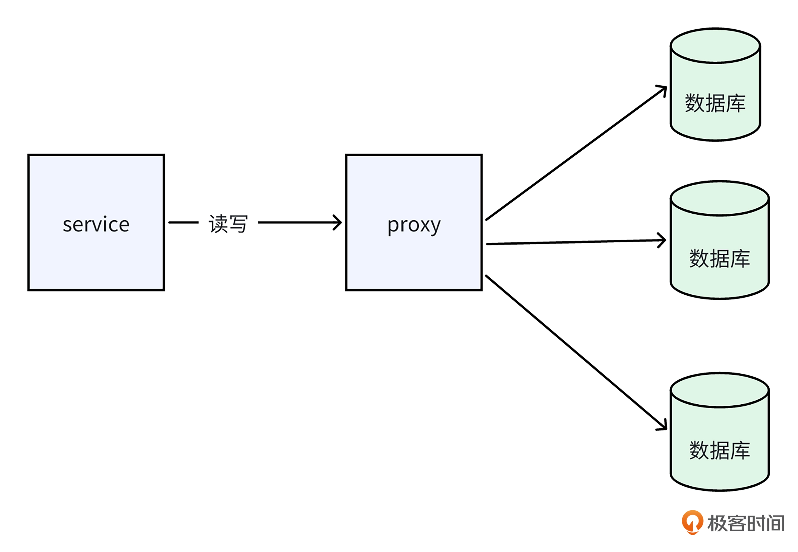
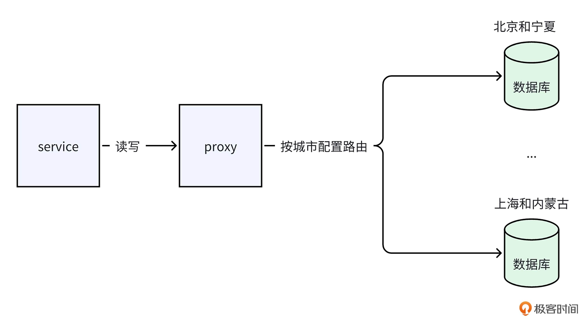
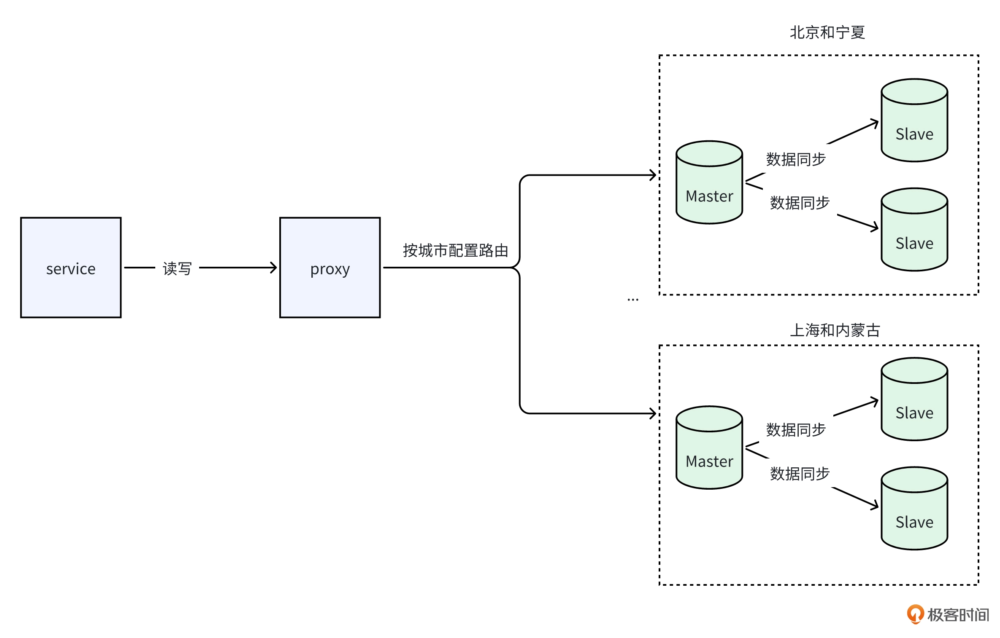

# 11 | 数据库：分库分表，没有用户id怎么分？

你好，我是徐逸。

通过前面的课程学习，我们已经了解了如何从编码和框架这两个层面来优化服务性能。不过呢，当性能瓶颈点是下游数据库时，这两个层面的优化就无能为力了。

对于数据库性能的优化，除了合理使用索引等使用细节上的优化之外，在高并发场景，我们还需要在架构层面进行优化。

今天我们就来聊聊，在高并发读写场景，如何从架构层面来优化数据库的读写性能。

## 案例准备

为了让你更加身临其境，我会以一个实践中的案例为基础，带你通过一步步演化数据库架构，来实现高并发读写数据库的目标。

作为用户，想必你使用过类似微信“附近的人”这样的产品功能。对于这样的产品功能，它的内部是如何实现的呢？


- 图1 附近的人

从服务端的角度出发，为了实现这个产品功能，服务端通常需要提供下面这两个功能接口。

1. 第一个是写入接口。在用户打开页面时，客户端将调用此接口，用以上传用户所处位置的相关信息。

2. 第二个是查询接口。当用户打开页面后，客户端会调用此接口，根据用户当下的位置信息，检索在一定时间内出现在其附近的其他用户。

从服务端内部实现的角度，对于位置数据的存储和检索，我们可以用 MongoDB 数据库来实现。

假如现在我们构建了一个基于 MongoDB 数据库的 “附近的人” 服务，它采用的是单库单表的数据库架构设计，核心实现逻辑如下。

首先，在调用服务的写入接口时，我们会把包含用户位置信息的数据存储到 MongoDB 数据库中。这些存储的数据具有特定格式，在每条记录里都会有一个经纬度字段，用来精准表示用户所处的位置，具体格式就像下面展示的一样。

```json
{
   "user_id": "12345",
   "create_time": 1733805510, // 创建时间
   "update_time": 1733805510, // 更新时间
   "location": { // 用户位置
       "latitude": 37.7749, // 纬度
       "longitude": 122.4194 // 经度
   }
}
```

接着，当调服务的查询接口时，我们会基于用户当前的位置，从 MongoDB 中召回最近一天出现在附近 10km 内的人。

```javascript
// 一天之内，出现在附近的人
// 获取当前时间的时间戳（秒级）
var currentTime = Math.floor(Date.now() / 1000);
// 计算一天前的时间戳（秒级）
var oneDayAgo = currentTime - 86400;
// 查找附近10km的人
var current_location = {
   type: "Point",
   coordinates: [current_longitude, current_latitude]
};
// MongoDB查询
db.users.find({
   "update_time":{$gt:oneDayAgo},//一天之内的数据
   "location": {
       $nearSphere: {
           $geometry: current_location,
           $maxDistance: 10000 // 单位是米，这里表示10公里
       }
   }
});
```

最后，出于性能上的考虑，我们需要给表结构增加空间索引。同时，为了防止表膨胀，我们需要定时删除一天之前的数据。

```
// 创建空间索引
db.users.createIndex({ "location": "2dsphere" });
```

现在，因为运营活动需要，我们要基于目前的单库单表架构，做数据库架构的优化，达成下面的性能目标。

- 读接口高峰 10w QPS（Queries Per Second）

- 写接口高峰 10w TPS（Transactions per Second）

那么我们该怎么做架构优化，才能达到这个性能目标呢？

## 读性能优化

在我给出高并发读的具体解决方案之前，你不妨先思考一下这个问题：当业务服务的 QPS 过高时，我们通常会采取何种操作，才能使服务能够承受更高的 QPS 呢？

### 读写分离：单库读 QPS 太高怎么办？

在实际的业务实践过程中，我们通常会采用为服务增添更多机器资源的方式，来应对高 QPS的业务诉求。而针对数据库层面，为了使其同样能够通过增加机器达成高 QPS 读操作的要求，在业界广泛应用着一种名为读写分离的数据库集群架构方案。

在读写分离这种架构模式里，正如下面的图呈现的那样，数据库被划分为主库与从库两个部分。其中，主库承担着所有数据写入的任务，而从库则主要负责处理数据的读取。值得注意的是，在读写分离架构中，写入主库的数据会通过特定的数据同步机制及时地传输并更新至从库之中，从而确保整个数据库系统的数据一致性，为高 QPS 读操作提供坚实稳定的架构支撑。



- 图2 读写分离架构

通过读写分离架构优化，我们就可以通过扩充从库，来增加数据库集群可承载的读 QPS 上限。比如，我们现在压测出来单库读 QPS 上限是 1w QPS，那么我们就可以通过增加 10 个从库，来达到整体读 10w QPS 的性能目标。

当然，在通过增加从库实现数据库集群整体可承载读 QPS 上限提升的同时，主从同步这一过程会额外占用主库的硬件资源。就像下面的图展示的一样，针对主库的写操作，在数据写入binlog 日志后，主库会启用一个特定线程，将 binlog 日志同步传输至从库。如此一来，主从同步操作便会消耗主库的 CPU 、网卡带宽等硬件资源，并且从库数量越多，主库所需消耗的硬件资源也就越多。



- 图3 主从同步

然而，单台主库设备的硬件资源规格是存在上限的，这就意味着从库数量无法无限制地扩充。

所以，为了实现整体性能目标，在从库数量受限的情况下，我们务必确保单库的读 QPS 上限不至于过低。

而影响单库读 QPS 上限的一个重要因素，就是表里数据的行数。单表数据行数过多，会使查询变慢，在影响数据库可承载 QPS 的同时，还可能导致单个请求的延时达不到业务诉求。

### 分表：单表数据量大怎么办？

在明确了单表行数过多有可能使性能无法达标的情况后，接下来我们需要深入思考的关键问题便是——我们这张专门用于存储用户位置信息的表，其数据行数是否过多呢？

在实践中，我们能够借助压测的手段来确定单表可存储数据量的上限，与此同时，还要依据对业务数据量的预估，来推断单表可能会存储的最大数据量规模，以此作为判断单表行数是否超出合理范围的重要依据。

例如，倘若我们通过压力测试最终确定，这张专门用于存储用户位置信息的单表，其数据量上限大致处于 300w 行的水平。然而，鉴于我们的业务规则是仅保留最近 1 天的数据，而每天访问我们此功能的 DAU 高达 3000w，因此我们可以预估单表最多可能会存储 3000w 行左右的数据。由此可以断定，当前确实存在单表行数过多的问题。

那么，在单表行数过多这种情况出现时，我们应当如何来解决这一问题呢？

为了解决表行数过多导致读性能下降的问题，业界提供了一种数据库分表的方案。所谓数据库分表，是指当单表数据量过大，导致查询性能变差时，我们可以将这个大的数据表，按照一定的规则拆分成多个较小的数据表，从而提升表数据查询的性能。

当然，针对分表规则，业界也提供了下面几种较为常见的方案。

1. 第一种是范围路由方案。所谓范围路由，是指针对整型、时间戳等数据类型，按照其数值范围进行拆分，使处于不同范围的数据分别存储到不同的子表之中。

2. 第二种是 hash 路由方案。所谓 hash 路由，就是通过计算某个特定列的 hash 值，然后依据该 hash 值将数据路由分配至不同的子表当中。

3. 第三种是配置路由方案。所谓配置路由方案，意味着我们能够进行相关配置，使得数据依据某个列的值来完成路由操作。例如，我们可以在远程配置文件里设定城市路由规则，这样一来，不同城市的用户数据便会被分别存储到不同的子表之中。

在充分理解并掌握了分表相关知识之后，现在让我们着手来处理这张用于存储用户位置信息的表，解决其数据行数过多的问题。

由于类似“附近的人”这种产品功能，通常情况下不会涉及召回跨城市用户，所以我们能够依据用户所在的城市来实施分表操作。由于不同城市的日活跃用户（DAU）数量存在差异，倘若采用基于城市 ID 的 hash 路由方式，极有可能导致单表数据量分布不均的状况。因此，为了有效规避这个问题，我们可以采用配置路由的方法，根据不同城市的具体情况进行针对性配置。

例如，已知我们单个数据表能够承载的数据量为 300 w 行，其中上海的 DAU 为 250 w、北京为 190 w 、宁夏为 100 w、内蒙古为 20 w。那么在进行配置路由时，我们就可以将上海和内蒙古的数据配置路由到同一张子表，而不应把上海和宁夏的数据配置到一张子表，避免单表数据量超过上限。

分表架构你可以参考下面的图来理解，



- 图4 分表架构

借助读写分离技术以及分表策略，我们便能成功构建起可实现 10 万 QPS 读取能力的数据库架构。

## 写性能优化

在顺利完成读性能的优化工作之后，接下来我们所面临的关键问题便是——应当采用何种方式来优化写性能呢？

### 分库：单库写瓶颈怎么办？

与优化读性能的思路相似，针对高 TPS 写操作而言，很容易想到的策略便是增添机器资源。为了确保数据库在面临高 TPS 写需求时，同样能够通过增加机器的方式达到目标，在业界存在一种名为分库的数据库集群架构方案。

所谓分库的方案，是指在单库写操作的 TPS 处于较高水平时，我们能够对数据库进行拆分，构建出多个主库，并且把写请求分散到这些不同的主库之中。

正如下面图所展示的那样，通过把写操作合理地分配到多个主数据库，数据库集群便能够并行处理数量更多的写请求，从而有效提升整个数据库集群整体的写 TPS 上限。



- 图5 分库架构

当然，和分表方案一样，在分库规则方面，较为常用的同样是范围路由、hash 路由以及配置路由这三种类型。

回到我们的案例，由于在做读性能优化时，我们已经用城市做了分表操作。所以在进行分库处理时，我们能够直接把不同的子表分别放置到不同的数据库之中，从而达成分库的预期目的，就像下面的图展示的一样。



- 图6 按城市配置路由

历经读写分离以及分库分表架构的优化进程之后，“附近的人” 项目架构呈现出下面的图所展示的形态。通过拆分多个主库，我们达成了高并发写的性能目标。并且，通过给每个主库添加从库，实现读写分离，我们就可以达成高并发读的目标。



- 图7 “附近的人”高并发架构

## 小结

今天这节课，我以“附近的人”项目为例，在逐步对其读写吞吐进行优化的过程中，向你介绍了读写分离和分库分表的数据库架构知识，现在让我们来回顾下这节课的要点。

- 首先是读写分离架构。当我们数据库读 QPS 过高时，可以通过读写分离架构，增加从库来提升数据库集群的读 QPS。

- 其次是分表架构。当我们单表数据行数太多，导致读性能下降时，可以用分表架构，将一张表拆成多张小表，从而提升读性能。

- 最后是分库架构。当我们数据库写入 TPS 过高时，可以用分库架构，通过增加多个主库，分散单库的写压力，从而提升数据库整体的写 TPS 上限。

希望你好好体会读写分离和分库分表架构的应用。当遇到高并发数据库读写场景时，别忘了用上今天学到的架构知识去做优化。

## 思考题

网上有种说法，MySQL 表行数超过 2000w 左右，一般会被认为是大表，需要做拆分，这个数值是怎么来的呢？

欢迎你把你的答案分享在评论区，也欢迎你把这节课的内容分享给需要的朋友，我们下节课再见！
