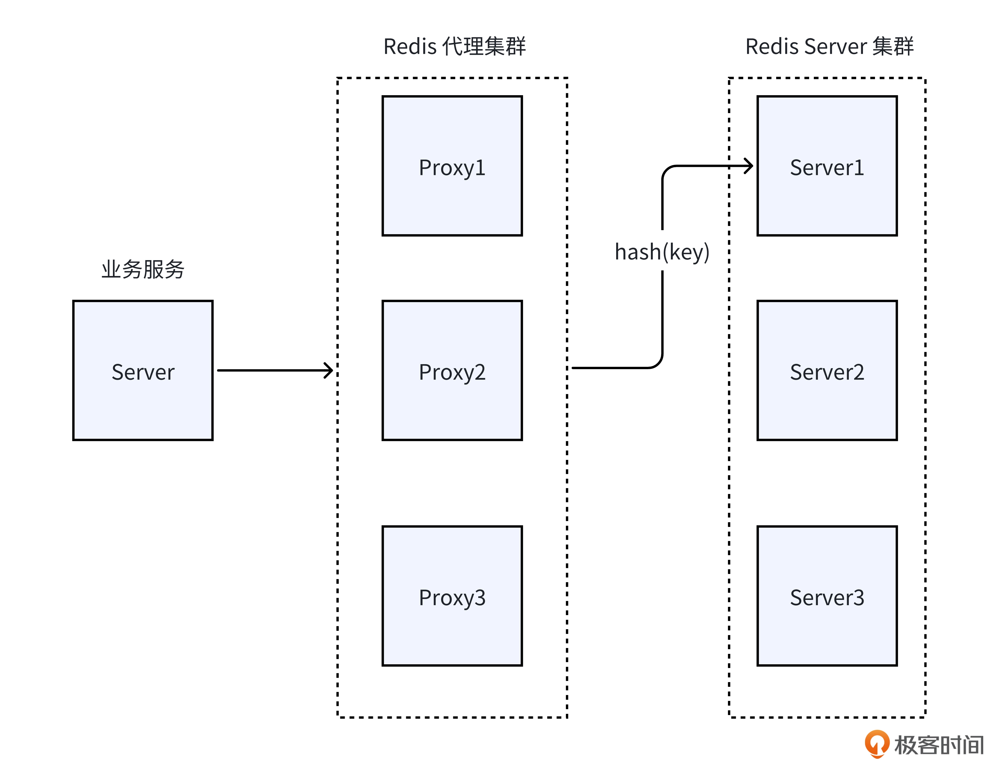
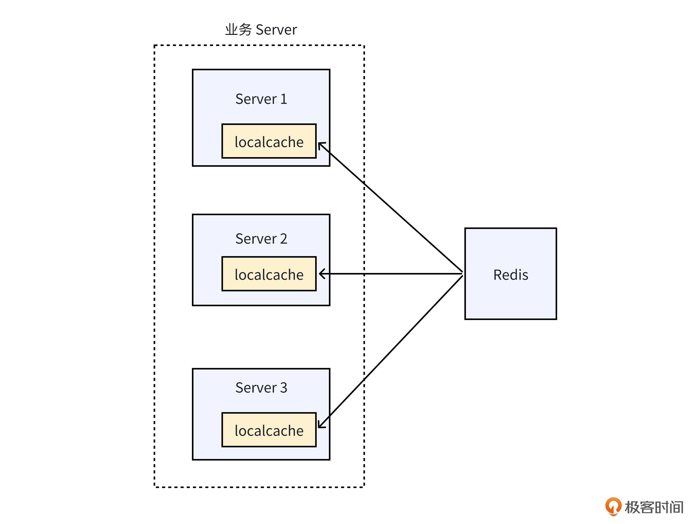
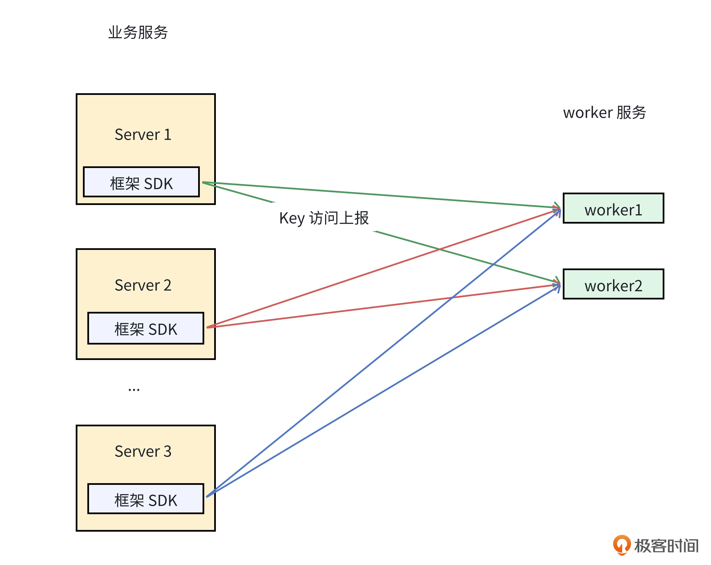
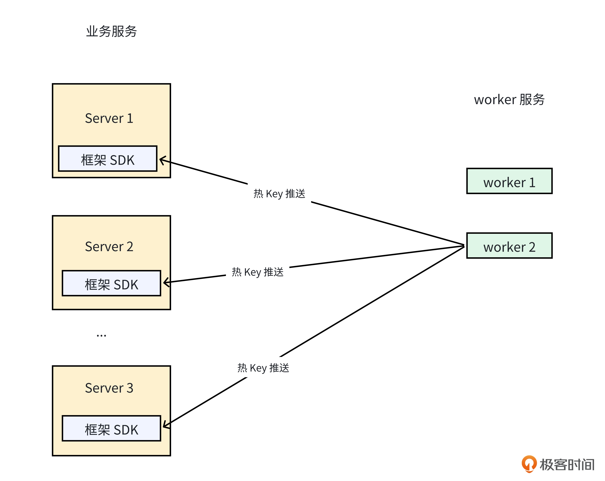
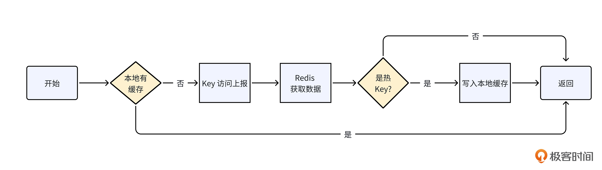
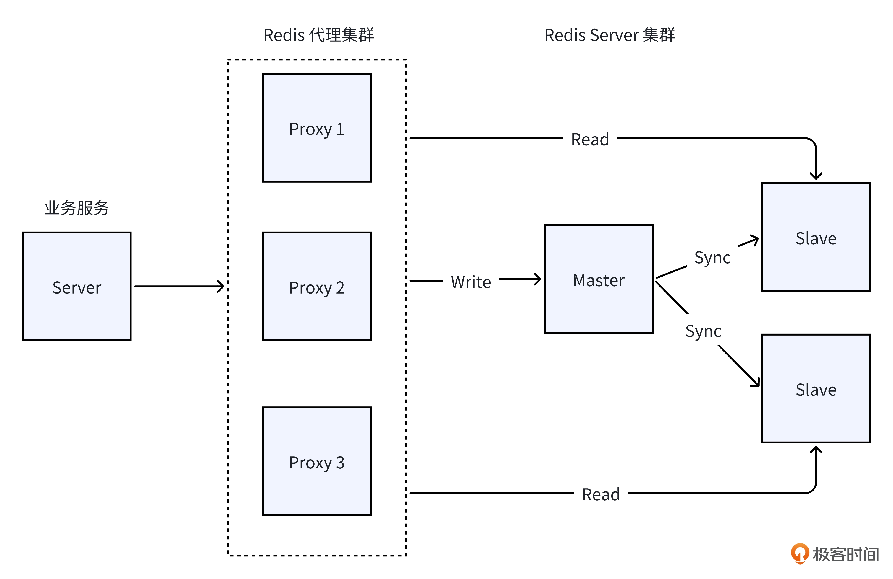
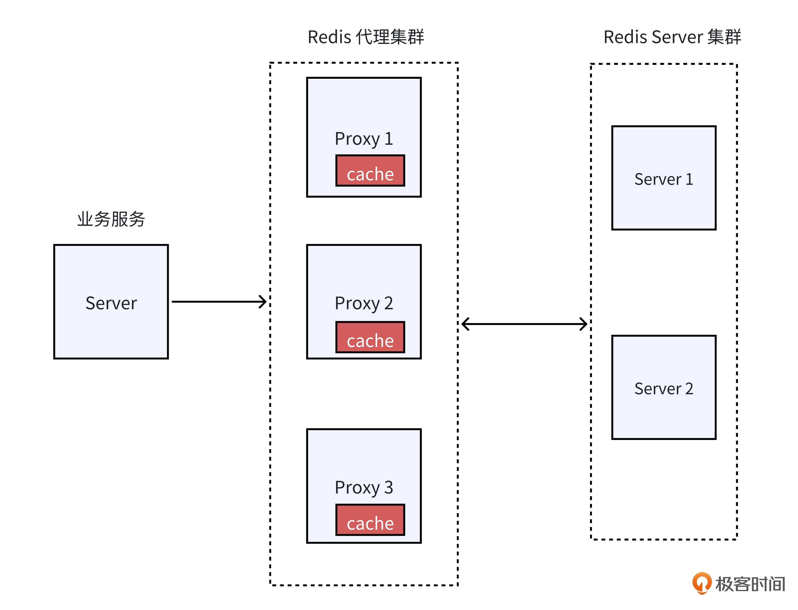

# 12 | 分布式缓存：大促抢购，不知热点咋防热Key？

你好，我是徐逸。

通过上节课的学习，我们知道了提升服务吞吐的数据库架构方案。

不过在实践中，除了在数据库层面做优化之外，我们还可以通过搭配缓存的方式，来减轻数据库的访问压力，避免数据库成为性能瓶颈点。例如电商大促的商品详情页，由于商品的名称、图片链接、价格等数据会被频繁访问，因此一般会被缓存，以便提升系统的性能。

今天我们就来聊聊，在大促抢购期间，有些商品访问 QPS 突然大幅度增高时，我们如何才能保障 Redis 访问的性能不受影响呢？

## 什么是热 Key 问题

在讨论具体方案之前，你不妨先想一想：要是 Redis 中某个 Key 的访问 QPS 突然变得很高，会给我们的系统带来怎样的影响？

就像下面的图展示的一样，当从 Redis 读取数据时，Redis 代理服务会基于 Key 进行 Hash 计算，以此定位到 Redis 中实际存放数据的后端 Redis Server。所以，要是某个 Key 的访问QPS 突然大幅攀升，那么这个 Key 所在的 Redis Server 就会有部分请求被迫排队，进而导致延迟升高，严重时还会出现超时失败的状况。这便是我们平常所说的热 Key 问题，而那些被高频率访问的 Key 就是热 Key。



- 图1 Redis 分片架构

在应对突发热 Key 所引发的性能难题时，各个公司所采用的解决方案可谓是各有千秋。不过，它们的核心思路却殊途同归，那便是借助更多的机器资源，来分担热 Key 的访问流量。这些方案大致能够归为以下两类。

- 第一类是在业务层进行改造，从而解决热 Key 问题的方案。

- 第二类是对业务层透明的，云厂商提供的，Redis 附带方案（比如阿里云和腾讯云）。

## 业务层解决方案

我们先来看看业务层方案的具体情况。

### 本地缓存全量数据

对于业务层的方案，最为简单的是服务本地缓存全量数据的方案。也就是在服务的各个实例内存中，把所有数据都缓存起来。这样当请求访问时，就可以直接从服务实例的本地缓存中获取数据，而不用请求 Redis，防止发生热 Key 问题。



- 图2 localcache 全量缓存

然而，要是服务本地没办法缓存全部数据，像数据量超大，超出内存规格所能承受的范围，又或者是为了避开 Golang 的 GC（垃圾回收）带来的影响，这种情况下，在本地缓存全量数据的方案就行不通了。

### 本地缓存部分数据

为了应对服务本地内存无法缓存全量数据这一困境，在业务层的方案中，还存在一种仅对部分数据进行缓存的策略，即专门针对热 Key 数据进行缓存，而将其他数据排除在缓存范围之外。

然而，要实现这个策略，关键在于服务端得有办法知道哪些是热 Key，这样才能在本地缓存它们。所以呢，这得靠一套很完善的热 Key 探测框架，有了它，就能又快又准地发现热 Key。

那么，到底存不存在能够实现热 Key 探测的框架呢？

实际上，京东推出了一个开源的热 Key 探测框架—— JdHotkey，有了它，我们的服务端就能及时地感知到热 Key。接下来咱们就来研究一下它是怎么做热 Key 探测的。使用 JdHotkey框架来实现热 Key 的探测，主要包含两个关键步骤。

首先是 Key 访问的上报与统计。



- 图3 Key 访问上报

正如前面的图里所展示的那样，由于同一个 Key 会在不同的服务实例中被访问，所以仅仅依靠单个客户端或者 Redis Proxy 难以完成热 Key 的统计工作。

为了能够精准地统计热 Key，就必须单独部署一个专门的 worker 服务。当我们访问某个 Key时，需要调用 JdHotkey 框架提供的 SDK 进行上报。SDK 底层会周期性地把收集到的 Key 访问数据上报至这个统一的 worker 服务，以便开展聚合计算。需要注意的是，已经热了的 Key不会再次发送给 worker 服务，除非 Client 本地该 Key 缓存已过期。

当然，针对不同服务实例访问相同 Key 的情况，框架 SDK 会根据类似下面的伪代码，将相同Key 的访问上报到同一个 worker 实例。这样一来，就能够有效对 Key 访问频率做出精确统计，为后续热 Key 的判定与处理提供可靠的数据支撑。

```go
// workers列表，可以通过服务发现获取workers列表
workers := []string{"worker1", "worker2", "worker3", "worker4", "worker5"}
key := "example_key"
index := hash(key)%len(workers)
worker = workers[index] // 上报的worker
```

第二步就是热 Key 的判断与推送。当专门负责统计的 worker 服务监测到热 Key 出现时，它会主动地将热 Key 信息推送到所有相关的业务服务实例，从而确保各个业务服务实例能够及时知晓热 Key 的情况，并据此做出相应的处理策略调整。这个过程的示意图如下。



- 图4 热 Key 推送

为了让你有个直观的感知，下面的图里，我给出了服务端接入热 Key 探测之后的 Redis 访问流程图，供你参考。



- 图5 服务端 Redis 访问流程图

在业务层接入热 Key 的探测框架，虽然可以解决热 Key 问题，但是给我们带来了额外的复杂度。比如我们需要接入特定的 SDK 才能使用，而且还需要部署一个额外的 worker 服务来做统计。

那我们有没有办法避免对业务层的改造，在 Redis 数据库层解决热 Key 问题呢？

## Redis 层解决方案

实际上，我们可以利用各个云厂商的 Redis 所提供的功能，来解决热 Key 问题，从而避免增加业务逻辑的复杂性。而利用云 Redis 解决热 Key 问题，通常有两种比较常用的方案。

### 读写分离

首先是读写分离方案。就像下面的图一样，我们可以给分片 Server 增加更多的从库，让从库来承载 Key 的读访问，从而避免热 Key 访问影响单台 Redis Server 的性能。



- 图6 读写分离架构

不过呢，在采用读写分离这种架构的时候，由于我们事先没办法确定究竟哪些 Key 会成为热Key，所以为了保险起见，我们就只能对所有的 Redis Server 都进行扩充从库的操作。这样一来，必然会使得所耗费的 Redis 资源成本大幅增加。

那么，我们究竟应该采用什么样的方法，才能有效解决这样的问题呢？

### Proxy 热 Key 承载

实际上，不少云厂商都额外提供了一种借助 Proxy 来承载热 Key 的方案。

就拿阿里云 Redis 的 Proxy Query Cache 特性来说，这类方案的核心思路在于，并非针对每个 Redis Server 都去扩充从库，而是巧妙地利用 Proxy 来缓存热 Key 数据，承担热 Key访问所带来的压力。这样在应对热 Key 问题时，既能有效缓解系统压力，又能避免因大规模扩充从库而导致的资源浪费。



- 图7 Proxy 热 Key 承载方案

那么，这类方案究竟是怎样实现的呢？

实际上，虽然这类方案的实现细节各有不同，但大致都可以分为下面几步。

首先，当对 Key 进行访问时，在 Redis Server 端进行 Key 访问频率统计。

接着，当 Redis Server 判定为热 Key 时，通过推或者拉的模式，将这个热 Key 及其相关数据缓存到 Proxy 之中。

之后，当有热 Key 访问时，直接从 Proxy 获取数据返回，而不再从 Redis Server 获取，从而减轻单个 Redis Server 的压力。

最后，当 Proxy 缓存的数据过期时，重新从 Redis Server 获取。

## 小结

今天这节课，我以大促抢购商品详情页的缓存场景为例，带你梳理了缓存的热 Key 问题以及常用解决方案，现在让我们来回顾下这些解决方案。

- 首先是业务服务本地缓存全量数据的方案。要是数据量不大，我们可以直接在服务本地内存把所有数据都缓存起来，这样能大幅度降低热 Key 问题导致的 Redis 访问压力。

- 然后是业务服务本地只缓存热 Key 数据的方案。当服务不能缓存全部数据时，我们可以接入热 Key 探测框架，只把那些被频繁访问的热 Key 数据存到本地，节省内存之外还能保证热 Key 的快速读取。

- 之后是 Redis 读写分离架构方案。要是不想让业务层变得复杂，我们可以采取读写分离架构，给每个 Redis Server 都加上从库，让从库去应对热 Key 的高频率读取，分担压力。

- 最后是 Proxy 热 Key 承载方案。由于读写分离架构会增加 Redis 资源成本，所以在 Redis提供了热 Key 承载方案的条件下，我们可以优先用 Proxy 热 Key 承载方案，这样既能解决热 Key 问题，又能控制成本。

希望你好好体会这几个方案的使用场景和原理。当遇到热 Key 问题时，别忘了选择合适的方案来解决。

## 思考题

在 Go 语言的并发库存在这样一个类型，利用它能够避免服务 Server 向下游（比如 Redis）同时发起过多请求。那么，这个类型究竟是什么呢？

欢迎你把你的答案分享在评论区，也欢迎你把这节课的内容分享给需要的朋友，我们下节课再见！
