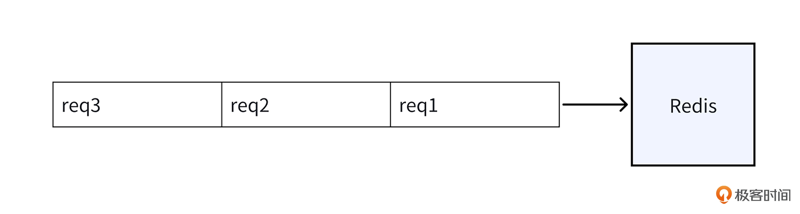
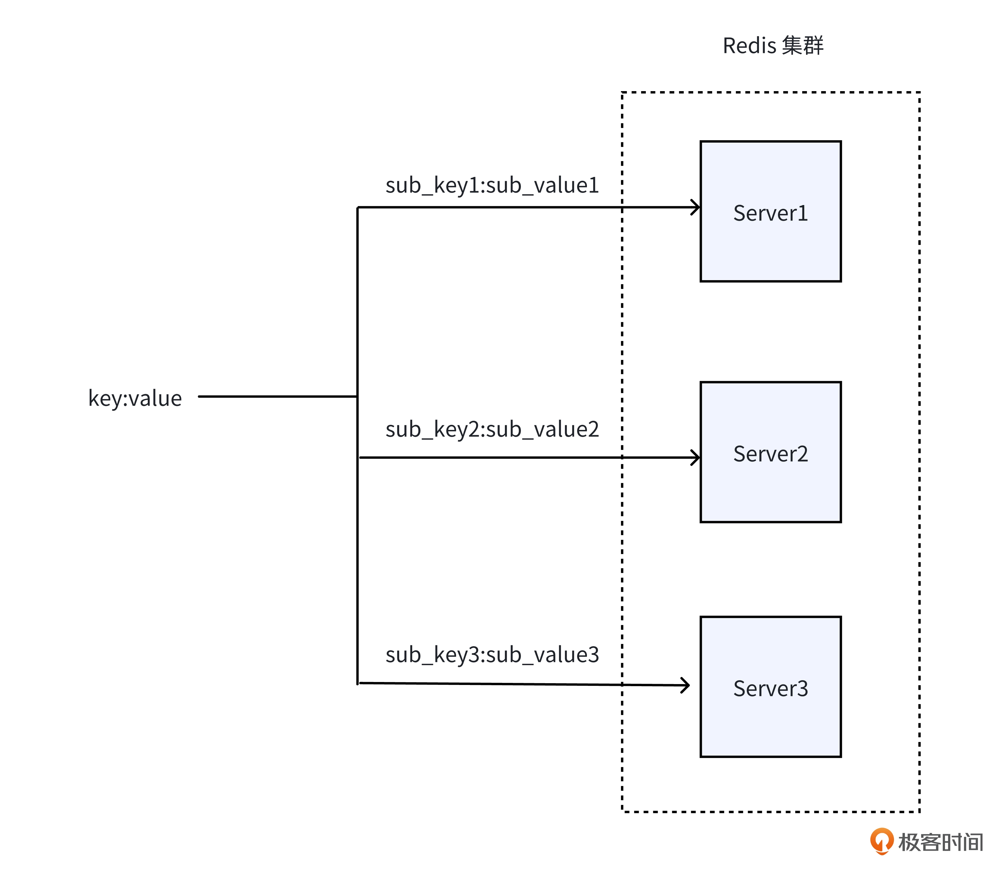
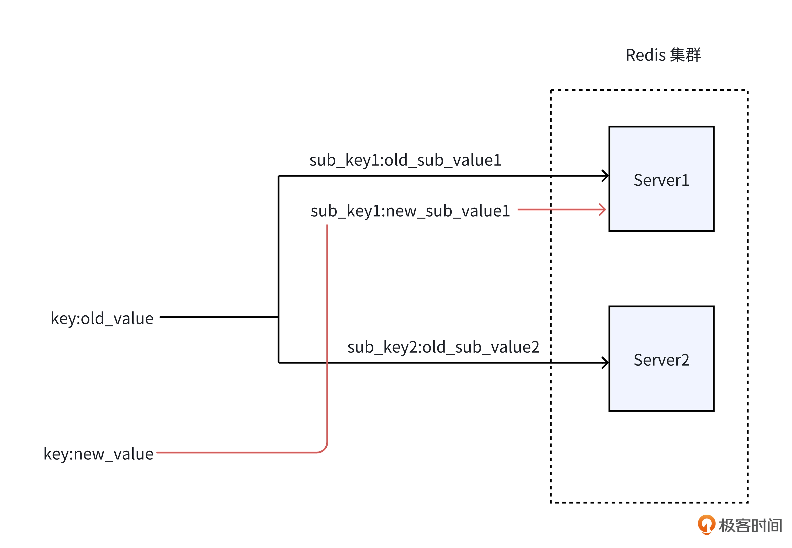

# 13 | 分布式缓存：大Key更新，拆分大Key如何防脏读？

你好，我是徐逸。

在上一节课中，我们深入探讨了如何应对 Redis 中的热 Key 问题，并掌握了多种解决方案。然而，在面对高并发的挑战时，我们不仅要关注热 Key 问题，还必须关注另一个可能影响Redis 性能的因素——大 Key 问题。

今天这节课，我们就来聊聊 Redis 大 Key 问题和相应的解决方案。

## 什么是大 Key 问题

Redis 作为单线程应用程序，它的请求处理模式类似排队系统，就像下面的图一样，所有请求只能依序逐个处理。一旦处于队列前面的请求处理时间过长，后续请求的等待时间就会被迫延长。



- 图1 Redis 请求排队处理

在请求处理过程中，若涉及的键（Key）或键关联的值（Value）数据量过大，Redis 针对这个请求的 I/O 操作耗时以及整体处理时间都将显著增加。

倘若这种情况频繁发生，不仅 Redis 的吞吐会下降，而且大量后续请求都会因长时间得不到响应，而导致延迟上涨，甚至引发超时。在实际应用场景中，这种现象被定义为 “大 Key 问题”，而那些数据量过大的键（Key）与值（Value）则被称为 “大 Key”。

当然，要判断什么是“大 Key”，我们得综合考虑两个因素：Key 的大小和 Key 中包含的成员数量。

不过，对于 Key 究竟要达到多大规模或者包含的成员数量具体为多少才能够被认定为大Key，实际上并没有一个统一的标准，这个标准得根据你的 Redis 配置来定。接下来，我给你分享一些阿里云提供的关于大 Key 的参考标准，这些标准可以作为你判断和处理大 Key 问题的参考。

1. 从 Key 的数据量来说，一个 String 类型的 Key，如果它的数据量达到 5MB，我们就可以认为它是一个“大 Key”。

2. 从 Key 成员数量来看，一个 ZSET 类型的 Key，如果它包含的成员数量超过了 10,000 个，这也符合“大 Key”的定义。

3. 从 Key 的成员数据量来看，一个 Hash 类型的 Key，即使它的成员数量只有 2,000 个，但如果这些成员的 Value（值）加起来总大小超过了 100MB，那它同样可以被视为“大 Key”。

在深入了解了大 Key 问题之后，我们来探讨一个实际问题：如果在实际应用中，我们不得不将超过大 Key 标准的数据存储到 Redis 中，我们应该如何进行优化以规避大 Key 问题呢？

在实际操作中，我们主要有两种方案可供选择。

1. 第一个是数据压缩方案，通过压缩技术减少数据的体积，使其符合大 Key 的标准，从而减少对 Redis 性能的影响。

2. 第二个是大 Key 拆分方案，将一个大型的 Key 拆分成多个小型的 Key，这样可以分散单个Key 对 Redis 性能的负担。

这两种思路都能在不同程度上帮助我们减轻大 Key 问题带来的挑战。接下来，我们就来看看每种方案的具体实施方法。

## 数据压缩方案

在实际的应用场景中，我们经常需要将数据以 JSON 字符串的形式存储到 Redis 中。对于这类数据，如果能在存储前去除 JSON 中多余的数据，比如 JSON 里面的 Key，那么存储到Redis 的数据量就会相应减少。

因此，我们可以利用 Protocol Buffers（PB）等序列化工具对数据进行预处理，然后再存储到 Redis 中。这样做可以显著减少存储在 Redis 中的数据大小，降低出现大 Key 问题的风险。

以下面代码中的 JSON 字符串为例，如果我们直接将其存储到 Redis 中，所占的字节大小为94 字节。

```go
func main() {
   dataStr := []byte(`{
       "product_id":1,
       "name":"aaaa",
       "price":111,
       "url":"https://www.xxx.com/image.jpg"
   }`)
   fmt.Println(len(dataStr)) // json字符串字节数，输出94
}
```

而如果我们使用下面的 PB 文件格式，情况就有所不同了。

```protobuf
syntax = "proto3";
option go_package = "./pb";  // 将这里修改为你期望的包名和路径
message Product {
 int32 product_id = 1;
 string name = 2;
 int32 price = 3;
 string url = 4;
}
```

按下面的代码进行序列化，存储到 Redis 的数据将显著减少，变成了 41 字节。和直接存入JSON 字符串相比，数据大小降低了 50% 以上。

```go
func main() {
   product := &pb.Product{
       ProductId: 1,
       Name:      "aaaa",
       Price:     111,
       Url:       "https://www.xxx.com/image.jpg",
   }
   data, _ := proto.Marshal(product)
   fmt.Println(len(data)) // PB序列化后字节数，输出41
}
```

尽管我们可以通过 PB 序列化来减少存储到 Redis 的数据大小，但如果 PB 序列化后的数据仍然较大，或者不适合使用 PB 序列化的情况，比如 Value 不是 JSON 形式，我们又该怎么办呢？

## 大 Key 拆分方案

这个时候，我们就可以采用大 Key 拆分方案。所谓大 Key 拆分，是指将一个 Key 的数据，拆分成多个小块，每个小块存入不同的 Redis Server 里，从而避免单个 Redis Server 处理大Key 的压力。你可以参考后面的示意图来理解。



- 图2 大 Key 拆分

对于大 Key 的拆分，不同团队可能会有不同的实现思路。然而，这些方案都存在一个核心难点，即如何有效规避脏读现象。

举例来说，正如下方的图里呈现的那样，当新数据写入 sub_key1，但尚未更新 sub_key2时，如果有读 Redis 的请求，就有可能读取到旧的 sub_key2 数据与新的 sub_key1 数据，进而拼接出一个在实际中并不存在的数据，这会给数据的准确性和可靠性带来极大的负面影响。



- 图3 脏读问

那我们该如何拆分大 Key 才能防止脏读呢？

这里我们来学习一种在实际应用中较为通用的大 Key 拆分方案。它的核心设计理念在于巧妙借助版本号这一机制，而非采用直接覆盖原始数据的做法，从而达成有效防止脏读的目的。

就像下面的代码展示的一样，这个方案对大 Key 进行拆分，并写入 Redis 的关键流程如下。

1. 首先，对于大 Key，我们需要对数据进行 MD5 运算，并提取运算结果的后 6 位作为本次数据的特定版本号。

2. 接着，我们按字节大小做拆分，子 Key 拼接上版本号，避免直接覆盖之前的数据，导致脏读。

3. 然后，我们更新 Key 的元数据信息，元数据信息里记录了子 Key 信息，从而使线上生效。

4. 最后，我们需要给旧子 Key 设置过期时间，而不是直接删除，避免有 Client 正在读旧子Key 数据。

```go
// 数据元信息
type MetaInfo struct {
       Data     []byte   `json:"data"` // 如果不是大Key直接取这个字段，避免需要请求Red
       IsBigKey bool     `json:"is_big_key"`// 标记是否是大Key，如果不是，直接取Data字
       Keys     []string `json:"keys"` // 子Key数组
}
// 将Value按字节大小拆分后存入Redis
func storeValueInRedis(ctx context.Context, key string, value []byte, chunkSize i
       // 计算需要多少个chunk
       totalChunks := len(value) / chunkSize
       if len(value)%chunkSize != 0 {
               totalChunks++
       }
       // 默认小Key
       meta := MetaInfo{IsBigKey: false, Data: value}
       // 大key处理
       if totalChunks > 1 {
               // md5后6位作为数据版本号
               version := md5LastSixBytes(value)
               keys := make([]string, 0, totalChunks)
               // 创建Pipeline
               pipe := redisClient.Pipeline()
               // 存储每个chunk
               for i := 0; i < totalChunks; i++ {
                       start := i * chunkSize
                       end := (i + 1) * chunkSize
                       if end > len(value) {
                               end = len(value)
                       }
                       chunk := value[start:end]
                       // 构造每个chunk的Key
                       chunkKey := fmt.Sprintf("%s:%s:%d", key, version, i)
                       keys = append(keys, chunkKey)
                       // 将chunk存入Pipeline
                       pipe.Set(ctx, chunkKey, chunk, 0)
               }
               // 执行Pipeline中的所有命令
               _, err := pipe.Exec(ctx)
               if err != nil {
                       return err
               }
               meta = MetaInfo{IsBigKey: true, Keys: keys, Data: nil}
       }
       metaByte, err := json.Marshal(meta)
       if err != nil {
               return err
       }
       // 获取原来的数据元信息，以便设置过期时间
       oldMetaByte, err := redisClient.Get(ctx, key).Bytes()
       if err != nil {
               return err
       }
       // 新数据生效
       _, err = redisClient.Set(ctx, key, metaByte, 0).Result()
       if err != nil {
               return err
       }
       var oldMetaInfo MetaInfo
       err = json.Unmarshal(oldMetaByte, &oldMetaInfo)
       if err != nil {
               return err
       }
       if oldMetaInfo.IsBigKey {
               // 获取旧Key,设置旧Key过期时间，比如说10分钟，防止服务端还有旧数据在读
       }
       return nil
}
```

看完大 Key 写入，现在让我们看看大 Key 读取的关键流程。

1. 首先，我们需要根据查询的 Key，从 Redis 获取包含子 Key 的元数据信息。

2. 接着，我们需要根据子 Key，获取各个子 Key 的数据。

3. 最后，把获取的子 Key 数据拼接起来，就得到了我们需要的完整大 Key 数据。

下面是读取的代码，供你参考。

```go
// 从Redis获取数据
func getDataFromRedis(ctx context.Context, key string) ([]byte, error) {
       // 获取数据元信息
       metaByte, err := redisClient.Get(ctx, key).Bytes()
       if err != nil {
               return nil, err
       }
       var metaInfo MetaInfo
       err = json.Unmarshal(metaByte, &metaInfo)
       if err != nil {
               return nil, err
       }
       // 不是大Key，直接取Data字段数据
       if !metaInfo.IsBigKey {
               // 如果不是大Key，直接返回Data字段
               return metaInfo.Data, nil
       }
       // 如果是大Key，使用Pipeline从多个键中获取数据
       pipe := redisClient.Pipeline()
       // 将所有Get操作添加到Pipeline
       for _, chunkKey := range metaInfo.Keys {
               pipe.Get(ctx, chunkKey)
       }
       // 执行Pipeline中的所有命令
       cmds, err := pipe.Exec(ctx)
       if err != nil {
               return nil, err
       }
       // 获取的各个子Key数据进行拼接，就是完整的数据
       var data []byte
       for _, cmd := range cmds {
               if cmd.Err() != nil {
                       return nil, cmd.Err()
               }
               chunkData := []byte(cmd.String())
               if err != nil {
                       return nil, err
               }
               data = append(data, chunkData...)
       }
       return data, nil
}
```

## 小结

今天这节课，我们讨论了大 Key 问题，并提出了两种有效的解决方案。现在，让我们一起回顾下这两个方案。

首先是基于 PB 序列化的数据压缩方案。在将数据存储到 Redis 时，我们很多时候会使用JSON 格式。通过改用 PB 序列化，我们可以避免不必要的数据写入，从而有效减少数据体积，预防大 Key 问题的发生。

其次是基于版本号机制的大 Key 拆分方案。在数据经过压缩后，如果它的大小仍然超出了大Key 的标准，我们就可以采用这一方案。通过将数据拆分成多个部分，并为每个部分添加版本号作为子 Key，我们可以有效避免因拆分操作而可能引发的脏读问题。

希望你好好体会这两个方案。在未来遇到大 Key 问题时，不妨考虑运用这些方案来有效解决问题。

## 思考题

在实践中，面对大 Key 问题，你还有哪些解决方式呢？

欢迎你把你的答案分享在评论区，也欢迎你把这节课的内容分享给需要的朋友，我们下节课再见！
