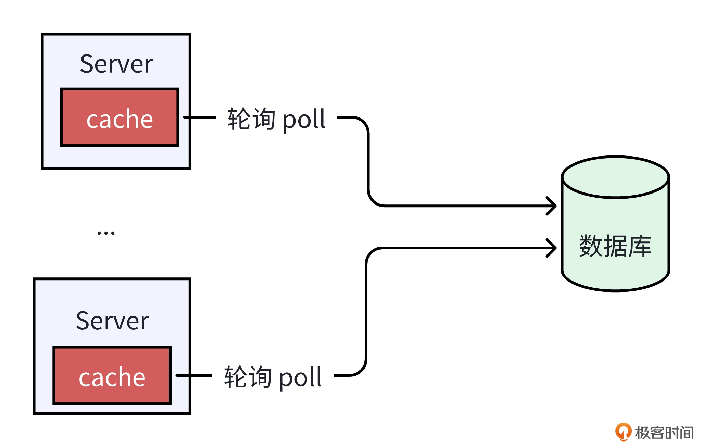
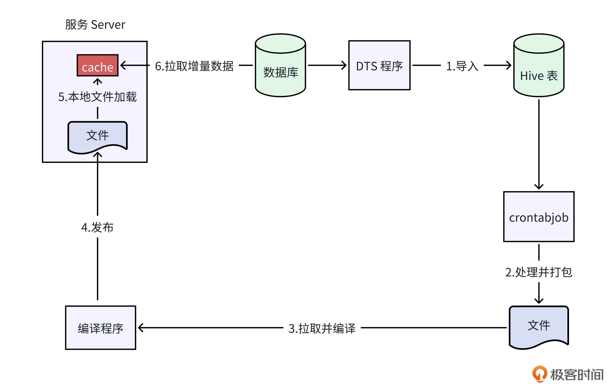
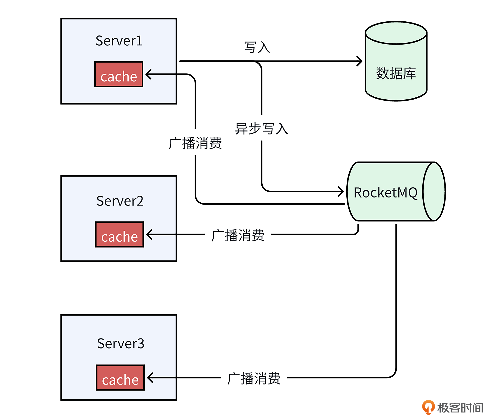
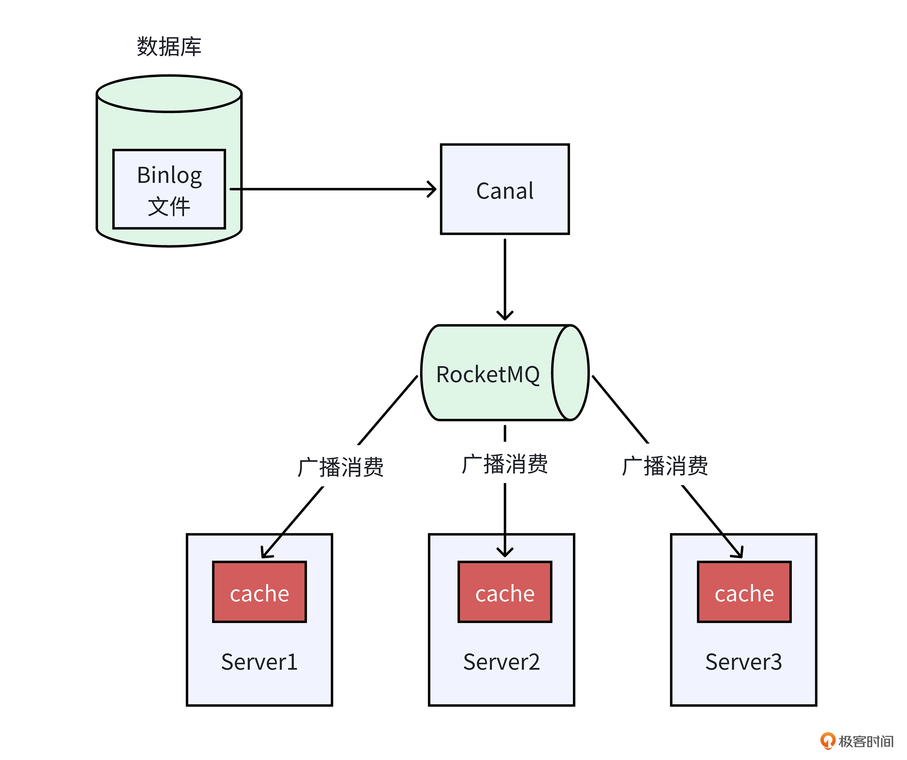
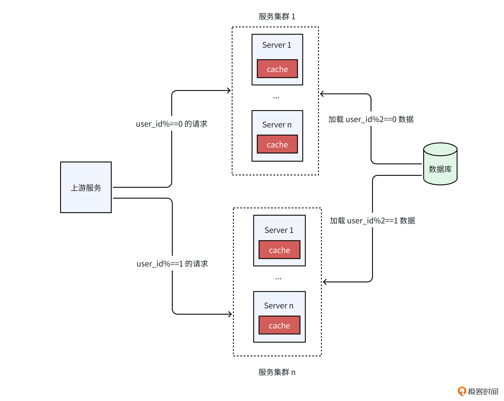

# 14 | 本地缓存：缓存存不下又不能回源怎么破？

你好，我是徐逸。

在前面两节课里，我们已经深入探讨了多种解决分布式缓存问题的策略。然而，在面对高并发、低延迟的场景，特别是在抖音、快手这类短视频应用的推荐与搜索功能场景，我们发现Redis 作为缓存解决方案存在一定的局限性。

这是因为 Redis 主要支持基本的 GET 操作，对于复杂的业务逻辑处理能力有限。为了达成个性化推荐的效果，单个请求通常都得从 Redis 中调取大量数据，然后在服务本地开展个性化的过滤与排序等工作。即便我们能够借助增加本地缓存来减少延时，可本地缓存从 Redis 回源的这个过程，还是会使响应时间变长，导致延时无法达到性能要求。

对于这类场景，我们更倾向于采用服务本地主动缓存全量数据的策略，由于服务所有实例缓存了全量数据，这一方式还天然规避了 Redis 的热 Key 和大 Key 问题。

今天我们就来聊聊，在本地缓存全量数据时，如何处理缓存加载、更新以及数据量过大的问题。

## 启动：如何解决加载慢的问题？

如果采用本地缓存全量数据的方案，那么当程序启动时，我们就需要加载所有数据。对于数据的加载，最简单的方法就是当程序启动时，轮询从数据库拉取所有数据，并写入本地缓存。



- 图1 轮询 poll 加载

对于数据量较小的场景，这种方法是可行的。然而，随着数据量的增加，这种从数据库拉取全量数据的方式，会导致程序的启动时间显著变长。一旦服务出现问题，很难快速完成发布与回滚操作。

为了优化启动性能，我们可以采用本地文件加载和数据库轮询加载相结合的策略。实现这个策略的流程如下图所示。



- 图2 本地文件加载

首先，我们可以用 Sqoop 等 DTS（数据传输服务）工具，以一天或者一小时为周期，将数据库中的数据导入 Hive 表。

接着，我们用一个定时任务，定时将 Hive 表的数据处理成我们需要的格式，并传到远程文件存储系统。

然后，在服务编译时，我们的编译脚本需要从远程存储拉取这些预处理的文件，并与程序的二进制文件一起打包，在发布时将它们部署到目标机器上。

最后，在服务启动时，我们的代码应当优先从本地文件加载数据，以便快速完成绝大部分数据的加载。不过，考虑到文件生成与发布之间存在时间差，数据库中可能已经产生了新增或修改的数据。因此，我们还需要根据文件中记录的最新时间戳，从数据库中轮询拉取这个时间戳之后的所有增量数据。这样一来，由于我们只从数据库中拉取这部分增量数据，避免了全量数据从数据库拉取，就能大幅缩短服务的启动时间。

## 更新：如何解决实时性和一致性问题？

了解了程序启动时本地缓存的加载问题，现在我们把目光转向另一个关键问题——当数据库里的数据完成更新后，我们怎样才能将这些更新同步到本地缓存里呢？

### 时间间隔轮询

就像下面的代码一样，我们可以在本地维持一个最新的时间戳记录。然后，以固定时间间隔轮询的方式，去拉取在这个时间戳之后，一定时间内数据库表中发生更改的记录，从而实现对本地缓存数据的更新，确保本地缓存与数据库数据的同步。

```go
var lastUpdateTime int64 // 最新一次从数据库里拉取数据的时间戳
func init(){
   //  启动全量加载数据并更新lastUpdateTime
   // 启动协程，后台轮询更新数据
   go func(){
       PollDBForData()
   }()
}
// 定时轮询从数据库拉数据
func PollDBForData() {
   // 轮询间隔时间（单位：秒），可按需调整
   interval := 5
   for {
       // 获取当前时间戳并减去interval秒，防止主从延迟
       now := time.Now()
       secondsAgo := now.Add(-interval * time.Second)
       // 准备查询语句，假设数据库表中有个名为'update_time'的时间戳列，按实际情况修改表名和列
       query := fmt.Sprintf("SELECT * FROM your_table WHERE update_time>%d and
       rows, err := db.Query(query)
       // 做数据处理
       lastUpdateTime=secondsAgo // 更新时间戳
       // 等待间隔时间
       time.Sleep(time.Duration(interval) * time.Second)
   }
}
```

当然，采用固定时间间隔的轮询机制，意味着数据库中的新增或修改操作需要经过一定的延迟才能反映到本地缓存中。这种延迟是由于轮询周期的限制，可能导致本地数据在一段时间内不是最新的。

### 广播触发更新

为了让数据更新能尽可能实时更新到本地缓存中，减少数据延迟对业务的影响，业界有一种基于广播机制触发本地缓存更新的策略。下面是两种实现这一策略的方法，供你参考。

首先，如下面的图所示，我们可以在数据写入数据库后，异步地将数据写到消息队列RocketMQ。由于RocketMQ 支持广播消费模式，这意味着同一条消息可以被服务端的每个实例所对应的消费者进程接收并处理。这样，每个服务实例都能够根据接收到的消息内容，及时地更新其本地缓存。通过这种机制，我们就能实现本地缓存数据的快速更新。



- 图3 RocketMQ 广播消费

然而，直接在数据库操作中集成 MQ 写入逻辑，虽然能够实现数据的实时更新，但这种做法会增加数据库操作代码的复杂性。而且，如果我们绕过服务接口直接对数据库进行操作，会导致本地缓存无法同步更新，需要重启服务来解决这一问题。

所以另一个方法就派上用场了，就像下面的图一样，与直接在数据库操作代码中耦合 MQ 的逻辑不同，我们可以利用像 Canal 这样的开源中间件，来达成数据同步目标。



- 图4 binlog 订阅模式

Canal 能模拟 MySQL 主从复制的交互协议，把自己伪装成一个 MySQL 的从节点，向 MySQL主节点发送数据转储（dump）请求。MySQL 收到这些请求后，就会开始向 Canal 推送Binlog。Canal 接收到 Binlog 字节流后，会解析这些日志并将其转换成易于读取的结构化数据，然后我们可以将这些数据写入 RocketMQ 中。

这种方法不仅减少了对现有数据库操作代码的侵入，还可以确保直接对数据库进行操作时，本地缓存与数据库变更能保持同步，而无需重启服务。

当然，使用 RocketMQ 广播消费的方式，虽然能够提升数据同步的实时性，但同时也可能面临数据丢失的风险，例如写入 RocketMQ 时失败或者 RocketMQ 本身出现故障。

为此我们需要建立一种保障机制。一种有效的方法是实施定期对账机制。具体来说，我们可综合考量数据一致性要求、服务负载状况以及数据库压力等因素，来设定一个合适的周期，每隔一段时间就从数据库中检索出在该周期内新增或修改的数据。

如果发现这些数据比本地缓存中的数据更新，我们就更新本地缓存，以确保本地缓存与数据库保持同步。通过这种周期性的对账和数据同步，我们就能够实现本地缓存与数据库之间的最终一致性。

## 分片集群：如何解决本地缓存过大问题？

然而，采用本地全量缓存的方式，由于单机内存规格是有限的，随着数据变多，单机内存可能存不下全量数据。这个时候，我们该怎么办呢？

我们可以借鉴数据库分库分表的设计思路，将数据按一定规则拆分成多份，并放入不同的服务集群中，上游服务根据规则将请求路由到相应的集群，这就是所谓的分片集群策略。

比如，就像下面的图一样，我们可以将服务拆分成两个集群，集群 1 加载 user_id 模 2 为 0 的数据，集群 2 加载 user_id 模 2 为 1 的数据。然后上游服务根据请求的 user_id，请求我们的不同集群。通过这种方式，我们能够有效减少单个服务实例所需加载的数据量。



- 图5 分片集群

当然，对于集群的分片规则，和前面第 11 节课讲的数据库分库分表规则一样，较为常用的同样是范围路由、hash 路由以及配置路由这三种类型，你可以根据自己的场景选择。

## 小结

今天的课程里，我们讨论了全量本地缓存数据所面临的几个挑战，并针对这些挑战提出了相应的解决策略。现在，让我们一起回顾下这些关键问题和解决方案。

首先要解决程序启动时的效率问题。对于数据量较小的情况，我们可以直接从数据库轮询获取数据。然而，面对大量数据时，这种方法会导致启动时间过长。为了加速程序启动，我们可以采用本地文件加载和数据库轮询加载相结合的策略。

之后是缓存更新的问题。对于那些对实时性要求不高的场景，我们可以设定一个时间间隔，定期从数据库轮询获取更新的数据。但是，如果业务需要更高的实时性，我们可以采用RocketMQ 广播消费的方式，以实现更快速的数据同步。

最后，我们讨论了数据量过大的问题。当本地缓存的数据量超出单机内存的承载能力时，我们可以采用分片集群的思想，将数据分散加载到不同的服务集群中，从而降低单机内存的负担。

希望你好好体会这些问题和解决方案。在未来遇到本地缓存问题时，不妨考虑运用这些方案来有效解决问题。

## 思考题

在实际应用中，面对本地缓存的这些挑战，你还有哪些解决方案呢？

欢迎你把你的答案分享在评论区，也欢迎你把这节课的内容分享给需要的朋友，我们下节课再见！
