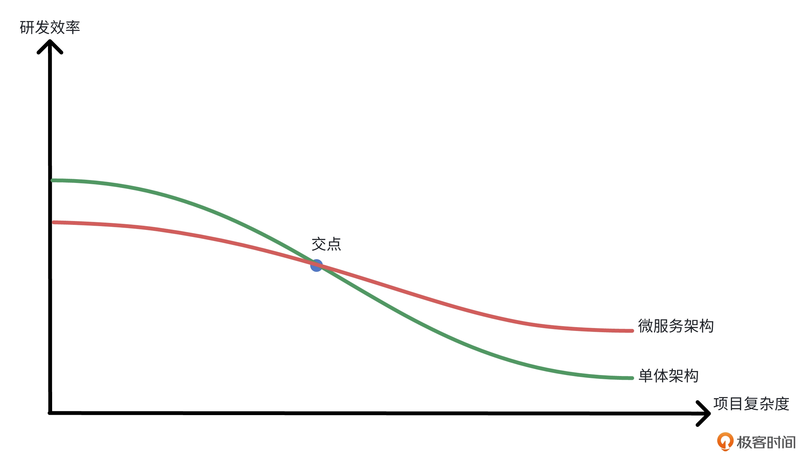
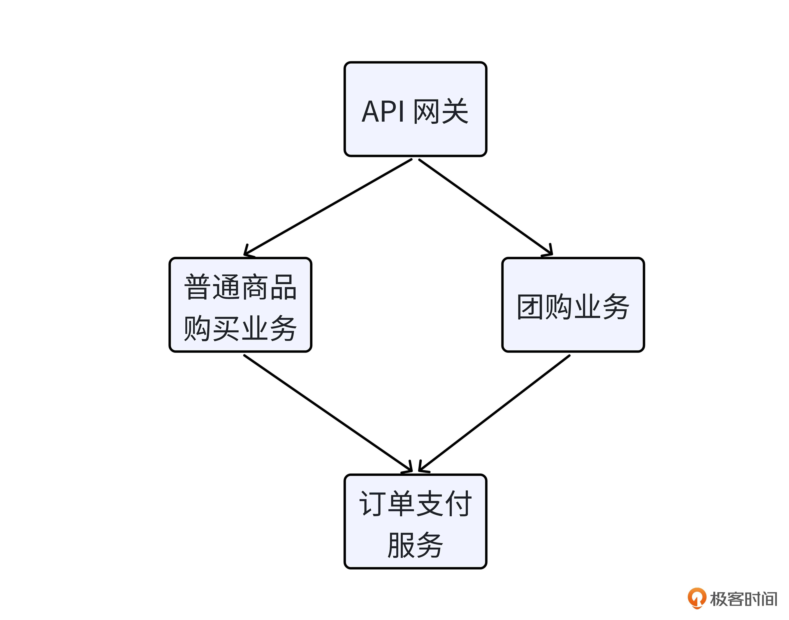
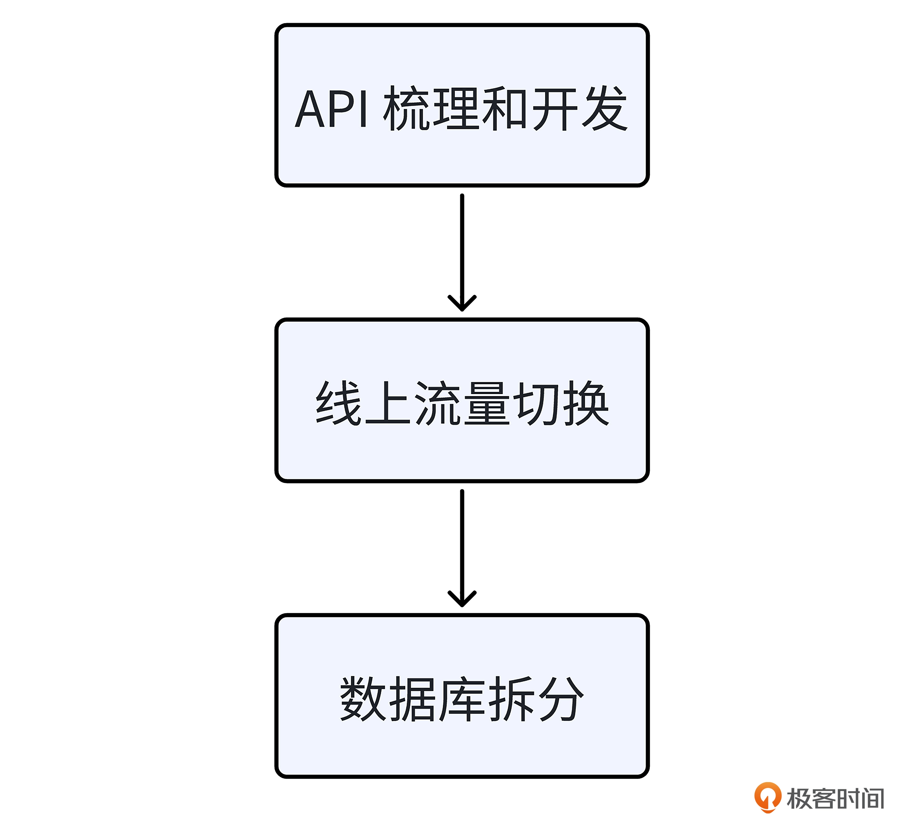
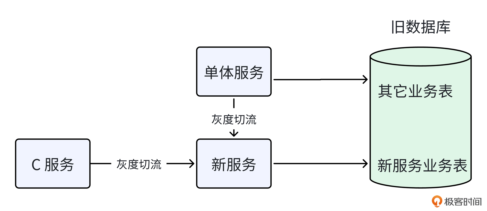
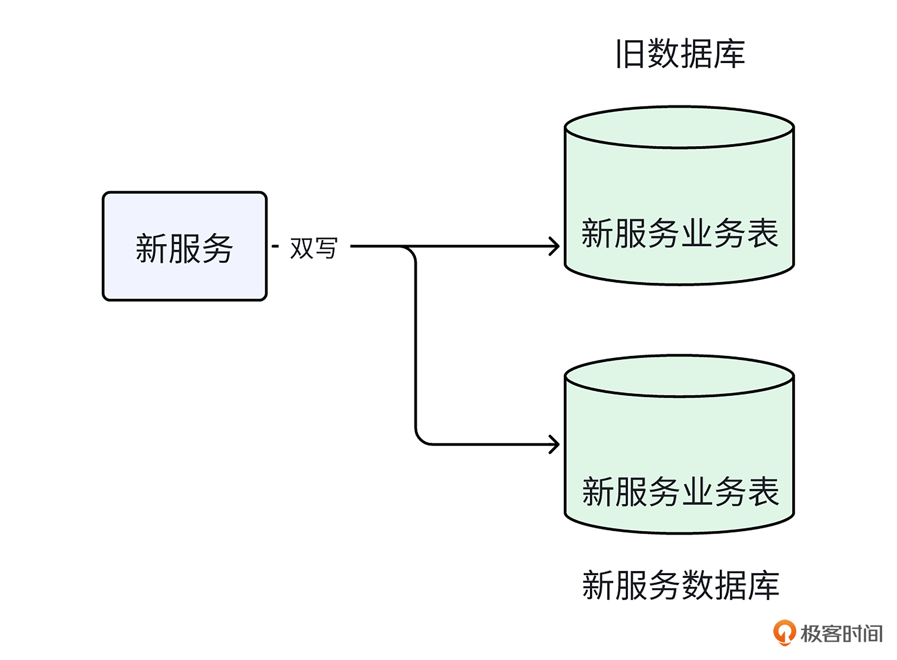
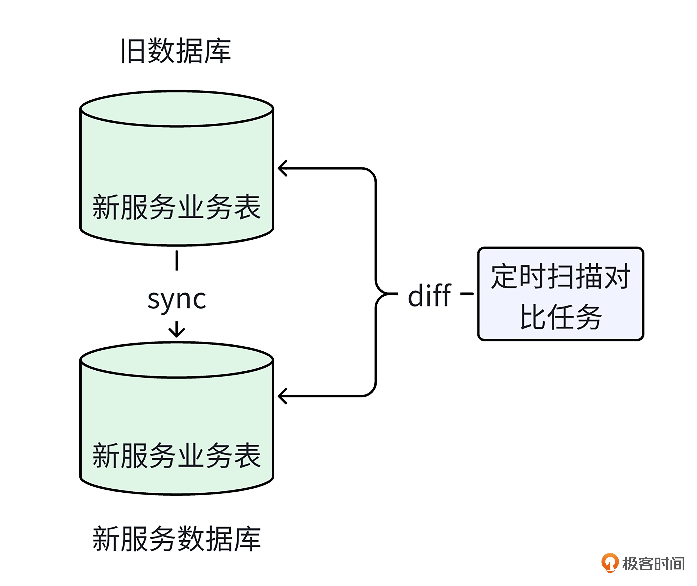
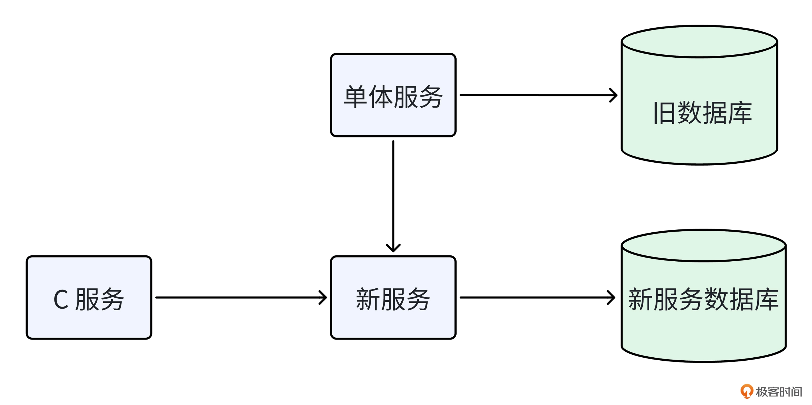
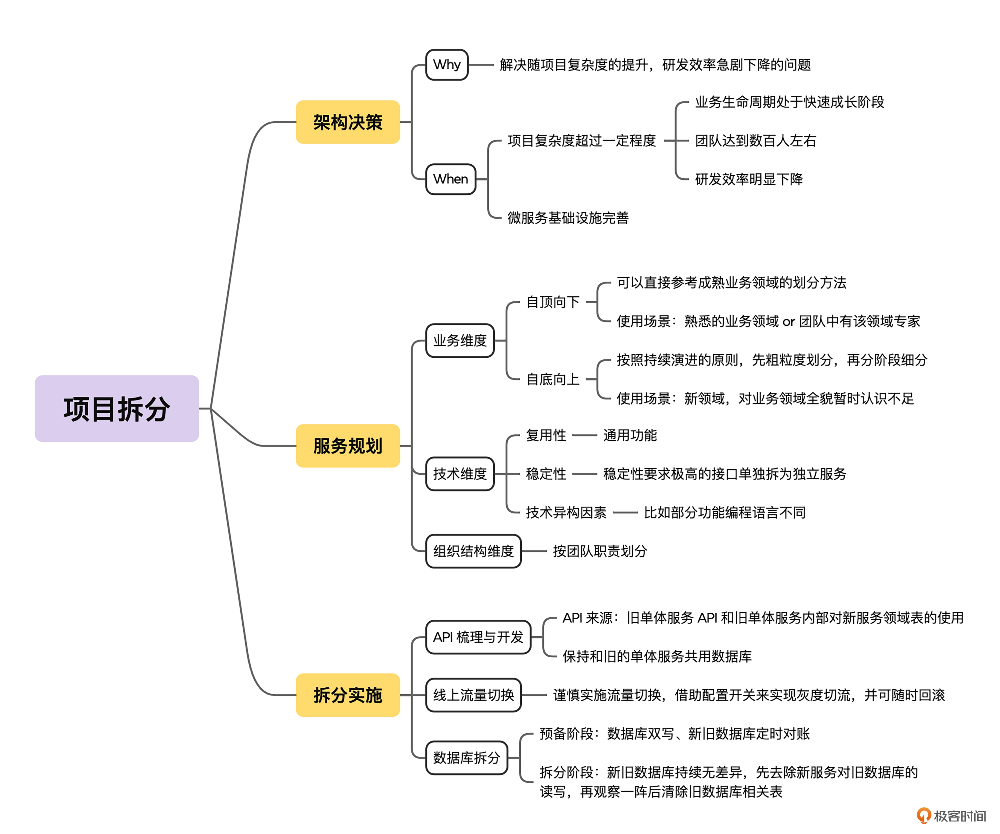

# 15 | 项目拆分：业务逻辑复杂，如何拆分服务让协作清晰有序？

你好，我是徐逸。

作为后台研发，在我们的日常工作中或多或少都接触过微服务架构。对于微服务架构，我们除了要熟悉常用的微服务技术栈之外，还有一个极为重要的部分，那就是如何进行微服务拆分。要知道，服务拆分决策与实施的过程，会直接对系统未来的迭代效率和可维护性产生重大影响。

所以，今天这节课，我们就来聊一聊，如何进行微服务拆分。首先，在着手微服务拆分之前，你需要思考一个问题，那就是你们的团队到底适不适合采用微服务架构呢？

## 架构决策：你们团队是否需要使用微服务？

要想清楚这个问题，我们可以从下面两个方面思考：

1. 微服务架构主要是为了解决什么问题，你的项目是否面临类似的问题呢？

2. 采样微服务架构需要哪些技术栈，你们公司是否具有实施微服务架构的技术条件呢？

微服务架构是为了解决随着项目复杂度的提升，研发效率急剧下降的问题。就像下面的图一样，当项目复杂度不高时，微服务架构因为需要额外的微服务管理成本，研发效率会比单体架构低。随着项目复杂度的升高，理解和迭代项目的成本越来越高，最终微服务架构的研发效率会超过单体架构。

- 图1 架构和研发效率关系图

因此，只要咱们的项目复杂度超过图中单体架构和微服务架构曲线交点时，就可以采取微服务架构。

那这个交点究竟该如何确定呢？

在实践中，并没有可以量化的指标可以指导我们找到这个交点。不过，我们可以依据研发过程中的一些现象，来大致预估是否处于这个交点附近。以下是一些常见的现象：

1. 从业务生命周期来讲。当业务模式经过市场验证，进入快速成长阶段，业务规模持续扩大时，便可以考虑引入微服务架构。

2. 从团队规模的角度看。通常情况下，当团队人数达到百人左右时，就需要思考微服务架构的适用性了。

3. 从研发效率层面分析。如果察觉到研发效率出现了较为明显的下降，比如开发一个需求所需的时间越来越长、代码合并时频繁出现冲突、线上不同模块之间频繁互相影响时，就应当予以关注。

那么，当项目复杂度很高时，我们是不是就可以立刻采用微服务架构呢？

答案是否定的。微服务架构的实施必须有微服务基础设施来支撑。比如说，当有大量微服务需要发布时，为了达成快速编译和高效部署的目标，流水线以及 Kubernetes 等相关技术的支持是不可或缺的。不仅如此，要确保微服务之间能够顺利地进行调用，像服务注册和发现这类基础设施同样是必不可少的。

所以，当我们决定是否采用微服务架构时，既要考虑项目复杂度是否适合微服务架构，也要考量公司的微服务基础设施是否完善齐全。

## 服务规划：哪些服务需要拆出来？

当决定了采用微服务架构，接下来我们需要考虑的是，在现在的单体应用中，哪些功能我们需要拆分出来作为单独的新服务呢？

咱们可以从业务、技术和组织结构三个维度进行考虑拆分微服务。

### 业务维度

按业务维度拆分，也就是将项目模块按业务领域进行拆分，将不同的业务领域，划分为不同的新项目。

对于业务领域的划分，可以采用自顶向下和自底向上两种方式。

如果我们对某个业务领域极为熟悉，或者团队中有该领域的专家，那么就可以采用自顶向下的方式。这种方式可以直接参考成熟业务领域的划分方法。例如在电商领域，我们能够依据领域经验，直接将其划分为商品域、交易域、营销域等。

如果我们面对的是一个新领域，对业务领域全貌暂时认识不足时，则可以采用自底向上的方式。按照持续演进的原则，首先对业务进行粗粒度的拆分，把项目中较大的功能模块直接分离出来，然后分阶段继续进行拆分。

### 技术维度

当我们按照业务维度进行拆分后，大部分场景下，我们还需要加入其它维度进一步拆分，才能最终解决单体架构带来的问题。

我们这就来看看常见的三种维度。

基于复用性拆分

在不同的业务或者服务中，重复功能是较为常见的现象。比如鉴权、限流、安全这类功能几乎在每个服务中都存在。对于这些通用功能，我们可以将其拆分出来，构建成独立的服务，这就是微服务架构中的 API 网关。

- 图2 复用性拆分

再比如电商平台，其中包含普通商品购买业务和团购业务。在这两种业务模式下，订单支付环节的功能具有高度相似性。鉴于此，我们可以把订单支付功能独立出来，使其成为一个通用服务，从而更好地为上层业务提供支持。

基于稳定性来进行拆分

对于稳定性要求极高的接口，我们要避免其他功能频繁迭代或承受较大性能压力时，对其产生影响。因此可以将这些接口单独拆分出来，成为独立的服务。

就像我曾经负责的下单前校验接口，这个接口本身是很少需要迭代的。然而，在其他功能不断迭代发布的过程中，这个核心功能接口受到了影响，导致部分用户无法下单。于是，后来我就把这个下单前校验接口单独拆分出来，将它变成了一个微服务。

基于技术异构因素拆分

当部分功能使用现有语言进行开发的成本过高时，我们可以换用另一种语言开发，并将其构建成一个微服务，再通过 RPC 进行调用。

例如，在使用 Golang 开发时，对于算法功能的线上部署，由于算法原本都是用 python 实现的，这种情况下，就可能会构建一个异构的 python 算法服务。

### 组织结构维度

除了业务维度和技术维度，组织结构的调整同样会促使我们重新拆分服务。倘若同一个服务由不同的团队负责，那么大概率需要依据新的团队职责来拆分服务。否则，不同团队对同一服务进行迭代，就会造成代码管理混乱，各团队的修改可能会相互冲突。

## 拆分实施：如何平滑拆分出新服务？

当我们确定了要把哪些功能拆分成新服务后，接下来需要思考的问题是，怎样才能毫无风险、平滑地将流量调用从旧服务过渡到新服务呢？

我以典型的拆分出包含数据库的新服务为例，将服务拆分实施过程中的要点归纳为关键的 3步。就像下面的图一样，它们分别是 API 梳理和开发、线上流量切换和数据库拆分。

- 图3 服务拆分步骤

首先，在前期的服务规划中，我们已经确定了要拆分出来的服务的职责和功能，不过这些只是粗粒度层面的内容。因此，在 API 梳理与开发环节，我们必须清晰地界定新服务对外提供的API，并在新服务中实现。

这些 API 有两个来源：

- 一个是旧的单体服务直接对外提供的，属于新服务职责的 API。

- 另一个是单体服务原先直接使用了属于新服务职责的表，这部分需要抽象出一些功能，作为新服务的 API。

同时，我们需要注意，当实现新服务的时候，先保持和旧的单体服务共用数据库。

接着，在进行线上流量切换时，正如下面的图一样，我们需要谨慎实施流量切换，借助配置开关来实现灰度切流，并可随时回滚。

所谓灰度切流，就是一种逐步将部分用户流量引导至新服务的策略。在这个过程中，不是一次性将所有流量都切换到新服务，而是按照一定比例或特定规则，先让一小部分流量进入新服务进行验证。这样一来，如果新服务在运行过程中出现问题，我们能够马上关闭配置开关，使流量迅速回滚到原服务，从而最大程度降低对用户体验和业务的影响。

- 图4 服务流量切换

完成线上流量切换后，我们就进入了数据库拆分阶段。在这个阶段，我们必须在确保新数据库数据准确无误的前提条件下开展切换工作，那么我们要怎样确保这一点呢？

基于实践经验，我总结出了一套数据库拆分流程：

首先，就像下面的图一样，为了确保新增和修改的增量数据在新旧数据库中不存在差异，新服务需要在生产环境下进行数据库双写，为后续拆分数据库做好准备。

- 图5 数据库双写

接着，为了保障新旧数据库数据的一致性，我们需要进行历史存量数据同步和新旧数据库定时对账。

- 图6 定时对账

最后，当确认新旧数据库持续不存在差异时，我们便可以进入数据库拆分环节，这个环节可以去除新服务对旧数据库的读写操作。经过一段时间的观察后，再将旧数据库中的相关表清理掉，完成数据库拆分。

- 图7 数据库拆分

## 小结

今天这节课的内容就到此为止了。在这节课中，我们学习了微服务拆分的方法，也掌握了微服务拆分每一步的关键要点。现在，让我们来回顾一下微服务拆分的流程。

首先，要进行架构决策，确定是否有必要采用微服务架构。在做这个决策时，一方面要考虑项目的复杂程度是否适合微服务架构，另一方面要考量公司的微服务基础设施是否完善。

其次，要开展服务规划，明确需要拆分出哪些服务。在进行服务拆分时，可以从业务、技术和组织结构这三个维度入手。

最后，在拆分过程中，要确保整个过程是平稳且没有风险的。

现在你已经了解了服务拆分的流程，以后在进行服务拆分时不妨尝试一下，相信这能帮助你更高效、更出色地完成微服务拆分工作。

## 思考题

在进行服务拆分的时候，咱们要遵循哪些常见的原则呢？

欢迎你把你的答案分享在评论区，也欢迎你把这节课的内容分享给需要的朋友，我们下节课再见！
