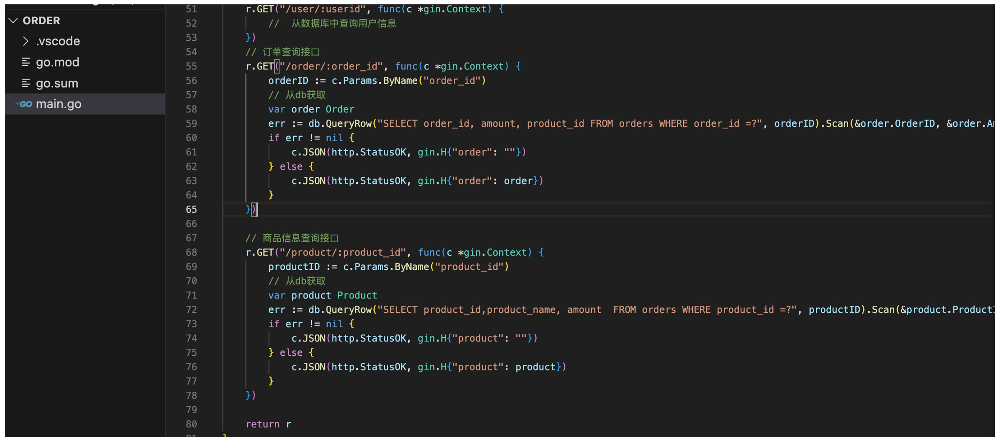
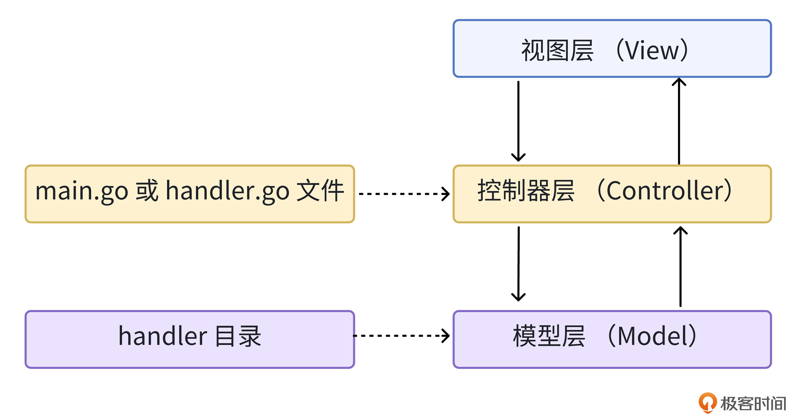
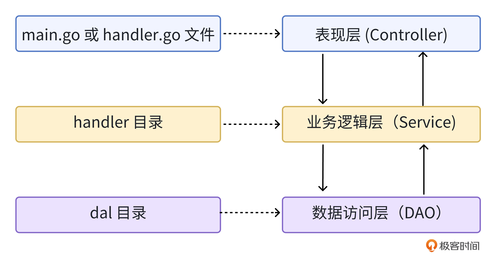
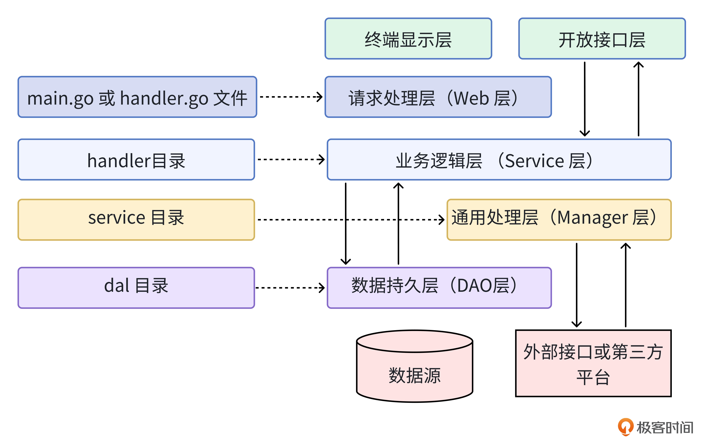

# 16 | 目录规范：几万行的大文件，如何重构目录结构？

你好，我是徐逸。

上节课我们学习了如何拆分项目，不过对于复杂系统来说，即便拆分了项目，每个子项目里的文件庞大且复杂，管理和维护都非常困难。这时候我们就需要学会如何抽丝剥茧，为这样的文件建立一个合理的目录结构。

今天我就用分层架构的思想，带你将一个包含订单、商品、用户业务逻辑，有好几万行代码的大文件，一步步重构成一个合理的项目目录结构。



- 图1 逻辑复杂的大文件 main.go

假如现在产品提了个需求，在获取用户订单的时候，需要将订单涉及的商品信息一起返回给前端展示。

为了找到修改点，我们需要从几万行代码的大文件里面，找到获取订单逻辑。这是一个效率非常低的事。我们要么从 main.go 文件的开头，一行行浏览代码，找到获取订单逻辑。要么通过order 关键词进行搜索。但对于有几万行代码的文件来说，可能会搜索出来大量的 order 关键词，需要一个个去辨别。

有什么方法能快速定位到订单获取业务逻辑呢？

## 三层目录结构：数据访问逻辑复用

我们可以把接口里面的业务逻辑从 main.go 文件拆出来，并把业务逻辑按业务功能归类到一个个文件里，比如下面的 order_handler.go、product_handler.go 文件。再将这些文件放到handler 目录中。

```
.
├── go.mod
├── go.sum
├── handler
│   ├── init.go
│   ├── order_handler.go // 订单逻辑
│   ├── product_handler.go // 商品逻辑
│   └── user_handler.go // 用户逻辑
└── main.go
```

这样 main.go 中的接口就变成了简单的取参和路由操作。

```go
// 订单获取接口
r.GET("/order/:order_id", func(c *gin.Context) {
   orderID := c.Params.ByName("order_id")
   // 调用handler目录里面的业务逻辑
   order, err := handler.GetOrder(c, orderID)
   if err != nil {
       c.JSON(http.StatusOK, gin.H{"order": ""})
   } else {
       c.JSON(http.StatusOK, gin.H{"order": order})
   }
})
// 商品信息获取接口
r.GET("/product/:product_id", func(c *gin.Context) {
   productID := c.Params.ByName("product_id")
   // 调用handler目录里面的业务逻辑
   product, err := handler.GetProduct(c, productID)
   if err != nil {
       c.JSON(http.StatusOK, gin.H{"product": ""})
   } else {
       c.JSON(http.StatusOK, gin.H{"product": product})
   }
})
```

业务逻辑由 handler 目录下对应的 handler 文件来实现。

```go
// order_handler.go文件
type Order struct {
 OrderID   string  `json:"order_id"`
 Amount    float64 `json:"amount"`     // 订单金额
 ProductID string  `json:"product_id"` // 商品id
}
// GetOrder 获取订单信息
func GetOrder(ctx context.Context, orderID string) (*Order, error) {
 // 从db获取
 var order Order
 err := db.QueryRow("SELECT order_id, amount, product_id FROM orders WHERE order
 if err != nil {
   return nil, err
 }
 return &order, nil
}
```

重构之后，当我们查找获取订单信息的实现逻辑时，只用去 handler 目录里面的order_handler.go 文件去找，而不用关心其它业务功能，效率会高很多。

实际上，我们现在的目录结构，就是传统 MVC 三层架构的变种。



- 图2 目录和 MVC 架构对应关系

- View 层。用于存放 html、js 等前端页面。由于我们这个项目是前后端分离项目，所以没有View 层目录。

- Controller 层。用于接收前端请求，并调用 Model 层。相当于我们这个项目中的 main.go文件，有些项目会把所有请求的路由放在一个 handler.go 文件。

- Model 层。用于具体的业务逻辑处理以及从 db 等外部存储读取数据。相当于我们这里的handler 目录。

回到我们的产品需求，要在订单获取的业务逻辑里，从商品表查询信息，并和订单信息一起返回给前端展示。

假如我们将从商品表查询商品信息的代码，复制到获取订单逻辑里，就会存在代码重复，后续维护变得很麻烦。比如当我们的商品表数据量太大，需要分表查询时，就需要同时修改获取订单和获取商品信息的业务逻辑。

有什么办法可以避免获取订单和获取商品里的逻辑重复呢？

我们可以将从商品表查询商品信息的逻辑下沉，抽象出一个数据访问层，专门负责数据库等外部存储交互以及所有表的增删改查。获取订单和商品的业务逻辑，都可以调用数据访问层的商品查询函数。这样就可以把从商品表里查询商品的逻辑，统一封装在一个地方，避免查询同一张表的逻辑重复。

重构后的目录是后面这样。

```
.
├── dal
│   ├── init.go
│   ├── order.go
│   └── product.go
├── go.mod
├── go.sum
├── handler
│   ├── order_handler.go
│   ├── product_handler.go
│   └── user_handler.go
└── main.go
```

后面是 order_handler.go 文件中的获取订单逻辑，可以看到现在是从 dal 层获取订单信息和商品信息。

```go
// handler/order_handler.go文件中的GetOrder 获取订单信息
func GetOrder(ctx context.Context, orderID string) (*dal.Order, *dal.Product, err
   order, err := dal.GetOrder(ctx, orderID)
   if err != nil {
       return order, nil, nil
   }
   // 从dal层查商品信息
   var product *dal.Product
   if order != nil {
       product, err = dal.GetProduct(ctx, order.ProductID)
   }
   return order, product, err
}
```

实际上，这是经典的后端三层架构的思想。



- 图3 目录和后端三层架构对应关系

- Controller 层。用于接收前端请求，并调用 Service 层。相当于我们这个项目中的 main.go文件。

- Service 层。负责具体的业务逻辑处理，调用 DAO 层，不直接读写数据库。相当于我们这里的 handler 目录。

- DAO 层。负责 MySQL、Redis 等数据库的增删改查。相当于我们这里的 dal 目录。

实践中，为了方便多层之间的数据传输，还会建一个 model 目录，用于存放层与层之间交互的结构体定义。同时，model 目录也会存放和数据库表一一对应的数据实体定义。

而且，在 dal 目录里，会根据组件的不同新建不同的子目录。

```
.
├── dal
│   ├── mysql
│   │   ├── init.go
│   │   ├── order.go
│   │   └── product.go
│   └── redis
├── go.mod
├── go.sum
├── handler
│   ├── order_handler.go
│   ├── product_handler.go
│   └── user_handler.go
├── main.go
└── model // 用于存放层与层之间的数据传输结构体定义和数据库表实体定义
   ├── order.go
   └── product.go
```

假如现在因为商品表读性能问题，我们需要给商品信息加个 redis 缓存逻辑。当我们在handler 目录里的业务逻辑，根据商品 id 读取商品信息时，对应的读写缓存逻辑是后面这样。

1. 根据商品 id 读 Redis，如果 Redis 中不存在商品信息，则读 db。

2. 从 db 中读出商品信息后，写 Redis 进行缓存。

由于 order_handler.go 和 product_handler.go 文件中都有读商品信息逻辑，如果我们把这段缓存读写逻辑，放在 handler 目录里实现，就会出现和抽象出 dal 目录之前一样的问题——代码逻辑重复，后续维护麻烦难题。

这段缓存读写逻辑放在哪合适呢？这时候四层目录结构就派上用场了。

## 四层目录结构：业务逻辑复用

我们可以抽象一层，将商品信息缓存读写的逻辑，放在一个 service 目录，而 item_handler.go和 product_handler.go 文件读商品信息时，都调用 service。

```
.
├── dal
│   ├── mysql
│   │   ├── init.go
│   │   ├── order.go
│   │   └── product.go
│   └── redis
│       ├── init.go
│       └── product.go
├── go.mod
├── go.sum
├── handler
│   ├── order_handler.go
│   ├── product_handler.go
│   └── user_handler.go
├── main.go
├── model
│   ├── order.go
│   └── product.go
└── service
   └── product_service.go
```

product_service.go 文件，封装了商品读写缓存逻辑。

```go
// GetProduct 获取商品信息
func GetProduct(ctx context.Context, productID string) (*model.Product, error) {
   product, err := redis.GetProduct(ctx, productID)
   if err != nil {
       return nil, err
   }
   if product != nil {
       return product, nil
   }
   product, err = mysql.GetProduct(ctx, productID)
   if err != nil {
       return nil, err
   }
   redis.SetProduct(ctx, product)
   return product, nil
}
```

order_handler.go 和 product_handler.go 都从 service 层读取商品信息。

```go
// order_handler.go
// GetOrder 获取订单信息
func GetOrder(ctx context.Context, orderID string) (*model.Order, *model.Product,
   order, err := mysql.GetOrder(ctx, orderID)
   if err != nil {
       return order, nil, nil
   }
   var product *model.Product
   if order != nil {
       // 从service层读商品信息
       product, err = service.GetProduct(ctx, order.ProductID)
   }
   return order, product, err
}
// product_handler.go文件
// GetProduct 获取商品信息
func GetProduct(ctx context.Context, productID string) (*model.Product, error) {
   // 从service层读商品信息
   return service.GetProduct(ctx, productID)
}
```

其实，这是借鉴阿里 4 层架构思想构建的目录结构。



- 图4 目录和阿里四层架构的对应关系

- 请求处理层。用于接收前端请求，做简单的参数校验和路由，调用 service 层。相当于我们这个项目中的 main.go 文件。

- 业务逻辑层。负责具体的业务逻辑，可以对 Manager 层和 DAO 层的能力进行编排。相当于我们这里的 handler 目录。

- 通用处理层。主要有两个功能：1. 将原先 Service 层的通用业务逻辑下沉到这一层 2. 封装第三方接口调用。相当于我们的 service 目录。

- 数据持久层。与底层 MySQL、Redis 等数据库交互。相当于我们这里的 dal 目录。

现在的项目目录结构，对于一个项目，只有一个应用程序的情况，基本够用了。但在一个项目，存在多个应用程序时，也就是一个项目有多个 main.go 文件时，又该怎么组织呢？

## Go 社区目录结构：多应用程序代码复用

对于单项目多应用程序，Go 社区有个推荐的项目目录结构 project-layout。我们可以参考这个，重新组织我们的目录。

- cmd 目录，用于存放我们多个应用程序的 main.go 文件。

- internal，用于存放不能被其它项目使用的包。

- internal 子目录 pkg，用于存放可以被多个应用程序代码使用的包。

- internal 子目录 order_server，用于存放 order_server 应用程序可以使用的包。

```
.
├── cmd
│   ├── order_consumer
│   │   └── main.go // 订单消费者应用程序
│   └── order_server
│       └── main.go  // 订单商品服务应用程序
├── go.mod
├── go.sum
└── internal // 本项目私有包，不能被外部项目使用
   ├── order_server // 订单商品服务私有包
   │   └── handler
   │       ├── order_handler.go
   │       ├── product_handler.go
   │       └── user_handler.go
   └── pkg  // 本项目，多应用程序公有包
       ├── dal
       │   ├── mysql
       │   │   ├── init.go
       │   │   ├── order.go
       │   │   └── product.go
       │   └── redis
       │       ├── init.go
       │       └── product.go
       ├── model
       │   ├── order.go
       │   └── product.go
       └── service
           └── product_service.go
```

## 小结

今天这节课的内容就到这里了，我带你从一个几万行的大文件，一步步重构出了一个规范的项目目录结构。现在我们回顾一下重构的思路。

首先，我们用传统 MVC 三层架构，新建 handler 目录，将业务逻辑从 main.go 文件进行了分离，以便能快速定位到我们的业务逻辑。

接着，为了能实现表操作的逻辑复用，我们借鉴后端三层架构的思想，构建出 dal 目录。将对MySQL、Redis 等数据库的访问逻辑都封装在里面，从而实现了数据访问的逻辑复用。

然后， 为了能实现业务逻辑的复用，我们借鉴了阿里四层架构的思想，构建了 service 目录，将 handler 目录里面的通用业务逻辑下沉到 service 目录。handler 负责对 dal 和 service 里面的能力进行编排。

最后，为了能在一个项目中承载多个应用程序，实现代码复用。我们借鉴 Go 社区项目目录结构 project-layout，构建了一个支持多应用程序的项目目录结构。

项目目录结构代码我放在 GitHub 上了，希望通过这部分内容的学习，你能够构建一个属于自己的项目目录结构。

## 课后练习

请你模仿这节课里的重构过程，重构下你感觉可维护性差的项目目录。

欢迎你在留言区和我交流讨论，也欢迎你把这节课的内容分享给需要的朋友，我们下节课再见！
