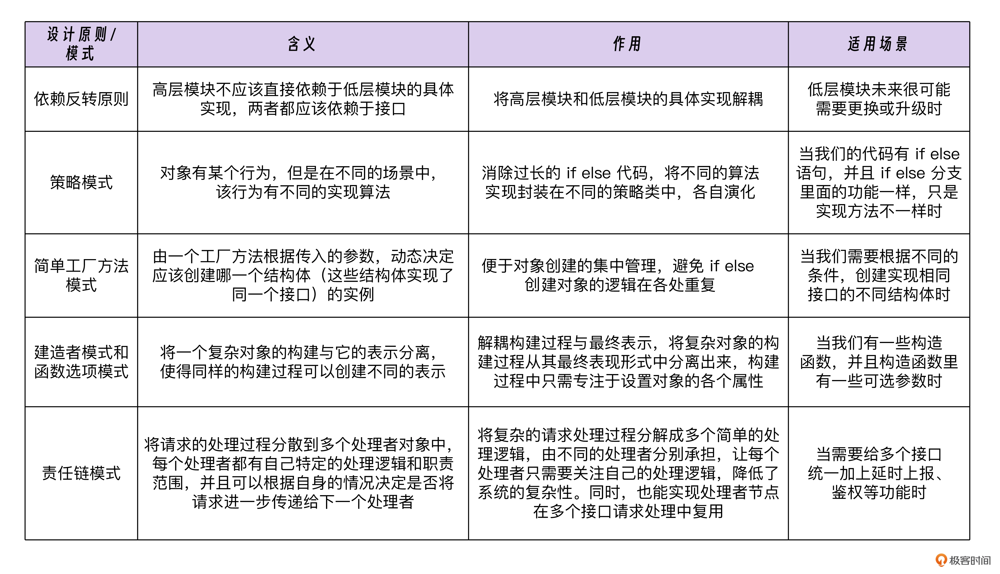

# 17 | 设计原则和模式：功能持续迭代，如何减少改动？

你好，我是徐逸。

上节课我们学习了如何构建一个规范的目录，不过对于一个快速迭代的项目，即便有了清晰的目录结构，但如果写代码不讲究一定的方法，后续修改和扩展也会非常困难。针对写代码过程中面临的一些场景，业界早就总结归纳出了一些通用解决方案，而这些场景和对应的解决方案，正是我们所熟知的设计原则和设计模式。

今天我就以一个个需求的形式，带你体会在做需求的过程中，代码设计原则和设计模式是如何在 Golang 项目中应用的。

在上节课的案例中，我们的商品 service 有个 GetProduct 方法，用于从 Redis 缓存读商品信息。

```go
// product_service.go
// GetProduct 获取商品信息
func GetProduct(ctx context.Context, productID string) (*model.Product, error) {
   product, err := redis.GetProduct(ctx, productID)
   if err != nil {
       return nil, err
   }
   if product != nil {
       return product, nil
   }
   product, err = mysql.GetProduct(ctx, productID)
   if err != nil {
       return nil, err
   }
   redis.SetProduct(ctx, product)
   return product, nil
}
```

现在我们在本地写个单元测试，验证各种情况下这个 GetProduct 方法是否正确。

```go
// product_service_test.go
func TestGetProduct(t *testing.T) {
   ctx := context.TODO()
   productID := "1"
   product, _ := GetProduct(ctx, productID)
   assert.Equal(t, productID, product.ProductID, "The two id should be the same.
}
```

为了验证 Redis 和 MySQL 里面分别有值的情况下，我们的 GetProduct 方法返回是否正常，我们要么改 dal 目录里的代码，写死方法的返回值用于测试，要么往测试环境 Redis 和MySQL 里造数据。

然而，这两个方法都不太理想。改 dal 目录里代码的方式，很容易就忘了改回去导致线上Bug。往测试环境 Redis 和 MySQL 造数据的方式，由于测试环境不稳定，又很难保证我们单测结果的稳定性。

## 依赖反转原则

那有没有不用改 dal 层代码，也不用往 Redis 和 MySQL 造数据，还可以在测试文件模拟外部依赖返回，方便测试我们 service 层逻辑的方法呢？

我们可以用 Golang 接口和依赖反转原则来实现 mock 外部依赖的能力。所谓依赖反转，是指高层模块不应该直接依赖于低层模块的具体实现，两者都应该依赖于接口。这样当低层模块需要更换或升级时，只要新的模块仍然满足高层模块所依赖的接口，就不会影响高层模块的正常运行。

举个例子，下面代码中 service 层获取商品信息的 GetProduct 方法，就是因为直接依赖了Redis 和 MySQL 目录里面的实现函数，所以才导致无法在测试文件里面替换 GetProduct 方法对 Redis 和 MySQL 的调用，实现 mock 外部依赖能力。

```go
// product_service.go
// GetProduct 获取商品信息
func GetProduct(ctx context.Context, productID string) (*model.Product, error) {
   product, err := redis.GetProduct(ctx, productID)
   if err != nil {
       return nil, err
   }
   if product != nil {
       return product, nil
   }
   product, err = mysql.GetProduct(ctx, productID)
   if err != nil {
       return nil, err
   }
   redis.SetProduct(ctx, product)
   return product, nil
}
```

现在让我们用 Golang 接口和依赖反转原则，重构一下代码，实现 mock 外部依赖的能力。

首先，重构一下 dal 层读写 Redis 的函数，定义一个 Product 接口和 ProductImpl 结构体。接口里面定义了读写 Redis 的方法，ProductImpl 结构体实现了这个接口。

```go
// redis/product.go
type Product interface {
   GetProduct(ctx context.Context, productID string) (*model.Product, error)
   SetProduct(ctx context.Context, product *model.Product) error
}
// redis/product.go
// 商品结构体，实现了读写redis
type ProductImpl struct {
}
// redis目录product.go文件
// GetProduct 获取商品信息
func (impl *ProductImpl) GetProduct(ctx context.Context, productID string) (*mode
   // 从 Redis 中获取商品信息
   productKey := fmt.Sprintf("product:%s", productID)
   result, err := client.Get(productKey).Result()
   if err == redis.Nil {
       return nil, nil
   } else if err != nil {
       return nil, err
   }
   // 假设商品信息在缓存中是以 JSON 格式存储的
   var product model.Product
   err = json.Unmarshal([]byte(result), &product)
   if err != nil {
       return nil, err
   }
   return &product, nil
}
func (impl *ProductImpl) SetProduct(ctx context.Context, product *model.Product)
   return nil
}
```

接着，我们按同样的方式，重构读 MySQL 的逻辑，在 MySQL 目录里定义一个 Product 接口和 ProductImpl 结构体，ProductImpl 结构体实现了 Product 接口，用于从 MySQL 读取商品信息。

```go
// mysql目录product.go文件
type Product interface {
   GetProduct(ctx context.Context, productID string) (*model.Product, error)
}
type ProductImpl struct {
}
// GetProduct 获取商品信息
func (impl *ProductImpl) GetProduct(ctx context.Context, productID string) (*mode
   var product model.Product
   err := db.QueryRow("SELECT product_id,product_name, amount  FROM orders WHERE
   if err != nil {
       return nil, err
   }
   return &product, nil
}
```

然后，我们把 service 层，读商品信息的 GetProduct 方法重构一下。定义 ProductService 接口和结构体 ProductServiceImpl，ProductServiceImpl 实现了 ProductService 接口。这里请你留意一下 ProductServiceImpl 结构体内部的成员变量，并不直接依赖 dal 层里面的结构体，而是依赖 dal 层的接口。

```go
type ProductService interface {
   GetProduct(ctx context.Context, productID string) (*model.Product, error)
}
type ProductServiceImpl struct {
   cache redis.Product // 接口类型
   db    mysql.Product // 接口类型
}
// GetProduct 获取商品信息
func (impl *ProductServiceImpl) GetProduct(ctx context.Context, productID string)
   product, err := impl.cache.GetProduct(ctx, productID)
   if err != nil {
       return nil, err
   }
   if product != nil {
       return product, nil
   }
   product, err = impl.db.GetProduct(ctx, productID)
   if err != nil {
       return nil, err
   }
   impl.cache.SetProduct(ctx, product)
   return product, nil
}
```

最后，对于 ProductServiceImpl 结构体里面的成员变量，我们通过 NewProductService 方法注入。

```go
func NewProductService(cacheProduct redis.Product, dbProduct mysql.Product) Produ
   return &ProductServiceImpl{cache: cacheProduct, db: dbProduct}
}
```

重构之后，我们的 service 层就不直接依赖 dal 层的实现，而是依赖 dal 层的接口，而且接口的实现通过 NewProductService 方法注入，符合依赖反转原则。

现在让我们看一下，代码重构之后，在单测时怎么 mock 外部依赖返回呢？

```go
func TestGetProduct(t *testing.T) {
   ctx := context.TODO()
   // 注入mock结构体
   impl := NewProductService(&MockProductCache{}, &MockProductDB{})
   productID := "1"
   product, _ := impl.GetProduct(ctx, productID)
   assert.Equal(t, productID, product.ProductID, "The two id should be the same.
}
// mock 商品读写redis
type MockProductCache struct {
}
func (cache *MockProductCache) GetProduct(ctx context.Context, productID string)
   return &model.Product{ProductID: productID}, nil
}
func (cache *MockProductCache) SetProduct(ctx context.Context, product *model.Pro
   return nil
}
// mock商品从db读
type MockProductDB struct {
}
func (db *MockProductDB) GetProduct(ctx context.Context, productID string) (*mode
   return nil, nil
}
```

就像上面这段代码一样，我们可以直接在测试文件实现 dal 层的接口，比如MockProductCache 和 MockProductDB 结构体，并通过 NewProductService 方法注入service 层。

## 策略模式和简单工厂方法

学完了依赖反转原则，现在让我们来看看 Golang 项目中常用的设计模式。

上节课的案例中，我们 handler 层有个获取商品信息的方法，它是调用 service 层的一个从Redis 读商品信息的方法实现的。

```go
// product_handler.go
// GetProduct 获取商品信息
func GetProduct(ctx context.Context, productID string) (*model.Product, error) {
   // 从service层读商品信息
   serviceImpl := service.NewProductService(&redis.ProductImpl{}, &mysql.Product
   return serviceImpl.GetProduct(ctx, productID)
}
```

对于某些对商品信息的准确性要求非常高的场景，比如电商的下单页等，需要根据商品价格计算订单金额。毕竟商品价格不对，那算出来的支付金额也会不准。而 Redis 由于是缓存，和DB 存在短期的一致性问题，因此对于这些场景，必须直接从 DB 获取数据。

为了实现这个需求，我们就要对 handler 层获取商品信息的方法进行改造，在代码里增加 ifelse 分支逻辑，由前端传入的参数来决定是从 DB 和还是 Redis 获取数据。

```go
// product_handler.go 文件
// GetProduct 获取商品信息
func GetProduct(ctx context.Context, productID string, scene int) (*model.Product
   if scene == 1 {
       // 直接读db
       impl := &mysql.ProductImpl{}
       return impl.GetProduct(ctx, productID)
   } else {
       // 缓存读写逻辑
       impl := service.NewProductService(&redis.ProductImpl{}, &mysql.ProductImp
       return impl.GetProduct(ctx, productID)
   }
}
```

假如除了 GetProduct 方法需要上面这段 if else 的代码逻辑，来判断是走 DB 还是缓存，在handle 层其它地方也需要这段判断逻辑。我们该怎么避免代码重复呢？

我们可以用策略模式和简单工厂方法模式来解决这个问题。

先复习一下策略模式，策略模式指对象有某个行为，但是在不同的场景中，该行为有不同的实现算法。就比如我们这里的 GetProduct 方法，它有从外部获取商品信息的行为，且会根据scene 参数的不同，选择两种策略，从 DB 或是缓存查商品信息。策略模式有两个重要的组成角色，一个是抽象的策略接口，一个是实现这个接口的策略类。

那怎么应用策略模式重构 service 层呢？我们还是结合例子来看，下面是我用策略模式重构后的代码。

```go
// 重新定义一个直接从db读的service并实现接口ProductService。
// service/product_service.go
// 查询商品信息的策略接口
type ProductService interface {
   GetProduct(ctx context.Context, productID string) (*model.Product, error)
}
// 从DB读的策略类
type ProductServiceDBImpl struct {
   db mysql.Product
}
func NewProductDBService(dbProduct mysql.Product) ProductService {
   return &ProductServiceDBImpl{db: dbProduct}
}
// GetProduct 获取商品信息
func (impl *ProductServiceDBImpl) GetProduct(ctx context.Context, productID strin
   return impl.db.GetProduct(ctx, productID)
}
// 从缓存读的策略类
type ProductCacheServiceImpl struct {
   cache redis.Product // 接口类型
   db    mysql.Product // 接口类型
}
func NewProductCacheService(cacheProduct redis.Product, dbProduct mysql.Product)
   return &ProductServiceImpl{cache: cacheProduct, db: dbProduct}
}
// GetProduct 获取商品信息
func (impl *ProductServiceImpl) GetProduct(ctx context.Context, productID string)
   // 从缓存读
}
```

这段代码定义了一个 ProductService 策略接口和两个实现接口的策略类ProductServiceDBImpl、ProductServiceCacheImpl 结构体，由策略类分别实现从 DB 和缓存读的逻辑。

改为策略模式后，handler 层的代码变成了下面的样子，不再依赖 dal 层和 service 层两个接口，而是统一依赖 ProductService 策略接口，并且代码也比之前简洁了很多，if else 里面只负责策略类型构造，调用底层获取商品信息的动作放在了 if else 逻辑外面。

```go
// product_handler.go 文件
// GetProduct 获取商品信息
func GetProduct(ctx context.Context, productID string, scene int) (*model.Product
   var impl service.ProductService
   if scene == 1 {
       // 直接读db
       impl = service.NewProductDBService(&mysql.ProductImpl{})
   } else {
       // 缓存读写逻辑
       impl = service.NewProductCacheService(&redis.ProductImpl{}, &mysql.Produc
   }
   return impl.GetProduct(ctx, productID)
}
```

虽然这段代码依然没解决我们的 if else 逻辑在各个 handler 重复的问题，但是让不同的结构体类型实现相同的接口，是我们应用简单工厂模式解决问题的基础。

简单工厂方法模式的实质是由一个工厂方法根据传入的参数，动态决定应该创建哪一个结构体（这些结构体实现了同一个接口）的实例。

下面是我用简单工厂方法对 handler 重构后的代码。

```go
//handler/product_handler.go文件
// GetProduct 获取商品信息
func GetProduct(ctx context.Context, productID string, scene int) (*model.Product
   // 调用简单工厂方法创建对象
   impl := service.NewProductService(scene)
   return impl.GetProduct(ctx, productID)
}
// service/product_service.go
// 简单工厂方法，根据传入参数创建同类对象
func NewProductService(scene int) ProductService {
   var impl ProductService
   if scene == 1 {
       // 直接读db
       impl = NewProductDBService(&mysql.ProductImpl{})
   } else {
       // 缓存读写逻辑
       impl = NewProductCacheService(&redis.ProductImpl{}, &mysql.ProductImpl{})
   }
   return impl
}
```

这段代码将分散在各个 handler 里，用 if else 创建策略对象的逻辑，下沉到 service 层的简单工厂方法 NewProductService。这个方法根据传入的 scene 参数，决定创建哪个具体的策略对象返回。

经过我们用策略模式和简单工厂方法模式重构，现在的代码已经解决了 if else 代码逻辑在handler 层多个地方重复的问题。未来再加更多的策略类，也只需要修改创建策略类的简单工厂方法。

## 建造者模式

讲完策略模式和简单工厂方法模式，让我们看个在设计 Golang SDK 时常用的模式，也就是建造者模式和它的变种函数选项模式。

下面是我的 Golang SDK 里一段拉取远程配置的代码。它有一个 Config 结构体和一个从远程拉取配置的函数 FetchConfigByKey。结构体由有一个必填参数的 NewConfig 函数构造。

```go
// 远程配置类
type Config struct {
   apiKey string // 鉴权key
   client *http.Client
}
func NewConfig(apiKey string) *Config {
   client := &http.Client{}
   config := &Config{apiKey: apiKey, client: client}
   return config
}
// FetchConfigByKey 从远程拉取配置
func (c *Config) FetchConfigByKey(key string) (string, error) {
   url := fmt.Sprintf("http://example.com/config?apiKey=%s&key=%s", c.apiKey, ke
   resp, err := c.client.Get(url)
   if err != nil {
       return "", err
   }
   defer resp.Body.Close()
   body, err := io.ReadAll(resp.Body)
   if err != nil {
       return "", err
   }
   return string(body), nil
}
```

那问题来了，假如未来我们需要在这个 NewConfig 函数里加很多不同类型的可选参数（比如超时时间、请求下游的集群），以便让使用我们 SDK 的人，可以更灵活地控制FetchConfigByKey 函数的行为。那么该如何设计才能实现这个目的呢？

这时我们就可以借鉴建造者模式实现。建造者模式也叫 Builder 模式，它的作用是将一个复杂对象的构建与它的表示分离，使得同样的构建过程可以创建不同的表示。建造者模式有两个核心角色，一个是建造者，一个是建造者创建的对象。

建造者模式的概念可能有点抽象，让我用建造者模式重构一下代码，帮你看清楚概念和实践的对应关系。

下面代码里的 ConfigBuilder 就是建造者模式中的建造者角色，它由 NewConfigBuilder 构造函数构建，构造函数里只有必填参数。对于可选参数，它提供了一些设置属性的方法，我们可以调用这些方法即可设置属性，等设置完属性之后，通过再调用 ConfigBuilder 的 Build 方法构建 Config 对象。

```go
// ConfigBuilder结构体用于构建Config类
type ConfigBuilder struct {
   apiKey  string // 鉴权key
   client  *http.Client
   timeout int
   cluster string
}
// NewConfigBuilder创建一个新的ConfigBuilder实例
func NewConfigBuilder(apiKey string) *ConfigBuilder {
   return &ConfigBuilder{
       apiKey:  apiKey,
       client:  &http.Client{},
       timeout: 60,
       cluster: "default",
   }
}
// 设置超时时间
func (cfb *ConfigBuilder) SetTimeout(timeout int) *ConfigBuilder {
   cfb.timeout = timeout
   return cfb
}
// SetCluster设置请求的下游集群
func (cfb *ConfigBuilder) SetCluster(cluster string) *ConfigBuilder {
   cfb.cluster = cluster
   return cfb
}
// Build构建Config实例
func (cfb *ConfigBuilder) Build() (*Config, error) {
   return &Config{
       apiKey:  cfb.apiKey,
       client:  cfb.client,
       timeout: cfb.timeout,
       cluster: cfb.cluster,
   }, nil
}
```

下面是 ConfigBuilder 构建的 Config 对象，Config 对象就是建造者模式中的复杂对象。

```
// Config结构体用于从远程拉取配置
type Config struct {
   apiKey  string // 鉴权key
   client  *http.Client
   timeout int
   cluster string
}
// FetchConfig执行从远程按key拉取配置的操作
func (c *Config) FetchConfigByKey(key string) (string, error) {
   return "", nil
}
```

用建造者模式重新实现从远程拉取配置的功能后，ConfigBuilder 可以扩展更多的可选参数，不会导致构造函数参数越来越长，也不会导致已经使用我们 SDK 的地方报错。

实际上，在 Golang 项目中用得比较多的是 Builder 模式的一种变种，函数选项模式。相比Builder 模式，函数选项模式的代码结构更加简洁。它不需要定义专门的 Builder 结构体和大量的设置方法，而是通过定义函数选项类型和对应的函数选项函数，直接在创建实例时通过传递函数选项来设置属性。

我们这就用函数选项模式实现一段代码，其功能和上面建造者模式的例子相同。它定义了一个Option 函数选项类型和 With 开头的一系列函数选项函数，直接在 NewConfig 构造函数里根据传入的函数选项来设置属性，构造 Config 对象。

```go
// Config结构体用于从远程HTTP拉取配置
type Config struct {
   apiKey  string // 鉴权key
   client  *http.Client
   timeout int
   cluster string
}
// Option是函数选项类型，用于设置Config的属性
type Option func(*Config)
// WithTimeout函数选项用于设置超时时间
func WithTimeout(timeout int) Option {
   return func(cf *Config) {
       cf.timeout = timeout
   }
}
// WithCluster函数选项用于设置调用集群
func WithCluster(cluster string) Option {
   return func(cf *Config) {
       cf.cluster = cluster
   }
}
// NewConfig创建一个新的Config实例，并根据传入的函数选项进行设置
func NewConfig(apiKey string, opts ...Option) (*Config, error) {
   cf := &Config{
       apiKey:  apiKey,
       client:  &http.Client{},
       timeout: 60,
       cluster: "default",
   }
   for _, opt := range opts {
       opt(cf)
   }
   return cf, nil
}
// FetchConfig执行从远程HTTP按指定参数拉取配置的操作
func (c *Config) FetchConfigByKey(key string) (string, error) {
   return "", nil
}
```

## 责任链模式

除了建造者模式，在 Golang 项目中，还有个由框架封装的我们经常会与它打交道的设计模式——责任链模式。

假如我们有个 Handler 方法，是对 HTTP 请求进行处理的业务逻辑代码。

```go
// 定义实际的业务逻辑处理函数
func Handler(w http.ResponseWriter,r *http.Request) {
   // 业务逻辑处理
}
```

现在我们想给 Handler 加个接口响应时间统计功能，你可以直接在 Handler 方法内部加上这段逻辑。

```go
// 定义实际的业务逻辑处理函数
func Handler(w http.ResponseWriter,r *http.Request) {
   // 记录请求开始时间
   start := time.Now()
   defer func() { // 计算响应时间
       elapsed := time.Since(start) // 打印响应时间
       log.Printf("响应时间: %v\n", elapsed)
   }()
   fmt.Fprintf(w, "Hello, World!")
}
```

那假如我们想给 HTTP 服务的所有接口加上响应时间统计功能呢？如果继续把这段逻辑放在接口的实现逻辑里，我们需要把这段代码复制到各个业务处理函数，会造成大量的代码重复。而且，后续如果需要给所有接口加上鉴权等更多功能，所有的接口实现函数又得改一遍。怎么才能避免这种情况呢？

我们可以用责任链模式实现给所有接口加上统一的处理逻辑。责任链模式允许你将请求沿着处理者链进行发送。收到请求后，每个处理者均可对请求进行处理，或将其传递给链上的下个处理者。

下面的代码我定义了耗时统计函数 CostMiddleware 和鉴权函数 AuthMiddleware，它们接收请求处理函数类型的参数 next，并且返回了一个新的请求处理函数。这个新的请求处理函数的内部实现是，在调用 next 函数之前，先执行耗时统计和鉴权的逻辑。封装返回的请求处理函数就是责任链中的处理者节点。

```go
// 定义一个函数类型，用于表示中间件函数
type Middleware func(http.HandlerFunc) http.HandlerFunc
// 接口耗时记录中间件
func CostMiddleware(next http.HandlerFunc) http.HandlerFunc {
   return func(w http.ResponseWriter, r *http.Request) {
       start := time.Now()
       defer func() { // 计算响应时间
           elapsed := time.Since(start) // 打印响应时间
           log.Printf("响应时间: %v\n", elapsed)
       }()
       next(w, r)
   }
}
// 权限验证中间件
func AuthMiddleware(next http.HandlerFunc) http.HandlerFunc {
   return func(w http.ResponseWriter, r *http.Request) {
       // 这里简单模拟权限验证，假设只有特定的用户可以访问
       if r.Header.Get("Authorization") != "valid_token" {
           http.Error(w, "权限不足", http.StatusUnauthorized)
           return
       }
       next(w, r)
   }
}
// 定义实际的业务逻辑处理函数
func Handler(w http.ResponseWriter, r *http.Request) {
   fmt.Fprintf(w, "Hello, World!")
}
```

实现责任链中的处理者节点后，我用了 ApplyMiddleware 方法，将传入的业务逻辑处理函数和耗时统计函数、鉴权函数构造成责任链，并将责任链作为 http 请求的处理函数，就能给所有接口加上耗时统计和权限验证功能。

```go
// 应用中间件到处理函数的函数
func ApplyMiddleware(middlewares []Middleware, handler http.HandlerFunc) http.Han
   for _, middleware := range middlewares {
       handler = middleware(handler)
   }
   return handler
}
func main() {
   // 创建一个HTTP服务器
   http.HandleFunc("/", ApplyMiddleware(
       []Middleware{CostMiddleware, AuthMiddleware},
       Handler,
   ))
   // 启动服务器并监听端口
   log.Fatal(http.ListenAndServe(":8080", nil))
}
```

## 小结

今天这节课的内容里，我们一共学习了 1 个设计原则和 4 个设计模式，并带你用这些设计原则和模式解决了一个个编码的扩展性问题。现在让我们来回顾一下这些原则和模式的含义与用法。



希望你好好体会这些设计原则和设计模式的应用。在下次遇到编码问题时，别忘了尝试运用这些设计模式，让你的代码更好扩展、更好维护。

## 思考题

除了这节课介绍的 4 种设计模式，你在 Go 项目中还用到了哪些设计模式呢？

欢迎你把你的答案分享在评论区，也欢迎你把这节课的内容分享给需要的朋友，我们下节课再见！
