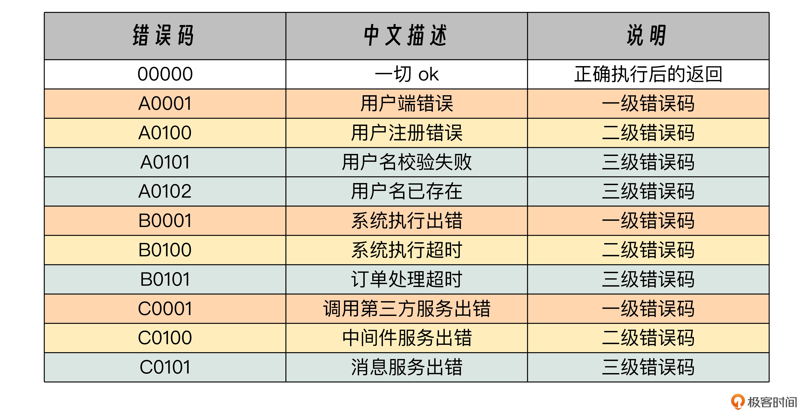

# 20 | 日志和错误码：如何快速定位线上问题？

你好，我是徐逸。

通过上节课的学习，相信你已经掌握了 Go 代码中潜藏的四类陷阱。然而，除了编写健壮的代码来预防线上问题之外。当出现线上问题时，能够快速定位和修复问题同样至关重要。而日志和错误码，是我们快速定位线上问题的得力工具。可以说，日志记录的质量高低以及错误码设置的合理与否，直接影响着我们面对问题时的定位效率。

因此，今天这节课，我们就来聊聊怎样合理地打印日志和设置错误码，才能帮助我们更快的定位问题。

## 日志最佳实践

为了能通过日志更高效地定位问题，我们在进行日志打印时，重点需要考虑下面三个问题。

1. 首先是日志的位置。我们需要确定在代码的哪些关键位置打印日志，从而确保当问题发生时，我们能够有足够的信息来定位问题。

2. 其次是日志的等级。我们需要决定在不同情况下应该记录哪种级别的日志，以便在问题发生时能够快速识别问题的严重性。

3. 最后是日志的内容。我们必须考虑日志中应该包含哪些具体内容，以确保日志信息的完整性和有用性，从而帮助我们高效地诊断和解决问题。

### 日志位置：我们该在哪些地方打印日志？

为了能借助日志快速定位问题，日志打印要适度，既不能过多也不能太少。日志过多不仅会淹没关键信息，而且过多的日志打印与收集，会大量占用磁盘、网络等硬件资源，对服务性能造成不良影响；反之，如果日志过少，一旦出现问题，由于缺乏足够的信息，会导致我们难以靠日志定位问题根源，增加故障排查和修复的难度。

要做到适度，我们只需要在程序的一些关键节点打印日志。通常，下面这几个地方就是服务中打印日志的关键节点。

首先是服务启动阶段，我们需要打印系统的配置参数和数据库等组件初始化状态，以便确保系统是按照期望启动的。

其次是请求处理环节，我们需要记录参数、关键步骤的中间结果，除此之外，就像下面的代码，我们还需要在程序的分支逻辑中记录执行路径。这样当出现问题时，就能帮助我们快速进入特定分支流程排查，提高问题定位效率。

```go
func processUser(ctx,user) {
   if user.Age >= 18 {
       logs.CtxInfo(ctx，"执行成年用户相关逻辑，用户年龄为 %d，已成年", user.Age)
       // 这里可以添加成年用户相关逻辑代码
   } else {
       logs.CtxInfo(ctx，"执行未成年用户相关逻辑，用户年龄为 %d，未成年", user.Age)
       // 这里可以添加未成年用户相关逻辑代码
   }
}
```

然后是外部交互部分，当我们与第三方服务进行通信时，记录发送和接收的数据日志十分必要。一旦出现问题，这些请求和返回日志不仅能帮助我们判断发出的请求以及下游给出的返回是否符合预期，还能帮助我们定位调用失败的原因。

接着是定期执行的后台任务，对于这类任务，记录它开始和结束时间以及任务运行过程的具体情况，有助于我们掌握后台任务的运行状态。

最后是异常处理环节，当服务运行出现偏离预期的情况时，我们必须及时打印错误详情日志，为后续的问题排查留存关键线索。

当然，在明确了在哪些关键节点打印日志后，为了避免打印过多日志，我们还需要注意下面几个要点。

首先，要避免重复打印日志。例如，下面的代码中错误日志被重复打印了两次，实际上我们只需要在错误处理的顶层记录一次即可。

```go
// 不推荐的做法
func process(ctx) error{
   err : = json.Unmarshal(data, &task)
   if err != nil {
     logs.CtxError(ctx, "unmarshal error, err=%v", err) // 第1次错误处理
     return err
   }
}
// 推荐的做法
func process(ctx) error{
   err : = json.Unmarshal(data, &task)
   if err != nil {
     return err
   }
}
func main() {
   err := process(ctx)
   if err != nil {
       logs.CtxError(ctx, "process task error:", err) // 第2次错误处理
   }
}
```

其次，要注意合并相关日志。对于能够整合在一行日志里的内容，我们不应该分散在多条日志里输出。比如就像下面的代码，我们不应该将请求和响应的相关信息分散在多条日志里，这样会使得日志的关联性降低，难以直观地将请求与响应对应起来。

```go
// 不推荐的做法
func handle(ctx,req,rsp) {
   logs.CtxInfo(ctx,"request: %+v", req)
   // 请求处理，给rsp赋值
   ...
   logs.CtxInfo(ctx,"response: %+v", rsp)
}
// 推荐的做法
func handle(ctx,req,rsp) {
    defer func() {
       // 将请求和响应日志合并在同一行打印
       logs.CtxInfo(ctx, "request: %+v, response: %+v", req, rsp)
   }()
   // 请求处理，给rsp赋值
   ...
}
```

### 日志等级：我们该打印什么等级的日志？

当确定要记录日志后，为了提升问题排查的效率，我们需要根据日志的重要程度，打印不同等级的日志。

除调试阶段会使用 DEBUG 日志外，线上环境我们一般记录下面三种级别的日志。

首先是 ERROR 级别，这是最高级别的日志，表示系统遇到了错误，导致部分功能无法正常执行，例如程序启动失败、接口调用超时等错误。这类错误通常需要立即关注和处理，以确保系统能够恢复到正常运行状态。

对于 ERROR 级别的日志，我们通常会设置告警机制，因此必须谨慎使用，避免滥用。如果错误地将所有问题都标记为 ERROR 级别，将会产生大量的告警噪音，这不仅会分散我们的注意力，还可能导致我们忽视那些真正重要的问题。

其次是 WARN 级别，这个级别的日志用于记录那些需要引起注意，但不会立即影响系统运行的问题。这些问题包括请求参数错误、非核心组件初始化失败、后端服务出现错误但最终重试成功等。

最后是 INFO 级别，这个级别的日志用来记录系统正常运行过程中的关键信息，包括程序的启动、关闭、配置变更等重要事件。

### 日志规范：我们的日志应该包含哪些内容？

一旦确定了要打印的日志等级，接下来我们必须思考的是，所打印的日志需要包含哪些内容。

除了时间、机器 IP、串联日志的请求 ID 这些通常由日志框架自动打印的标准字段之外，研发人员需要特别关注的是日志消息字段。一个优质的日志消息字段应该精确地记录足以反映当前事件的关键信息，主要包含下面这些内容。

- 首先是事件描述，清晰简洁地说明发生了什么事件，例如 “user login attempt”（用户尝试登录）。

- 接着是事件状态，用于表明事件处于何种状态，例如 “success（成功）”、“failed（失败）”“in progress（进行中）”等。

- 然后是触发原因，对于 WARN 和 ERROR 级别的日志，我们应该明确导致这个事件状态异常的关键原因，例如 “due to invalid password”（由于密码错误）。

- 之后是关键上下文信息，提供与事件紧密相关的信息，可以帮助我们更好的排查问题。例如在数据库操作相关日志中，记录操作的表名、SQL 语句。

- 最后是函数调用堆栈信息，对于 ERROR 级别的日志，我们应该打印包含完整的函数调用堆栈信息，以便能准确确定错误发生的代码位置。

为了让你有更直观的感知，下面列举了不同等级日志的示例，可供参考。

```
2024 - 01 - 01 12:34:56.789 [192.168.1.100] [req - 123456] INFO - user login atte
2024 - 01 - 01 12:35:00.123 [192.168.1.100] [req - 123457] WARN - user login atte
2024 - 01 - 01 12:35:10.567 [192.168.1.100] [req - 123458] ERROR - file upload fa
Stack trace:
github.com/your - project/pkg/upload.(*Uploader).Upload
       /path/to/your - project/pkg/upload/uploader.go:256
github.com/your - project/cmd/app.main
       /path/to/your - project/cmd/app/main.go:46
```

需要注意的是，在 Go 语言中，当我们像下面代码这样直接打印 error 信息时，函数调用堆栈信息并不会被打印出来。

```go
func ReadFile(path string) ([]byte, error) {
   f, err := os.Open(path)
   if err != nil {
       return nil, err
   }
   defer f.Close()
   buf, err := io.ReadAll(f)
   if err != nil {
       return nil, err
   }
   return buf, nil
}
func main() {
   filePath := "config.xml"
   _, err := ReadFile(filePath)
   if err != nil {
       log.Printf("read file failed, file_path:%s, due to %+v\n", filePath, err)
   }
}
// 输出
killianxu@KILLIANXU-MB0 20 % go run main.go
read file failed, file_path:config.xml, due to open config.xml: no such file or d
```

为了解决这个问题，我们可以使用第三方 error 库，例如 errors 库。就像下面代码展示的一样，通过 errors 库，我们就可以打印出函数调用栈，定位到出错的代码行。

```go
import (
   "github.com/pkg/errors"
)
func ReadFile(path string) ([]byte, error) {
   f, err := os.Open(path)
   if err != nil {
       //return nil, err
       return nil, errors.Wrap(err, "open failed")
   }
   defer f.Close()
   buf, err := io.ReadAll(f)
   if err != nil {
       //return nil, err
       return nil, errors.Wrap(err, "read failed")
   }
   return buf, nil
}
// 输出
killianxu@KILLIANXU-MB0 20 % go run main.go
read file failed, file_path:config.xml, due to open config.xml: no such file or d
open failed
main.ReadFile
       /usr/local/go/src/server-go/20/main.go:15
main.main
       /usr/local/go/src/server-go/20/main.go:28
runtime.main
       /usr/local/go/src/runtime/proc.go:272
runtime.goexit
       /usr/local/go/src/runtime/asm_amd64.s:1700
```

## 错误码规范

除了打印日志之外，就像下面的示例一样，当程序出错时，我们的接口会返回包含数字或字母的错误码，这些错误码用来标识服务运行过程中遇到的特定错误。此外，通常我们还会针对这些错误码配置相应的告警。

```json
{
   "code": "A0102",
   "message": "user_name already exists",
   "data": {
   }
}
```

虽然业界没有统一的错误码规范标准，但我们在设计时必须确保它们能够快速溯源并实现沟通标准化。具体来说，这体现在下面两个方面。

一方面，通过错误码，我们能够迅速识别错误的来源，从而快速判断责任归属。例如，使用C0210 错误码表示调用下游某个 RPC 服务调用超时。当我们的接口返回这个错误码时，尽管我们无法立即知道具体超时原因，但我们可以迅速确定问题出在某个服务的 RPC 调用超时上，从而明确排查的方向。

另一方面，错误码有助于团队成员快速对错误原因达成共识。通过一套标准化的错误码体系，团队成员可以迅速理解错误的性质，无需额外的沟通成本。

在构建错误码体系时，我们可以借鉴阿里成熟的错误码规范。阿里的错误码采用字符串格式，固定为 5 位长度，由“错误产生来源”和“错误编号”两大部分组成，构建了一个三级错误码体系。

其中，错误来源用 1 位字母，表示一级错误。字母 A 表示错误来源于用户，比如参数错误，用户安装版本过低等问题；B 表示错误来源于当前系统，往往是业务逻辑出错，或程序健壮性差等问题；C 表示错误来源于第三方服务，比如 RPC 调用超时等问题。

至于错误编号，它的取值范围从 0001 到 9999。前两位代表二级错误，后两位代表三级错误。

以 C0101 这个错误码为例，字母“C”作为一级错误码，表示错误源自第三方服务调用；前两位数字“01”作为二级错误码，表示中间件层面的错误；最后两位数字“01”则指具体的三级错误码，表示消息服务出错。

下面是阿里的部分错误码，供你参考。



## 小结

今天这节课，我们一同探讨了为实现问题的快速定位，在日志打印与错误码设计方面应当遵循的关键要点。现在，让我们一起回顾一下这节课的核心知识点。

首先，关于日志打印，我们要把握适度原则。太多日志会导致信息过载，干扰问题排查；太少日志会导致关键信息缺失，增加定位难度。

其次，我们要根据日志的重要程度选择合适的日志等级，对 ERROR 级别日志要谨慎使用，避免产生过多的告警噪音，影响对真正问题的关注。

接着，我们要在日志消息字段精确地记录足以反映当前事件的关键信息，以提高问题排查的效率。

最后，在设计错误码时，我们可以借鉴阿里成熟的错误码规范，确保错误码能够快速溯源并实现沟通标准化。

现在，你已经掌握了日志打印和错误码设计的关键要点，相信这些知识未来能帮助你更快地定位问题。

## 思考题

除了今天讲到的内容，在日志打印与错误码规范方面，你还知道哪些需要注意的地方呢？

欢迎你把你的答案分享在评论区，也欢迎你把这节课的内容分享给需要的朋友，我们下节课再见！
