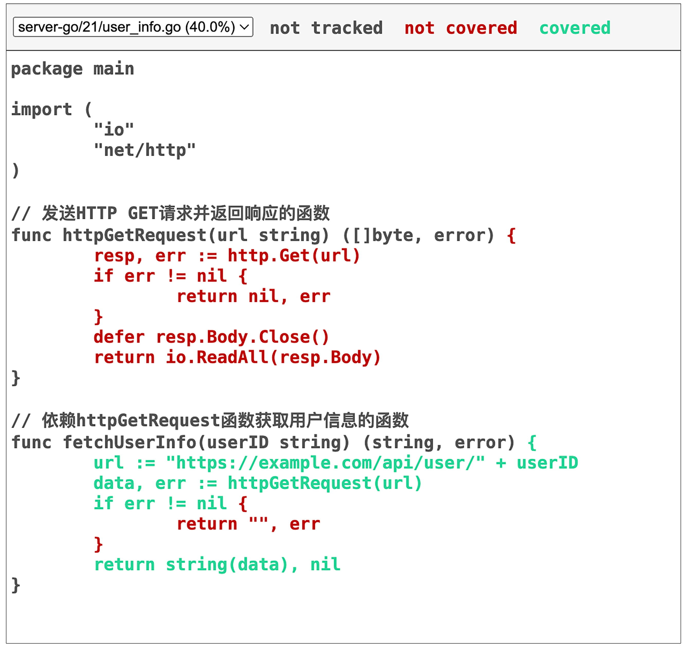

# 21 | 单元测试：如何mock外部依赖并提升覆盖率？

你好，我是徐逸。

通过前面课程的学习，想必你已经掌握了从编码角度规避代码陷阱的方法，也了解了如何合理地打印日志与返回错误码。然而，即便我们在编码过程中十分谨慎，也无法完全杜绝代码出现问题的可能性。幸运的是，我们能够借助测试手段提前发现潜在的代码问题。而在众多测试手段之中，单元测试有着举足轻重的地位，它能为整个代码库的质量奠定一个坚实的基础。

所以，在今天的课程里，我们就来聊聊单元测试的相关知识，以及 Go 语言中用于单元测试的工具。

## 什么是单元测试？

所谓单元测试（unit testing），是指对软件中的最小可测试单元进行检查和验证，在 Golang编程语境里，这通常具体指代单个函数。单元测试遵循着 AAA（Arrange-Act-Assert）的代码组织结构，就像下面的代码一样。

```go
func TestAdd(t *testing.T) {
   // Arrange(安排）
   a := 5
   b := 3
   expected := 8
   // Act（行动）
   result := Add(a, b)
   // Assert（断言）
   assert.Equal(t, expected, result)
}
```

首先在 Arrange 部分，我们需要准备测试所需的所有前置条件，比如初始化被测试对象、准备输入数据、创建模拟对象（如果有外部依赖）等。接着，在 Act 部分，我们需要调用被测试的函数或方法，触发实际的行为。最后在 Assert 部分，需要验证调用的结果是否符合预期。

由于单元测试是针对单个函数的细粒度测试，所以一旦某个用例未能通过测试，我们就能迅速将问题锁定在这个函数的内部，从而更高效地定位问题根源。

不过，根据阿里巴巴 Java 手册的规范，一个好的单元测试在宏观层面必须遵循下面的 AIR原则。

- 首先是 Automatic（自动化）原则。单元测试必须自动运行，不能手动检查结果。例如，我们不能通过打印输出来检查，而应该使用断言（assert）来验证结果是否正确。

- 接着是 Independent（独立性）原则。每个测试用例应该独立运行，不依赖其他测试用例。如果测试用例相互依赖，一旦某个测试失败，其他依赖它的测试也可能失败，导致我们难以确定问题所在。比如就像下面的代码，TestMultiplyBySum 依赖 TestAdd 的结果，如果TestAdd 失败或未执行，会导致 TestMultiplyBySum 的结果不准确。

```go
var sumResult int
func TestAdd(t *testing.T) {
   result := Add(2, 3)
   sumResult = result
   expected = 5
   assert.Equal(t, expected, result)
}
func TestMultiplyBySum(t *testing.T) {
   // 依赖 TestAdd 测试的结果
   result := MultiplyBySum(2, 3, 4)
   expected := sumResult * 4
   assert.Equal(t, expected, result)
}
```

- 最后是 Repeatable（可重复）原则。单元测试在任何时间和环境下执行，结果都应该一致，不受外部环境影响。在持续集成中，频繁执行的测试如果结果不稳定，会降低开发人员对测试结果的信任度，也难以定位和修复问题。为避免依赖外部资源，我们可以用 Mock框架模拟第三方资源，比如用 Mock 框架模拟外部 API 响应来进行测试。

如果要让单元测试切实遵循这三大原则，断言库与 Mock 框架的支持是不可或缺的。

## 断言：如何判断结果符合预期？

我们这就了解一下断言库。在 Go 的实践中，testify 和 goconvey 两个断言库使用较为广泛。

testify 的断言风格和其它编程语言中的断言库类似，测试用例结构简单，对于开发者而言，极易上手。就像下面这段代码所展示的，借助 testify 库 assert 包里的断言函数，我们就能够直接针对结果进行断言检查。

```go
import (
   "testing"
   "github.com/stretchr/testify/assert"
)
func TestAddWithTestify(t *testing.T) {
   a := 3
   b := 5
   result := Add(a, b)
   expected := 7
   // Assert
   assert.Equal(t, expected, result, "Add(3, 5) should return 8")
}
```

而 goconvey 库的功能更为强大，不过相应地，它的学习成本也相对较高。goconvey 库的核心在于 Convey 和 So 这两个函数。Convey 函数主要用于描述测试场景，而 So 则负责对结果进行断言。

值得一提的是，goconvey 还支持分组嵌套测试的代码组织结构，这种特性使它在大型项目中表现出色，能够更好地组织和管理复杂的测试用例。以下面的代码为例。

- 这段代码最外层的 Convey 函数描述了整个测试的主题是 “关于 Add 函数的测试”。

- 第一层嵌套的 Convey 分别描述了 “正常情况的测试” 和 “边界情况的测试” 这两个分组。

- 第二层嵌套的 Convey 针对每个分组下的具体测试场景进行描述，并在每个场景中调用Add 函数，使用 So 进行断言验证结果是否符合预期。

```go
import (
   . "github.com/smartystreets/goconvey/convey"
)
func TestAddWithConvey(t *testing.T) {
   Convey("关于Add函数的测试", t, func() {
       Convey("正常情况的测试", func() {
           Convey("两个正数相加", func() {
               result := Add(2, 3)
               So(result, ShouldEqual, 5)
           })
           Convey("一个正数和一个负数相加", func() {
               result := Add(5, -3)
               So(result, ShouldEqual, 2)
           })
       })
       Convey("边界情况的测试", func() {
           Convey("两个零相加", func() {
               result := Add(0, 0)
               So(result, ShouldEqual, 0)
           })
           Convey("一个数与最大整数相加", func() {
               result := Add(int(math.MaxInt32), 1)
               So(result, ShouldEqual, int(math.MaxInt32)+1)
           })
       })
   })
}
```

## Mock：如何去除不稳定依赖？

了解了断言库之后，接下来，我们一起看看 mock 功能。

在 Go 实践中，我们可以使用应用广泛的 gomonkey 库来实现 mock 功能。gomonkey 库通过 Monkey patch 技术，在程序运行时巧妙地改写函数指令，达到 mock 的目的。以下面代码为例，我们使用 ApplyFunc 函数，对不稳定的 HTTP 调用进行 mock 替换，这样可以有效规避违反单元测试 Repeatable 原则的风险。

```go
import (
   "github.com/agiledragon/gomonkey/v2"
)
// 发送HTTP GET请求并返回响应的函数
func httpGetRequest(url string) ([]byte, error) {
   resp, err := http.Get(url)
   if err != nil {
       return nil, err
   }
   defer resp.Body.Close()
   return io.ReadAll(resp.Body)
}
// 依赖httpGetRequest函数获取用户信息的函数
func fetchUserInfo(userID string) (string, error) {
   url := "https://example.com/api/user/" + userID
   data, err := httpGetRequest(url)
   if err != nil {
       return "", err
   }
   return string(data), nil
}
func TestMock(t *testing.T) {
   // 使用gomonkey mock函数httpGetRequest的返回
   mockData := []byte(`{"name":"killianxu","age":32}`)
   patch := gomonkey.ApplyFunc(httpGetRequest, func(url string) ([]byte, error)
       return mockData, nil
   })
   defer patch.Reset()
   // 底层httpGetRequest的函数调用返回，会被mock
   mockUserInfo, _ := fetchUserInfo("123")
   fmt.Printf("mocked user info: %s\n", mockUserInfo)
}
// 输出
killianxu@KILLIANXU-MB0 mock % go test -gcflags=all=-l
mocked user info: {"name":"killianxu","age":32}
```

## 如何提升单测覆盖率？

掌握了单元测试的原则和相关工具后，紧接着我们需要思考的另一个重要问题是——当完成单元测试的编写之后，我们依据什么来判断代码得到了充分的测试呢？

在实际应用中，我们一般通过单元测试覆盖率指标来衡量单元测试对代码的覆盖程度。对于Go 语言，我们能够借助 go test 命令，通过下面的步骤，来统计在测试执行期间，源代码中实际运行的语句数量占所有可执行语句的比例，并生成详细的覆盖率报告。

首先，就像下面的示例一样，我们可以借助 go test 命令，并指定 -coverprofile 参数来生成详细的覆盖率数据文件，同时它也会输出覆盖率的统计数据。

```
killianxu@KILLIANXU-MB0 21 % go test -coverprofile=coverage.out
....
4 total assertions
.
5 total assertions
PASS
coverage: 45.5% of statements
ok      server-go/21    0.569s
```

接着，我们可以 go tool cover 来生成 HTML 格式的覆盖率报告。

```
go tool cover -html=coverage.out -o coverage.html
```

最后，打开 HTML 文件，我们就能看到单测覆盖率的详细情况了，展示内容如下。



- 图1 单测报告

为了提高单测覆盖率，除了依赖研发人员自觉编写更全面的测试用例外，我们还可以将单元测试集成到持续集成（CI）流程中。通过这种方式，每次代码提交时，单元测试会自动运行，并检查覆盖率。如果覆盖率未达到预设的阈值，系统将阻止代码合并。

以 GitLab CI/CD 为例，为了实现单元测试覆盖率卡控，我们可以在项目的 .gitlab-ci.yml 文件中添加相应的配置节点，并设置一个规则，当单元测试覆盖率低于 80% 时，测试将被标记为失败，不允许进行代码合并。具体你可以参考后面的代码。

```
# 定义用于运行CI任务的Docker镜像，这里选择最新的Go语言镜像
# 该镜像将提供运行Go项目测试所需的环境
image: golang:latest
# 定义CI/CD的阶段，这里只设置了一个test阶段用于执行单元测试
stages:
 - test
# test阶段的具体配置
test:
 # 此阶段名称为test，用于执行单元测试任务
 stage: test
 script:
   # 更新项目的依赖项，确保所有依赖都是最新且正确的
   - go mod tidy
   # 运行单元测试，并将覆盖率信息输出到coverage.out文件中
   - go test -coverprofile=coverage.out
   # 提取并检查覆盖率信息
   # 首先，使用go tool cover -func=coverage.out命令获取覆盖率的详细信息
   # 然后，通过grep命令筛选出包含“total:”及覆盖率数值的行
   # 接着，使用awk命令提取出覆盖率数值
   # 最后，再次使用awk命令检查覆盖率是否低于80%，如果低于则使脚本以非零状态码退出，导致CI任务失
   - go tool cover -func=coverage.out | grep -E "total:.*\d+.\d+%" | awk '{print
 allow_failure: false
 # 设置为false表示此阶段任务不允许失败，如果单元测试失败或覆盖率不达标，整个CI流程将失败
```

## 小结

今天这节课，我们一起学习了好的单元测试应该遵循的原则，以及 Golang 单元测试相关的工具库。现在，让我们一起回顾一下这节课的核心知识点。

首先，我们写的单元测试宏观上应该遵循 AIR 原则。为了遵循 AIR 原则，我们可以使用testify 或者 goconvey 断言库判断结果，并用 gomonkey 库 mock 替换不稳定的外部依赖。

其次，为了衡量单测对代码的覆盖程度，我们可以使用 go test 命令来统计单测覆盖率并生成单测报告。

最后，为了强制提升单测覆盖率，我们可以将单元测试集成到 CI 流程中，每次代码提交自动运行单元测试并检查覆盖率。若覆盖率未达设定阈值，则阻止代码合并。

希望你能够好好领会单元测试原则，熟练掌握单元测试工具的应用。不要忘记在项目中设置单元测试覆盖率卡控机制，避免存在问题的代码流入生产环境。

## 思考题

在实践中，当我们需要在单个测试函数内针对多组数据开展测试时，存在一种将数据与测试逻辑进行有效分离的设计模式。这种设计模式究竟是什么呢？

欢迎你把你的答案分享在评论区，也欢迎你把这节课的内容分享给需要的朋友，我们下节课再见！
