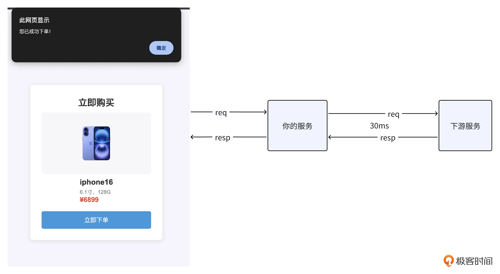
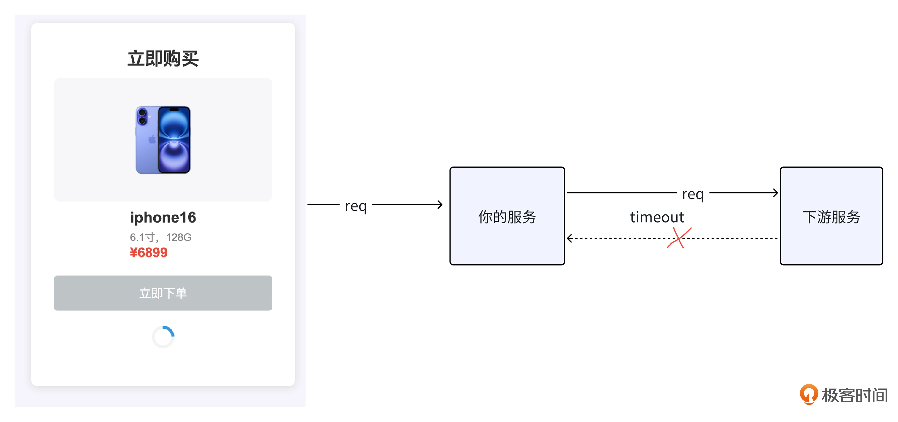
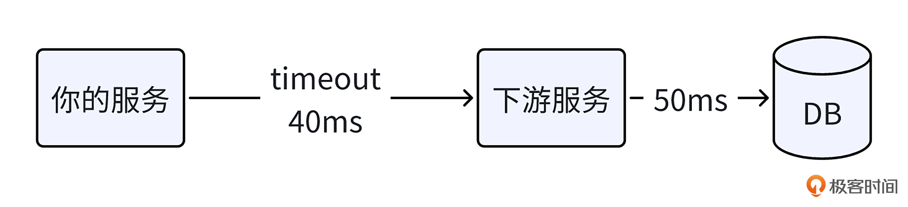
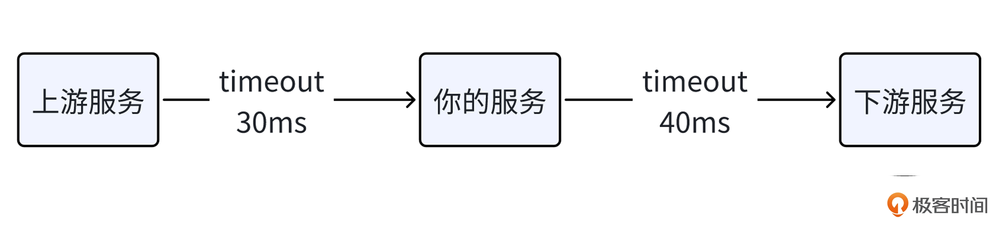
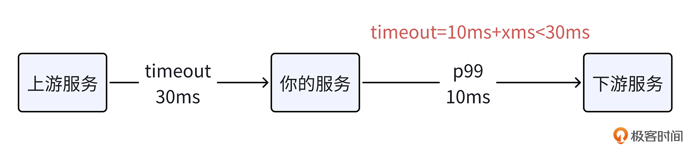
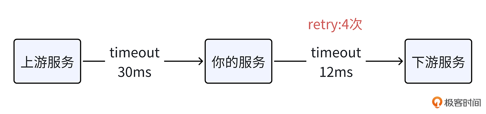
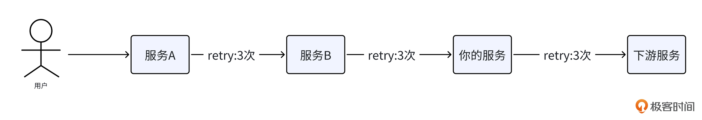
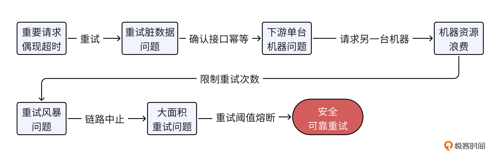

# 22 | 超时和重试：如何提升高并发重要请求的成功率？

你好，我是徐逸。

首先预祝你春节假期快乐。这节课是春节前最后一次更新，1 月 28 日到 2 月 4 日期间我们会暂时停止更新，2 月 5 日再恢复更新。

在这一章前面的课程内容里，咱们一同深入学习了如何从编码以及单元测试这两个关键层面，来全力保障服务上线之后的稳定性。不过呢，即便咱们把代码编写得再健壮，服务在线上环境实际运行的过程当中，依旧会有很多突发状况。

这一章我们就从架构层面入手，一起看看线上服务稳定性的各种常见问题如何解决。

作为用户，想必你对双十一大促或者春运抢票这样的情况并不陌生，这种流量高峰期，也是最考验系统稳定性的时候。那今天呢，咱们就先来聊一聊，在这样的高并发场景下，下游访问偶尔响应时间变得很长时，我们究竟应当采取哪些措施，才能尽可能地确保我们的服务始终保持稳定且可用呢？

## 下游响应时间变长对我们服务有什么影响？

在讨论具体方案之前，你不妨先想一想：倘若请求下游偶尔出现响应时间变长的情况，可能给我们的服务带来怎样的影响呢？

- 图1 正常响应

要知道，当请求下游迟迟不能返回结果时，我们服务与下游服务之间的连接就无法释放，而且正在等待请求返回的协程也会被读请求给阻塞住。一旦响应时间变长的请求数量变多，极有可能使我们服务的机器资源被耗尽，最终使得我们的服务崩溃。

- 图2 响应超时

那么，面对请求下游偶现超时，进而可能导致我们服务崩溃的这种情况，我们又该采取什么样的措施来应对呢？

我们很容易想到的一个方案就是采取超时主动快速失败的策略。若下游在一定时间内没有返回，则我们的服务就主动释放请求下游占用的连接和协程，避免因无限等待下游，导致系统的资源被耗尽而宕机。

## 超时时间设置多少比较合适呢？

谈到超时，其中很重要的一点是超时时间的设置。如果超时时间设置过短，就像下面的图一样，假设下游服务访问数据库就要 50ms，而你将调用下游的超时时间设置为 40ms，就会导致调用下游大量超时失败。

- 图3 超时时间设置过短

当然，超时时间也不能设置过长，过长达不到快速失败、释放资源的目的。比如就像下面的图一样，上游调用你的服务设置超时时间是 30ms，而你调用下游服务的超时时间设置为40ms，实际上，一旦下游发生延时抖动，上游服务 30ms 就超时返回了，你对下游的调用在30ms 之后返回毫无意义。

- 图4 链路超时设置

超时时间既不能设置过短，也不能过长，那我们到底要怎么设置呢？

实际上，就像下面的图展示的一样，为了避免调用下游大量超时失败，我们可以基于调用下游服务的 p99 延时（99% 的请求都在这个时间内返回），外加一定的冗余时间作为超时时间。而且为了尽量避免无意义的等待，这个超时时间应该小于上游调用我们服务设置的超时时间。

- 图5 实践中的超时设置

## 如何安全可靠的重试？

我们再思考一下，超时快速失败的方案会不会有什么问题？

这样做的确可以尽量防止我们被下游拖垮，但是假如我们调用下游的请求是一个重要请求，比如说在下单前的校验请求，超时失败会直接导致用户下不了单，造成公司收入上的损失。对于这种重要请求超时，我们就要特别对待了。

### 超时重试次数应该如何设置？

实际上，由于网络抖动或者下游服务单台机器的问题，线上请求偶尔出现超时非常正常。为了提升我们服务整体的可用性，在确保下游服务接口调用幂等的情况下，你可以采取超时重试的策略。在超时失败时，向下游服务的另外一台机器发起请求，在很多时候，重试请求都能够成功收到下游响应。

然而，重试不是无限的重试，对于每个请求，我们都需要限制超时重试的次数。这一方面是避免因重试次数过多，一旦出现大规模超时情况，就会增加下游系统的负载，导致超时现象更加严重。

另一方面是为了节约机器资源，在我们的上游服务调用超时返回之后，我们对下游的重试请求会占用连接和协程资源，并且毫无意义。就像下面的图一样，上游调你的服务超时时间是30ms，在 30ms 之后它就返回了，你在 30ms 之后对下游的重试属于无效重试。

- 图6 重试次数过多

那重试次数设置为多少比较合适呢？实践经验，我们一般设置成 2-3 次，而且这个重试次数，需要小于上游超时时间除以我们调下游的超时时间，避免无效重试。

那么，是不是只要给超时请求设置重试机制，并且对单个请求的重试次数加以限制，就必然能够提升我们服务的可用性呢？

### 如何防止大面积重试把下游打崩？

要知道，我们所处的是高并发场景，在此情形下，还必须警惕一种情况，那就是当下游出现较多超时时，我们的服务若频繁进行大量重试，是极有可能把下游服务给压垮的。

而且，现在很多系统采用的都是微服务架构，除了我们自身服务会有重试操作外，当对下游服务的调用一直失败时，位于我们上游链路的服务说不定也会展开重试操作，这样一来，便很可能引发重试风暴问题，进而使得下游服务的故障程度进一步加剧。

就像下面的图展示的一样，我们的服务在调用下游服务时会重试 3 次，而上游的服务 B 因为调用失败又会重试 3 次，再往上的服务 A 由于超时失败同样也会重试 3 次。这样一来，虽然用户发出的仅仅是一个请求，实际上我们的下游服务累计会被调用多达 27 次。

- 图7 重试风暴

那我们该如何避免大面积重试把下游服务打垮呢？

你可以采用链路中止策略，对于上游链路过来的重试请求，不再对下游进行超时重试，避免重试风暴问题。而且，对下游的重试调用，你可以设置重试阈值熔断，当在一个时间窗口内，重试请求达到正常请求的一定比例，就不再进行重试，这样就能避免大面积重试把下游打垮。

在深入理解了有关超时和重试的相关知识之后，现在让我们再看下这个问题：在高并发场景，当下游访问偶现响应时间很长时，我们究竟应当采取哪些措施，才能够尽可能地确保我们所提供的服务始终保持稳定且可用呢？

1. 首先，我们需要对下游调用设置合理的超时时间，避免因长时间等待下游返回，我们服务的机器资源不能释放而耗尽。

2. 接下来，如果对下游的调用是重要的请求类型，比如说涉及到关键业务流程的校验等环节，在保证下游调用是幂等的情况下，我们需要进行超时重试，尽量提升我们服务整体的可用性。

3. 再然后，我们需要采用链路中止策略，避免重试风暴给下游造成较大压力。

4. 最后，我们需要设置重试阈值熔断，控制重试比例，避免大面积超时重试直接把下游打崩。

## 小结

今天这节课的内容里，我们学习了超时和重试相关的知识，并用超时和重试解决了高并发场景下，面对下游偶现超时，我们服务可能存在的稳定性问题。现在让我们来回顾一下其中的重点知识。

首先我们需要明白超时最坏的结果可能导致服务崩溃，为了防患于未然，就得提前设计预案，采用不同的方式来处理超时。

最直接的方式就是主动快速失败，释放被占用的连接和协程资源，避免系统资源被耗尽。但这要求我们先拿捏好“判断超时”的分寸，也就是设置合理的超时时间。

其次我们要想到重要的请求需要特别对待，为了提升服务整体的可用性，就需要引入重试策略。

然后我们需要注意重试的安全可靠问题，避免因大面积重试把下游打崩，反而导致可用性急剧下降。我把安全可靠重试的要点总结成了下面的图，供你参考。

- 图8 安全可靠重试

希望你好好体会超时和重试的应用。别忘了给线上服务配置超时时间，同时对于重要的下游调用可以加上重试策略，确保你的服务更加稳定可用。

## 思考题

1. 超时时间和重试次数、重试熔断阈值等的设置，你觉得硬编码在代码里合适吗？为什么？

2. 在实践中，怎么识别上游的请求是重试请求呢？

欢迎你把你的答案分享在评论区，也欢迎你把这节课的内容分享给需要的朋友，我们下节课再见！
