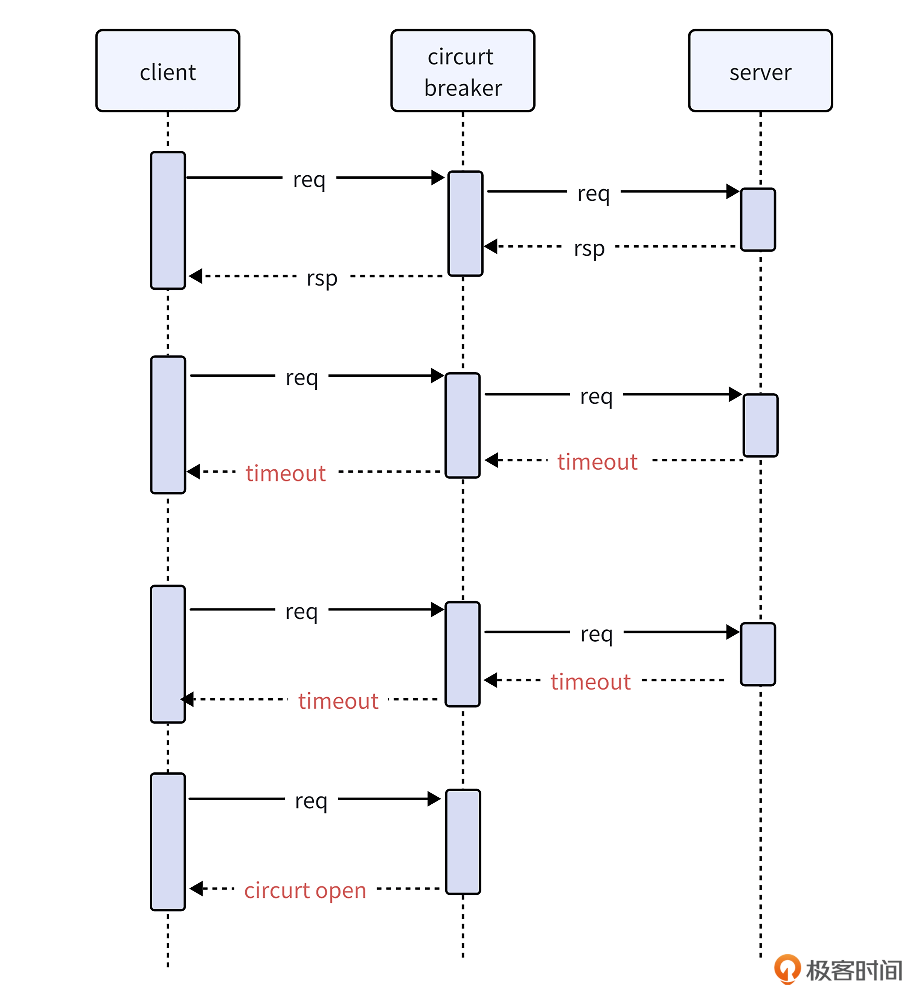
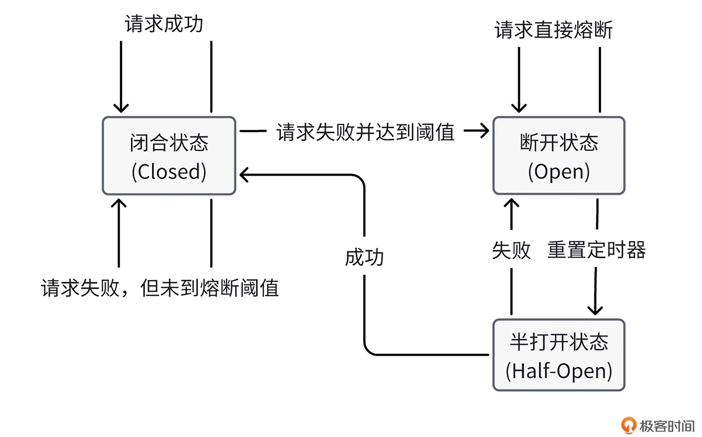

# 23 | 熔断和降级：下游服务大量报错，如何快速止损？

你好，我是徐逸。

通过上节课的学习，相信你已经知道，当下游服务偶尔出现超时的状况时，怎样借助重试机制来提高服务的可用性。然而，一旦下游服务出现容量过载这类较为严重的问题时，重试便不再是提升服务可用性的有效手段了。在这种情况下，我们必须通过其它方法，来保障服务的稳定性。

今天呢，我们就来聊一聊，当下游服务因过载等原因而导致大量报错时，作为上游服务，有哪些行之有效的方法能帮我们快速止损。

## 熔断：下游服务过载怎么办？

在讨论具体方案之前，你不妨先思考这样一个问题：倘若下游服务出现过载，而我们却未采取任何应对措施，将会引发怎样的连锁反应呢？

一旦下游服务过载，如果我们还在源源不断地请求下游服务，那么新的请求就会不断地在下游堆积，排队等待处理。这些积压的请求会大量占用连接、内存等资源，让下游服务很难恢复。此外，由于我们的服务需要长时间等待下游服务的响应，这将导致我们服务大量的协程和连接资源被占用。在极端情况下，甚至可能拖垮我们的整个系统，进而引发雪崩效应。

那么，面对下游服务过载，持续不断的请求导致下游迟迟无法恢复，甚至可能引发雪崩的问题，我们该如何应对呢？

我们知道，在电路系统里，当电流超过安全阈值时，保险丝会自动熔断，切断电路，从而避免电器设备因电流过载而受损。借鉴电路系统里保险丝的保护机制，在服务治理领域，同样存在与之类似的熔断机制来应对服务过载问题。

如下图所示，熔断机制指的是当调用某个服务出现超时等指定的错误，并且在一段时间内的错误率超过了预先设定的阈值时，我们的服务就自动停止向下游服务发送后续请求，转而暂时返回错误信息或者备用数据。这一机制能有效防止因单个服务故障引发的连锁反应，避免故障范围继续扩大。

- 图1 熔断机制的思想

实现了熔断机制的组件，我们一般称为熔断器（circurt breaker）。如下图所示，熔断器的核心在于为每个调用对象维护下面三种状态，并在这三个状态之间转换。

- 图2 熔断机制的状态图

首先是闭合状态（Closed）。当处于这种状态时，每次对下游服务发起调用，系统都会记录指定错误的失败次数以及总调用次数。在一定的时间窗口内，一旦失败次数达到预设阈值，就会触发熔断，状态转变为断开状态。

接着是断开状态（Open）。在该状态下，针对下游的请求将不再调用后端服务，而是直接立即返回错误响应。与此同时，会启动一个计时器，当定时器计时结束，便会进入半熔断状态。

最后是半熔断状态 (Half-Open)。在这一状态下，系统允许向故障服务发送少量试探性请求，这是为了检测服务是否已恢复正常。如果这些试探性调用都能正常完成，就可判定被调用服务已恢复，这时熔断器会切回闭合状态，同时重置相关计数。倘若这些试探性调用中仍存在失败的情况，那就表明被调用服务尚未恢复，熔断器会重新切换到断开状态，并重置计时器。半熔断状态能有效避免正在恢复的服务，因突然大量涌入的请求而再次被打垮。

除了上面三种状态转换，在熔断机制的具体落地实施过程中，还有下面一些关键要点需要我们特别留意。

首先是熔断粒度的选择，也就是针对的熔断对象是谁，它分为下面三种类型。

- 服务粒度熔断，按照服务粒度进行熔断统计。如果调用某个下游服务的失败或超时次数达到设定的阈值，就触发熔断。不过这种方式过于 “粗暴”，如果下游服务只是某个接口响应慢，会导致对这个服务的其它接口调用也全部被熔断。

- 接口粒度熔断，按照方法级别的异常做熔断统计。针对下游的每个接口独立统计调用失败和超时次数，当某个接口达到熔断阈值时，仅对下游的这个接口进行熔断，不影响其它接口的正常调用。这种粒度更精细，能在下游部分接口出现问题时，尽量不影响其它接口的调用。

- 实例粒度熔断，按照实例粒度进行熔断统计。当下游某个实例出现故障，导致调用这个实例的失败或超时次数达到阈值时，仅熔断对该实例的调用，其他正常实例仍可被调用，主要用于解决单实例异常问题。

在实际应用场景里，由于经常会出现因调用特定接口致使下游过载，或者由于容器混部引发单实例过载的现象，为了更精准地应对这些常见的过载问题，我们会同时启用接口粒度和实例粒度的熔断。

其次是下游服务过载的判断，也就是判断什么样的错误类型需要进行熔断计数。熔断机制的主要作用是缓解系统过载，因此我们需要准确识别与系统过载相关的错误类型，以便进行有效的熔断处理。常见的过载相关错误包括超时和限流等，而应用层的错误，比如“参数校验不通过”，则不在熔断机制的处理范围内。

当然，在实际应用中，微服务框架一般都会集成熔断器，我们无需自行开发。如果我们使用的微服务框架没有集成熔断器，也有不少开源的第三方组件可供选择。例如，Netflix 开源的hystrix-go，以及阿里开源的 sentinel-golang，都能为我们提供熔断功能支持。

## 降级：如何保证核心功能和场景可用？

虽然熔断机制能够有效隔离出现故障的服务，防止级联故障的发生，避免故障范围进一步扩大。但是当下游服务在短时间内无法恢复正常运行时，仅仅依靠熔断机制是不够的。这时我们需要从业务功能层面入手，搭配降级的方案来实现快速止损。

降级是指服务本身资源不足或下游服务不可用时，通过提供默认结果或关闭非核心功能等手段，来保证系统的核心功能能够继续运行，从而提高系统的可用性和稳定性。例如对于个性化推荐功能，当调用下游服务失败，无法实现个性化推荐时，我们可以直接用热门商品作为兜底返回，推荐给用户。

降级方案的核心在于精心设计降级策略。由于业务场景的多样性，相应的降级策略也会各不相同。下面是一些常见的策略，供你在实际工作中参考。

第一种策略是返回兜底数据。当从下游服务获取数据失败时，返回预先准备好的备用数据，维持业务基本展示或操作。兜底数据可以是静态数据，也可以是缓存中的旧数据。比如在电商平台，如果商品推荐服务由于系统故障而无法提供个性化的推荐数据，系统可以返回一组预先设定的热门商品列表。

第二种策略是异步处理。为了避免因等待操作完成而阻塞系统资源，我们可以将原本的同步操作转换为异步操作。特别是在写数据场景中，将同步写转换为异步写，可以提高系统的响应速度和吞吐量。

以秒杀活动为例，在活动期间，很短的时间里会涌入大量下单请求。如果后端服务在接收到下单请求后直接将订单信息同步写入数据库，可能会使数据库承受过大的压力，从而影响数据库的性能和稳定性。

为应对这一挑战，在进行秒杀活动时，我们可以将下单请求的处理降级为异步模式。先把下单信息发送到消息队列暂存，随后由异步处理程序从队列中获取下单消息进行处理，最后将订单信息持久化写入数据库。这样一来，由于异步处理程序的消费速度是可控的，我们就能有效调控写入数据库的 TPS（Transactions Per Second），防止数据库压力过大，从而保障系统的稳定性。

另外，我们还可以选择关闭非核心功能。当系统面临压力时，我们可以暂时关停非核心功能，将资源集中于核心业务，确保关键业务流程的顺畅运行。例如，某些服务可能具有用户访问记录的上报功能，这些上报的数据主要用于数据分析团队进行离线分析和异常问题排查。在流量较大时，我们可以将这些功能暂时关闭，减少系统资源的消耗，从而降低服务的负载。

当然，在降级实践过程中，除了制定合适的降级策略，还有两个关键要点要注意。

首先，关于降级方式的选择，我们有两种主要途径：一是利用远程配置开关来实现灵活的降级控制，二是依赖自动降级机制以实现快速响应。

远程配置开关具有较强的可控性，但它的缺点在于需要人工操作，在系统遭遇突发状况时，可能因反应不够迅速而使系统压力增大。相比之下，自动降级机制无需人工干预，它能够依据预先设定的规则（例如，当调用下游服务出错时）自动启动，从而迅速应对各种异常情况。不过这个方式的缺点是可控性相对较低，一旦启动，人工不好干预。

其次为了防止降级功能因长期没有使用而失效，我们还需要定期演练，确保降级的有效性。只有这样，才能确保在真正面临系统危机时，降级措施切实发挥作用，有力保障系统的稳定性与可用性。

## 小结

今天这节课的内容里，我们学习了熔断和降级相关的知识。现在让我们来回顾一下其中的重点知识。

首先是熔断机制的应用场景。当下游服务过载时，为了避免持续不断的请求导致下游迟迟不能恢复，甚至引发级联故障，我们需要熔断机制断开对下游的调用。

接着是熔断器的原理。熔断器的核心实现逻辑是一个状态机，分别在打开状态、断开状态、半打开状态之间转换。

之后是降级机制的应用场景。服务降级是一种在系统面临高负载或部分故障时，通过提供默认结果或关闭非核心功能等手段来保证系统整体可用性和稳定性的策略。

最后是降级的策略。降级的常见策略有返回兜底数据、异步处理和关闭非核心功能三种方案。

希望你好好体会熔断和降级的应用。在对下游服务进行调用时，别忘了配备熔断器并精心制定降级预案，从而提升服务的稳定性和可用性。

## 思考题

在项目实践中，你采取了哪些策略来实现降级呢？

欢迎你把你的答案分享在评论区，也欢迎你把这节课的内容分享给需要的朋友，我们下节课再见！
