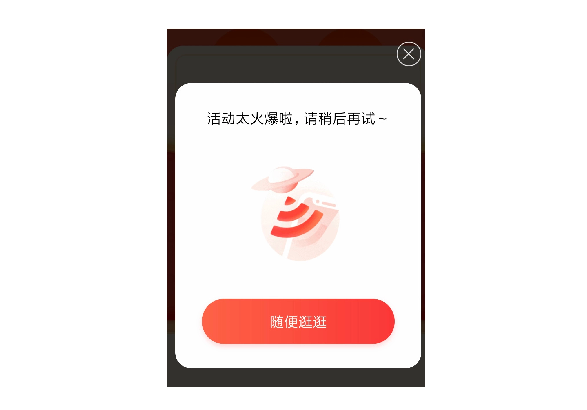
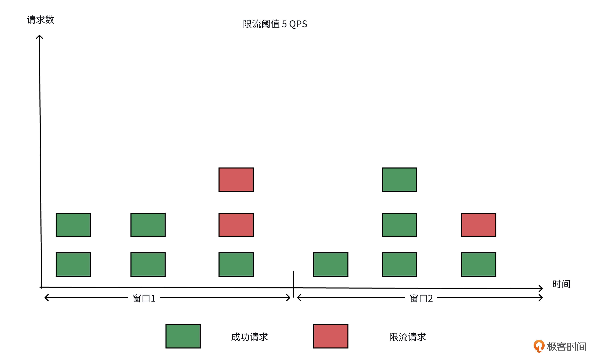
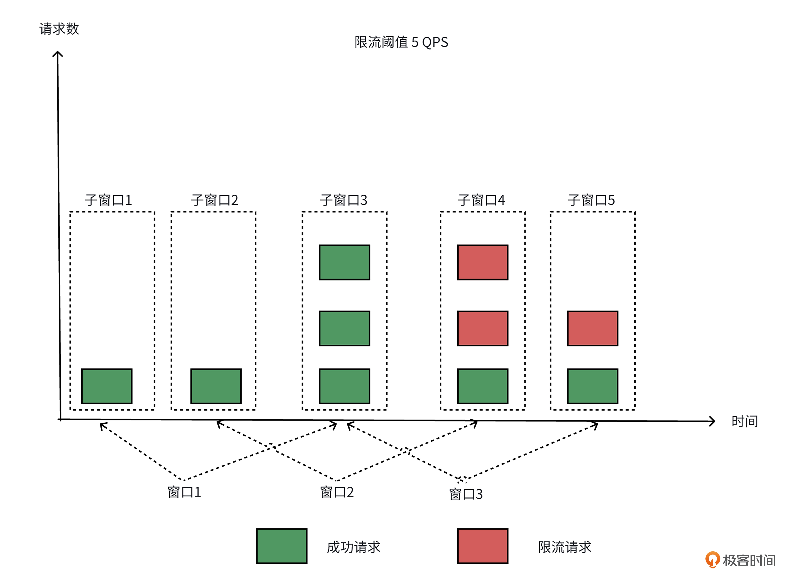
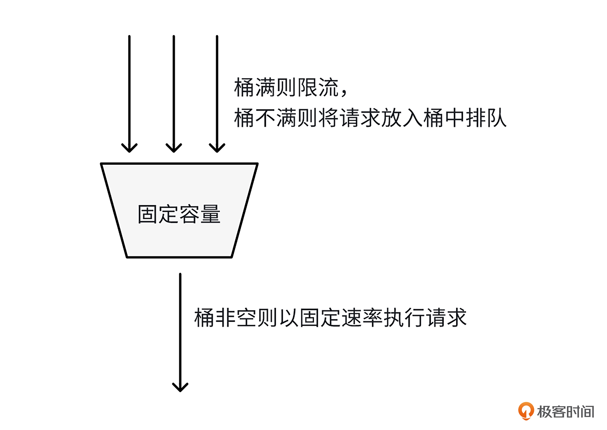
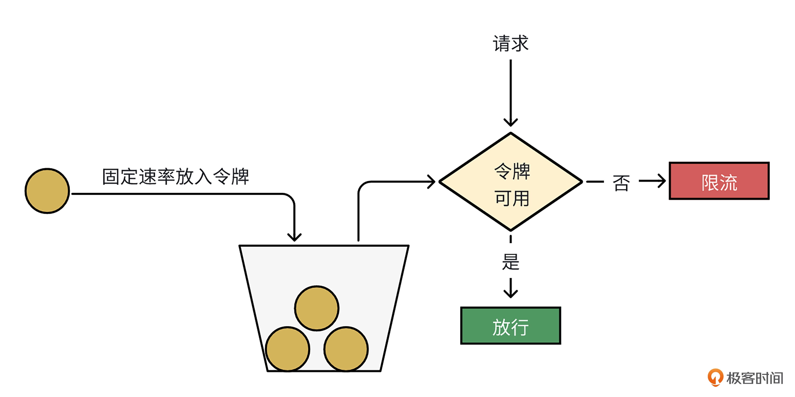
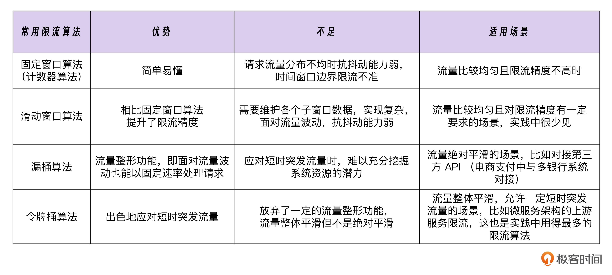

# 24 | 限流：不用Redis，如何搞定高并发低延时服务限流？

你好，我是徐逸。

通过上节课的学习，相信你已经清楚，当下游服务过载时，借助熔断和降级机制，我们能够有效提升服务的稳定性。不过，换个角度看，倘若我们自身作为其他服务的下游，在面对可能出现的突发流量时，怎样才能有效避免自身服务陷入过载状态呢？

今天，咱们就来聊一聊，当上游服务的调用流量突然增加时，如何保障我们的服务不出现过载的状况。

## 什么是服务限流？

我们知道，许多热门旅游景点会通过限制门票销售数量来控制景区的人数。当门票售罄后，后续的游客需要等待或改日再来。这种限流措施可以有效避免景区内过度拥挤，确保游客的安全和体验。

与之相似，在秒杀、大促抢购这类场景中，为避免超出预期的流量冲击，导致服务出现过载、性能下降乃至崩溃的状况，我们通常会给服务添加限流机制，限制服务在单位时间内处理的请求数量，当请求量超过预先设定的阈值时，就直接拒绝超出部分的请求。正如下方图示所呈现的，一旦触发限流，前端便会显示 “活动太火爆啦，请稍后重试” 之类的提示文案。

- 图1 秒杀限流

## 如何实现服务限流？

知道了什么是服务限流，那么我们该如何实现限流机制呢？

### 限流算法

首先，我们来一起看看常见的限流算法，主要包括下面四种。

先来看固定窗口算法，也称为计数器算法。就像下面的图展示的一样，计数器算法需要设定一个固定的时间窗口，在这个时间窗口里，每收到一个请求，计数器就加 1 。当计数器的值达到设定的限流阈值时，这个时间窗口内后续收到的请求就会被限流，直接拒绝或者排队，直到进入下一个周期后，计数器重置为 0，重新开始计数。

- 图2 计数器法算法

尽管计数器算法简单易懂，但在请求流量分布不均的情况下，存在下面两个问题。

首先是抗抖动能力较弱。当请求流量分布不均时，即便在设定的固定时间窗口内，整体流量没有突破限流阈值，但可能在局部较短时段内出现流量尖峰，导致服务负载突然升高。例如，设定限流阈值为 1000 QPS，在 1 秒的时间窗口内，可能前 10 毫秒就涌来了 999 次请求，而随后的 990 毫秒仅有 1 次请求，这就导致前 10 毫秒内服务负载压力极大。

其次是时间窗口边界限流不准。在时间窗口交替的地方，可能会出现高达两倍阈值的请求量。例如，设定限流阈值为 1000 QPS，在前 1 秒时间窗口的最后 10 毫秒，请求量达到 900 次，紧接着后 1 秒时间窗口的前 10 毫秒，请求量又达到 900 次。这样一来，在这短短 20 毫秒内，请求量就达到 1800 次，远远超过 1000 QPS 的限制。

接下来要给你介绍的是滑动窗口算法，它对计数器算法做了一定的改进。

我们先来看看什么是“滑动“？如图所示，将时间窗口划分为多个更小的子窗口，每个子窗口都有独立的计数器。随着时间的推移，窗口像滑动一样移动，统计滑动窗口内的请求总数进行限流。比方说，将 1 分钟的时间窗口划分为 60 个 1 秒的子窗口，每个子窗口记录该秒内的请求数量。当窗口滑动时，就会移除最旧的子窗口的计数，再把新的子窗口计数纳入统计。

- 图3 滑动窗口算法

相较于计数器算法，滑动窗口算法的确能在一定程度上避开临界问题，让限流的精准度有所提升。但它的实现过程较为复杂，需要对多个子窗口的计数器进行维护。特别是当时间窗口划分得过细时，会过度消耗内存空间。并且，滑动窗口算法在应对流量波动时，抗抖动能力差的问题依然存在 。

第三个是漏桶算法。如下面的图所示，我们可以把请求想象成水，漏桶则是一个固定容量的容器，底部有一个固定大小的孔用于漏水（处理请求）。水（请求）以任意速率流入漏桶，但漏桶始终以固定的速率将水（请求）漏出（处理）。如果漏桶已满，新流入的水（请求）将溢出（被限流）。

- 图4 漏桶算法

漏桶算法最大的优势在于它的流量整形功能，不管请求流量如何波动，都能以固定的速率处理请求，保障服务不会因为突发流量而导致过载。

不过，漏桶算法也有局限，它在应对短时突发流量时，难以充分挖掘系统资源的潜力。因为它始终保持固定的请求处理速率，一旦遭遇短时突发流量，极有可能导致大量请求因漏桶满而被限流。

事实上，对于多数服务而言，短时间内处理压力的增大，并不至于引发整个系统的崩溃。所以，当服务负载水平较低，却面临短时突发流量时，我们期望服务能够适度提升处理速度，从而尽量减少不必要的限流，影响用户体验。那么，究竟有没有可行的办法呢？

此时，最后一个算法——令牌桶算法就派上用场了。如下图所示，在这种算法机制下，系统会以固定的速率生成令牌，并将这些令牌放入桶中。每个请求在被处理前，都必须从桶中获取一个令牌。要是桶里有令牌，这个请求就能顺利进入处理流程；要是桶内没有令牌，这个请求就会被限流。值得注意的是，令牌桶设有容量上限，一旦桶被令牌填满，新生成的令牌就会被丢弃。

- 图5 令牌桶算法

采用令牌桶算法，当服务处于低负载状态，令牌桶内会积累大量令牌。这时，如果遭遇短暂的突发流量，凭借充足的令牌储备，这些突发请求能够得到快速处理。因此，令牌桶算法能够出色地应对短时突发流量，有效保障服务稳定、流畅。

在微服务架构实践中，针对上游服务限流，为了实现流量的平滑处理，同时又能允许一定程度的突发流量出现，我们往往会选用令牌桶算法。

不过，其他几种限流算法也各有其独特的优势和适用场景。以固定窗口计数器算法为例，它在流量较为均匀且对限流精度要求不高的情况下，能够发挥重要作用。例如，在一些日常访问量相对稳定、无需精细控制请求频率的系统中，固定窗口算法可以简单有效地控制请求量。

而漏桶算法则特别适用于对接第三方 API 的场景。当第三方 API 对调用频率有明确限制时，为了防止因超出频率限制而导致调用失败，我们需要在客户端进行精准限流。此时，漏桶算法无疑是最佳选择。

例如，在电商购物的支付环节，支付系统需要与众多上游银行系统对接，我们必须根据各银行的服务等级协议（SLA）来严格限制请求速率。在这样的场景下，漏桶算法不仅能够确保请求的平滑处理，还能有效避免因请求过载而导致的支付失败，保障支付流程稳定可靠。

### 限流对象

了解了各类限流算法之后，接下来，我们来探讨一下如何选择限流对象，即确定我们应该针对哪个关键标识（key）进行限流。在服务端限流的实际应用场景中，我们通常会将下面的关键元素组合，构建出具有针对性的限流 key。

首先是上游服务唯一标识。通常情况下，一个服务可能会对接多个上游服务。如果某个上游服务的流量突然大幅增加，引发限流，很可能会波及其他服务的正常访问。因此，为了防止这种情况发生，我们需要以上游服务为维度进行限流。

接着是本服务接口名称。由于一个上游服务可能会调用我们服务的多个接口，如果某一个接口的调用量超出限制，就可能影响其他接口的正常访问。所以，为了保障各接口的稳定访问，我们有必要针对接口名称实施限流。

然后是本服务集群名称。由于不同的服务集群，机器数量存在差异，处理能力也不尽相同。因此，为了适配不同集群的实际情况，我们需要针对不同的集群制定差异化的限流配置。

最后是上游服务集群名称。在实际业务中，上游往往会依据不同的业务场景划分集群，而不同集群的重要程度各有不同。若采用统一的限流策略，可能会出现例如上游一些非关键业务场景的突发调用，导致像下单这类核心集群被限流的情况。所以，为了避免此类情况，我们同样会针对上游服务集群名称进行限流。

### 限流方式

在深入了解限流算法和限流对象后，接下来我们来看看限流方式的选择。常见的限流方式主要有集中式限流与单机本地限流这两种。

集中式限流是在系统架构中借助一个中心化的组件（如 Redis）来集中统一地管理和执行限流逻辑。多个应用实例或服务节点都向这个中心组件请求限流许可，由它来决定每个请求是否被允许通过。集中式限流能够精确控制整个服务的流量，确保整体流量不超过设定的阈值。然而，由于请求需经由中心化组件处理，这在一定程度上增加了请求延迟。特别是在高并发的复杂场景下，中心化组件承受的巨大压力，会显著提升服务稳定性受损的风险。

本地限流是指在单个服务器或服务实例上进行限流，通过限制单台服务器在单位时间内处理的请求数量，防止服务器过载。得益于限流操作在本地内存中的高效执行，本地限流的延迟极低，且无需依赖任何外部组件，这保障了更高的稳定性。然而，本地限流的应用场景相对受限，它更适用于那些服务节点流量分布相对均衡的环境。一旦面临流量分布不均的情况，想要合理设定各个单机的限流阈值就会变得特别困难。

在微服务架构体系下，服务调用通常会借助负载均衡机制来实现。基于此，我们可以合理假设各个单机所承担的流量大致相当。因此，在进行服务限流时，本地限流便成为了首选方案。具体操作中，我们会将整体的限流阈值均匀分配到每台机器上，以此作为单机本地限流的精准阈值，从而确保整个服务在高并发场景下的稳定运行与高效处理。

## 小结

今天这节课我们一起学习了服务限流的相关知识，这对于保障服务的稳定性至关重要。现在，让我们一起回顾其中的重点内容。

首先，我们了解了多种限流算法。常见的有固定窗口、滑动窗口、漏桶以及令牌桶这四种算法。当我们需要针对上游服务进行限流时，为了既能实现流量的平滑处理，又能允许一定程度的突发流量出现，我们往往会选用令牌桶算法。

其次，关于限流对象的选择也很关键。为了防止出现误限流的情况，我们会综合考虑多个因素，将上游服务标识、本服务接口名称、本服务集群名称以及上游服务的集群名称进行组合，形成限流的关键标识（key），以此来实现精准的限流控制。通过这种方式，可以更加细致地对不同来源、不同接口以及不同集群的流量进行管理，避免因单一维度的限流导致不必要的业务影响。

最后是限流方式。常见的限流方式有集中式和本机限流两种，集中式限流会增加延迟并且在高并发场景会增加稳定性风险，因此服务限流一般会采用本机限流的方式。

希望你好好体会服务限流的知识。当面临上游服务可能出现突发大流量调用的情况时，一定要记得增加服务限流机制，避免服务因超出预期的流量调用而导致过载被打垮。

## 思考题

在项目实践中，你在哪些场景使用了限流机制？针对这些场景，你又选择了何种算法和限流方式呢？

欢迎你把你的答案分享在评论区，也欢迎你把这节课的内容分享给需要的朋友，我们下节课再见！
