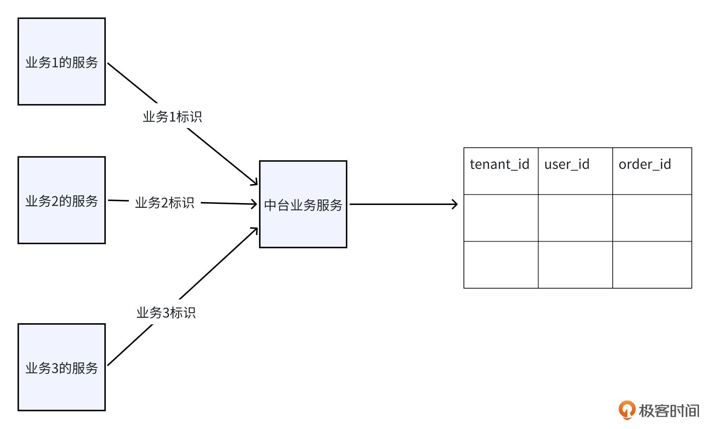
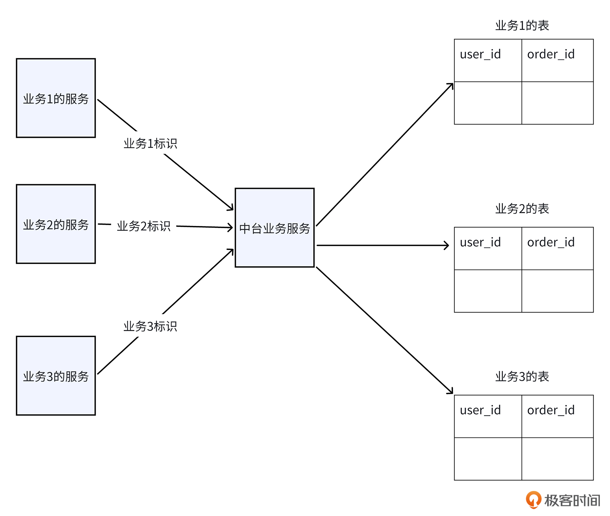
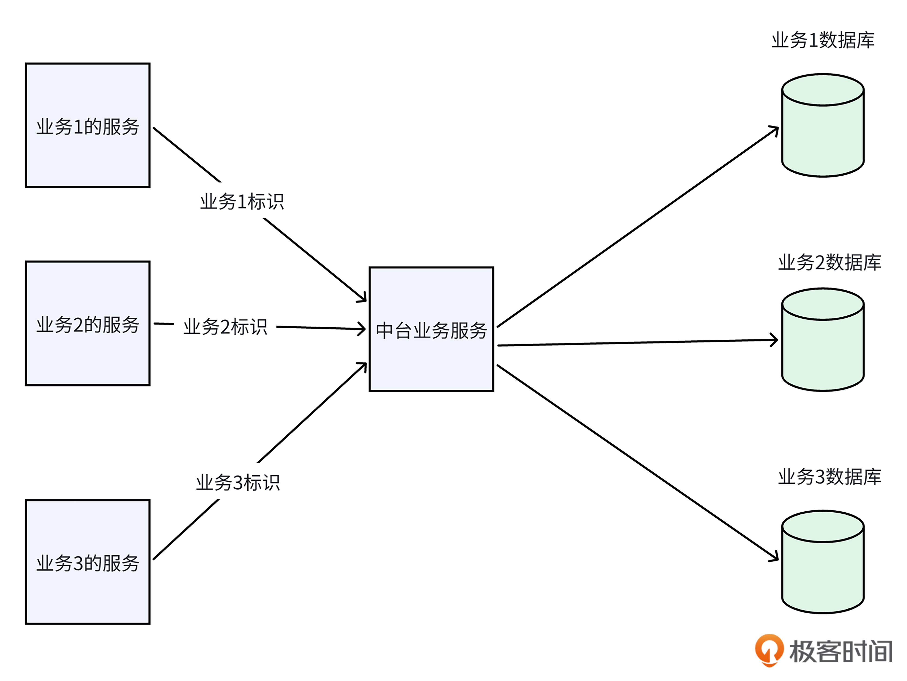
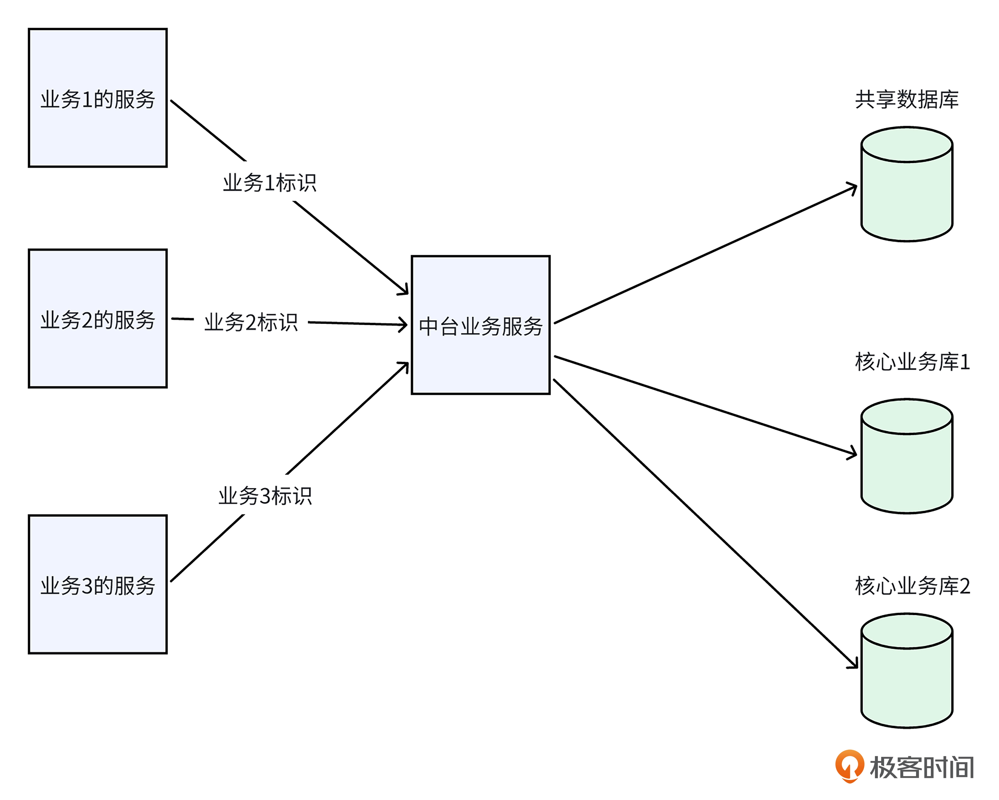
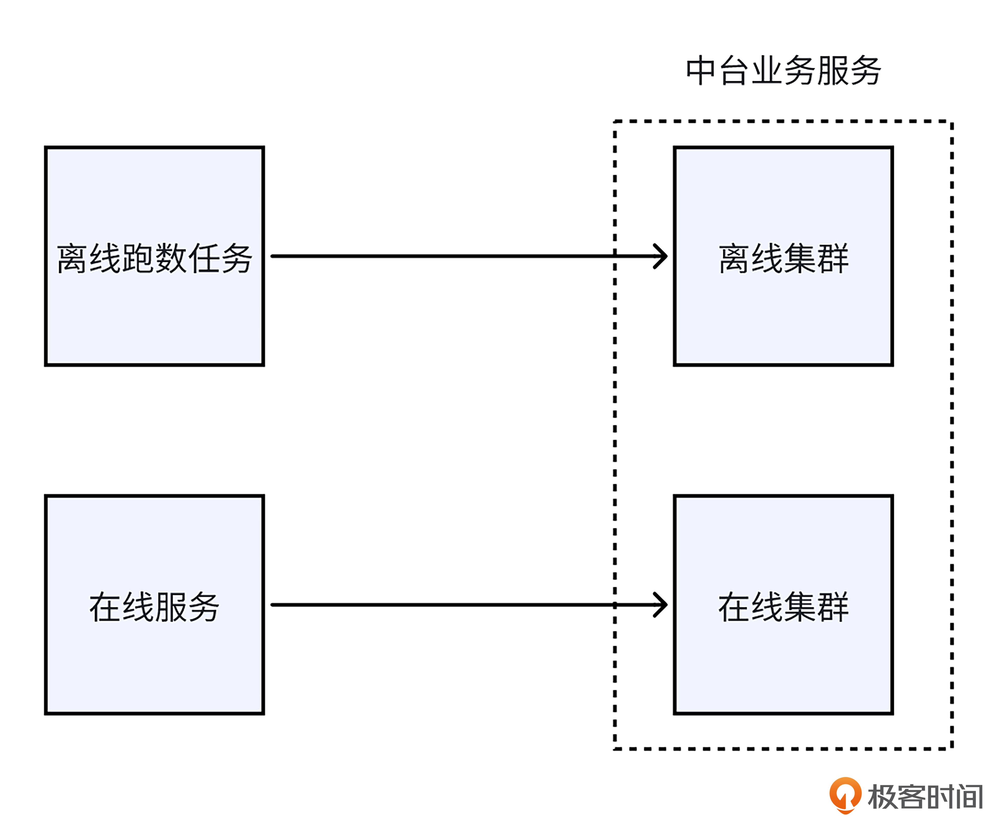
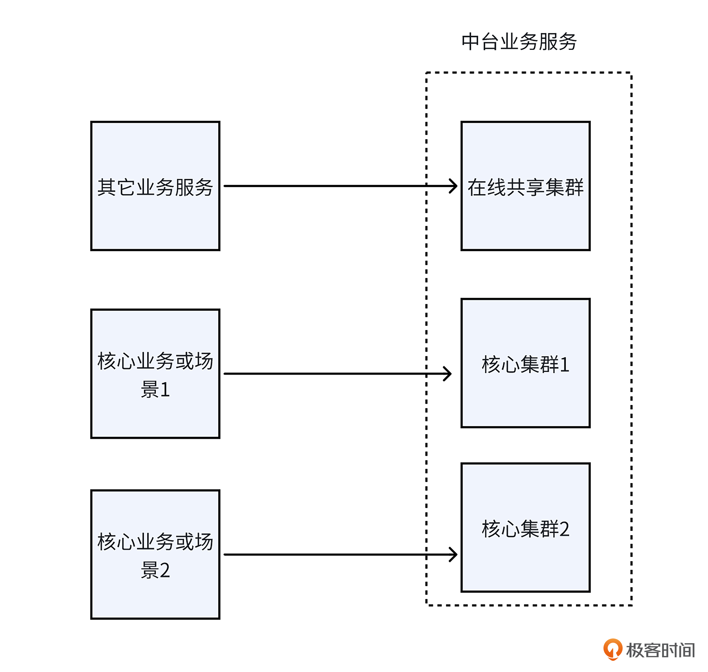
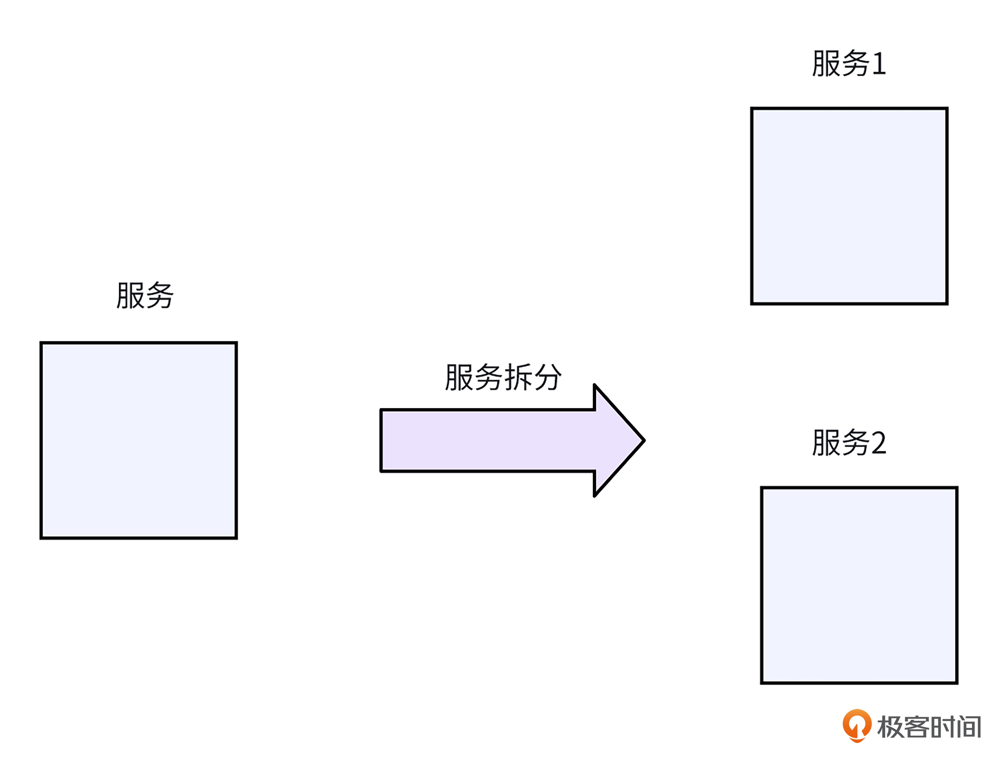
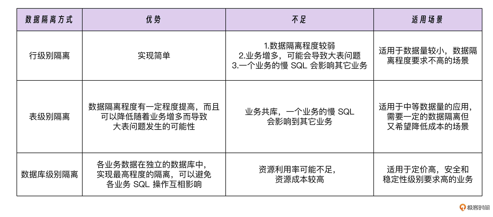

# 25 | 隔离：订单核心流程总被干扰，如何隔离保成交？

你好，我是徐逸。

通过前面两节课的学习，相信你已经掌握了从上游和下游视角出发，保障服务稳定性的方法。然而，服务稳定性保障是一个多维度、全方位的课题。想要构建高可用的服务体系，仅仅关注上下游视角是不够的。我们还需继续转换视角，从具体的业务场景着手，引入一项至关重要的策略——故障隔离。这一策略对于保障核心业务流程的稳定性有着举足轻重的作用。

所以，今天这节课，我们就来聊一聊，如何巧妙地运用故障隔离策略，来提升我们服务的稳定性，避免影响到像订单处理这样的核心业务流程。

## 什么是故障隔离？

我们知道，在疫情防控期间，经常会实行社区封闭管理。一旦某个社区出现感染病例，通过封闭管理，我们能够切断传播链条，将病毒传播范围控制在这个社区内，最大程度避免疫情向其他社区蔓延，遏制大规模感染的发生。

与之相似，在分布式系统架构中，为了防止某些模块或组件出现异常故障时波及到其他正常运行的模块，我们也会预先实施故障隔离措施。具体来说，我们会采用特定的方法在不同模块之间设置隔离机制，确保一旦某一模块发生故障，它不会干扰到其他模块正常运作。这样的做法能够有效降低系统整体瘫痪的风险，显著提升系统的可用性和可靠性。

## 如何进行故障隔离？

说到故障隔离，从业务场景的角度来看，隔离的目的在于防止不同业务间，以及同一业务的不同场景间，在访问同一服务时互相干扰。为实现这一目标，在设计服务架构时，我们通常会采取三种主要的隔离设计策略。这三种策略分别是数据隔离、集群隔离以及服务拆分。

### 数据隔离

在数据隔离策略的应用上，中台类型的服务尤为典型。这种类型的服务，同一个接口，往往需要支持多个不同的业务。为了保障不同业务数据的独立和完整，防止它们相互干扰，我们必须在存储层面采取隔离措施。下面是几种常见的数据隔离实现方式。

首先是行级别的隔离。就像下面的图展示的一样，这种隔离方式下，在同一个库的同一个表中，通过引入额外的租户 ID 字段来区分不同业务所对应的数据。在进行数据查询操作时，借助传入的租户 ID 标识过滤数据，从而确保每个业务都能获取到属于自己的数据，实现不同业务数据的隔离。

- 图1 行级别隔离

行级别的隔离虽然在实现上相对简单，但存在下面两个明显的问题。

一是不同业务间的数据隔离性较差。由于所有数据都存储在同一张表中，一旦某个业务的数据出现操作失误，如数据被错误修改、删除，很容易波及到其他业务的数据，导致其它业务的数据被污染。

二是性能问题。随着租户数量的增长和数据量的持续增加，数据表的规模也会不断膨胀。如果每次查询都需要在海量数据中根据租户 ID 进行过滤筛选，就会增加数据库的负担，降低查询效率，严重影响查询性能。

此外，当不同业务同时针对数据表执行 SQL 操作时，如果其中某个业务出现慢查询的状况，可能会导致其它业务的 SQL 操作也受到牵连，执行速度变得迟缓，进而给其它业务的正常运行带来不利影响。

接下来我们来看下表级别的隔离。在表级隔离模式下，我们需在同一个数据库中，为每个业务分别创建独立的表。这些表的结构要保持一致，但各个表的数据相互隔离，从而确保不同业务的数据不会相互干扰 。

- 图2 表级别隔离

相比行级别的隔离，在表级隔离中，每个业务都拥有属于自己的独立数据表。这种方式在一定程度上增强了数据的隔离性，这样一个业务的数据出现问题时，不会直接对其它业务造成影响。而且业务数量逐渐增加时，通过为新业务添加新的数据表来存储数据，不会像共享数据表那样，由于数据的过度累积导致单个数据表变得异常庞大，进而影响系统性能。

然而，表级别的隔离会使数据库的维护变得更为复杂。随着业务数量不断增多，需要维护的数据表数量也会增加。在实际运维过程中，每当涉及表结构调整、索引优化等变更操作时，都必须针对多个业务的数据表逐一处理。这一过程不仅极大地增加了维护成本，还大幅提高了操作失误的风险。

此外，表级隔离依旧无法有效解决因某个业务出现慢 SQL，进而拖累其它业务 SQL 操作性能的问题。

最后我们来看下数据库级别的隔离。在这种模式下，我们为每个业务单独构建一个数据库。这些数据库中的表结构完全一致，但各自的数据处于相互隔离的状态。

相较于表隔离和行隔离级别，数据库级别的隔离为每个业务提供了完全独立的数据库环境，从而实现了最高程度的数据隔离效果。每个业务的数据彼此独立，互不干扰，即便某个业务出现慢 SQL 操作，也不会波及到其它业务的正常运行。

- 图3 独立数据库

然而，这种方式需要为每个业务建立和维护一个独立的数据库，要花费的资源成本自然比较高。而且，每个业务的数据库可能不会充分利用服务器资源，特别是在业务量较小的情况下，与共享数据库方式相比，可能会造成一定程度的资源浪费。

当然，在实际应用中，我们可以采取更为灵活的策略，分别处理普通业务和重点业务。例如，我们可以构建一个默认数据库，并在其中拆分出不同的表来服务于普通业务。这种做法既能满足一定程度的数据隔离要求，又能降低资源成本，实现资源的高效利用。

同时，对于那些极为关键的重点业务，特别是那些在数据库出现慢 SQL 或负载过高时，极易引发重大影响的业务，例如关乎业务下单交易链路的核心环节，我们必须全力确保它免受普通业务的干扰。因此，我们可以采用独立数据库的方式，将这些业务的数据放在单独的数据库里，为其提供重点保障，如下图所示。

- 图4 多种方式混用

### 集群隔离

当然，在数据库层面完成数据隔离之后，我们也不能忽视计算层的隔离工作。在计算层的隔离策略中，集群隔离是一种较为常见的方法。接下来，我将为你介绍一些具体的集群隔离应用场景。

首先是离线和在线请求做集群拆分。在实践中，有些服务既要处理需要迅速响应的实时业务请求，同时还会接收一些离线任务请求。

这些离线任务请求一般用于数据分析、报表生成等非实时业务，它涉及的数据量通常非常庞大，为了加快离线任务的运行速度，DA 等角色经常会使用超高的 QPS 来请求我们的服务，这会使服务的负载达到极高的水平。如果不把离线任务和实时业务请求明确区分开来，离线任务就很有可能会对在线请求产生负面影响。

- 图5 离线和在线隔离

其次是核心业务与非核心业务做集群拆分。当一个服务需要服务于不同业务或多种业务场景时，对于那些至关重要、对性能和稳定性有着极高要求的业务或场景，特别是当服务涉及到交易下单链路这样至关重要的环节时，我们应将其部署在独立的集群中。这样做的目的是确保交易不受其他业务场景的干扰，而且我们也能针对性地做重点保障。

而对于那些对性能和稳定性要求相对较低的业务场景，则可以安排在默认的共享集群上，以此实现资源的合理分配与高效利用。

- 图6 核心业务集群隔离

借助在线与离线集群的隔离，以及核心与非核心集群的拆分，我们就能在计算层较好地实现故障隔离，避免不同重要程度的请求相互干扰，确保各业务流程的顺畅运行。

### 服务拆分

当然，除了实施集群隔离措施外，有时候，为了降低其他接口迭代更新对核心接口可能产生的影响，我们还可能会采取服务隔离的策略，即将核心接口拆分为独立的服务。这样一来，核心接口就能在相对稳定、独立的环境中运行，有效避免因其他接口的变动而引发的潜在风险，确保核心业务的稳定、可靠。

- 图7 服务拆分

## 小结

今天这节课，我们从业务场景的视角着手，学习了避免不同业务互相影响的故障隔离方法。现在，让我们一起回顾其中的重点内容。

首先，我们了解了多种数据隔离的方法。对于数据隔离，最为常见的有三种实现方式，它们分别是行级别隔离、表级别隔离以及数据库级别隔离。

其次，在计算层进行集群隔离同样至关重要。根据请求的不同，我们通常会把在线请求和离线请求分别部署在不同的集群中，同时，也会对在线请求进一步按照核心和非核心的区别来拆分集群。

最后是服务拆分的内容。为避免其他接口的迭代过程对核心接口产生影响，我们有时候可以考虑将核心接口单独拆分成独立的服务。

希望你能够深入理解故障隔离的知识。当你的服务需要应用于多种不同的业务场景时，切记要从业务场景的角度出发，制定合适的故障隔离策略，以防不同业务场景之间相互干扰。

## 思考题

实际上，除了从业务场景的视角实施故障隔离之外，还存在其他一些故障隔离策略，那么它们究竟是哪些呢？

欢迎你把你的答案分享在评论区，也欢迎你把这节课的内容分享给需要的朋友，我们下节课再见！
