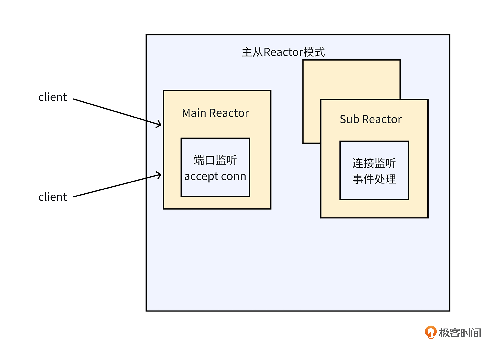
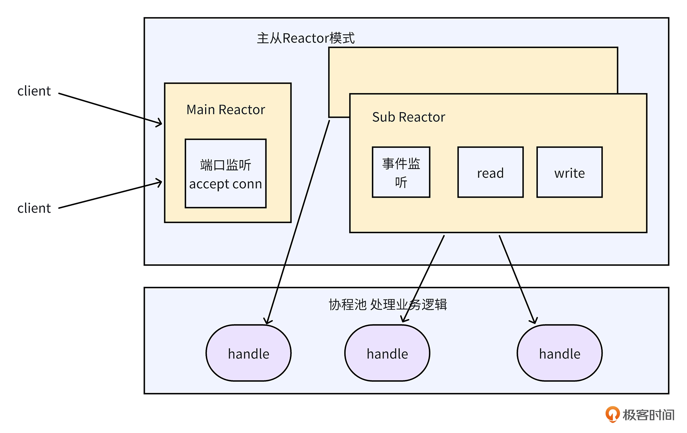
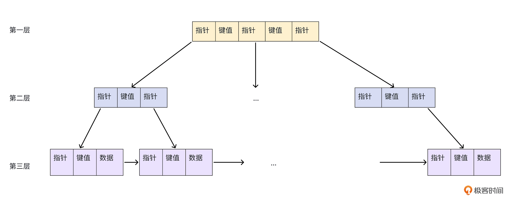

# 思考题答案集锦

你好，我是徐逸。

这节课我们把之前课程的思考题答案统一发布，希望能给你提供参考，查漏补缺。也希望你先独立思考，踊跃发言，这样有助于锻炼自己分析问题、活用知识的能力。

第二节课

Q：为什么有些公司会选择在 QPS 高峰期对线上进行 pprof 定时采样，而较少在此时进行trace 操作呢？

A：公司之所以在高峰期进行 pprof 采样，而不进行 trace 操作，主要基于下面两点原因。

从性能上来说，pprof 按一定间隔获取程序性能数据，性能开销小。而 trace 操作需要详细记录程序中的各类事件，必须追踪海量的细节信息，包括协程从起始到终结的完整历程、网络输入输出的每一个环节以及垃圾回收的全过程等，导致它的性能消耗很大。在系统处于高峰期时，倘若开启 trace 操作，极有可能对线上正常运行的请求产生干扰和不良影响。

从实用性上来说，高峰期进行 pprof 采样，能帮助我们识别资源瓶颈，通过采样数据快速定位消耗资源多的函数或模块，从而针对性进行优化。而 trace 操作虽提供详细轨迹，但 QPS 高峰时，请求比较多，生成数据量庞大复杂，难以去做精细化分析，因此实用价值不高。

第三节课

Q：对于容器类型，除了这节课讲到的 2 种高性能使用技巧，你还知道哪些高性能的使用技巧呢？

A：当我们对结构体数组或切片做循环遍历时，基于性能上的考虑，建议优先使用下标遍历的方式，而不提倡使用 for range 值遍历的方式。

我们可以借助下面的 Benchmark 脚本，来测试下标遍历与 for range 值遍历在性能方面的表现。

```go
type Item struct {
   id  int
   val [2048]byte
}
// 用下标遍历[]struct{}
func BenchmarkSliceStructByFor(b *testing.B) {
   var items [2048]Item
   for i := 0; i < b.N; i++ {
       var tmp int
       for j := 0; j < len(items); j++ {
           tmp = items[j].id
       }
       _ = tmp
   }
}
// 用for range下标遍历[]struct{}
func BenchmarkSliceStructByRangeIndex(b *testing.B) {
   var items [2048]Item
   for i := 0; i < b.N; i++ {
       var tmp int
       for k := range items {
           tmp = items[k].id
       }
       _ = tmp
   }
}
// 用for range值遍历[]struct{}的元素
func BenchmarkSliceStructByRangeValue(b *testing.B) {
   var items [2048]Item
   for i := 0; i < b.N; i++ {
       var tmp int
       for _, item := range items {
           tmp = item.id
       }
       _ = tmp
   }
}
```

测试结果出来了，使用 for range 值遍历的方式，性能远远不如下标遍历。从耗时上来看，下标遍历比 for range 值遍历的方式，性能提升达数百倍。

```
BenchmarkSliceStructByFor-4               853914              1208 ns/op
BenchmarkSliceStructByRangeIndex-4        934891              1164 ns/op
BenchmarkSliceStructByRangeValue-4          3693            320654 ns/op
```

那么为什么 for range 值遍历结构体切片的方式，性能会低很多呢？

原因是存在复制开销。当使用 for range 值遍历的方式时，每次迭代都会将结构体元素复制到一个新的变量中。如果结构体的字段较多或者字段的数据类型占用较大空间（如包含大型数组的结构体），这种复制操作的开销会很大。

第四节课Q：除了这节课里提到的 3 种高性能数据处理技巧，你还知道哪些高性能数据处理技巧呢？

A：对于数据处理的优化，咱们还有一种常用的思路，当官方库没有性能更高的实现方式时，可以使用性能更高的第三方库。比如当我们需要进行 JSON 序列化和反序列化操作时，可以使用考虑使用 sonic 库。

sonic 库是由字节跳动开源的一款高性能 JSON 库，其底层架构经历了多维度的深度优化，并且在字节跳动庞大的业务体系内部获得了充分的实践验证。这使得在通常状况下，它相对于官方库以及其他第三方库而言，在处理速度上具有显著的优势，能够以更高效的方式应对 JSON数据的处理需求。

在它的 GitHub 页面的说明文档里，借助 benchmark 对不同的 JSON 库进行了性能测试，结果表明，对于所有大小的JSON和所有使用场景，sonic 表现均为最佳。

sonic 库的使用非常简单，就像下面的代码一样，我们只需要调用 Marshal 和 Unmarshal 方法就可以实现序列化和反序列化操作。

```go
import (
   "testing"
   "github.com/bytedance/sonic"
)
type User struct {
   Name string
   Age  int
}
// sonic序列化/反序列化
func TestSonic(t *testing.T) {
   user := User{Name: "test", Age: 18}
   // sonic序列化
   data, err := sonic.Marshal(user)
   if err != nil {
       panic(err)
   }
   var newUser User
   err = sonic.Unmarshal(data, &newUser)
   if err != nil {
       panic(err)
   }
}
```

第五节课

Q：除了这节课介绍的对象池和协程池技巧，你还知道哪些资源复用技巧呢？

A：在一些数据库和微服务框架的底层实现里，连接池也是一种被广泛应用的技巧。当框架向下游发起调用，待调用结束后，会将已经建立好的 TCP 连接存放在一个专门的池子里。如此一来，下一次需要再次调用时，便可以直接从这个池子中获取 TCP 连接。这种方式有效避免了每次调用都要重新建立 TCP 连接所产生的延时开销，从而达到提升系统性能的目的。

第六节课

Q：当多任务并发运行时，会遇到这样一种特殊的场景：只有当所有并发的任务都出现错误时，整个请求才会返回错误信息；而只有部分任务出错时，请求也不会返回错误。那么我们究竟该怎么在主协程里获取每个并发任务的执行出错信息呢？

A：就像下面的代码一样，我们可以提前创建长度和并发任务数相等的错误类型切片，并且在并发任务里，将 error 类型的结果存入切片对应的位置，从而实现在主协程里获取所有错误的功能。

```go
func TestGetAllErr(t *testing.T) {
   // 创建WaitGroup对象
   wg := sync.WaitGroup{}
   results := make([]string, len(urls))
   // 保存所有并发任务执行结果
   errors := make([]error, len(urls))
   for index, url := range urls {
       url := url
       index := index
       // 在创建协程执行任务之前，调用Add方法
       wg.Add(1)
       go func() {
           // 任务完成后，调用Done方法
           defer wg.Done()
           // Fetch the URL.
           resp, err := http.Get(url)
           if err != nil {
               errors[index] = err // 保存执行结果
               return
           }
           defer resp.Body.Close()
           body, err := io.ReadAll(resp.Body)
           if err != nil {
               errors[index] = err // 保存执行结果
               return
           }
           results[index] = string(body)
       }()
   }
   // 主协程阻塞，等待所有的任务执行完成
   wg.Wait()
}
```

第七节课

Q：在众多的数据结构中，栈是比较重要的一个数据结构，请你使用这节课学到的 atomic 包知识，实现一个并发安全的无锁栈。

A：可以用链表来实现无锁栈，示例代码如下。

```go
import (
   "sync/atomic"
   "unsafe"
)
// LockFreeStack 表示无锁栈结构体
type LockFreeStack struct {
   top unsafe.Pointer
}
// Node 表示栈中的节点
type Node struct {
   next unsafe.Pointer
   v    interface{}
}
// NewLockFreeStack 创建一个新的无锁栈实例
func NewLockFreeStack() *LockFreeStack {
   return &LockFreeStack{}
}
// Push 将元素压入栈顶
func (s *LockFreeStack) Push(value interface{}) {
   item := Node{v: value}
   for {
       top := atomic.LoadPointer(&s.top)
       item.next = top
       if atomic.CompareAndSwapPointer(&s.top, top, unsafe.Pointer(&item)) {
           return
       }
   }
}
// Pop 从栈顶弹出元素
func (s *LockFreeStack) Pop() (interface{}, bool) {
   for {
       top := atomic.LoadPointer(&s.top)
       if top == nil {
           return nil, false
       }
       item := (*Node)(top)
       next := atomic.LoadPointer(&item.next)
       if atomic.CompareAndSwapPointer(&s.top, top, next) {
           return item.v, true
       }
   }
}
```

这段代码的核心是下面几步。

1. 首先，我们设计一个 LockFreeStack 结构来表示栈，它的成员变量 top 是指针类型，指向栈顶节点。

2. 接着，我们设计一个 Node 的结构，表示栈中的节点。它的成员变量 next 是指针类型，指向这个节点的下一个节点。

3. 然后，我们提供了 Push 方法，用于往栈顶写数据。它的核心是用 for 循环和CompareAndSwapPointer 方法来实现无锁更新栈顶指针。

4. 最后，我们提供了 Pop 方法，用于从栈顶弹出数据。和 Push 方法一样，它的核心也是用for 循环和 CompareAndSwapPointer 方法来实现无锁更新栈顶指针。

第八节课

Q：在大规模数据缓存时，我们虽然可以用 bigcache 来避免 GC，但是却会引起其它开销，那么是哪些开销呢？

A：为了避免 GC，我们需要将对象变成字节切片写入 bigcache，这样会增加序列化和反序列化开销。以下面的代码为例，当我们将 User 信息存入缓存时，需要先序列化。而且，如果我们一次需要从缓存取一批数据，就需要循环反序列化。假如反序列化的量比较大，会增加接口的处理延时。

```go
package main
import (
   "encoding/json"
   "fmt"
   "github.com/allegro/bigcache"
)
// User结构体表示用户信息
type User struct {
   Id    string
   Name  string
}
func main() {
   // 配置bigcache
   cache, err := bigcache.NewBigCache(bigcache.New(context.Background(), bigcach
   if err!= nil {
       fmt.Println("创建bigcache实例失败:", err)
       return
   }
   // 准备一些用户数据进行存储
   user1 := User{
       Id  :  "123",
       Name:  "killianxu",
       Age:   25,
       Email: "alice@example.com",
   }
   // 将用户数据序列化后存入bigcache
   user1Data, _ := json.Marshal(user1)
   cache.Set(user1.Id, user1Data)
   // 从bigcache中循环取出数据并反序列化
   for _, key := range []string{"123", "456","789"} {
       data, err := cache.Get(key)
       if err!= nil {
           fmt.Printf("获取 %s 失败: %v\n", key, err)
           continue
       }
       // 反序列化
       var user User
       err = json.Unmarshal(data, &user)
       if err!= nil {
           fmt.Printf("反序列化 %s 数据失败: %v\n", key, err)
           continue
       }
   }
}
```

第九节课

Q：虽然 Golang 网络库的性能已经很高了，但还是有不少高性能网络库在 Golang 官方库的基础上进行了改进，请找一个高性能网络库并分析它的改进点。

A：

Golang 官方的 net 库在高并发场景存在下面两个问题，第三方库一般会针对这两个问题优化。

第一个问题，像下面的代码展示的一样，golang 运行时在调用操作系统的 epoll_wait 方法后，需要循环对网络就绪事件进行处理，但 net 库是由一个 epoll 池监听所有的网络事件，在高并发场景下，由于同时需要处理的事件很多，循环本身可能会成为性能瓶颈。

```go
//  runtime/netpoll_epoll.go
// netpoll checks for ready network connections.
// Returns list of goroutines that become runnable.
// 循环对网络事件进行处理，转化为就绪协程列表
func netpoll(delay int64) (gList, int32) {
   var events [128]syscall.EpollEvent
   n, errno := syscall.EpollWait(epfd, events[:], int32(len(events)), waitms)
   var toRun gList
   delta := int32(0)
   // 循环将网络事件转化为网络事件就绪的协程列表
   for i := int32(0); i < n; i++ {
       ev := events[i]
   }
   return toRun, delta
}
//循环改变协程的状态并推入协程就绪队列
// injectglist adds each runnable G on the list to some run queue
func injectglist(glist *gList) {
   // Mark all the goroutines as runnable before we put them
   // on the run queues.
   head := glist.head.ptr()
   var tail *g
   qsize := 0
   // 循环处理，改变协程状态
   for gp := head; gp != nil; gp = gp.schedlink.ptr() {
       tail = gp
       qsize++
       casgstatus(gp, _Gwaiting, _Grunnable)
   }
}
```

第二个问题，net 库的每个连接，都需要一个协程进行处理（goroutine-per-connection 模式），而且当网络连接的读写事件未就绪时，协程会被阻塞。在高并发场景，连接数比较多时，会导致存在大量被阻塞的协程，增加内存占用和协程调度开销。

针对这两个问题，我以字节开源的高性能网络库netpoll为例，看它是如何解决这两个问题的。

1. 针对高并发场景循环处理的事件过多的问题，就像下面的图一样，netpoll 采用了主从多Reactor 的模式。也就是由多个协程监听多个 epoll 池，每个 epoll 池放一部分需要监听的文件描述符（fd）。主 Reactor 监听连接事件，从 Reactor 监听读写等网络事件。



- 图1 主从 Reactor

2. 针对 net 库读写未就绪，导致协程阻塞问题，就像下面的图一样，netpoll 由从 Reactor 完成内核和程序之间的数据复制，协程池中的协程只负责异步对业务逻辑进行处理，不再需要阻塞等待网络 IO 事件就绪和数据复制，从而避免了大量协程因网络 IO 而被阻塞的问题。



- 图2 非阻塞读写

第十节课

Q：在实践中，如果单纯为了降低延时，很少使用合并编译的方案，这是为什么呢？

A：合并编译会导致服务之间的隔离失效，产生一些稳定性问题。比如当下游服务 panic 时，上游服务也会挂掉，无法提供服务。再比如，如果下游服务导致容器负载变高，由于两者共用容器资源，上游服务也会受影响。

第十一节课

Q：网上有种说法，MySQL 表行数超过 2000w 左右，一般会被认为是大表，需要做拆分，这个数值是怎么来的呢？

A：在 MySQL 中，为了加快数据的查找速度，我们可以给查找的条件列添加索引。MySQL 内部常用存储引擎 InnoDB，用的是 B+ 树结构实现的索引，而 2000 万的数据量级，就是根据B+ 树索引估算出来的。

在详细介绍估算过程之前，我们先来了解下 B+ 树的结构。

就像下面的图展示的一样，在表的主键 B+ 树结构里，叶子节点承担着实际数据的存储任务，而非叶子节点则主要存储键值与指针信息。通过非叶子节点的指针，我们可以一层层地往下找，最终定位到键值所在行的完整记录。



- 图1 B+ 树索引

然而，随着表数据量增长，B+ 树结构高度会增加，这将导致查询所需磁盘 I/O 次数增多。例如，在根节点被内存缓存的情况下，3 层 B+ 树查一条记录需 2 次 I/O，4 层则需 3 次。

由于磁盘 I/O 速度慢，过多操作会形成性能瓶颈，使查询变慢，影响整体效率。在实际应用中，由于 1-3 层 B+ 树能兼顾存储容量与查询性能，因此是较为合理的高度。

了解了 B + 树索引后，我们以 Bigint 类型的主键索引为例，来估算一下 3 层高的 B+ 树索引能存多少数据。

1. 先看根节点，InnoDB 存储引擎的最小存储单元是页，一页为 16KB，在 B+ 树索引里，Bigint 占 8 字节，指针占 6 字节，那根节点能存的数据元素大概就是 16KB 除以 14B，也就是 1170 个。

2. 接着算第二层，这一层每个节点存储的也是键值和指针，所以每个节点也能存 1170 个元素，那第二层总共能存的元素个数就是 1170 乘 1170，也就是 137 万个。

3. 最后看第三层，如果每行数据占 1KB 空间，那第三层每个节点能存 16KB 除以 1KB，即16 个元素。这样算下来，第三层总共能存的数据个数大概是 1170 乘 1170 乘 16，结果在2100 万左右。

经过上述估算，我们就明白这约 2000 万行的数值是怎么得出的了。

不过要注意的是，从刚才的估算过程可知，2000 万这个数值是基于主键为 Bigint 类型，并且每行数据占用 1KB 这些特定条件估算出来的。实际上，表所能容纳的最大行数与键值长度、每行数据的大小都有关系，所以 2000 万行并非一个适用于所有情况的固定标准。

在实践中，我们除了要依据具体的业务场景和数据特征进行预估，还需要通过压测等方法，来确定单表行数的合理上限，这样才能避免单表行数过多，让数据库的性能达到最佳状态，满足业务需求。

第十二节课

Q：在 Go 语言的并发库存在这样一个类型，利用它能够避免服务 Server 向下游（比如Redis）同时发起过多请求。那么，这个类型究竟是什么呢？

A：在 Go 语言的 singleflight 扩展并发库里面，所提供的 Group 类型具备独特功能。它能够有效防止 Server 对相同函数同时执行，并且在同时执行的情况下，还可达成对相同结果的共享，减少不必要的重复计算与资源消耗。

这么说可能有点抽象，你可以结合下面的代码理解。当首次调用 DoChan 方法且尚未执行完毕时，再次对 DoChan 方法进行调用。由于这两次调用所使用的是同一个 key，于是第二次调用将不会被执行，而是会直接共享首次调用所产生的结果。

```go
package main
import (
   "fmt"
   "golang.org/x/sync/singleflight"
)
func main() {
   g := new(singleflight.Group)
   block := make(chan struct{})
   res1c := g.DoChan("key1", func() (interface{}, error) {
       <-block
       return "func_1", nil
   })
   res2c := g.DoChan("key1", func() (interface{}, error) {
       <-block
       return "func_2", nil
   })
   close(block)
   res1 := <-res1c
   res2 := <-res2c
   // Only the first function is executed: it is registered and started with "ke
   // and doesn't complete before the second function is registered with a dupli
   fmt.Println("Equal results:", res1.Val.(string) == res2.Val.(string))
   fmt.Println("Result:", res1.Val)
}
```

那实际情况究竟是否如此呢？我们不妨通过输出结果来进行验证。

结果出来了，果然，经检验发现两次调用所得到的结果完全一致，足以证明第二次调用确实没有执行。

```
killianxu@KILLIANXU-MB0 12 % go run main.go
Equal results: true
Result: func_1
```

第十五节课

Q：在进行服务拆分的时候，咱们要遵循哪些常见的原则呢？

A：

微服务拆分要遵循下面这些常见原则。

- 单一职责原则。每个微服务应该只负责一项单一的业务功能或职责。这意味着微服务的功能应该高度内聚，专注于完成一件特定的事情。

- 持续演进原则。微服务架构是一个持续演进的过程，随着业务的发展和需求的变化，微服务也需要不断地进行调整和优化。例如，业务初期为了快速上线，可能会将某些功能合并在一个微服务中，但随着业务量的增长和功能的细化，就需要对这个微服务进行进一步拆分。

- 避免循环依赖。如果服务之间出现循环依赖，当一项修改涉及两个服务时，可能会存在两个服务的修改互相依赖，而无法发布的问题。

- 阶段性合并原则。阶段性合并原则是指在特定阶段，根据业务场景和系统性能等因素，将一些关联性强、交互频繁的微服务进行合并。例如，在系统性能优化阶段，发现某些微服务之间的频繁调用导致了网络开销过大，影响了整体性能，此时可以考虑将这些微服务合并。

第十八节课

Q：在实践中，哪几类场景适合用泛型来实现呢？

A：

关于何时使用泛型，我们可以参考这篇博客 <<When To Use Generics>>。如果你发现需要重复编写相同的代码，而这些代码唯一的区别就是类型不同，那么就可以使用泛型来实现逻辑复用。具体来说，主要包含下面几类场景。

第一类场景是，当我们对 Go 语言中的容器，如 slices、maps 和 channels 进行操作时，若代码逻辑与元素类型并无关联，这种情况下就可以考虑使用泛型。代码示例如下：

```go
// MapKeys returns a slice of all the keys in m.
// The keys are not returned in any particular order.
func MapKeys[Key comparable, Val any](m map[Key]Val) []Key {
   s := make([]Key, 0, len(m))
   for k := range m {
       s = append(s, k)
   }
   return s
}
```

第二类场景，当我们需要实现通用数据结构，比如二叉树、栈、队列等时，就可以考虑使用泛型。

第三类情况出现在不同类型需要实现大量相同方法，且这些方法内部逻辑相近之时，这时我们不妨考虑使用泛型。

以切片排序功能为例，假如我们需要对不同类型的切片进行排序。如果采用传统方式，每种类型的切片我们都要分别实现 Len、Swap 和 Less 这三个方法。但实际上，除了 Less 方法与具体类型紧密相关外，不同类型切片的 Len 和 Swap 方法逻辑基本一致。因此，我们可以借助泛型构造一个实现了 sort.Interface 接口的通用排序类型 SliceFn，具体代码如下。

```
// SliceFn implements sort.Interface for a slice of T.
type SliceFn[T any] struct {
   s    []T
   less func(T, T) bool
}
func (s SliceFn[T]) Len() int {
   return len(s.s)
}
func (s SliceFn[T]) Swap(i, j int) {
   s.s[i], s.s[j] = s.s[j], s.s[i]
}
func (s SliceFn[T]) Less(i, j int) bool {
   return s.less(s.s[i], s.s[j])
}
```

另外，针对与类型相关的 Less 方法，我们可以按如下代码实现通用排序函数 SortFn。这个函数能够接受包含任意类型元素的切片，以及与类型对应的比较方法，这样即可实现对任意类型元素切片排序的功能。

```go
// SortFn sorts s in place using a comparison function.
func SortFn[T any](s []T, less func(T, T) bool) {
   sort.Sort(SliceFn[T]{s, less})
}
```

第二十一节课

Q：

在实践中，当我们需要在单个测试函数内针对多组数据开展测试时，存在一种将数据与测试逻辑进行有效分离的设计模式。这种设计模式究竟是什么呢？

A：

当我们在一个单元测试函数里测试多组数据时，如果按照以下代码的写法，随着测试用例数量的增加，会导致出现大量重复的代码。此外，若需添加或修改测试用例，我们必须直接在函数内部更改代码，这不仅会使代码变得冗长，还可能增加维护的难度。

```go
func TestAdd(t *testing.T) {
   // 测试用例1
   assert := assert.New(t)
   result := Add(1, 2)
   assert.Equal(result, 3, "add(1, 2) should return 3")
   // 测试用例2
   result = Add(-1, 1)
   assert.Equal(result, 0, "add(-1, 1) should return 0")
   // 测试用例3
   result = Add(0, 0)
   assert.Equal(result, 0, "add(0, 0) should return 0")
}
```

为了避免单测函数代码重复的问题，当我们需要在一个测试函数里针对多组数据进行测试时，可以采用 table-driven 的设计模式，它将多组测试数据以表格形式组织，与具体的测试逻辑分离开来。

在 Go 语言中，就像下面代码展示的一样，我们可以通过定义结构体切片来构建测试数据表格，接着在测试函数中遍历这个表格，对每组数据执行相同的测试逻辑，从而实现 table-driven 模式。

```go
func TestAdd(t *testing.T) {
   tests := []struct {
       name     string
       inputA   int
       inputB   int
       expected int
   }{
       {"Add positive numbers", 1, 2, 3},
       {"Add negative numbers", -1, 1, 0},
       {"Add zero", 0, 0, 0},
       // 更多测试用例...
   }
   for _, tt := range tests {
       t.Run(tt.name, func(t *testing.T) {
           result := Add(tt.inputA, tt.inputB)
           assert.Equal(t, tt.expected, result, "结果不符合期望")
       })
   }
}
```

第二十二节课

Q：

1. 超时时间和重试次数、重试熔断阈值等的设置，你觉得硬编码在代码里合适吗？为什么？

2. 在实践中，怎么识别上游的请求是重试请求呢？

A：

1. 超时时间和重试次数、重试熔断阈值等的设置，不应该生硬地编码在代码里，而应该采用远程配置的方式。这是因为这些数值需要根据线上实际运行状况灵活调整。比如，当出现下游服务延时突然略有上升，进而引发大量超时失败，且短时间内无法迅速恢复的情况时，如果这时的超时时间仍存在一定余量，尚未达到上游为我们设定的超时时间界限，那么我们或许就需要提高对下游服务的超时时间设定，以便能快速止损，保障业务的稳定运行。

2. 我们可以通过在 HTTP 协议头部，或是在 RPC 的 Request 中添加扩展字段的方式，实现对重试请求的有效标识。在执行重试操作时，我们携带上这个扩展字段，并在整个服务链路中进行透明传递。这样一来，链路上的各个服务就能根据这个特定的扩展字段，准确识别出来这是一个重试请求。下面是一段从 HTTP 协议头获取重试标识，并将标识传给下游服务的代码，供你参考。

```go
// 请求处理函数，从HTTP头部获取重试字段，放入context，调用下一跳服务
func handler(w http.ResponseWriter, r *http.Request) {
   // 从请求头获取x - retry - flag标识
   retryFlag := r.Header.Get("x-retry-flag")
   // 将这个标识设置到context中，这样这个服务的后续处理逻辑都能从这个context里面获取重试标识
   ctx := context.WithValue(r.Context(), "x-retry-flag", retryFlag)
   // 构建下一跳服务的请求
   nextReq, err := http.NewRequestWithContext(ctx, "GET", "http://next-hop-servi
   if err!= nil {
       http.Error(w, err.Error(), http.StatusInternalServerError)
       return
   }
   // 从context中获取x - retry - flag标识，并设置到请求头
   if val, ok := ctx.Value("x-retry-flag").(string); ok {
       nextReq.Header.Set("x-retry-flag", val)
   }
   // 这里应该是实际发起请求到下一跳服务的逻辑，这里简单打印请求信息
   fmt.Printf("Sending request to next hop with retry flag: %s\n", retryFlag)
   // 实际可以使用http.Client发起请求，例如：
   // client := &http.Client{}
   // resp, err := client.Do(nextReq)
   //... 处理响应和错误
}
```

以上就是这次加餐的全部内容，没有提供答案的几节课都是开放性问题，所以答案略过。如果你还有其他疑问，我们可以继续在留言里交流探讨。
