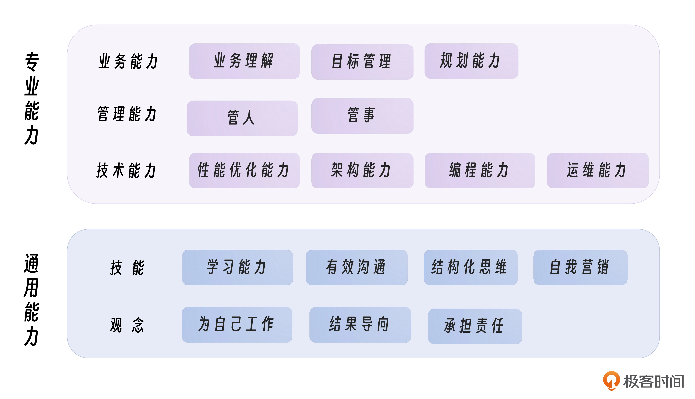
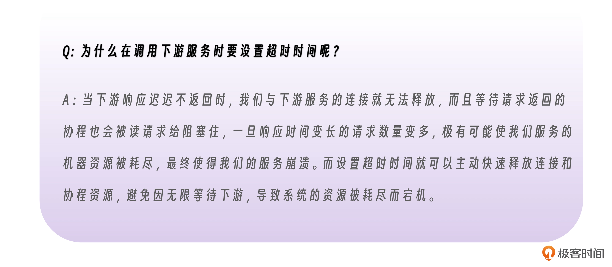
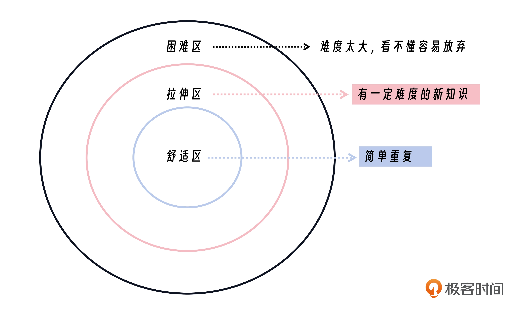
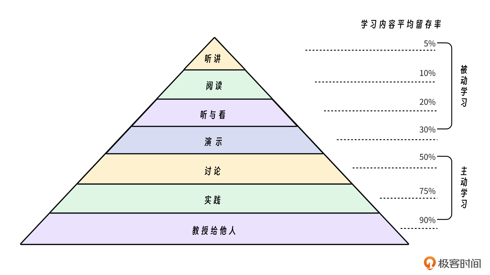
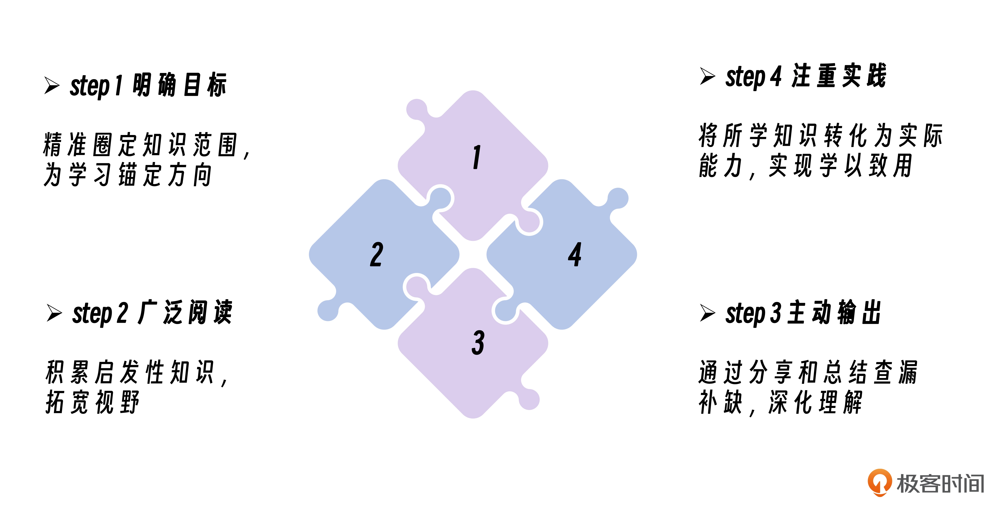

# 结束语 | 以终为始，持续成长

你好，我是徐逸。

通过前面 2 个多月的刻苦学习，我们的 Go 服务开发高手课迎来了最后一节课。课程虽将画上句点，但成长的脚步永不停歇。所以，在这即将暂别的时刻，我想和你分享一下后续的学习方向以及相应的学习方法，希望能为你在技术道路上的持续前行提供助力。

## 今后要学什么

之所以选择今后要学什么这个话题，是因为我注意到不少同学都陷入了迷茫。有些同学在工作中停滞不前，完全不清楚该学习哪些内容，才能实现进一步的自我突破；还有些同学，则恰恰相反，似乎被知识淹没，什么都学，却感觉没有尽头，学得身心俱疲。

在《高效能人士的七个习惯》一书中，提到 “以终为始” 这一重要习惯。实际上，我们的学习同样可以借鉴这一理念，通过设定明确的学习目标，来圈定需要学习的知识范围。

从程序员的职业成长路径来看，大多数程序员的职业规划，都是成为架构师或是技术管理者。为了达成这一职业目标，我们就必须明确架构师和技术管理者的工作内容，也就是他们的岗位职责。只有明确了这些职责，我们才能有针对性地提前储备相应的能力，为胜任更高层级的工作做好充分准备。而这些能力，恰恰为我们指明了学习的方向。

例如，我们可以从公司内部的职级要求入手，或者参考外部招聘市场上的岗位说明书（JD），通过反向推导的方式，明确实现职业目标所需的关键能力。以下是我结合多个招聘 JD 中的架构师岗位职责，并参考阿里、腾讯等大公司的能力模型，归纳出的较为通用的架构师能力模型，供你参考。

- 图1 架构师能力模型

首先是通用能力。通用能力是绝大部分工作都需要的能力，具有强迁移性。它包括学习能力、有效沟通、结构化思维能力、自我营销能力和为自己工作、结果导向、承担责任的个人观念。

其次是业务能力。业务能力是基于对业务问题和目标的深入理解，将其拆解为具体技术目标，并进行合理技术规划的能力。它主要包含业务（产品）理解能力以及目标管理和规划能力。

对于程序员来说，业务能力为何这么重要呢？这要从技术的本质说起。技术作为推动业务发展的生产工具，只有深入了解业务问题和业务目标，才能识别出为实现业务目标，需要搭建的技术平台和实现的工具有哪些，从而为业务发展提供有力支持，实现技术与业务的深度融合。

然后是管理能力。管理能力是带人做事的能力，主要体现在管人（涵盖团队管理、团队协作以及向上管理）和管事（主要指项目管理）这两个方面。通常情况下，架构师所负责的工作方向较为复杂，往往需要带领团队成员共同推进。因此，如何在团队内部进行合理分工协作，确保各项任务顺利完成，就成为架构师必备的一项重要能力。它不仅关乎团队的工作效率，更关系到项目的最终成败。

最后是技术能力。技术能力是指在开发技术产品以及解决技术问题过程中所需掌握的知识与技能，主要包括编程能力、运维能力、性能优化能力以及架构能力。其中，运维能力具体指应用发布、线上故障分析与排查等方面的能力。实际上，我们 《Go 服务开发高手》 这个专栏，就是为了提升你的编程能力、性能优化能力以及架构能力，助力你在技术领域不断进阶。

## 我的学习方法

虽然能力模型为我们指明了学习的方向，但如果想让学习真正带来改变，我们还需要掌握有效的方法，将所学知识内化为自己的能力。

接下来，我想和你分享，在过去两年我通过不断阅读和思考总结出的一套学习方法。正是凭借这套方法，我才完成了这门课程的创作。

这个方法包括三个关键步骤。

首先，针对能力模型中的各项技能，我们需要广泛阅读相关主题的文献，持续积累启发性知识。这里所说的“启发性知识”，是指那些当你接触到时，会有一种“原来如此”之感的知识，就像下图展示的例子一样。这种学习方法其实也是周岭老师在《认知觉醒：开启自我改变的原动力》中所推崇的。

- 图2 启发性知识

就像下面的图展示的一样，之所以要积累启发性知识，是因为它能帮助我们突破舒适区，进入“拉伸区”。在拉伸区，我们的学习不再是简单的重复，而是通过接触新的、略高于当前水平的知识，不断挑战自我，从而实现真正的成长。

- 图3 拉伸区理论

接着，当我们在某一主题的知识积累到一定程度后，就需要主动进行输出。这正是费曼技巧的核心应用。根据学习金字塔理论，只有当我们能够将所学知识清晰、准确地表达出来，并在不同知识点之间建立联系时，我们才能真正发现知识的漏洞，进而加深对知识的理解，使其在大脑中的留存率最大化。

- 图4 学习金字塔

当然，输出的形式可以多种多样，比如撰写文章、进行演讲、录制视频，或者与他人展开讨论。无论选择哪种方式，都能有效帮助你巩固知识。

在创作《Go 服务开发高手》这个专栏的过程中，我深刻体会到了知识输出的力量。通过不断地梳理和总结自己的经验，我不仅巩固了自己对 Go 语言和架构的理解，还发现了很多之前没有注意到的细节。这个过程对我来说是一次宝贵的学习和成长机会。

在此，我也要借机感谢每一位学习这门课的小伙伴。你们的支持和反馈是我不断前进的动力。每一条留言、每一次互动都让我感受到你们的热情和对知识的渴望。这不仅激励我更加努力地创作高质量的内容，也让我更加坚信，分享知识是一件非常有意义的事情。

最后，我们还需要注意实践。例如，如果你学习编程，那么最好的方式就是动手写代码；如果你学习管理知识，那么可以尝试将它应用到团队协作中。只有通过实践，我们才能积累经验，提升能力，最终实现知识的真正内化。

以上所述的三个步骤构成了我的核心学习方法，如果结合前面提到的学习目标设定，整个学习流程可以进一步优化为下面四个关键步骤。

- 四步学习法

- 首先，明确目标，精准圈定知识范围，为学习锚定方向；

- 其次，广泛阅读，积累启发性知识，拓宽视野；

- 接着，主动输出，通过分享和总结查漏补缺，深化理解；

- 最后，注重实践，将所学知识转化为实际能力，实现学以致用。

希望我的学习方法能够帮助到你，让你在学习的道路上更加高效、更有收获。

写到这里，这门课程就正式落下帷幕了。虽然课程结束了，但学习的脚步不会停止，我也会继续为你答疑解惑。如果你在学习过程中有任何问题，欢迎向我提问，我会尽力为你提供帮助。

最后，我为你准备了一份结课问卷，希望你能抽出几分钟时间填写一下。你的反馈对我非常重要，期待听到你对这门课程的真实感受和宝贵建议！
