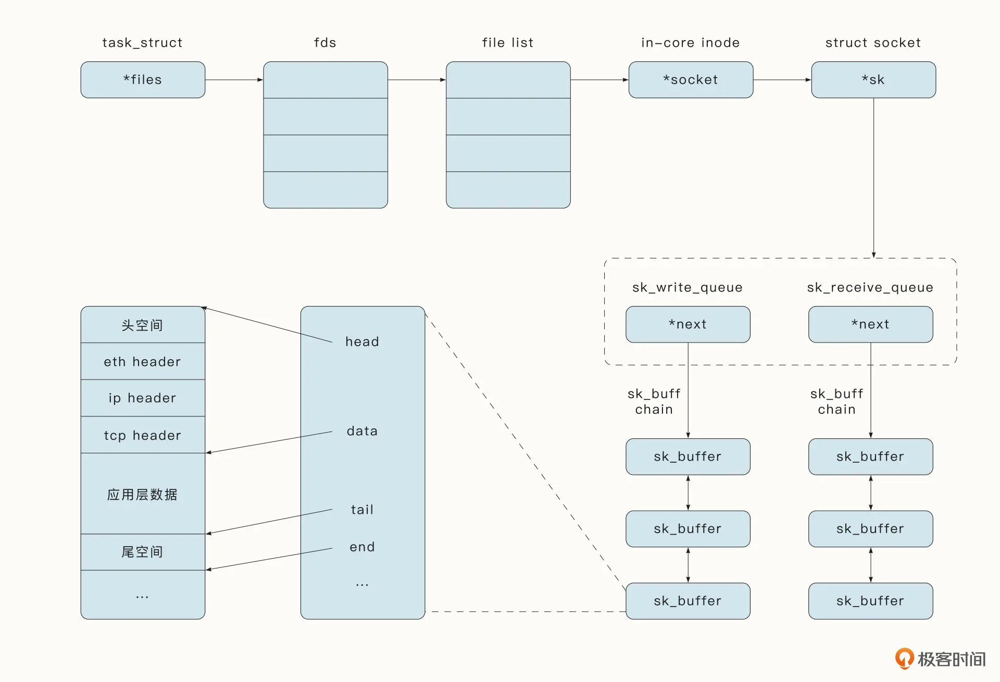
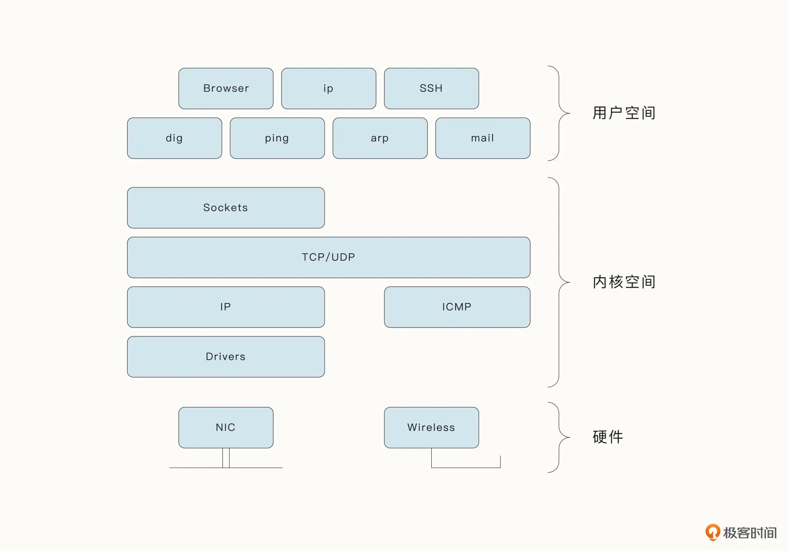
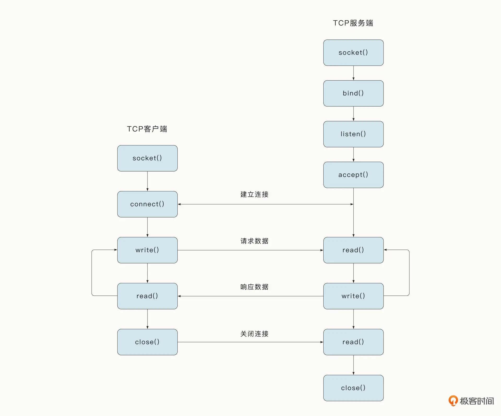
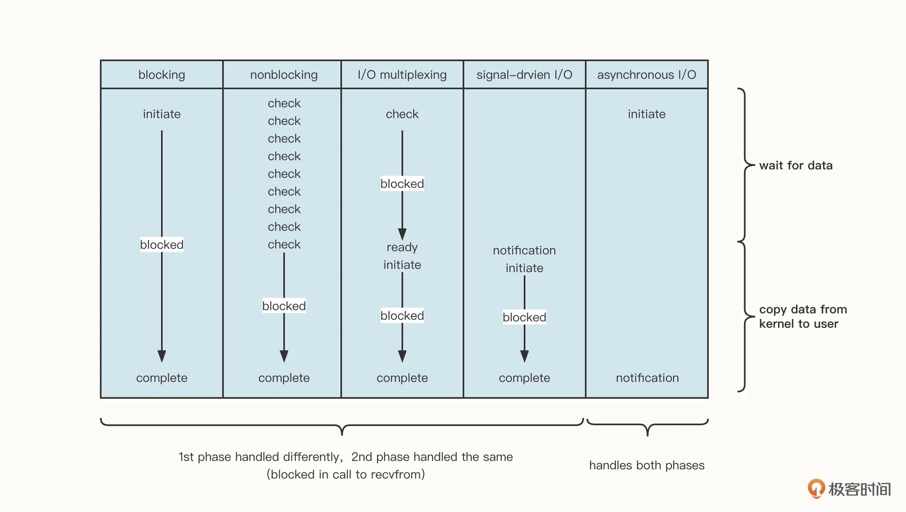
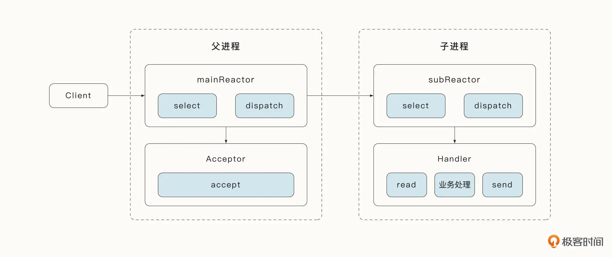
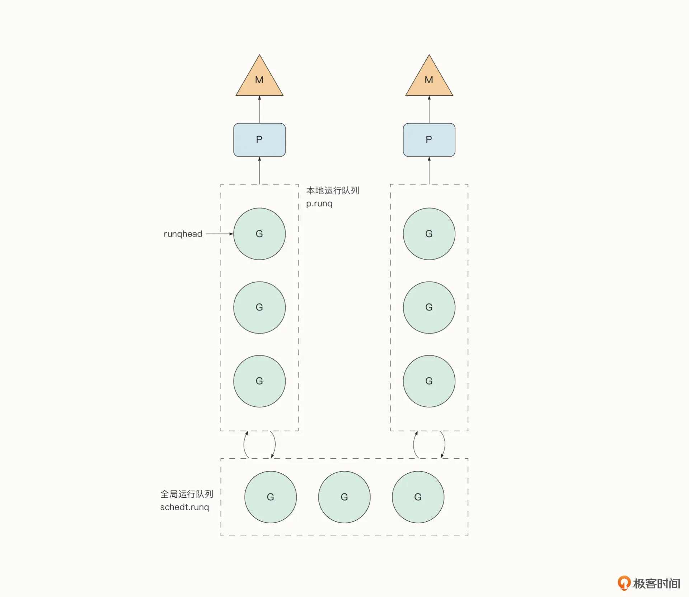
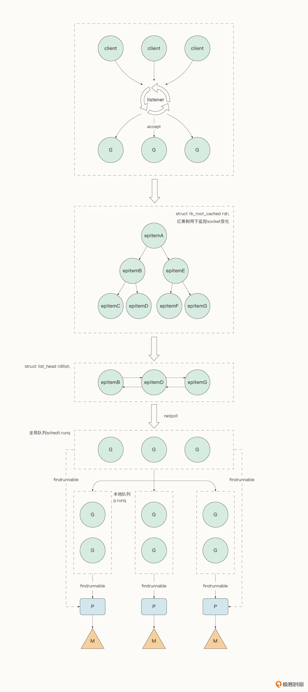

# 07 | 冰川之下：深入Go高并发网络模型

你好，我是郑建勋。

很多人认为，Go 语言是开发网络服务的极佳选择。因为开发者能够简单、高效地处理大量的并发请求。

之所以说 Go 语言开发简单，是因为 Go 是以同步的方式来处理网络 I/O 的，它会等待网络I/O 就绪后，才继续下面的流程，这是符合开发者直觉的处理方式。说 Go 语言高效，是因为在同步处理的表象下，Go 运行时封装 I/O 多路复用，灵巧调度协程，实现了异步的处理，也实现了对 CPU 等资源的充分利用。这节课，我们就深入看看 Go 是如何做到这一点的。

首先，让我们循序渐进地从几个重要的概念，阻塞与非阻塞、文件描述符与 Socket 说起。

## 阻塞与非阻塞

程序在运行过程中，要么在执行，要么在等待执行（陷入到阻塞的状态）。如果当前程序处理的时间大多数花在 CPU 上，它就是 CPU 密集型（CPU-bound）系统。相反，如果程序的大多数时间花费在等待 I/O 上，这种程序就是 I/O 密集型（I/O bound）的。

很多网络服务属于 I/O 密集型系统，因为它们把大量时间花费在了网络请求上。如果后续的处理流程需要依赖网络 I/O 返回的数据，那么当前的任务就要陷入到堵塞状态中。然而，很多情况下我们并不希望当前任务的堵塞会影响到其他任务的执行，我们希望充分利用 CPU 资源，承载更多的请求量和更快的响应速度。

想象一下，如果浏览器只有在页面完全加载之后才能完成关闭的操作会有多么让人抓狂。另一方面，当一个浏览器在请求服务器时，服务器中的图片和文件可能来自几十个地方，浏览器一般会并行地请求这些资源，当一个连接陷入到阻塞状态时，CPU 不会闲着，而是紧接着去处理另一个连接。所以一个高效的网络服务要能够处理下面这些问题：

- 一个任务的阻塞不影响其他任务的执行；

- 任务之间能够并行；

- 当阻塞的任务准备好之后，能够通过调度恢复执行。

在 Linux 操作系统中，要解决上面的这些问题，就离不开一个重要的结构：Socket。

## 文件描述符与 Socket

当我们谈到网络编程的时候，免不了要谈 Socket，但是 Socket 在不同的语境下有不同的含义。

Socket 大多数时候指的是一个“插槽”。在网络连接时，我们需要建立一个 Socket，服务器与客户端要想发送和接收网络数据都需要经过 Socket。在 Linux 一切皆文件的设计下，Socket是一个特殊的文件，存储在描述进程的 task_struct 结构中。

以 TCP 连接为例，Socket 的相关结构如下图所示。进程可以通过文件描述符找到对应的Socket 结构。Socket 结构中存储了发送队列与接收队列，每一个队列中保存了结构sk_buffer。sk_buff 是代表数据包的主要网络结构，但是 sk_buff 本身存储的是一个元数据，不保存任何数据包数据，所有数据都保存在相关的缓冲区中。



- socket及其相关结构

在另一些时候，Socket 指的是用户态和内核态之间进行交互的 API。现代操作系统在处理网络协议栈时，链路层 Ethernet 协议、网络层 IP 协议、传输层 TCP 协议都是在操作系统内核实现的。而应用层是在用户态由应用程序实现的。应用程序和操作系统之间交流的接口就是通过操作系统提供的 Socket 系统调用 API 完成的。

下面这张图列出了硬件、操作系统内核、用户态空间中分别对应的组件和交互。在这里，操作系统与硬件之间通过设备驱动进行通信，而应用程序与操作系统之间通过 Socket 系统调用API 进行通信。



还有些时候，Socket 指的是 Socket API 中的 socket 函数。例如，在 Unix 典型的 TCP 连接中，需要完成诸多系统调用，但是第一步往往都是调用 socket 函数。



在这些系统调用中，默认使用的是阻塞的模式。例如 accept 函数阻塞等待客户端的连接，read 函数阻塞等待读取客户端发送的消息。但是 Unix 操作系统也为我们提供了一些其他手段来避免 I/O 的阻塞（相对应地也需要一些机制，例如轮询、回调函数来保证非阻塞的 socket在未来准备就绪后能够正常处理），这就是我们将要谈到的 I/O 模型。

## I/O 模型

在经典的著作《UNIX Network Programming》（Volume 1, Third Edition）中，就有对于 I/O模型的权威论述，它将 I/O 模型分为 5 种类型，分别是：

- 阻塞 I/O；

- 非阻塞 I/O；

- 多路复用 I/O；

- 信号驱动 I/O；

- 异步 I/O。



其中，阻塞 I/O 是最简单直接的类型，例如，read 系统调用函数会一直堵塞，直到操作完成为止。

```
非阻塞 I/O 顾名思义不会陷入到阻塞，它一般通过将 Socket 指定为 SOCK_NONBLOCK 非堵塞
```

模式来实现。这时就算当前 Socket 没有准备就绪，read 等系统调用函数也不会阻塞，而会返回具体的错误。所以，这种方式一般需要开发者采用轮询的方式不时去检查。

多路复用 I/O 是一种另类的方式，它仍然可能陷入阻塞，但是它可以一次监听多个 Socket 是否准备就绪，任何一个 Socket 准备就绪都可以返回。典型的函数有 poll、select、epoll。多路复用仍然可以变为非阻塞的模式，这时仍然需要开发者采用轮询的方式不时去检查。

信号驱动 I/O 是一种相对异步的方式，当 Socket 准备就绪后，它通过中断、回调等机制来通知调用者继续调用后续对应的 I/O 操作，而后续的调用常常是堵塞的。

异步 I/O 异步化更加彻底，全程无阻塞，调用者可以继续处理后续的流程。所有的操作都完全托管给操作系统。当 I/O 操作完全处理完毕后，操作系统会通过中断、回调等机制通知调用者。Linux 提供了一系列 aoi_xxx 系统调用函数来处理异步 I/O。

这样讲解完，你可能会觉得这几种 I/O 模式，从阻塞 I/O 模式到异步 I/O 模式是越来越高级、越来越先进的。如果从单个进程的角度来看，也许有几分道理。但现实的情况是，阻塞 I/O 和多路复用是最常用的。

为什么会这样呢？因为阻塞是一种最简单直接的编程方式。同时，在有多线程的情况下，即便一个线程内部是阻塞状态，也不会影响其他的线程。

根据不同的 I/O 模型，不同线程与进程的组织方式，也产生了许多不同的网络模型，其中最知名的莫过于 Reactor 网络模型。我们可以把 Reactor 网络模型理解为 I/O 多路复用 + 线程池的解决方案。

目前，Linux 平台上大多数知名的高性能网络库和框架都使用了 Reactor 网络模型，包括Redis、Nginx、Netty、Libevent 等等。

Reactor 本身有反应堆的意思，表示对监听的事件做出相应的反应。Reactor 网络模型的思想是监听事件的变化，一般是通过 I/O 多路复用监听多个 Socket 状态的变化，并将对应的事件分发到线程中去处理。

Reactor 网络模型的变体有很多种，包括：

- 单 Reactor 单进程 / 线程；

- 单 Reactor 多线程；

- 多 Reactor 多进程 / 线程。

我以多 Reactor 多线程为例说明一下，主 Reactor 使用 selelct 等多路复用机制监控连接建立事件，收到事件后通过 Acceptor 接收，并将新的连接分配给子 Reactor。

随后，子 Reactor 会将主 Reactor 分配的连接加入连接队列，监听 Socket 的变化，当 Socket准备就绪后，在独立的线程中完成完整的业务流程。



- 多 Reactor 多线程（来自《从 0 开始学架构》）

## 基于协程的网络处理模型

如果说 Reactor 网络模型是 I/O 多路复用 + 线程池。那么 Go 则采取了一种不太寻常的方式来构建自己的网络模型，我们可以将其理解为 I/O 多路复用 + 非阻塞 I/O + 协程。 在多核时代，Go 在线程之上创建了轻量级的协程。作为并发原语，协程解决了传统多线程开发中开发者面临的心智负担（内存屏障、死锁等），并降低了线程的时间成本与空间成本。

线程的时间成本主要来自于切换线程上下文时，用户态与内核态的切换、线程的调度、寄存器变量以及状态信息的存储。

提醒一下，如果两个线程位于不同的进程，进程之间的上下文切换还会因为内存地址空间的切换导致缓存失效，所以不同进程的切换要显著慢于同一进程中线程的切换（现代的 CPU 使用快速上下文切换技术解决了进程切换带来的缓存失效问题）。

再话说回来，线程的空间成本主要来自于线程的堆栈大小。线程的堆栈大小一般是在创建时指定的，为了避免出现栈溢出（Stack Overflow），默认的栈会相对较大（例如 2MB），这意味着每创建 1000 个线程就需要消耗 2GB 的虚拟内存，这大大限制了创建的线程的数量（虽然 64位的虚拟内存地址空间已经让这种限制变得不太严重了）。

而 Go 语言中的协程栈大小默认为 2KB，并且是动态扩容的。因此在实践中，经常会看到成千上万的协程存在。

```
// 源码中初始的栈大小
_StackMin = 2048
```

线程的特性决定了线程的数量并不是越多越好。实践中不会无限制地创建线程，而是会采取线程池等设计来控制线程的数量。

协程的特性决定了在实践中，我们一般不会考虑创建一个协程带来的成本。如下为一个典型的网络服务器，main 函数中监听新的连接，每一个新建立的连接都会新建了一个协程执行handle 函数。这种设计是符合开发者直觉的，因此其书写起来非常简单。在正常情况下网络服务器会出现成千上万的协程，但 Go 运行时的调度器也能够轻松应对。

```go
func main() {
 listen, err := net.Listen("tcp", ":8888")
 if err != nil {
   log.Println("listen error: ", err)
   return
 }
 for {
   conn, err := listen.Accept()
   if err != nil {
     log.Println("accept error: ", err)
     break
   }
   // 开启新的Groutine，处理新的连接
   go Handle(conn)
 }
}
func Handle(conn net.Conn) {
 defer conn.Close()
 packet := make([]byte, 1024)
 for {
   // 阻塞直到读取数据
   n, err := conn.Read(packet)
   if err != nil {
     log.Println("read socket error: ", err)
     return
   }
   // 阻塞直到写入数据
   _, _ = conn.Write(packet[:n])
 }
}
```

## 同步编程模式

继续看上面这个例子，在这里，每一个新建的连接都有单独的协程处理 handle 函数，这个函数通过 conn.Read 读取数据，然后通过 conn.Write 写入数据。他们在开发者的眼中都是一种阻塞的模式。当 conn.Read 等待数据的读取时，当前的协程陷入到等待的状态，等到数据读取完毕，调度器才会唤醒协程去执行。这是一种直观、简单的编程模式。相对于回调、信号处理等异步机制，同步的编程模式明确并简化了处理流程，不易犯错并且方便调试。

协程虽然会陷入阻塞，但是这种阻塞并不是对线程的阻塞，而是发生在用户态的阻塞。借助Go 运行时强大的调度器，当前的协程阻塞了，其他可运行的协程借助逻辑处理器 P 仍然可以调度到线程上执行。在后面的课程中，还会详细介绍协程与调度器的原理。



- GMP模型

## 多路复用

Go 网络模型中另一个重要的机制是对 I/O 多路复用的封装。

在上例中，协程可能会处于阻塞的状态，所以我们需要机制能够监听大量的 Sokcet 的变化。当 Socket 准备就绪之后，能够让被阻塞的协程恢复执行。

为了实现这一点，Go 标准的网络库实现了对于不同操作系统提供的多路复用 API（epoll/kqueue/iocp）的封装。我们可以把 Go 语言的这种机制称作 netpoll。例如在 Linux 系统中，netpoll 封装的是 epoll。epoll 是 Linux2.6 之后新增的，它采用了红黑树的存储结构，在处理大规模 Socket 时的性能显著优于 select 和 poll。关于 select 和 poll 接口的缺陷，可以参考《The Linux Programming Interface》第 63 章。

epoll 中提供了 3 个 API，epoll_create 用于初始化 epoll 实例、epoll_ctl 将需要监听的 Socket放入 epoll 中，epoll_wait 等待 I/O 可用的事件。

```
#include <sys/epoll.h>
int epoll_create(int size);
int epoll_ctl(int epfd,int op,int fd,struct epoll_event*event);
int epoll_wait(int epfd,struct epoll_event* events,int maxevents,int timeout);
```

在 Go 中对其封装的函数为：

```go
// netpoll_epoll.go
func netpollinit()
func netpollopen(fd uintptr, pd *pollDesc) int32
func netpoll(delay int64) gList
```

Go 运行时只会全局调用一次 netpollinit 函数。而我们之前看到的 conn.Read、conn.Write 等读取和写入函数底层都会调用 netpollopen 将对应 Socket 放入到 epoll 中进行监听。

```
程序可以轮询调用 netpoll 函数获取准备就绪的 Socket。netpoll会调用  epoll_wait
获取 epoll 中  eventpoll.rdllist  链表，该链表存储了 I/O 就绪的 socket 列表。接着
```

netpoll 取出与该 Socket 绑定的上下文信息，恢复堵塞协程的运行。

```
调用netpoll 的时机下面有两个。
```

- 系统监控定时检测。Go 语言在初始化时会启动一个特殊的线程来执行系统监控任务sysmon。系统监控在一个独立的线程上运行，不用绑定逻辑处理器 P。系统监控每隔10ms 会检测是否有准备就绪的网络协程，若有，就放置到全局队列中。

```go
func sysmon() {
 ...
 if netpollinited() && lastpoll != 0 && lastpoll+10*1000*1000 < now {
     atomic.Cas64(&sched.lastpoll, uint64(lastpoll), uint64(now))
     // netpoll获取准备就绪的协程
     list := netpoll(0)
     if !list.empty() {
       incidlelocked(-1)
       // 放入可运行队列中
       injectglist(&list)
       incidlelocked(1)
     }
   }
}
```

- 在调度器决定下一个要执行的协程时，如果局部运行队列和全局运行队列都找不到可用协程，调度器会获取准备就绪的网络协程。调度器通过 runtime.netpoll 函数获取当前可运行的协程列表，返回第一个可运行的协程。然后通过 injectglist 函数将其余协程放入全局运行队列等待被调度。涉及到调度器的原理，在后面还会详细介绍。

```go
func findrunnable() (gp *g, inheritTime bool) {
...
 if netpollinited() && atomic.Load(&netpollWaiters) > 0 && atomic.Load64(&sched.
   if list := netpoll(0); !list.empty() { // non-blocking
     gp := list.pop()
     injectglist(&list)
     casgstatus(gp, _Gwaiting, _Grunnable)
     if trace.enabled {
       traceGoUnpark(gp, 0)
     }
     return gp, false
   }
 }
}
```

要注意的是，netpoll 处理 Socket 时使用的是非堵塞模式，这也意味着 Go 网络模型中不会将阻塞陷入到操作系统调用中。而强大的调度器又保证了用户协程陷入堵塞时可以轻松的切换到其他协程运行，保证了用户协程公平且充分的执行。这就让 Go 在处理高并发的网络请求时仍然具有简单与高效的特性。

## 总结

好了，这节课就讲到这里。今天我们重点讨论了 Go 语言的网络模型，并解释了 Go 语言为什么适合开发网络服务。

其实，Go 语言的致胜法宝可以总结为一个公式：同步编程 + 多路复用 + 非阻塞 I/O+ 协程调度。



- Go网络模型

Go 同步编程的模式简单直接，符合开发者的直觉。同时，协程的特点让开发者可以轻松地创建大量协程。

在同步编程模式下，Go 真正的阻塞并未发生在操作系统调用的阻塞上，而是发生在用户态协程的阻塞上。借助不同操作系统下多路复用的封装以及非阻塞的 I/O 模式，当可用的 Socket准备就绪，Go 就能保证之前陷入堵塞的协程可以运行，并最终被调度器调度。Go 调度器牢牢地锁定了协程的控制权，即便协程发生阻塞，调度器也能够快速切换到其他协程运行，在高并发网络 I/O 密集的环境下保证了程序的高性能。

## 课后题

最后，我也给你留一道思考题。

I/O 可以分为磁盘 I/O 与网络 I/O，你知道 Go 在处理二者时的区别吗？

欢迎你在留言区与我交流讨论，我们下节课再见！
