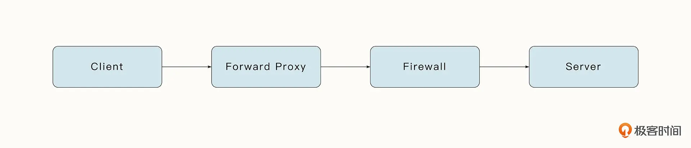
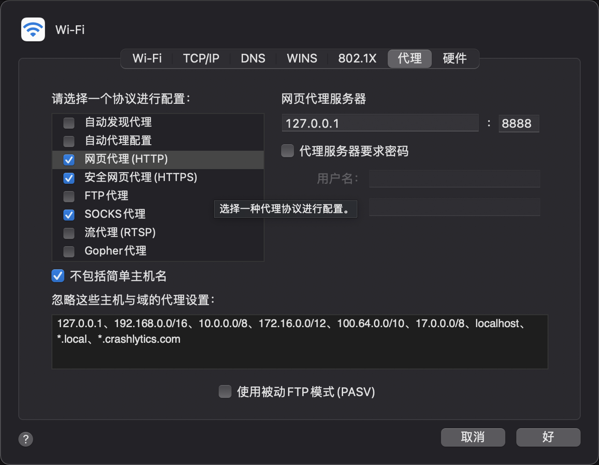
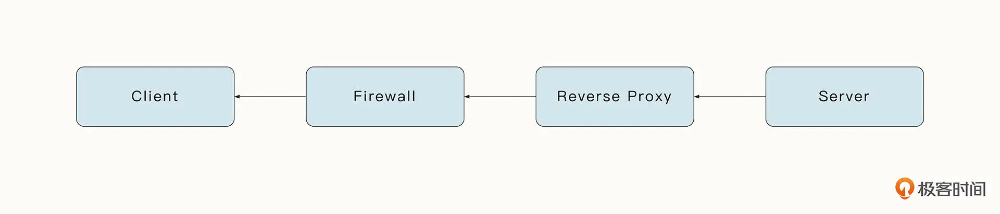

# 23 | 偷梁换柱：为爬虫安上代理的翅膀

你好，我是郑建勋。

在任何爬虫系统中，使用代理都是不可或缺的功能。代理是指在客户端和服务器之间路由流量的服务，用于实现系统安全、负载均衡等功能。在爬虫项目中，代理服务器常常扮演着重要的角色，它能帮助我们突破服务器带来的限制和封锁，达到正常抓取数据的目的。这节课，我们来看一看各种类型代理的区别和使用方式，并在代码中实现代理。

那么第一个问题来了，代理分为哪些类型呢？

代理作为客户端和服务器的中间层，按照不同的维度可以分为不同的类型。一种常见的划分方式是将代理分为正向代理（forward proxy）与反向代理（reverse proxy）。根据实现代理的方式可以分为 HTTP 隧道代理、MITM 代理、透明代理。而根据代理协议的类型，又可以分为HTTP 代理、HTTPS 代理、SOCKS 代理、TCP 代理等。

## 代理的分类和实现机制

### 正向代理

当我们谈论代理服务器时，通常指的就是正向代理。正向代理会向一个客户端或一组客户端提供代理服务。通常，这些客户端属于同一个内部网络。当客户端尝试访问外部服务器时，请求必须首先通过正向代理。

可是我们为什么需要这多余的中间层呢？因为正向代理能够监控每一个请求与回复，鉴权、控制访问权限并隐藏客户端实际地址。隐藏了客户端的真实地址之后，正向代理可以绕过一些机构的网络限制，这样一些互联网用户就实现了匿名性。



用 Go 实现的一个简单的 HTTP 正向代理服务如下所示。在这个例子中，代理服务器接受来自客户端的 HTTP 请求，并通过 handleHTTP 函数对请求进行处理。处理的方式也比较简单，当前代理服务器获取客户端的请求，并用自己的身份发送请求到服务器。代理服务器获取到服务器的回复后，会再次利用 io.Copy 将回复发送回客户端。

```go
func main() {
 server := &http.Server{
   Addr: ":8888",
   Handler: http.HandlerFunc(func(w http.ResponseWriter, r *http.Request) {
     handleHTTP(w, r)
   }),
 }
 log.Fatal(server.ListenAndServe())
}
func handleHTTP(w http.ResponseWriter, req *http.Request) {
  resp, err := http.DefaultTransport.RoundTrip(req)
  if err != nil {
     http.Error(w, err.Error(), http.StatusServiceUnavailable)
    return
  }
  defer resp.Body.Close()
  copyHeader(w.Header(), resp.Header)
  w.WriteHeader(resp.StatusCode)
  io.Copy(w, resp.Body)
}
func copyHeader(dst, src http.Header) {
 for k, vv := range src {
   for _, v := range vv {
     dst.Add(k, v)
   }
 }
}
```

代理服务器除了要在客户端与服务器之间搭建起一个管道，有时还需要处理一些特殊的 HTTP请求头，叫做 hop-by-hop 请求头。hop-by-hop，顾名思义，这些请求头不是给目标服务器使用的，它是专门给中间的代理服务器使用的。例如在 Go httputil 标准库中，就包含了如下hop-by-hop 请求头：

```javascript
var hopHeaders = []string{
 "Connection",
 "Proxy-Connection",
 "Keep-Alive",
 "Proxy-Authenticate",
 "Proxy-Authorization",
 "Te",
 "Trailer",
 "Transfer-Encoding",
 "Upgrade",
}
```

代理服务器需要根据情况对 hop-by-hop 请求头做一些特殊处理，并在发送给目标服务器之前删除 hop-by-hop 请求头。

### HTTP 隧道代理

在上面的例子中，代理服务器是直接与目标服务器进行 HTTP 通信的。但是在一些更复杂的情况下，客户端还希望与服务器进行 HTTPS 通信和 HTTP 隧道技术（HTTP Tunnel）形式的通信，防止中间人攻击并隐藏 HTTP 的特征。

在 HTTP 隧道技术中，客户端会在第一次连接代理服务器时给代理服务器发送一个指令，通常是一个 HTTP 请求。这里我们可以将 HTTP 请求头中的 method 设置为 CONNECT。

```
CONNECT example.com:443 HTTP/1.1
```

代理服务器收到该指令后，将与目标服务器建立 TCP 连接。连接建立后，代理服务器会将之后收到的请求通过 TCP 连接转发给目标服务器。因此，只有初始连接请求是 HTTP， 之后，代理服务器将不再嗅探到任何数据，它只是完成一个转发的动作。现在如果我们去查看其他开源的代理库，就会明白为什么会对 CONNECT 方法进行单独的处理了，这是业内通用的一种标准。

下面我在前一个例子的基础上，实现一下这个 HTTP 隧道。

```go
func main() {
 server := &http.Server{
   Addr: ":9981",
   Handler: http.HandlerFunc(func(w http.ResponseWriter, r *http.Request) {
     if r.Method == http.MethodConnect {
       handleTunneling(w, r)
     } else {
       handleHTTP(w, r)
     }
   }),
 }
 log.Fatal(server.ListenAndServe())
}
func handleTunneling(w http.ResponseWriter, r *http.Request) {
 dest_conn, err := net.DialTimeout("tcp", r.Host, 10*time.Second)
 if err != nil {
   http.Error(w, err.Error(), http.StatusServiceUnavailable)
   return
 }
 w.WriteHeader(http.StatusOK)
 hijacker, ok := w.(http.Hijacker)
 if !ok {
   http.Error(w, "Hijacking not supported", http.StatusInternalServerError)
   return
 }
 client_conn, _, err := hijacker.Hijack()
 if err != nil {
   http.Error(w, err.Error(), http.StatusServiceUnavailable)
 }
 go transfer(dest_conn, client_conn)
 go transfer(client_conn, dest_conn)
}
func transfer(destination io.WriteCloser, source io.ReadCloser) {
 defer destination.Close()
 defer source.Close()
 io.Copy(destination, source)
}
```

这里，当探测到 HTTP 请求是 CONNECT 方法之后，handleTunneling 函数会进行特殊处理，建立与服务器的 TCP 连接。在之后，代理服务器会将数据包从服务器转发到客户端。

上面的代码有几处巧妙的地方。第一处是在代码第 28 行，我们通过 hijacker.Hijack() 拿到了客户端与代理服务器之间的底层 TCP 连接。我们之前介绍过，Go 对 HTTP 进行了深度的封装，但有时候我们希望单独对连接进行处理，Go HTTP 标准库为我们提供了这种可能性。当调用 hijacker.Hijack() 拿到底层连接之后，hijackLocked 函数会为变量 hijackedv 赋值为true。

```
func (c *conn) hijackLocked() (rwc net.Conn, buf *bufio.ReadWriter, err error) {
 ...
 c.hijackedv = true
}
```

Go HTTP 标准库会在不同的阶段检测到该变量是否为 true，如果为 true 将放弃后续标准库的托管处理。

```
func (c *conn) hijacked() bool {
 c.mu.Lock()
 defer c.mu.Unlock()
 return c.hijackedv
}
```

另一个巧妙的地方是，我们通过 io.Copy 就简单地串联起了一个管道，实现了数据包在服务器与客户端之间的相互转发。当然在工业级的代码中，我们不会用这么粗暴的方式实现这一功能，因为传输的数据量可能很大。在工业级代码中，我们一般会写一个 for 循环，控制每一次转发的数据包大小。例如，在 Go 标准库 httputil 中，有一段实现将 src 数据拷贝到了 dst 中的操作，你可以参考一下：

```go
func (p *ReverseProxy) copyBuffer(dst io.Writer, src io.Reader, buf []byte) (int6
 if len(buf) == 0 {
   buf = make([]byte, 32*1024)
 }
 var written int64
 for {
   nr, rerr := src.Read(buf)
   if rerr != nil && rerr != io.EOF && rerr != context.Canceled {
     p.logf("httputil: ReverseProxy read error during body copy: %v", rerr)
   }
   if nr > 0 {
     nw, werr := dst.Write(buf[:nr])
     if nw > 0 {
       written += int64(nw)
     }
     if werr != nil {
       return written, werr
     }
     if nr != nw {
       return written, io.ErrShortWrite
     }
   }
   if rerr != nil {
     if rerr == io.EOF {
       rerr = nil
     }
     return written, rerr
   }
 }
}
```

### MITM 代理

除了我们上面提到的 HTTP 隧道技术，代理服务器还可以使用 HTTPS 来处理数据。意思是让代理服务器直接与目标服务器建立 HTTPS 连接，同时在客户端与服务器之间建立另一个HTTPS 连接。

但是我们之前说过，HTTPS 天然阻止了这种中间人攻击，而要突破这种封锁就需要让客户端能够完全信任代理服务器颁发的证书，因此这种代理服务器也被称为 MITM（Man-In-The-Middle）。MITM 就像一个中间人，能够看到所有流过它的 HTTP 和 HTTPS 流量。这种方式是一些代理软件（例如 Charles）能够嗅探到 HTTPS 数据的原因。

### 透明代理

在上面的代理中，客户端需要感知到代理服务器的存在。但是还有一类代理，客户端不用感知到代理服务器，只需要直接往目标服务器中发送消息，通过操作系统或路由器的路由设置强制将请求发送到代理服务器中。

举一个例子，在我的 Mac 电脑上（Windows 类似）就可以设置系统代理。这样我在浏览器上发送的所有 HTTP/HTTPS 请求都会被转发到代理服务器的地址 127.0.0.1:8888 中。



而在 Linux 服务器中，我们可以使用 iptables、IPVS 等技术强制将请求转发到代理服务器上。

### 反向代理

我们再来看一下反向代理。

与正向代理不同的是，反向代理位于服务器的前方，客户端不能直接与服务器进行通信，需要通过反向代理。我们比较熟悉的 Nginx 一般就是用于实现反向代理的。



反向代理可以带来下面几个好处。

- 负载均衡对于大型分布式系统来说，反向代理可以提供一种负载均衡解决方案，在不同服务器之间平均分配传入流量，防止单个服务器过载。如果某台服务器完全无法运转，可以将流量转发到其他服务器。

- 防范攻击配备反向代理后，服务器无需暴露真实的 IP 地址，这就让攻击者难以进行针对性攻击（例如 DDoS 攻击），同时，反向代理通常还拥有更高的安全性和更多抵御网络攻击的资源。

- 缓存代理服务器可以缓存（或临时保存）服务器的响应数据（即使服务器在千里之外），大大加快请求的速度。

- SSL 加密解密反向代理可以对客户端发出的 HTTPS 请求进行解密，对服务器发出的 HTTP 请求进行加密，从而节约目标服务器资源。

在 Go 语言中，实现反向代理非常简单，Go 语言标准库 httputil 中为我们提供了封装好的反向代理实现方式。下面是一个最简单的实现反向代理的例子。

```go
func main() {
 // 初始化反向代理服务
 proxy, err := NewProxy()
 if err != nil {
   panic(err)
 }
 // 所有请求都由ProxyRequestHandler函数进行处理
 http.HandleFunc("/", ProxyRequestHandler(proxy))
 log.Fatal(http.ListenAndServe(":8080", nil))
}
func NewProxy() (*httputil.ReverseProxy, error) {
 targetHost := "http://my-api-server.com"
 url, err := url.Parse(targetHost)
 if err != nil {
   return nil, err
 }
 proxy := httputil.NewSingleHostReverseProxy(url)
 return proxy, nil
}
// ProxyRequestHandler 使用代理处理HTTP请求
func ProxyRequestHandler(proxy *httputil.ReverseProxy) func(http.ResponseWriter,
 return func(w http.ResponseWriter, r *http.Request) {
   proxy.ServeHTTP(w, r)
 }
}
```

在这个例子中，NewProxy() 借助 httputil.NewSingleHostReverseProxy 函数生成了一个反向代理服务器。NewSingleHostReverseProxy 函数的参数是实际的后端服务器地址。如果后端有多个服务器，那么我们可以用一些策略来选择某一个合适的后端服务地址，从而实现负载均衡策略。我们可以看到，最核心的代码其实只有一行：

```go
 proxy := httputil.NewSingleHostReverseProxy(url)
```

httputil.NewSingleHostReverseProxy 内部封装了数据转发等操作。当客户端访问我们的代理服务器时，请求会被转发到对应的目标服务器中。httputil 对于反向代理的实现其实并不复杂，和我们之前介绍的正向代理的逻辑类似，主要包含了修改客户端的请求，处理特殊请求头，将请求转发到目标服务器，将目标服务器的数据转发回客户端等操作。感兴趣的同学可以查阅 httputil 源码中的核心方法 ReverseProxy.ServeHTTP。

```
// net/http/httputil/reverseproxy.go
func (p *ReverseProxy) ServeHTTP(rw http.ResponseWriter, req *http.Request)
```

## 如何在实际项目中实现代理？

前面，我们介绍了代理服务器的一些分类和实现机制，在爬虫项目中使用代理时，我们可能使用了自己搭建的代理服务器，也可能使用了外部付费或免费的代理池。在这里，假设我们已经拥有了众多代理服务器地址，客户端应该如何实现对代理的访问呢？

这里面其实涉及到两个问题，第一个问题涉及到如何访问代理服务器。第二个问题涉及选择代理的策略，在众多代理服务器中，怎样选择一个最合适的代理地址？

### 如何访问代理服务器？

我们先来看第一个问题，客户端怎么访问代理服务器。Go HTTP 标准库为我们封装了代理访

```
问的机制。在 Transport 结构体中，有一个 Proxy 函数用于返回当前应该使用的代理地
```

址。

```
type Transport struct {
 Proxy func(*Request) (*url.URL, error)
}
```

当客户端准备与服务器创建连接时，会调用该 Proxy 函数获取 proxyURL，并通过 proxyURL得到代理服务器的 IP 与端口，这就确保了客户端首先与代理服务器而不是与目标服务器建立连接。

```go
func (t *Transport) connectMethodForRequest(treq *transportRequest) (cm connectMe
 cm.targetScheme = treq.URL.Scheme
 cm.targetAddr = canonicalAddr(treq.URL)
   // 获取代理地址
 if t.Proxy != nil {
   cm.proxyURL, err = t.Proxy(treq.Request)
 }
 cm.onlyH1 = treq.requiresHTTP1()
 return cm, err
}
func (t *Transport) dialConn(ctx context.Context, cm connectMethod) (pconn *persi
   ...
   conn, err := t.dial(ctx, "tcp", cm.addr())
}
func (cm *connectMethod) addr() string {
   // 如果代理地址不为空，访问代理地址
 if cm.proxyURL != nil {
   return canonicalAddr(cm.proxyURL)
 }
 return cm.targetAddr
}
```

### 怎么选择代理地址？

另一个问题是，客户端需要实现何种代理地址的策略。这个代理地址的策略类似于调度策略，调度策略有很多，包括轮询调度、加权轮询调度、一致性哈希算法等，我们可以根据实际情况进行选择。

轮询调度（RR，Round-robin）是最简单的调度策略，轮询调度的意思是让每一个代理服务器都能够按顺序获得相同的负载。下面让我们在项目中用轮询调度来实现对代理服务器的访问。

我们新建一个文件夹 proxy，负责专门处理代理相关的操作。然后新建一个函数

```
RoundRobinProxySwitcher 用于返回代理函数，稍后将代理函数注入到 http.Transport
```

中。代码如下：

```go
// proxy.go
type ProxyFunc func(*http.Request) (*url.URL, error)
func RoundRobinProxySwitcher(ProxyURLs ...string) (ProxyFunc, error) {
 if len(ProxyURLs) < 1 {
   return nil, errors.New("Proxy URL list is empty")
 }
 urls := make([]*url.URL, len(ProxyURLs))
 for i, u := range ProxyURLs {
   parsedU, err := url.Parse(u)
   if err != nil {
     return nil, err
   }
   urls[i] = parsedU
 }
 return (&roundRobinSwitcher{urls, 0}).GetProxy, nil
}
type roundRobinSwitcher struct {
 proxyURLs []*url.URL
 index     uint32
}
// 取余算法实现轮询调度
func (r *roundRobinSwitcher) GetProxy(pr *http.Request) (*url.URL, error) {
 index := atomic.AddUint32(&r.index, 1) - 1
 u := r.proxyURLs[index%uint32(len(r.proxyURLs))]
 return u, nil
}
```

RoundRobinProxySwitcher 函数会接收代理服务器地址列表，将其字符串地址解析为url.URL，并放入到 roundRobinSwitcher 结构中，该结构中还包含了一个自增的序号 index。

RoundRobinProxySwitcher 实际返回的代理函数是 GetProxy，这里使用了 Go 语言中闭包的技巧。每一次调用 GetProxy 函数，atomic.AddUint32 会将 index 加 1，并通过取余操作实现对代理地址的轮询。

接下来让我们使用这一策略，在模拟浏览器访问的结构体 BrowserFetch 中添加代理函数。

```
type BrowserFetch struct {
 Timeout time.Duration
 Proxy   proxy.ProxyFunc
}
```

```
更新 http.Client 变量中的 Transport 结构中的 Proxy 函数，将其替换为我们自定义的
```

代理函数。

```go
func (b BrowserFetch) Get(url string) ([]byte, error) {
 client := &http.Client{
   Timeout: b.Timeout,
 }
 if b.Proxy != nil {
   transport := http.DefaultTransport.(*http.Transport)
   transport.Proxy = b.Proxy
   client.Transport = transport
 }
 ...
}
在 Go http 标准库中，默认 Transport 为 http.DefaultTransport ，它定义了包括超时时
```

间在内的诸多默认参数，并且实现了一个默认的 Proxy 函数 ProxyFromEnvironment。

```javascript
var DefaultTransport RoundTripper = &Transport{
 Proxy: ProxyFromEnvironment,
 DialContext: defaultTransportDialContext(&net.Dialer{
   Timeout:   30 * time.Second,
   KeepAlive: 30 * time.Second,
 }),
 ForceAttemptHTTP2:     true,
 MaxIdleConns:          100,
 IdleConnTimeout:       90 * time.Second,
 TLSHandshakeTimeout:   10 * time.Second,
 ExpectContinueTimeout: 1 * time.Second,
}
```

ProxyFromEnvironment 函数会从系统环境变量中获取 HTTP_PROXY、HTTPS_PROXY 等参数，从而根据不同的协议使用对应的代理地址。很多代理有从环境变量中读取这些代理地址的机制，这是我们有时通过修改环境能够改变代理行为的原因。

```go
func FromEnvironment() *Config {
 return &Config{
   HTTPProxy:  getEnvAny("HTTP_PROXY", "http_proxy"),
   HTTPSProxy: getEnvAny("HTTPS_PROXY", "https_proxy"),
   NoProxy:    getEnvAny("NO_PROXY", "no_proxy"),
   CGI:        os.Getenv("REQUEST_METHOD") != "",
 }
}
```

最后，我们在 main 函数中手动加入 HTTP 代理的地址，这样就可以正常地进行访问了（后面我们会将配置统一放入配置文件当中）。

我的电脑中开启了 127.0.0.1:8888 和 127.0.0.1:8889 两个代理地址，它们可以帮助我顺利地访问到谷歌网站。通过这种方式，我们隐藏了客户端的 IP，突破了服务器设置的一些反爬机制（例如客户端对某些 IP 有访问次数限制、白名单限制等。）

```go
func main() {
 proxyURLs := []string{"http://127.0.0.1:8888", "http://127.0.0.1:8889"}
 p, err := proxy.RoundRobinProxySwitcher(proxyURLs...)
 if err != nil {
   fmt.Println("RoundRobinProxySwitcher failed")
 }
 url := "<https://google.com>"
 var f collect.Fetcher = collect.BrowserFetch{
   Timeout: 3000 * time.Millisecond,
   Proxy:   p,
 }
 body, err := f.Get(url)
 if err != nil {
   fmt.Printf("read content failed:%v\\n", err)
   return
 }
 fmt.Println(string(body))
```

## 总结

代理在爬虫系统中扮演着重要的角色，它能够帮助我们突破服务器带来的限制和封锁，达到正常抓取数据的目的。在其他领域，代理也是非常常见的。

这节课，我们介绍了代理的多种类型，包括正向代理、反向代理、MITM 代理，透明代理等。同时，我们还介绍了代理在 Go 语言中的实现方式与原理。学完这节课，你应该就能在实际项目中，根据要实现的目标，合理地选择代理的类型了。

本节课代码位于 v0.1.0 中。

## 课后题

最后，我也给你留一道思考题。

在课程的最后代理的实现中，我们使用了 Round-robin 策略实现了对代理地址的选择，你还知道哪些选择代理地址的合理策略？你可以尝试用新的策略实现对代理地址的选择，并提交代码到 Git 仓库中。

欢迎你在留言区与我交流讨论，我们下节课再见！
