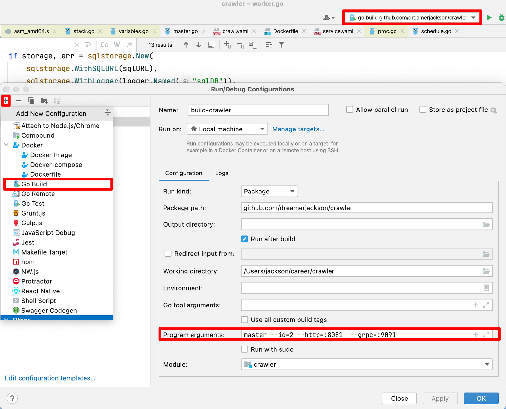
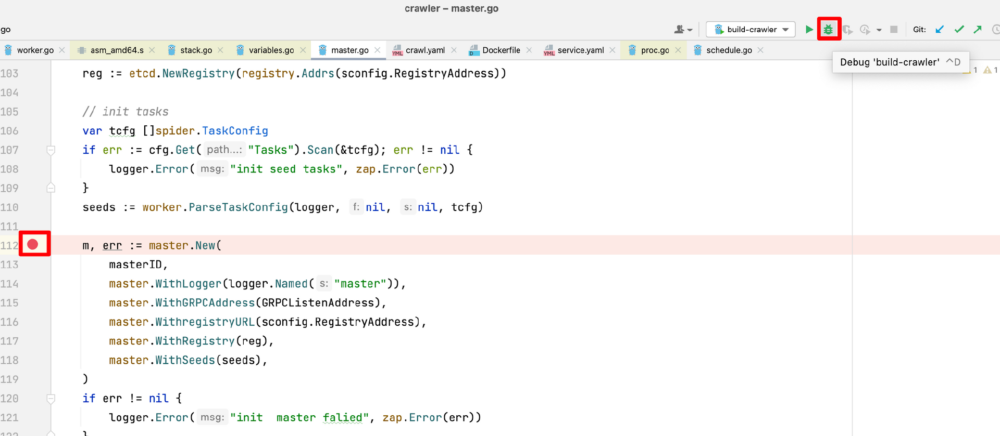
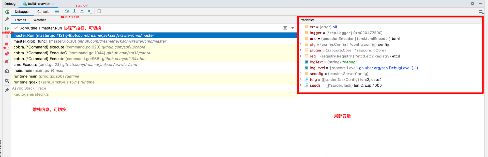
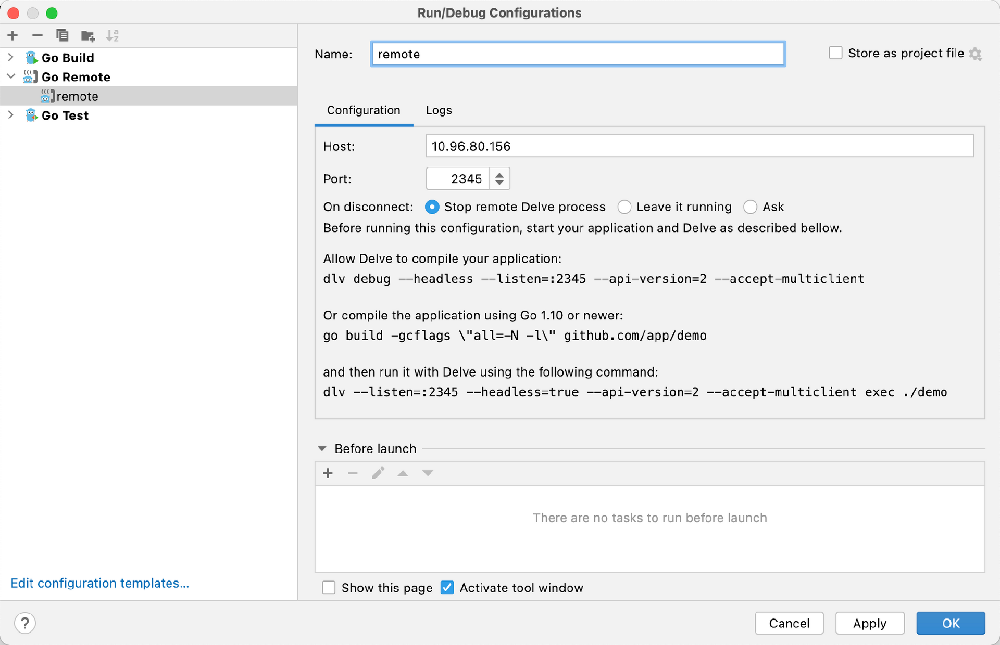

# 38 | 高级调试：怎样利用Delve调试复杂的程序问题？

你好，我是郑建勋。

工欲善其事，必先利其器。这节课，我们来看看怎么合理地使用调试器让开发事半功倍。调试器能够控制应用程序的执行，它可以让程序在特定的位置暂停并观察当前的状态，还能够控制单步执行代码和指令，以便观察程序的执行分支。

当我们谈到调试器，一些有经验的开发可能会想到 GDB，不过在 Go 语言中，我们一般会选择使用 Delve（dlv）。这不仅因为 Delve 比 GDB 更了解 Go 运行时、数据结构和表达式，还因为 Go 中栈扩容等特性会让GDB 得到错误的结果。所以这节课，我们就主要来看看如何利用 Delve 完成 Go 程序的调试。

## Delve 的内部架构

我们先来看看Delve的内部架构。Delve 本身也是用 Go 语言实现的，它的内部可以分为 3层。

- UI Layer

UI layer 为用户交互层，用于接收用户的输入，解析用户输入的指令。例如打印变量信息时用户需要在交互层输入 print a。

- Symbolic Layer

Symbolic Layer 用于解析用户的输入。例如对于 print a 这个打印指令，变量 a 可能是结构体、int 等多种类型，Symbolic Layer 负责将变量 a 转化为实际的内存地址和它对应的字节大小，最后通过 Target Layer 层读取内存数据。同时，Symbolic Layer 也会把从 Target Layer中读取到的数据解析为对应的结构、行号等信息。

- Target Layer

Target Layer 用于控制程序，它主要是通过调用操作系统的 API 来实现的。例如在 Linux 中，Delve 会使用 ptrace、waitpid、tgkill 等操作系统 API 来读取、修改、追踪内存地址的内容，但是它并不知道具体内容的含义。

## 用 Delve 进行实战

简单地了解了 Delve 的内部架构，下面让我们来使用常见的 Delve 指令实战一下。首先我们需要安装好 Delve。

```
$ go install github.com/go-delve/delve/cmd/dlv@latest
```

如果要安装指定的版本，可以用下面的指令。

```
$ go install github.com/go-delve/delve/cmd/dlv@v1.7.3
```

以代码 v0.3.9 为例，程序构建时，指定编译器选项 -gcflags=all=“-N -l”，禁止内联，禁止编译器优化。这有助于我们在使用 Delve 进行调试时得到更精准的行号等信息。

```
debug:
 go build -gcflags=all="-N -l" -ldflags '$(LDFLAGS)' $(BUILD_FLAGS) main.go
```

执行 make debug 完成代码的编译。

```
» make debug
go build -gcflags=all="-N -l" -ldflags '-X "github.com/dreamerjackson/crawler/ver
```

执行 dlv exec 指令启动程序并开始调试执行，执行完毕后会出现如下的 (dlv) 提示符。

```
» sudo dlv exec ./main worker
Password:
Type 'help' for list of commands.
(dlv)
```

下面我们来看看在 Delve 调试中一些常见的命令。

- 查看帮助信息：help。当我们记不清楚具体指令的含义的时候，可以执行该指令。

```javascript
(dlv) help
The following commands are available:
   args ------------------------ Print function arguments.
   break (alias: b) ------------ Sets a breakpoint.
   breakpoints (alias: bp) ----- Print out info for active breakpoints.
   call ------------------------ Resumes process, injecting a function call (EXP
   clear ----------------------- Deletes breakpoint.
   clearall -------------------- Deletes multiple breakpoints.
   condition (alias: cond) ----- Set breakpoint condition.
   config ---------------------- Changes configuration parameters.
   continue (alias: c) --------- Run until breakpoint or program termination.
   deferred -------------------- Executes command in the context of a deferred c
   disassemble (alias: disass) - Disassembler.
   ....
```

- 打断点：break 或者 b。执行该指令会在 main 函数处打印一个断点。

```
(dlv) b main.main
Breakpoint 1 set at 0x2089e86 for main.main() ./main.go:8
```

- 继续运行程序：continue 或者 c。程序将一直运行，直到在我们断点处停下来。

```
(dlv) c
> main.main() ./main.go:8 (hits goroutine(1):1 total:1) (PC: 0x2089e86)
    3: import (
    4:         "github.com/dreamerjackson/crawler/cmd"
    5:         _ "net/http/pprof"
    6: )
    7:
=>   8: func main() {
    9:         cmd.Execute()
   10: }
```

- 单步执行： n 或 next。 程序在单步一行代码后将会暂停下来，同时我们还能看到程序当前暂停的位置。

```
(dlv) n
> main.main() ./main.go:9 (PC: 0x2089e92)
    4:         "github.com/dreamerjackson/crawler/cmd"
    5:         _ "net/http/pprof"
    6: )
    7:
    8: func main() {
=>   9:         cmd.Execute()
   10: }
```

- 跳进函数中： s 或 step。这时将进入到调用函数的堆栈中执行。

```javascript
(dlv) s
> github.com/dreamerjackson/crawler/cmd.Execute() ./cmd/cmd.go:20 (PC: 0x2089d4a)
   15:         Run: func(cmd *cobra.Command, args []string) {
   16:                 version.Printer()
   17:         },
   18: }
   19:
=>  20: func Execute() {
   21:         var rootCmd = &cobra.Command{Use: "crawler"}
   22:         rootCmd.AddCommand(master.MasterCmd, worker.WorkerCmd, versionCmd
   23:         rootCmd.Execute()
   24: }
```

接下来我们用 b worker.go:135 在 worker.go 文件的 135 行打上断点。

```go
(dlv) b worker.go:135
Breakpoint 2 set at 0x2071659 for github.com/dreamerjackson/crawler/cmd/worker.Ru
(dlv) c
{"level":"INFO","ts":"2022-12-26T00:02:57.026+0800","caller":"worker/worker.go:10
{"level":"INFO","ts":"2022-12-26T00:02:57.029+0800","caller":"worker/worker.go:10
> github.com/dreamerjackson/crawler/cmd/worker.Run() ./cmd/worker/worker.go:135 (
  130:         // init tasks
  131:         var tcfg []spider.TaskConfig
  132:         if err := cfg.Get("Tasks").Scan(&tcfg); err != nil {
  133:                 logger.Error("init seed tasks", zap.Error(err))
  134:         }
=> 135:         seeds := ParseTaskConfig(logger, f, storage, tcfg)
  136:
  137:         _ = engine.NewEngine(
  138:                 engine.WithFetcher(f),
  139:                 engine.WithLogger(logger),
  140:                 engine.WithWorkCount(5),
```

- list 命令，可以为我们打印出当前断点处的源代码。

```go
(dlv) list
> github.com/dreamerjackson/crawler/cmd/worker.Run() ./cmd/worker/worker.go:135 (
  130:         // init tasks
  131:         var tcfg []spider.TaskConfig
  132:         if err := cfg.Get("Tasks").Scan(&tcfg); err != nil {
  133:                 logger.Error("init seed tasks", zap.Error(err))
  134:         }
=> 135:         seeds := ParseTaskConfig(logger, f, storage, tcfg)
  136:
  137:         _ = engine.NewEngine(
  138:                 engine.WithFetcher(f),
  139:                 engine.WithLogger(logger),
  140:                 engine.WithWorkCount(5),
```

- locals 命令，为我们打印出当前所有的局部变量。

```
(dlv) locals
proxyURLs = []string len: 2, cap: 2, [...]
seeds = []*github.com/dreamerjackson/crawler/spider.Task len: 0, cap: 57, []
cfg = go-micro.dev/v4/config.Config(*go-micro.dev/v4/config.config) 0xc000221508
enc = go-micro.dev/v4/config/encoder.Encoder(github.com/go-micro/plugins/v4/confi
err = error nil
f = github.com/dreamerjackson/crawler/spider.Fetcher(*github.com/dreamerjackson/c
logText = "debug"
plugin = go.uber.org/zap/zapcore.Core(*go.uber.org/zap/zapcore.ioCore) 0xc0002214
sqlURL = "root:123456@tcp(192.168.0.105:3326)/crawler?charset=utf8"
...
```

- print 或者 p 命令，打印出当前变量的值。

```
(dlv) print proxyURLs
[]string len: 2, cap: 2, [
       "<http://192.168.0.105:8888>",
       "<http://192.168.0.105:8888>",
]
(dlv) p logText
"debug"
```

- stack 命令，打印出当前函数的堆栈信息，从中我们可以看出函数的调用关系。

```
(dlv) stack
0  0x0000000002071659 in github.com/dreamerjackson/crawler/cmd/worker.Run
  at ./cmd/worker/worker.go:135
1  0x00000000020702cb in github.com/dreamerjackson/crawler/cmd/worker.glob..func1
  at ./cmd/worker/worker.go:44
2  0x0000000002058734 in github.com/spf13/cobra.(*Command).execute
  at /Users/jackson/go/pkg/mod/github.com/spf13/cobra@v1.6.1/command.go:920
3  0x00000000020596c6 in github.com/spf13/cobra.(*Command).ExecuteC
  at /Users/jackson/go/pkg/mod/github.com/spf13/cobra@v1.6.1/command.go:1044
4  0x0000000002058c8f in github.com/spf13/cobra.(*Command).Execute
  at /Users/jackson/go/pkg/mod/github.com/spf13/cobra@v1.6.1/command.go:968
5  0x0000000002089e5d in github.com/dreamerjackson/crawler/cmd.Execute
  at ./cmd/cmd.go:23
6  0x0000000002089e97 in main.main
  at ./main.go:9
7  0x000000000103e478 in runtime.main
  at /usr/local/opt/go/libexec/src/runtime/proc.go:250
8  0x000000000106fee1 in runtime.goexit
  at /usr/local/opt/go/libexec/src/runtime/asm_amd64.s:1571
```

- frame 命令，可以让我们在堆栈之间做切换。在下面这个例子中，我们输入 frame 1，就会切换到当前函数的调用方，再输入 frame 0 即可切换回去。

```
(dlv) frame 1
> github.com/dreamerjackson/crawler/cmd/worker.Run() ./cmd/worker/worker.go:135 (
Frame 1: ./cmd/worker/worker.go:44 (PC: 20702cb)
   39:         Use:   "worker",
   40:         Short: "run worker service.",
   41:         Long:  "run worker service.",
   42:         Args:  cobra.NoArgs,
   43:         Run: func(cmd *cobra.Command, args []string) {
=>  44:                 Run()
   45:         },
   46: }
   47:
   48: func init() {
   49:         WorkerCmd.Flags().StringVar(
```

- breakpoints 命令，打印出当前的断点。

```
(dlv) breakpoints
Breakpoint 1 at 0x2089e86 for main.main() ./main.go:8 (1)
Breakpoint 2 at 0x2071659 for github.com/dreamerjackson/crawler/cmd/worker.Run()
```

- clear 命令，清除断点。下面这个例子就可以清除序号为 1 的断点。

```
(dlv) clear 1
Breakpoint 1 cleared at 0x2089e86 for main.main() ./main.go:8
```

- goroutines 命令，显示当前时刻所有的协程。

```
(dlv) goroutines
* Goroutine 1 - User: ./cmd/worker/worker.go:135 github.com/dreamerjackson/crawle
 Goroutine 2 - User: /usr/local/opt/go/libexec/src/runtime/proc.go:362 runtime.g
 Goroutine 3 - User: /usr/local/opt/go/libexec/src/runtime/proc.go:362 runtime.g
 Goroutine 4 - User: /usr/local/opt/go/libexec/src/runtime/proc.go:362 runtime.g
 Goroutine 5 - User: /usr/local/opt/go/libexec/src/runtime/proc.go:362 runtime.g
 Goroutine 6 - User: /Users/jackson/go/pkg/mod/github.com/patrickmn/go-cache@v2.
 Goroutine 7 - User: /Users/jackson/go/pkg/mod/go-micro.dev/v4@v4.9.0/config/loa
```

goroutine 还可以实现协程的切换。例如下面这个例子，我们执行 goroutine 2 将协程切换到了协程 2，并打印出协程 2 的堆栈信息。接着执行 goroutine 1 切换回去。

```
(dlv) goroutine 2
Switched from 1 to 2 (thread 8118196)
(dlv) stack
0  0x000000000103e892 in runtime.gopark
  at /usr/local/opt/go/libexec/src/runtime/proc.go:362
1  0x000000000103e92a in runtime.goparkunlock
  at /usr/local/opt/go/libexec/src/runtime/proc.go:367
2  0x000000000103e6c5 in runtime.forcegchelper
  at /usr/local/opt/go/libexec/src/runtime/proc.go:301
3  0x000000000106fee1 in runtime.goexit
  at /usr/local/opt/go/libexec/src/runtime/asm_amd64.s:1571
```

还有一些更高级的调试指令，例如，disassemble 可以打印出当前的汇编代码。

```
(dlv) disassemble
TEXT github.com/dreamerjackson/crawler/cmd/worker.Run(SB) /Users/jackson/career/c
       worker.go:66    0x2070500       4c8da42408f9ffff                lea r12,
       worker.go:66    0x2070508       4d3b6610                        cmp r12,
       worker.go:66    0x207050c       0f8635180000                    jbe 0x207
       worker.go:66    0x2070512       4881ec78070000                  sub rsp,
       worker.go:66    0x2070519       4889ac2470070000                mov qword
       worker.go:66    0x2070521       488dac2470070000                lea rbp,
       worker.go:68    0x2070529       488d0518252f00                  lea rax,
```

另外，虽然 dlv 通常是在开发环境中使用的，但是有时它仍然能够用在线上环境中，例如可以在服务完全无响应时帮助我们排查问题。举个例子，假设我们的代码中有一段逻辑 Bug，导致服务陷入了长时间的 for 循环中，这个时候要排查原因我们就可以使用 dlv 了。

```go
...
count := 0
 for {
   count++
   fmt.Println("count", count)
 }
```

对于一个运行中的程序，要进行调试，我们可以使用 dlv attach 指令，其后跟程序的进程号。而要想查找到程序的进程号，我们可以用如下指令。本例中程序的进程号为 75296。

```
» ps -ef | grep './main worker'
 501 75296 91914   0 11:20PM ttys003    0:00.31 ./main worker
```

接着，执行 dlv attach 进行调试。注意，这时程序会完全暂停。

```
» dlv attach 75296
Type 'help' for list of commands.
(dlv)
```

接下来，我们可以查看当前协程所处的位置，找到可能造成程序卡死的协程。

```
(dlv) goroutines
 Goroutine 1 - User: /usr/local/opt/go/libexec/src/runtime/sys_darwin.go:23 sysc
 Goroutine 2 - User: /usr/local/opt/go/libexec/src/runtime/proc.go:362 runtime.g
 Goroutine 3 - User: /usr/local/opt/go/libexec/src/runtime/proc.go:362 runtime.g
 Goroutine 4 - User: /Users/jackson/go/pkg/mod/github.com/patrickmn/go-cache@v2.
 Goroutine 5 - User: /Users/jackson/go/pkg/mod/go-micro.dev/v4@v4.9.0/config/loa
 Goroutine 6 - User: /Users/jackson/go/pkg/mod/github.com/patrickmn/go-cache@v2.
 Goroutine 7 - User: /usr/local/opt/go/libexec/src/runtime/netpoll.go:302 intern
```

当我们切换到 goroutine 1 查看堆栈信息时可以发现，由于我们调用了 fmt 函数，所以执行了系统调用函数。继续查看调用 fmt 函数的位置是 ./cmd/worker/worker.go:84，结合代码就可以轻松地发现这个逻辑 Bug 了。

```
(dlv) goroutine 1
Switched from 0 to 1 (thread 9333412)
(dlv) stack
0  0x00000000010677e0 in runtime.systemstack_switch
   at /usr/local/opt/go/libexec/src/runtime/asm_amd64.s:436
1  0x00000000010563e6 in runtime.libcCall
   at /usr/local/opt/go/libexec/src/runtime/sys_libc.go:48
2  0x000000000106629f in syscall.syscall
   at /usr/local/opt/go/libexec/src/runtime/sys_darwin.go:23
3  0x000000000107ce09 in syscall.write
   at /usr/local/opt/go/libexec/src/syscall/zsyscall_darwin_amd64.go:1653
4  0x00000000010d188e in internal/poll.ignoringEINTRIO
   at /usr/local/opt/go/libexec/src/syscall/syscall_unix.go:216
5  0x00000000010d188e in syscall.Write
   at /usr/local/opt/go/libexec/src/internal/poll/fd_unix.go:383
6  0x00000000010d188e in internal/poll.(*FD).Write
   at /usr/local/opt/go/libexec/src/internal/poll/fd_unix.go:794
7  0x00000000010d93c5 in os.(*File).write
   at /usr/local/opt/go/libexec/src/os/file_posix.go:48
8  0x00000000010d93c5 in os.(*File).Write
   at /usr/local/opt/go/libexec/src/os/file.go:176
9  0x00000000010e2775 in fmt.Fprintln
   at /usr/local/opt/go/libexec/src/fmt/print.go:265
10  0x0000000001a4e329 in fmt.Println
   at /usr/local/opt/go/libexec/src/fmt/print.go:274
11  0x0000000001a4e329 in github.com/dreamerjackson/crawler/cmd/worker.Run
   at ./cmd/worker/worker.go:84
12  0x0000000001a4e097 in github.com/dreamerjackson/crawler/cmd/worker.glob..func
   at ./cmd/worker/worker.go:45
```

## 用 Goland 进行调试

Delve 虽然强大，但是在平时的开发过程中，我们更倾向于使用 Goland 和 VSCode 来进行调试。

Goland 和 VSCode 借助了 Delve 的能力，但是它提供了可视化的交互方式，可以让我们更加方便快捷地进行调试，下面我以 Goland 为例来说明一下它的用法。

使用 Goland 进行调试的第一步是设置构建的相关配置。如下图所示，我们设置了构建的目录位置和程序运行时的参数。我们启动 Master 程序的调试。



第二步，在代码左边适当的位置加入断点。

第三步，点击左上方的调试按钮开始调试。这时程序会开始运行，直到遇上断点才会停下来。



当程序在断点处停下来之后，在 Goland 界面下方会显示出当前局部变量的值和当前的堆栈信息，我们还可以切换到不同的协程和不同的堆栈。还可以使用各种按钮让程序继续执行、单步执行、跳入函数、跳出函数等。点击变量的右键还可以修改变量的值。



## 用 Goland+Delve 进行远程调试

接下来我们来看看如何让 Goland 与 Delve 配合在一起，对 Go 程序进行远程调试。我们需要远程调试程序的场景有很多，举几个例子。

- 本地机器配置跟不上，调试起来太卡。

- 远程服务器有更加完备的上下游环境、配置文件、硬件（例如 GPU）、特殊的依赖库（Linux 与 Windows）。

- 需要在特定环境复现问题。

利用 Goland 完成远程调试的优势也有很多。

- 可视化调试界面，减少心智负担。

- 本地机器负载小。

- 调试时间更快，减少繁琐的日志打印过程。

Goland 结合 dlv 的远程调试可以分为下面几步。

1. 将代码同步到远程机器，保证当前代码版本与远程机器代码版本相同。

2. 在远程机器上安装最新的 dlv。

3. 在远程机器上构建程序，并且禁止编译器的优化与内联，如下所示。

```
go build -o crawler -gcflags=all="-N -l" main.go
```

4. 执行 dlv exec，这时程序不会执行，而会监听 2345 端口，等待远程调试客户端发过来的信号。

```
dlv --listen=:2345 --headless=true --api-version=2 --accept-multiclient --check-g
```

5. 在本地 Goland 中配置远程连接地址。点击 Goland 右上角的 edit Configurations，选择 GoRemote，设置远程服务器监听的 IP 地址与端口。



接下来我们就可以和在本地一样进行代码调试了。

## 总结

这节课，我们介绍了如何使用 Delve 调试器来调试 Go 语言程序。Delve 调试器是专门为 Go语言设计的，相比于其他调试器，它更懂 Go 语言的运行时与数据结构。

学习 Delve 调试器的最好方式就是练习各个指令的含义。当然我们在平时的开发过程中，一般会选择界面化的调试方式。Goland 与 VSCode 底层仍然是使用了 Delve 的能力，但是可视化的本地调试和远程调试能起到事半功倍的效果。 在一些特殊的线上环境，我们无法使用可视化界面时，可以直接使用 Delve 调试器 attach 程序。

## 课后题

学完这节课，给你留两道思考题。

1. 在介绍 Go 语言的调试时，我们说在很多场景下 Delve 相对于 GDB 具有优势。那么有没有什么场景是用 GDB 比 Delve 更合适的呢？

2. Delve 能够用到线上的环境中吗？

欢迎你在留言区与我交流讨论，我们下节课见。
