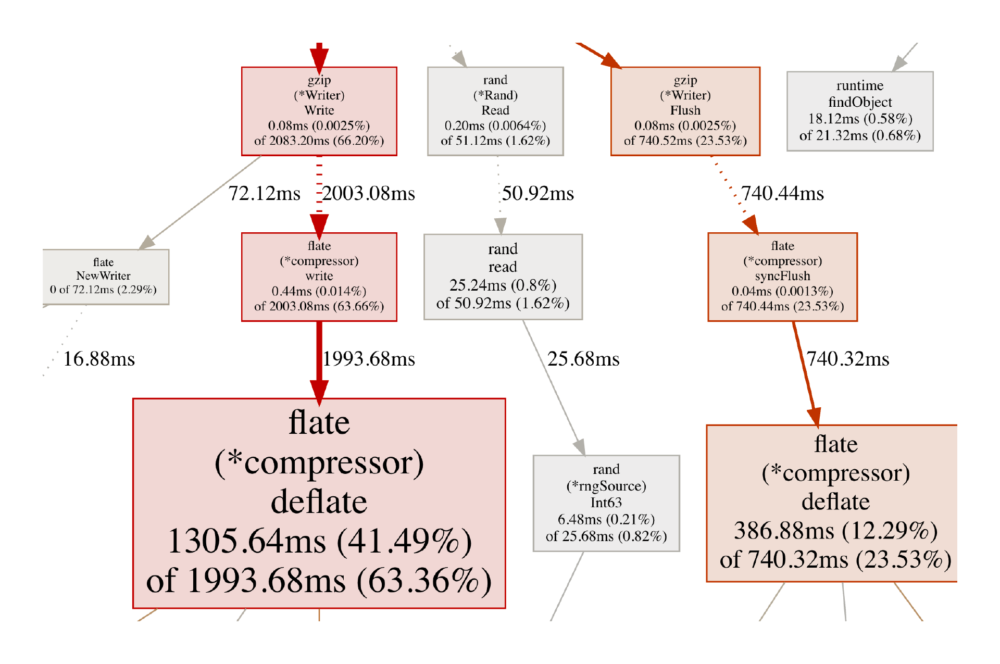
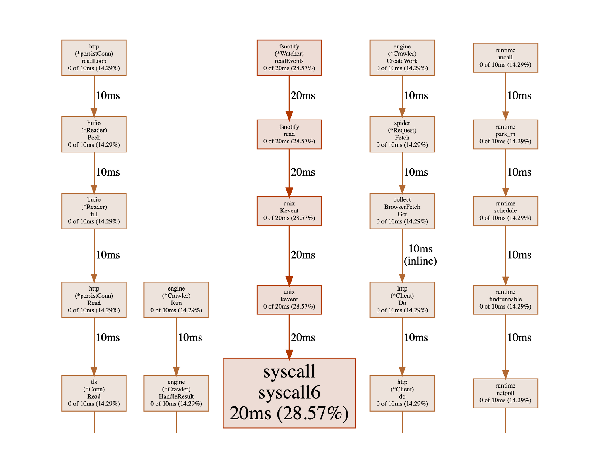
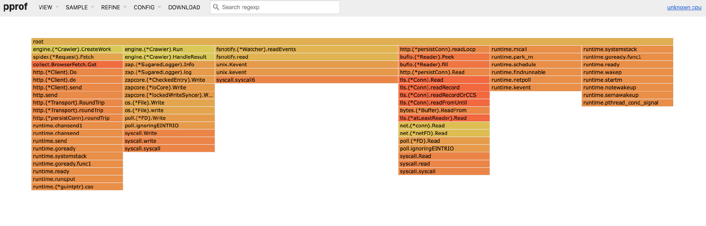
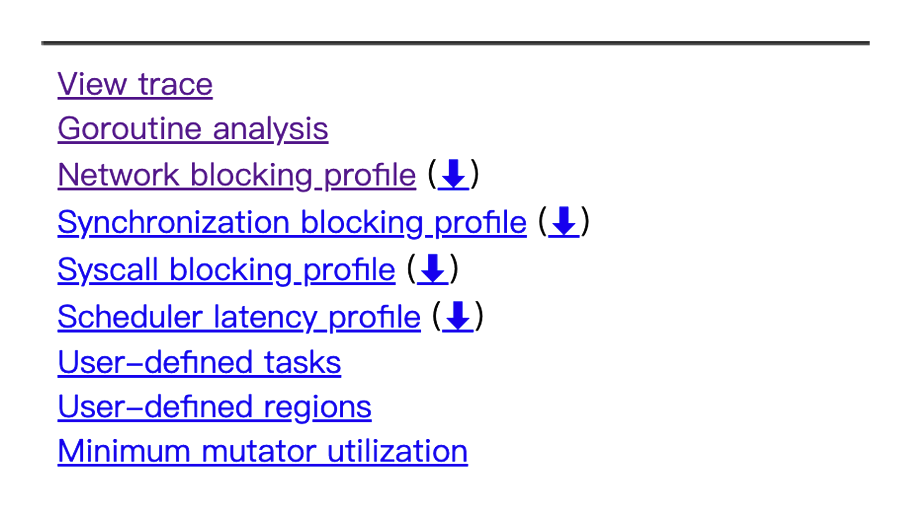
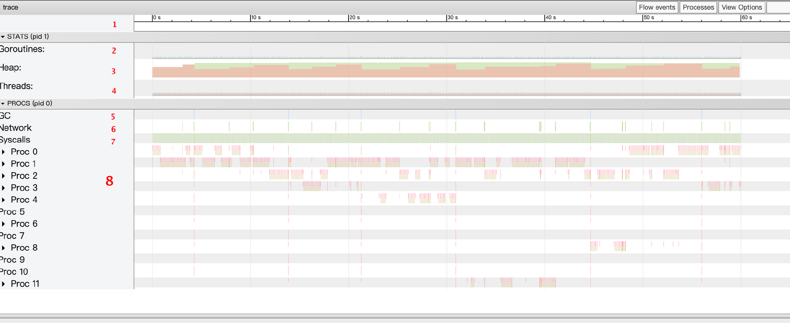
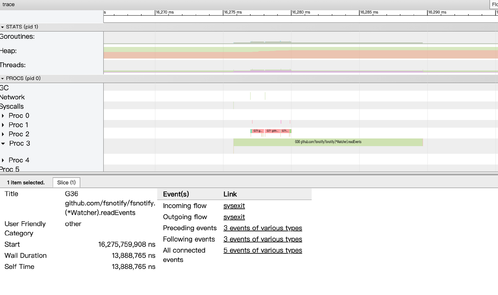
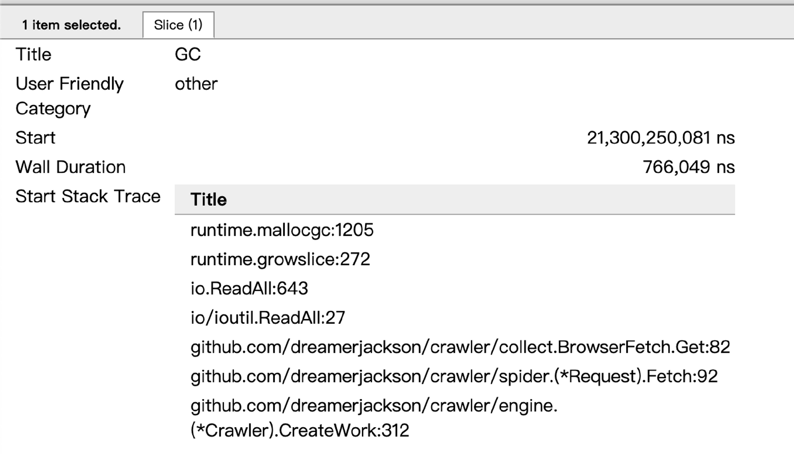
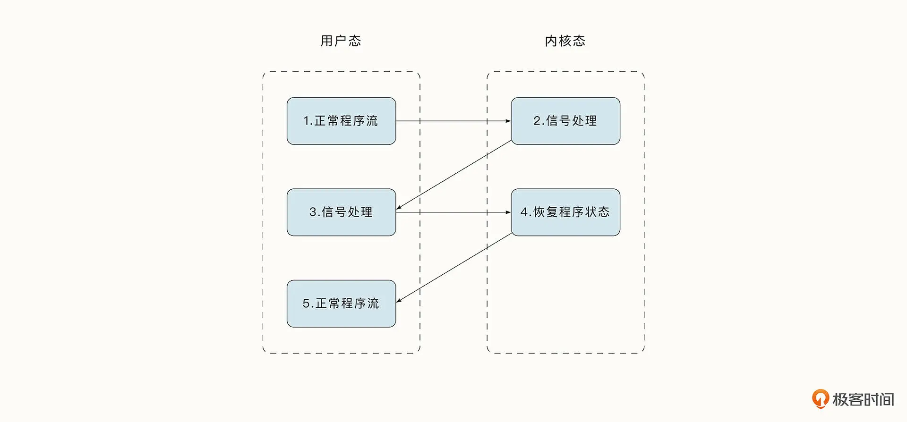

# 39 | 性能分析利器：深入pprof与trace工具

你好，我是郑建勋。

这节课，我们来学习分析 Go 程序的利器：pprof 和 trace。

## pprof 及其使用方法

先来看 pprof。pprof 用于对指标或特征的分析（Profiling）。借助 pprof，我们能够定位程序中的错误（内存泄漏、race 冲突、协程泄漏），也能对程序进行优化（例如 CPU 利用率不足等问题）。

Go 语言运行时的指标并不对外暴露，而是由标准库 net/http/pprof 和 runtime/pprof 来与外界交互。其中， runtime/pprof 需要嵌入到代码进行调用，而 net/http/pprof 提供了一种通过HTTP 获取样本特征数据的便利方式。而要对特征文件进行分析，就得依赖谷歌推出的分析工具 pprof 了。这个工具在 Go 安装时就存在，可以用 go tool pprof 执行。

要用 pprof 进行特征分析需要执行两个步骤：收集样本和分析样本。

收集样本有两种方式。一种是引用 net/http/pprof，并在程序中开启 HTTP 服务器，net/http/pprof 会在初始化 init 函数时注册路由。

```go
import _ "net/http/pprof"
if err := http.ListenAndServe(":6060", nil); err != nil {
 log.Fatal(err)
}
```

通过 HTTP 收集样本是实践中最常见的方式，但它并不总是合适的，例如对于一个测试程序，或是只跑一次的定时任务就是如此。

另一种方式是直接在需要分析的代码处嵌入分析函数，例如下例中我们调用了 runtime/pprof的 StartCPUProfile 函数，这样，在程序调用完 StopCPUProfile 函数之后，就可以指定特征文件保存的位置了。

```go
func main(){
  f, err := os.Create(*cpuProfile)
  if err := pprof.StartCPUProfile(f); err != nil {
     log.Fatal("could not start CPU profile: ", err)
  }
  defer pprof.StopCPUProfile()
  busyLoop()
}
```

接下来，让我们用第一种方式在项目的 main 函数中注册 pprof。

```go
package main
import (
 "github.com/dreamerjackson/crawler/cmd"
 _ "net/http/pprof"
)
func main() {
 cmd.Execute()
}
```

pprof 库在 init 函数中默认注册了下面几个路由。

```go
func init() {
 http.HandleFunc("/debug/pprof/", Index)
 http.HandleFunc("/debug/pprof/cmdline", Cmdline)
 http.HandleFunc("/debug/pprof/profile", Profile)
 http.HandleFunc("/debug/pprof/symbol", Symbol)
 http.HandleFunc("/debug/pprof/trace", Trace)
}
```

接着，我们需要在 Master 中开启一个默认的 HTTP 服务器，用它来接收外界的 pprof 请求。

其实在之前实现 GRPC-gateway 时，已经为 Master 和 Worker 开启了 HTTP 的服务器。但是当时开启的 HTTP 服务器并不是 Go 中默认的 HTTP 路由器，所以我们不能为 pprof 复用该端口。

我们在这里开启一个新的 HTTP 服务器来处理 pprof 请求，处理方式如下。

```go
// cmd/master.go
MasterCmd.Flags().StringVar(
   &PProfListenAddress, "pprof", ":9981", "set GRPC listen address")
func Run() {
 // start pprof
 go func() {
   if err := http.ListenAndServe(PProfListenAddress, nil); err != nil {
     panic(err)
   }
 }()
}
```

有了用于处理 pprof 请求的 HTTP 服务器之后，我们就可以调用相关的 HTTP 接口，获取性能相关的信息了。pprof 的 URL 为 debug/pprof/xxxx 形式，最常用的 3 种 pprof 类型包括了堆内存分析（heap）、协程栈分析（goroutine）和 CPU 占用分析（profile）。

- profile 用于获取 CPU 相关信息，调用如下。

```bash
curl -o cpu.out http://localhost:9981/debug/pprof/profile?seconds=30
```

- goroutine 用于获取协程堆栈信息，调用如下。

```bash
curl -o goroutine.out http://localhost:9981/debug/pprof/goroutine
```

- heap 用于获取堆内存信息，调用如下。在实践中我们大多使用 heap 来分析内存分配情况。

```bash
curl -o heap.out http://localhost:9981/debug/pprof/heap
```

- cmdline 用于打印程序的启动命令，调用如下。

```
» curl -o cmdline.out <http://localhost:9981/debug/pprof/cmdline>
» cat  cmdline.out
./main master --id=2 --http=:8081 --grpc=:9091
```

另外，block、threadcreate、mutex 这三种类型在实践中很少使用，一般只用于特定的场景分析。

获取到特征文件后，我们就可以开始具体地分析了。

一般我们使用 go tool pprof 来分析。

```
» go tool pprof heap.out
Type: inuse_space
Time: Dec 18, 2022 at 1:08am (CST)
Entering interactive mode (type "help" for commands, "o" for options)
(pprof)
```

此外，我们也可以直接采用下面的形式完成特征文件的收集与分析，通过 HTTP 获取到的特征文件将存储在临时目录中。

```
go tool pprof http://localhost:9981/debug/pprof/heap
```

### pprof 堆内存分析

当我们用 pprof 分析堆内存的特征文件时，默认的分析类型为 inuse_space，代表它是分析程序正在使用的内存，文件的最后一行会出现等待进行交互的命令。

交互命令有许多，我们可以通过 help 指令查看，比较常用的包括 top、list、tree 等。首先来看看使用最多的 top 指令，top 指令能够显示出分配资源最多的函数。

我们现在启动 Worker，在只有一个任务（爬取豆瓣图书的信息）的情况下，利用 pprof 查看堆内存的占用情况。可以看到，当前收集的内存量为 5915.93KB。

```
» go tool pprof heap.out
Type: inuse_space
Time: Dec 18, 2022 at 1:37am (CST)
Entering interactive mode (type "help" for commands, "o" for options)
(pprof) top
Showing nodes accounting for 5915.93kB, 100% of 5915.93kB total
Showing top 10 nodes out of 92
     flat  flat%   sum%        cum   cum%
2562.81kB 43.32% 43.32%  2562.81kB 43.32%  runtime.allocm
 768.26kB 12.99% 56.31%   768.26kB 12.99%  go.uber.org/zap/zapcore.newCounters (
 536.37kB  9.07% 65.37%   536.37kB  9.07%  google.golang.org/protobuf/internal/s
 512.23kB  8.66% 74.03%   512.23kB  8.66%  google.golang.org/protobuf/internal/f
 512.20kB  8.66% 82.69%   512.20kB  8.66%  runtime.malg
 512.05kB  8.66% 91.35%   512.05kB  8.66%  runtime.acquireSudog
    512kB  8.65%   100%      512kB  8.65%  go-micro.dev/v4/config/reader/json.(*
        0     0%   100%   768.26kB 12.99%  github.com/dreamerjackson/crawler/cmd
        0     0%   100%   768.26kB 12.99%  github.com/dreamerjackson/crawler/cmd
        0     0%   100%   768.26kB 12.99%  github.com/dreamerjackson/crawler/cmd
```

我们当前收集的内存量为 5915.93KB，这些内存来自哪里呢？top 可以为我们分析出分配内存最多的函数来自哪里。其中 2562.81KB 由 runtime.allocm 函数分配，这是运行时创建线程 m的函数。还有 768.26kB 来自 Zap 日志库的 zapcore.newCounters 方法。

top 会列出以 flat 列从大到小排序的序列。不同的场景下 flat 对应值的含义不同。当类型为heap 的 inuse_space 模式时，flat 对应的值表示当前函数正在使用的内存大小。

cum 列对应的值是一个累积的概念，指当前函数及其调用的一系列函数 flat 的和。flat 本身只包含当前函数的栈帧信息，不包括它的调用函数的栈帧信息，cum 字段正好弥补了这一点，flat% 和 cum% 分别表示 flat 和 cum 字段占总字段的百分比。

要注意的是，5915.93KB 并不是当前程序的内存大小，它只是样本的大小。在实践过程中，很多人会想当然地犯错。那如果我们想获取当前时刻程序的内存大小要怎么做呢？

在程序中，我们可以使用 runtime 标准库来获取当前的内存指标，下面是我打印出的程序当前的内存大小。

```go
     memStats := new(runtime.MemStats)
     runtime.ReadMemStats(memStats)
     fmt.Println(memStats.Alloc/1024, "KB")
```

另外我们也可以用 pprof 做到这一点，在 HTTP 请求中添加 debug=1 参数，我们就可以打印出当前的堆栈信息和内存指标了。

```bash
curl http://localhost:9981/debug/pprof/heap?debug=1
```

打印结果如下所示。

```
...
# runtime.MemStats
# Alloc = 3525848
# TotalAlloc = 28212464
# Sys = 21840904
# Lookups = 0
# Mallocs = 36600
# Frees = 26354
# HeapAlloc = 3525848
# HeapSys = 11599872
# HeapIdle = 6160384
# HeapInuse = 5439488
# HeapReleased = 3252224
# HeapObjects = 10246
# Stack = 983040 / 983040
# MSpan = 170680 / 179520
# MCache = 14400 / 15600
# BuckHashSys = 1454473
# GCSys = 5338888
# OtherSys = 2269511
# NextGC = 6464480
# LastGC = 1671360289891484000
# PauseNs = [80190 73495 74791 123637 100272 80321 64056 76872 105588 66730 0 0 0
# PauseEnd = [1671360184885772000 1671360188628568000 1671360202091581000 1671360
# NumGC = 10
# NumForcedGC = 0
# GCCPUFraction = 1.9176443581930546e-05
# DebugGC = false
# MaxRSS = 24653824
```

我们还可以使用 top-cum 命令，对 cum 进行排序，查看哪一个函数分配的内存量最多（包含了其子函数的内存分配）。

以 runtime.newm 函数为例进行说明，通过 runtime.newm 的 flat 指标可知，其自身没有分配内存，但是由于 runtime.newm 调用了 runtime.allocm，而 runtime.allocm 分配了 2.50MB，所以 runtime.allocm 的 cum 量也达到了 2.50MB。

```
(pprof) top -cum
Showing nodes accounting for 2.50MB, 43.32% of 5.78MB total
Showing top 10 nodes out of 92
     flat  flat%   sum%        cum   cum%
   2.50MB 43.32% 43.32%     2.50MB 43.32%  runtime.allocm
        0     0% 43.32%     2.50MB 43.32%  runtime.newm
        0     0% 43.32%     2.50MB 43.32%  runtime.resetspinning
        0     0% 43.32%     2.50MB 43.32%  runtime.schedule
        0     0% 43.32%     2.50MB 43.32%  runtime.startm
        0     0% 43.32%     2.50MB 43.32%  runtime.wakep
        0     0% 43.32%        2MB 34.66%  runtime.mstart
        0     0% 43.32%        2MB 34.66%  runtime.mstart0
        0     0% 43.32%        2MB 34.66%  runtime.mstart1
        0     0% 43.32%     1.27MB 22.05%  runtime.main
```

我们还可以使用 tree 命令查看当前函数的调用链。例如，runtime.allocm 分配了 2.5M 内存，其中 512.56KB 是 runtime.mcall 调用的，另外 2050.25KB 是由 runtime.mstart0 调用的。（runtime.mstart0 是程序启动时调用的函数）。

```
(pprof) tree
Showing nodes accounting for 5915.93kB, 100% of 5915.93kB total
Showing top 80 nodes out of 92
----------------------------------------------------------+-------------
     flat  flat%   sum%        cum   cum%   calls calls% + context
----------------------------------------------------------+-------------
                                        2050.25kB 80.00% |   runtime.mstart0
                                         512.56kB 20.00% |   runtime.mcall
2562.81kB 43.32% 43.32%  2562.81kB 43.32%                | runtime.allocm
----------------------------------------------------------+-------------
                                         768.26kB   100% |   go.uber.org/zap/zap
 768.26kB 12.99% 56.31%   768.26kB 12.99%                | go.uber.org/zap/zapco
```

更进一步地，我们还可以使用 list runtime.allocm 列出内存分配是在哪里发生的。如下所示，可以看到，runtime.allocm 函数位于 runtime/proc.go，它的内存分配位于第 1743 行代码的mp := new(m)。

```go
(pprof) list runtime.allocm
Total: 5.78MB
ROUTINE ======================== runtime.allocm in /usr/local/opt/go/libexec/src/
   2.50MB     2.50MB (flat, cum) 43.32% of Total
        .          .   1738:           }
        .          .   1739:           sched.freem = newList
        .          .   1740:           unlock(&sched.lock)
        .          .   1741:   }
        .          .   1742:
   2.50MB     2.50MB   1743:   mp := new(m)
        .          .   1744:   mp.mstartfn = fn
        .          .   1745:   mcommoninit(mp, id)
        .          .   1746:
        .          .   1747:   // In case of cgo or Solaris or illumos or Darwin
        .          .   1748:   // Windows and Plan 9 will layout sched stack on
```

这样一来，当遇到内存问题时，我们就可以非常精准地知道要查看哪一行代码了。

除却默认的分析类型 inuse_space，在 heap 中，还有另外三种类型分别是：alloc_objects、alloc_space 和 inuse_objects。其中 alloc_objects 与 inuse_objects 分别代表“已经被分配的对象”和“正在使用的对象”的数量，alloc_space 表示内存分配的数量，alloc_objects 与alloc_space 都没有考虑对象的释放情况。

要切换展示的类型很简单，只需要输入对应的指令即可。例如，输入 alloc_objects 后再次输入 top 指令，当前 flat 代表的就不再是分配的内存大小，而是分配内存的次数。可以看到，分配内存次数最多的是 go-micro 中的 json.Get 函数。

```
(pprof) alloc_objects
(pprof) top
Showing nodes accounting for 221497, 93.52% of 236838 total
Dropped 140 nodes (cum <= 1184)
Showing top 10 nodes out of 92
     flat  flat%   sum%        cum   cum%
    65536 27.67% 27.67%      65536 27.67%  go-micro.dev/v4/config/reader/json.(*
    65536 27.67% 55.34%      65536 27.67%  google.golang.org/grpc.DialContext
    32768 13.84% 69.18%      32768 13.84%  reflect.copyVal
    16384  6.92% 76.10%      16384  6.92%  crypto/sha256.(*digest).Sum
    12289  5.19% 81.28%      12289  5.19%  reflect.Value.MapRange
     8192  3.46% 84.74%      12894  5.44%  net/http.(*persistConn).readLoop
     6554  2.77% 87.51%       6554  2.77%  crypto/x509/pkix.(*Name).FillFromRDNS
     5461  2.31% 89.82%       5461  2.31%  runtime.acquireSudog
     4681  1.98% 91.79%       4681  1.98%  net/textproto.(*Reader).ReadMIMEHeade
     4096  1.73% 93.52%       4096  1.73%  crypto/sha256.New
```

proof 工具还提供了强大的可视化功能，可以生成便于查看的图片或 HTML 文件。但实现这种功能需要先安装 Graphviz（开源的可视化工具）。你可以在官网找到最新的下载方式，安装完成后，在 pprof 提示符中输入 Web 就可以在浏览器中看到资源分配的可视化结果了。

```
(pprof) web
```



从图中，我们能够直观地看出当前函数的调用链、内存分配数量和比例，找出程序中内存分配的关键部分，越大的方框代表分配内存的次数更多。

我们来详细解读一下这张图片。

- 节点颜色： 红色代表累计值 cum 为正，并且很大； 绿色代表累计值 cum 为负，并且很大； 灰色代表累计值 cum 可以忽略不计。

- 节点字体大小： 较大的字体代表当前值较大； 较小的字体代表当前值较小。

- 边框颜色：当前值较大且为正数时为红色； 当前值较小且为负数时为绿色；当前值接近 0时为灰色。

- 箭头大小：箭头越粗代表当前的路径消耗的资源越多， 箭头越细代表当前的路径消耗的资源越小。

- 箭头线型：虚线箭头表示两个节点之间的某些节点已被忽略，为间接调用；实线箭头表示两个节点之间为直接调用。

### pprof 协程栈分析

除了堆内存分析，协程栈分析使用得也比较多。分析协程栈有两个作用，一是查看协程的数量，判断协程是否泄漏；二是查看当前协程在重点执行哪些函数，判断当前协程是否健康。

下面这个例子，我们查看协程信息会发现，当前收集到了 36 个协程，程序总的协程数为 37个。收集到的协程中，33 个协程都位于 runtime.gopark 中，而 runtime.gopark 意味着协程陷入到了休眠状态。

```
» go tool pprof <http://localhost:9981/debug/pprof/goroutine>
Fetching profile over HTTP from <http://localhost:9981/debug/pprof/goroutine>
Saved profile in /Users/jackson/pprof/pprof.goroutine.015.pb.gz
Type: goroutine
Time: Dec 18, 2022 at 1:26pm (CST)
Entering interactive mode (type "help" for commands, "o" for options)
(pprof) top
Showing nodes accounting for 36, 97.30% of 37 total
Showing top 10 nodes out of 96
     flat  flat%   sum%        cum   cum%
       33 89.19% 89.19%         33 89.19%  runtime.gopark
        1  2.70% 91.89%          1  2.70%  runtime.sigNoteSleep
        1  2.70% 94.59%          1  2.70%  runtime/pprof.runtime_goroutineProfil
        1  2.70% 97.30%          1  2.70%  syscall.syscall6
        0     0% 97.30%          2  5.41%  bufio.(*Reader).Peek
        0     0% 97.30%          1  2.70%  bufio.(*Reader).Read
        0     0% 97.30%          2  5.41%  bufio.(*Reader).fill
        0     0% 97.30%          2  5.41%  bytes.(*Buffer).ReadFrom
        0     0% 97.30%          2  5.41%  crypto/tls.(*Conn).Read
        0     0% 97.30%          2  5.41%  crypto/tls.(*Conn).readFromUntil
```

我们再执行 tree，会看到大多数协程陷入到了网络堵塞和 select 中。这是符合预期的，因为我们的程序是网络 I/O 密集型的，当有大量协程在等待服务器返回时，协程会休眠等待网络数据准备就绪。

```
(pprof) tree
Showing nodes accounting for 33, 89.19% of 37 total
----------------------------------------------------------+-------------
     flat  flat%   sum%        cum   cum%   calls calls% + context
----------------------------------------------------------+-------------
                                               22 66.67% |   runtime.selectgo
                                                6 18.18% |   runtime.netpollbloc
                                                4 12.12% |   runtime.chanrecv
                                                1  3.03% |   time.Sleep
33 89.19% 89.19%
33 89.19%
|
runtime.gopark
```

### pprof mutex 堵塞分析

mutex 主要用于查看锁争用产生的休眠时间，它还可以帮助我们排查由于锁争用导致 CPU 利用率不足的问题。但是这两种特征并不常用，下面我们模拟了频繁的锁争用场景。

```go
var mu sync.Mutex
 var items = make(map[int]struct{})
 runtime.SetMutexProfileFraction(5)
 for i := 0; ; i++ {
   go func(i int) {
     mu.Lock()
     defer mu.Unlock()
     items[i] = struct{}{}
   }(i)
 }
```

接着我们分析 pprof mutex 会发现，当前程序陷入到互斥锁的休眠时间总共为 2.46s，这个时长大概率是有问题的，需要再结合实际程序判断锁争用是否导致了 CPU 利用率不足。

```
» go tool pprof <http://localhost:9981/debug/pprof/mutex>
Fetching profile over HTTP from <http://localhost:9981/debug/pprof/mutex>
Saved profile in /Users/jackson/pprof/pprof.contentions.delay.010.pb.gz
Type: delay
Time: Dec 18, 2022 at 1:57pm (CST)
Entering interactive mode (type "help" for commands, "o" for options)
(pprof) top
Showing nodes accounting for 2.46s, 100% of 2.46s total
     flat  flat%   sum%        cum   cum%
    2.46s   100%   100%      2.46s   100%  sync.(*Mutex).Unlock
        0     0%   100%      2.46s   100%  main.main.func2
```

### pprof CPU 占用分析

在实践中，我们还会使用 pprof 来分析 CPU 的占用情况。它可以在不破坏原始程序的情况下估计出函数的执行时间，找出程序的瓶颈。

我们可以执行下面的指令进行 CPU 占用分析。其中，seconds 参数可以指定一共要分析的时间。下面的例子代表我们要花费 60s 收集 CPU 信息。

```bash
curl -o cpu.out  <http://localhost:9981/debug/pprof/profile?seconds=60>
```

收集到 CPU 信息后，我们一般会用下面的指令在 Web 页面里进行分析。

```
go tool pprof -http=localhost:8000  cpu.out
```

Worker 的 CPU 信息的可视化图像如下所示。



从图片中我们可以看出耗时最多的函数在哪里。例如，从第一列调用链可以看出，在我们探测的周期内，程序有 14.29% 的时间是在 http.readLoop 函数中工作，这个函数是 http 标准库中读取数据的协程。从整体上可以看出，我们的耗时主要是在网络数据处理上。用户协程的数据处理占用的 CPU 极少。

除此之外，我们还可以将上面的图像切换为火焰图。火焰图是用于分析 CPU 特征和性能的利器，因为它的形状和颜色像火焰而得名。火焰图可以快速准确地识别出使用最频繁的代码路径，让我们看到程序的瓶颈所在。

Go 1.11 之后，火焰图已经内置到了 pprof 分析工具中，用于分析堆内存与 CPU 的使用情况。Web 页面的最上方为导航栏，可以查看之前提到的许多 pprof 分析指标，点击导航栏中VIEW 菜单下的 Flame Graph 选项，可以切换到火焰图。如下所示，颜色最深的函数为 HTTP请求的发送与接收。



我们以 CPU 火焰图为例说明一下。

- 最上方的 root 框代表整个程序的开始，其他的框各代表一个函数。

- 火焰图每一层的函数都是平级的，下层函数是它对应的上层函数的子函数。

- 函数调用栈越长，火焰就越高。

- 框越长、颜色越深，代表当前函数占用 CPU 的时间越久。

- 可以单击任何框，查看该函数更详细的信息。

## trace 及其使用方法

通过 pprof 的分析，我们能够知道一段时间内的 CPU 占用、内存分配、协程堆栈信息。这些信息都是一段时间内数据的汇总，但是它并不能让我们了解整个周期内发生的具体事件，例如指定的 Goroutines 何时执行，执行了多长时间，什么时候陷入了堵塞，什么时候解除了堵塞，GC 是怎么影响单个 Goroutine 的执行的，STW 中断花费的时间是否太长等。而这正是Go1.5 之后推出的 trace 工具的强项，它提供了指定时间内程序中各事件的完整信息，具体如下。

- 协程的创建、开始和结束

- 协程的堵塞，系统调用、通道和锁

- 网络 I / O 相关事件

- 系统调用事件

- 垃圾回收相关事件

收集 trace 文件的方式和收集 pprof 特征文件也非常相似，主要有两种，一种是在程序中调用runtime/trace 包的接口。

```python
import "runtime/trace"
trace.Start(f)
defer trace.Stop()
```

另一种方式仍然是使用 pprof 库。net/http/pprof 库中集成了 trace 的接口，下面这个例子，我们获取了 60s 内的 trace 事件并存储到了 trace.out 文件中。

```bash
curl -o trace.out <http://127.0.0.1:9981/debug/pprof/trace?seconds=60>
```

要对获取的文件进行分析，需要使用 trace 工具。

```
go tool trace trace.out
```

执行上面的命令会默认打开浏览器，显示出超链接信息。



这几个选项中最复杂、信息最丰富的当数第 1 个 View trace 选项。点击它会出现一个交互式的可视化界面，它展示的是整个执行周期内的完整事件。



我们来详细说明一下图中的信息。

1. 时间线。显示的是执行的时间，时间单位可以放大或缩小，可以使用键盘快捷键（WASD）浏览时间轴。

2. 堆内存。显示的是执行期间内存的分配情况，对于“查找内存泄漏”及“检查每次运行时 GC释放的内存”非常有用。

3. Goroutines。显示每个时间点正在运行的 Goroutine 的数量及可运行（等待调度）的Goroutine 的数量。如果存在大量可运行的 Goroutine，可能意味着调度器繁忙。

4. 操作系统线程。显示的是正在使用的操作系统线程数和被系统调用阻止的线程数。

5. GC 的情况。

6. 网络调用情况。

7. 系统调用情况。

8. 每个逻辑处理器的运行情况。

点击一个特定的协程，可以在下方信息框中看到许多协程的信息，具体包括下面几点。



- Title：协程的名字。

- Start：协程开始的时间。

- Wall Duration：协程持续时间。

- Start Stack Trace：协程开始时的栈追踪。

- End Stack Trace：协程结束时的栈追踪。

- Event：协程产生的事件信息。

对上面的程序进行分析，我们可以得出下面几点结论。

- 程序每隔 2 秒钟进行一次网络调用，这是符合预期的，因为我们设置了任务的请求间隔。

- 程序中有 12 个逻辑处理器 P，每一个 P 中间都可以明显看到大量的间隙，这些间隙代表没有执行任何任务。

- 查看 Goroutines，会发现在任一时刻，当前存在的协程都并不多，表明当前程序并无太多需要执行的任务，还未达到系统的瓶颈。

- 观察内存的使用情况，可以看到内存的占用很小，只有不到 8MB。但内存的增长表现出了锯齿状。进一步观察，我们发现在 60s 内，执行了 6 次 GC。点击触发 GC 的位置，会发现触发 GC 主要来自于 ioutl.ReadAll 函数。



接着查看函数堆栈信息，会发现我们在采集引擎中使用了 ioutil.ReadAll 读取数据。每一次HTTP 请求都会新建一个切片，切片使用完毕后就变为了垃圾内存。因此我们可以考虑在此处复用内存，优化内存的分配，减少程序 GC 的频率。

```go
func (b BrowserFetch) Get(request *spider.Request) ([]byte, error) {
 ...
 bodyReader := bufio.NewReader(resp.Body)
 e := DeterminEncoding(bodyReader)
 utf8Reader := transform.NewReader(bodyReader, e.NewDecoder())
 return ioutil.ReadAll(utf8Reader)
}
```

trace 工具非常强大，它提供了追踪到的运行时的完整事件和宏观视野。不过 trace 仍然不是万能的，如果想查看协程内部函数占用 CPU 的时间、内存分配等详细信息，还是需要结合pprof 来实现。

## pprof 底层原理

这节课的最后，我们再来了解一下 pprof 的底层原理。pprof 分为采样和分析两个阶段。

采样指一段时间内某种类型的样本数据，pprof 并不会像 trace 一样记录每个事件，因此相对于 trace ，pprof 收集到的文件要小得多。

以堆内存为例，对堆内存进行采样时，最好的时机就是分配内存的时候。Go 分配内存的函数为 mallocgc。但是并不是每次调用 mallocgc 分配堆内存信息都会被记录下来，这里有一个指标：MemProfileRate。当多次内存分配的大小累积到该指标以上时，样本才会被 pprof 记录一次。

```go
if rate := MemProfileRate; rate > 0 {
   // Note cache c only valid while m acquired; see #47302
   if rate != 1 && size < c.nextSample {
     c.nextSample -= size
   } else {
     profilealloc(mp, x, size)
   }
 }
```

记录下来的每个样本都是一个 bucket。该 bucket 会存储到全局 mbuckets 链表中，mbuckets链表中的对象不会被 GC 扫描，因为它加入到了 span 中的 special 序列。bucket 中保留的重要数据除了当前分配的内存大小，还包括具体触发了内存分配的函数以及该函数的调用链，这可以借助栈追踪来实现。

堆内存样本收集考虑到了垃圾回收的情况，最大程度地希望当前内存的分配信息表征是当前程序中活着的内存。但是内存分配是实时发生的，垃圾内存的清扫却是懒清扫，这导致了从当前时刻来看内存会存在一些没来得及回收的内存。为了解决这一问题，Go 语言做了特殊的处理，如果你想深挖下去，可以查看 runtime/mprof.go 中的注释。

pprof 分析 CPU 占用的能力更令人惊讶。它可以得到在某段时间内每个函数执行的时间，而不必修改原始程序。这是如何实现的呢？

其实，和调度器的抢占类似，这需要借助程序中断的功能为分析和调试提供时机。在类 Unix操作系统中，这需要调用操作系统库的函数 setitimer 实现。 setitimer 将按照设定好的频率中断当前程序，然后进入操作系统内核处理中断事件，这个过程显然进行了线程的上下文切换。操作系统会从内核态返回用户态，进入之前注册好的信号处理函数，从而为分析提供时机。



当调用 pprof 获取 CPU 样本接口时，程序会将 setitimer 函数的中断频率设置为 100Hz，即每秒中断 100 次。这是深思熟虑的选择，因为中断也会花费时间成本，所以中断的频率不可过高。同时，中断的频率也不可过低，否则我们就无法准确地计算出函数花费的时间了。

调用 setitimer 函数时，中断的信号为 ITIMER_PROF。当内核态返回到用户态之后，会调用注册好的 sighandler 函数，sighandler 函数识别到信号为 _SIGPROF 时，执行 sigprof 函数记录 CPU 样本。

```go
func sighandler(sig uint32, info *siginfo, ctxt unsafe.Pointer, gp *g) {
 if sig == _SIGPROF {
   sigprof(c.sigpc(), c.sigsp(), c.siglr(), gp, _g_.m)
   return
 }
 ...
}
```

sigprof 的核心功能是记录当前的栈追踪，同时添加 CPU 的样本数据。CPU 样本会写入叫作data 的 buf 中，每份样本数据都包含该样本的长度、时间戳、hdrsize 和栈追踪指针。

pprof 的所有样本数据最后都会经过序列化被转为 Protocol Buffers 格式并通过 gzip 压缩后写入文件。用户获取该文件后，可以使用 go tool pprof 对样本文件进行解析。go tool pprof 可以将文件解码并还原为 Protocol Buffers 格式。

## trace 底层原理

但是，即便我们使用 net/http/pprof 来获取 trace 信息，底层仍然会调用 runtime/trace 库。在trace 的初始阶段首先需要 STW，然后获取协程的快照、状态、栈帧信息，接着设置trace.enable=true 开启 GC，最后重新启动所有协程。

trace 提供了强大的内省功能，但这种功能不是没有代价的。Go 语言在运行时源码中每个重要的事件处都加入了判断 trace.enabled 是否开启的条件，并编译到了程序中。trace 开启后，会触发 traceEvent 写入事件。

```
if trace.enabled {
 traceEvent(args)
}
```

这些关键的事件包括协程的生命周期、协程堵塞、网络 I/O、系统调用、垃圾回收等。根据事件的不同，运行时可以保存和此事件相关的参数和栈追踪数据。每个逻辑处理器 P 都有一个缓存（p.tracebuf），用于存储已经被序列化为字节的事件（Event）。

事件的版本、时间戳、栈 ID、协程 ID 等整数信息使用 LEB128 编码，用于有效压缩数字的长度。字符串使用 UFT-8 编码。每个逻辑处理器 P 的缓存都是有限度的。当超过了缓存限度后，逻辑处理器 P 中的 tracebuf 会转移到全局链表中。同时，trace 工具会新开一个协程专门读取全局 trace 上的信息，此时全局的事件对象已经是序列化之后的字节数组了，直接添加到文件中即可。

当指定的时间到期后，我们需要结束 trace 任务，程序会再次陷入 STW 状态，刷新逻辑处理器 P 上的 tracebuf 缓存，设置 trace.enabled = false，完成整个 trace 收集周期。

完成收集工作并将数据存储到文件后，go tool trace 会解析 trace 文件并开启 HTTP 服务供浏览器访问，在 Go 源码中可以看到具体的解析过程。trace 的 Web 界面来自 trace-viewer 项目，trace-viewer 可以从多种事件格式中生成可视化效果。

## 总结

这节课，我结合我们的爬虫项目介绍了调试 Go 语言程序的强大工具 pprof 和 trace。除却使用方法，我们还介绍了它们的底层原理，这有助于我们更深入地理解 pprof 和 trace 的能力与局限。

pprof 提供了内存大小、CPU 使用时间、协程堆栈信息、堵塞时间等多种维度的样本统计信息。通过查看占用资源的代码路径，我们可以方便地检查出程序遇到的内存泄露、死锁、CPU利用率过高等问题。在实践中，我们可以放心地将 pprof 以 HTTP 的形式暴露出来，在不调用HTTP 接口的情况下，这种做法对程序的性能几乎没有影响。

而 trace 是以事件为基础的信息追踪工具，它可以反映出一段时间内程序的变化，例如频繁的GC 和协程调度情况等，方便我们追踪程序的运行状态，分析程序遇到的瓶颈问题。

## 思考题

学完这节课，给你留一道思考题。

如果我们利用 pprof 分析内存和 CPU，找到了内存分配最多和 CPU 耗时最长的函数，那它们就一定是最大的瓶颈吗？为什么？

欢迎你在留言区与我交流讨论，我们下节课再见。
