# 40 | 资源调度：深入内存管理与垃圾回收

你好，我是郑建勋。

程序的快速运行离不开内存这个重要的资源，存储在内存里的数据可以比磁盘等介质更快地被CPU 访问。但是内存是有限的，当多个进程共用内存空间时更是如此。因此，合理安排、组织、管理、释放内存是构建高效程序的基础。

现代高级语言一般都为我们屏蔽了内存分配的细节，但是程序内存分配过大、内存泄露以及垃圾回收导致的性能下降却是非常常见的。了解 Go 内存管理的细节也有助于我们排查艰难的系统问题，指导我们写出高性能程序。

Go 语言运行时依靠细微的对象切割、极致的多级缓存、精准的位图管理实现了对内存的精细化管理。下面我们就来看一看具体是如何实现的。

## 内存

在计算机中，内存又叫做主存，通常指的是可寻址的半导体存储器（硅基 MOS 晶体管组成的集成电路）。内存可分为非易失性内存和易失性内存两种，非易失性内存主要用于存储特殊的程序（例如 BIOS），易失性内存通常指的是 RAM（Random Access Memory，随机存储器）。主要用于存储当前正在使用的数据和机器码。

不管数据在物理内存的哪里，RAM 几乎都允许在相同的时间内读取或写入数据。我们可以将物理内存视为下面这样的单元阵列，每一个单元可容纳 8 位的信息。每个内存单元都有一个地址，CPU 可以通过寻址读取或者写入特定地址的数据。

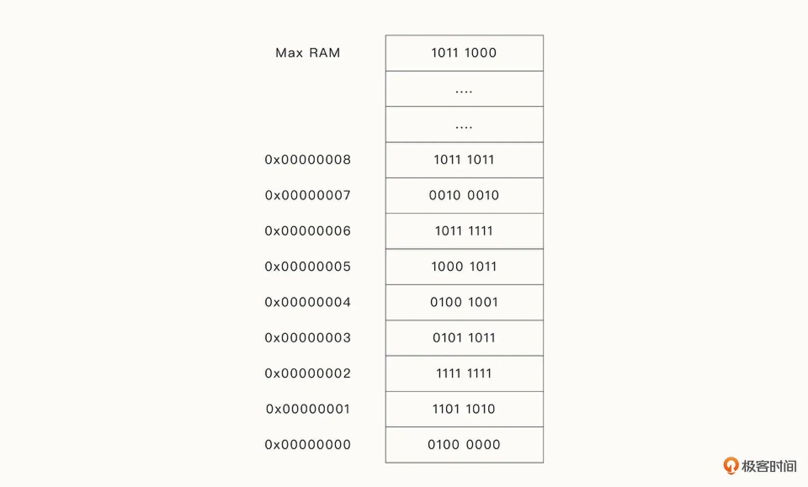

不过，由于计算机通常会运行多个程序，每个程序都直接操作物理内存是非常危险的。例如，某程序可以读取其他程序所有的数据，或者 A 程序修改了 B 程序在内存中的数据。因此，为了提高资源的隔离性和安全性，出现了间接操作物理内存的技术：虚拟内存。

## 虚拟内存

虚拟内存分为了许多的页（Page），分页的好处是我们可以对不同的页进行单独管理，设置不同的权限。页的大小因硬件而异，但通常为 4-64 KB。操作系统对内存进行操作时，并不是直接访问物理内存，而是访问虚拟内存。

虚拟内存的出现让程序有了独占整个内存的错觉，但分配了虚拟内存并不意味着在 RAM 中就一定有对应的数据。当程序需要将数据写入某一片虚拟内存时，如果当前虚拟内存区域没有对应的物理内存，操作系统会触发缺页中断（page fault），从而实现延迟分配物理内存。

操作系统还可以将一部分空闲的 RAM 置换到速度较慢的存储设备（例如磁盘）中，从而节省宝贵的 RAM，获得更大的内存空间。然后在需要时再将数据加载到 RAM 中，这无疑扩展了整个机器能够使用内存的大小。

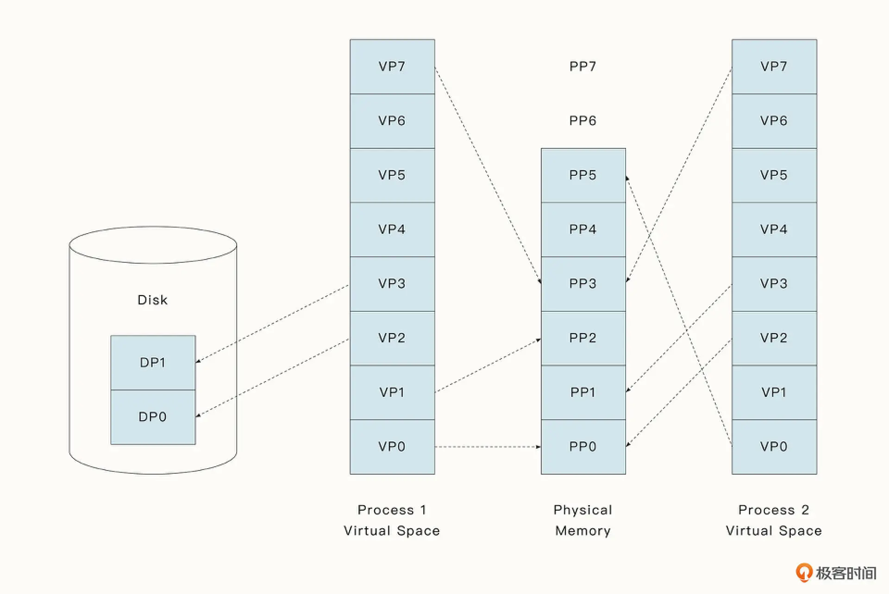

为了实现虚拟内存，我们需要一种叫做内存管理单元（MMU）的芯片，它一般集成在 CPU 芯片内部。MMU 将虚拟内存地址到物理内存地址的映射保存在页表（page table）中。MMU 还有叫做 TLB（Translation Lookaside Buffer）的物理缓存，负责存储从虚拟内存到物理内存最新的转换，加快转换的速度。

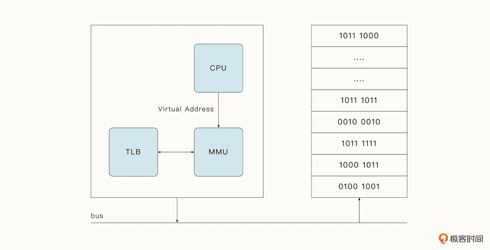

假设程序尝试访问没有绑定 RAM 的虚拟内存地址，会发生以下过程。

1. CPU 发出访问虚拟地址的命令，MMU 在页面表中检查该地址后禁止访问，因为尚未为该虚拟页面分配 RAM。

2. MMU 将缺页中断发送到 CPU。

3. 操作系统查找可用的 RAM，并完成虚拟内存与物理内存之间的映射。

4. 如果没有可用的 RAM，操作系统可以使用某种替换算法将现有的 RAM 转移到磁盘中。

我们在谈论程序的内存分配时，一般讨论的是对虚拟内存的分配。不仅如此，还隐含着谈论的是堆内存的分配。 程序加载到进程中时，操作系统会将程序的内存主要分为下面几个区域。

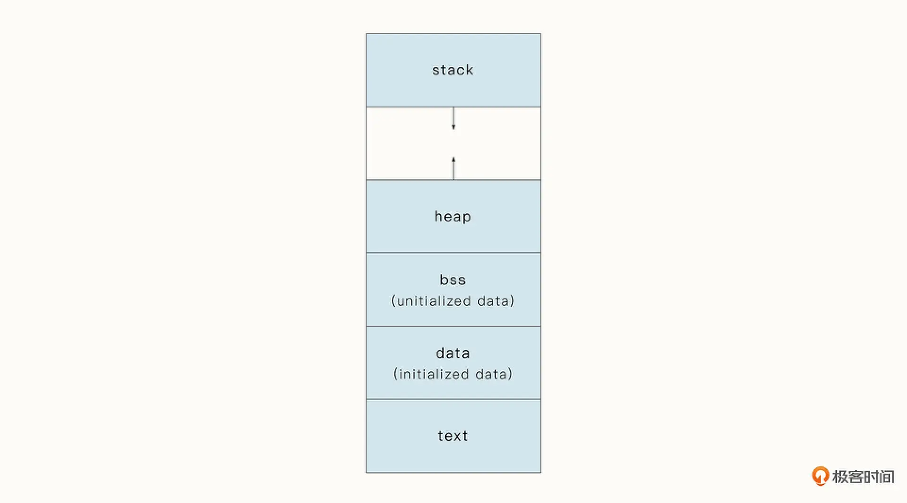

- text 区域：包含程序的指令、文字和静态常量，所在内存区域通常被 MMU 设置为只读，以保护代码段不会被意外改写。

- data 区域：通常是指用来存放程序中已初始化且不为 0 的全局变量的一块内存区域。

- stack 区域：程序栈，它会随着栈的增长而增长。

- heap 区域：与 stack 区域相向增长，可由用户动态分配。

可以发现，在程序的内存中，能够灵活变动的内存就是堆和栈了。但是栈的管理一般是由操作系统完成的，可以动态地增长和释放，一般开发者不用关心。而堆区的变量通常是由用户手动分配和释放的，它一般占用的内存也最多。所以我们提到内存分配时，通常指的是堆内存的分配。

## 内存分配算法概要

前面我们提到内存的分配一般指的是虚拟内存的分配，而且常指堆内存的分配。一般高级语言会有一些 API 帮助开发者分配和释放内存（例如 C 语言中的 malloc/free 函数），Go 语言则更加灵活，内存是否分配到堆区会先经过编译器检测再做决定，这被称为内存逃逸分析，并且运行时有自动的垃圾回收机制。

一个好的内存分配算法应当具有下面三个特征：

- 能够快速分配和释放

- 内存开销小

- 可以避免碎片化

知名的内存分配算法也有很多，例如 K&R malloc、Region-based allocator、Buddyallocator、Slab allocator 等。很难说哪一种算法是占有绝对优势的，因为它们都有特定的目标。

## 2n

以 Buddy allocator 为例，它分配的内存大小都必须是

- 字节，这意味着分配 17 个字节，

实际上需要消耗 32 字节的空间，看起来非常浪费内存。但是这种分配方法却可以预先将大的内存分为多个预置的内存块，让分配和释放都非常快。

现代的内存分配算法还会充分考虑并发分配的速度、CPU 核心增加带来的扩展性、缓存等因素。

Go 语言采用了现代的 TCmalloc 算法作为它内存分配的指导思想。TCmalloc 算法的核心思路之一是将内存分成若干级别不同的内存块。和 Buddy allocator 类似，TCmalloc 会将对象的内存映射到最接近的内存块，因此也会有内存浪费的问题。但是由于它提前划分了若干级别的内存块，并且将它们缓存了起来，这就让程序可以进行并发的无锁访问，大大提升了并发分配的性能。同时，TCmalloc 还能有效减少内存碎片。

下面我们详细来看一看 Go 运行时的内存分配细节。

## Go 内存分配算法原理

Go 语言将内存分成了大大小小 67 个级别的 span。其中，0 级代表特殊的大对象，它的大小是不固定的。每一个 span 中又包含了多个元素。当具体的对象需要分配内存时，并不是直接分配 span，而是分配不同级别的 span 中的元素。

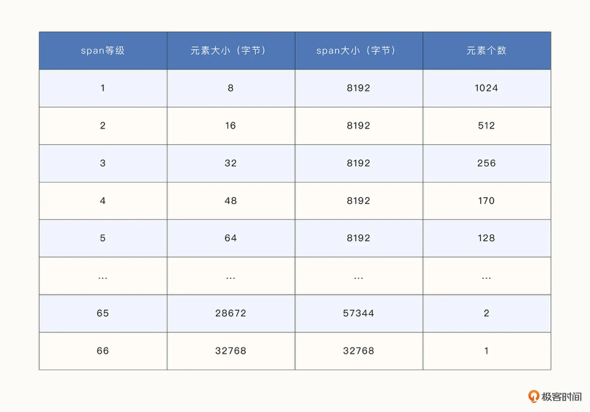

每个 span 的大小和 span 中元素的个数都不是固定的。例如第 1 级 span 中的元素大小为 8字节，span 大小为 8192 字节，所以第 1 级 span 拥有的元素个数为 8192/8 = 1024 个。第65 级 span 的大小为 57344 字节，每个元素的大小为 28672 字节，元素个数为 2。

每个具体的对象都需要被分配到对应大小的 span 上，例如我们要分配 17 字节的对象，会将其分配到比 17 字节大同时又最接近它的 span 等级，即第 3 级，这就导致它最终被分配了 32字节。这种分配方式不可避免地会带来一些内存的浪费。

为了能够方便地对 span 进行管理，加速 span 对象的访问和分配，Go 语言采取了三级管理结构，分别是 mcache、mcentral 和 mheap。

Go 语言采用了现代 TCMalloc 内存分配算法的思想，每个逻辑处理器 P 都存储了一个本地span 缓存，称作 mcache。如果协程需要内存，可以直接从 mcache 中获取。由于在同一时间只有一个协程运行在逻辑处理器 P 上，所以中间不需要加锁。

mcache 包含所有大小规格的 span 各一个。除 class0 外，mcache 的 span 都来自mcentral。每个 mcentral 都包含两个 mspan 的链表：empty List 表示没有空闲对象的 span链表，nonempty List 表示有空闲对象的 span 链表。

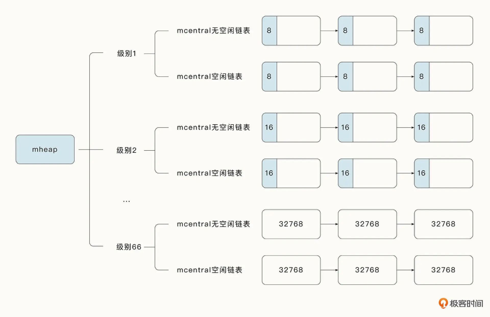

mheap 的作用不只是管理 central，大对象也会直接通过 mheap 进行分配。mheap 实现了对虚拟内存地址空间的精准管理，建立了 span 与具体虚拟地址空间的联系，保存了分配的位图信息，是管理内存的最核心单元，mheap 对内存进行的操作必须全局加锁。

根据对象的大小，Go 语言将堆内存分成了 heapArena、chunk、span 与 page 4 种内存块进行管理。其中，heapArena 内存块最大，在 Unix 64 位操作系统中占据了 64MB。chunk 占据了 512KB，span 根据级别大小的不同而不同，但必须是 page 的倍数，而 1 个 page 占据8KB。不同的内存块用于不同的场景，便于我们高效地对内存进行管理。


不同大小的对象会被分配到不同的 span 中。运行时分配对象的逻辑主要位于 mallocgc 函数中。其实这个名字也很有意思，malloc 代表分配，gc 代表垃圾回收（GC），这个函数除了分配内存还会为垃圾回收做一些位图标记工作。

```go
func mallocgc(size uintptr, typ *_type, needzero bool) unsafe.Pointer {
 // 判断是否为小对象, maxSmallSize 当前为32KB
 if size <= maxSmallSize {
   if noscan && size < maxTinySize {
     // 微小对象分配
   } else {
     // 小对象分配
   } else{
     // 大对象分配
   }
 }
}
```

内存分配时，将按照对象的大小不同划分为微小（tiny）对象、小对象和大对象。微小对象的分配流程最长，逻辑链路最复杂。由于微小对象的分配和小对象、大对象的分配流程类似，所以我们就以微小对象为例，看看对象的分配流程。

- 微小对象会被放入 class 为 2 的 span 中的某一个元素中。如果当前要分配的元素空间不够，运行时将尝试从 mcache 中查找 span 中下一个可用的元素。

- 如果当前的 span 中没有可以使用的元素，这时就需要从 mcentral 中加锁查找了。我们之前介绍过，mcentral 中有两种类型的 span 链表，分别是有空闲元素的 nonempty 链表和没有空闲元素的 empty 链表。在 mcentral 中查找时，会分别遍历这两个链表，查找是否有可用的 span。你可能想问，既然没有空闲元素的 empty 链表，为什么还需要遍历呢？这是因

- 为可能有些 span 虽然已经被垃圾回收器标记为空闲了，但是还没有来得及清理，这些span 在清扫后仍然是可以使用的。

- 如果在 mcentral 中找不到可以使用的 span，就需要在 mheap 中查找了。Go 1.12 采用Treap 结构进行内存管理，Treap 是一种引入了随机数的二叉搜索树。它的实现简单，引入的随机数和必要时的旋转保证了比较好的平衡性。但是 Treap 有扩展性的问题，因为内存是在 mheap 管理的，所以在操作它时需要维持一个锁。这在密集的对象分配及逻辑处理器P 过多时，会导致更长的等待时间。因此在 Go 1.14 之后，在每个逻辑处理器 P 中都维护了一份 Page Cache。

- Go 1.14 之后，如果要分配的 page 过大或者在逻辑处理器 P 的 Cache 中没有找到可用的page，就需要对 mheap 加锁，并在 mheap 管理的整个虚拟地址空间的位图中查找是否有可用的 page。这涉及 Go 语言对虚拟地址空间的位图管理，这种管理方式也被称为基数树。

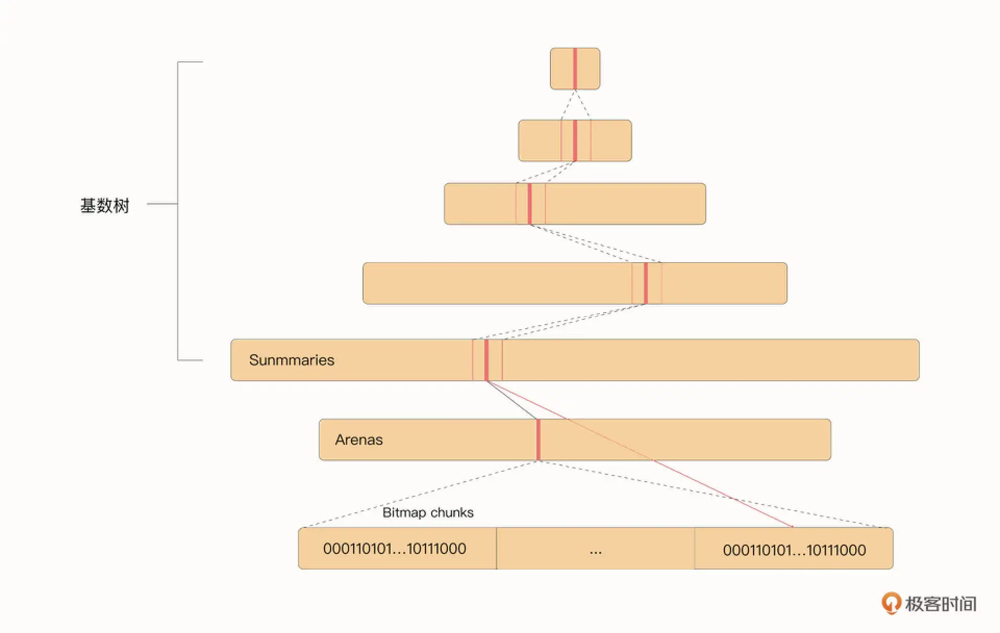

- 基数树中的每个节点都对应一个 pallocSum，最底层的叶子节点对应的 pallocSum 包含一个 chunk 的信息（512×8KB），除叶子节点外的节点都包含连续 8 个子节点的内存信息。例如， 倒数第 2 层的节点包含连续 8 个叶子节点（即 8×chunk）的内存信息。因此，越上层

- 的节点对应的内存越多。pallocSum 是一个简单的 uint64，分为开头（start）、中间（max）、末尾（end）三部分，pallocSum 的开头与末尾部分各占 21bit，中间部分占22bit，它们分别包含了这个区域中连续空闲内存页的信息。对于最顶层的节点，由于其

## 221

- max 位为 22bit，因此一棵完整的基数树最多代表pages=16GB 内存。

- 如果在基数树中查找不到可用的连续内存，就需要从操作系统中获取内存了。在 Unix 操作系统中，最终使用了 mmap 系统调用向操作系统申请内存，每一次向操作系统申请的内存大小必须为 heapArena 的倍数。在 64 位 Unix 操作系统中，heapArena 的大小为 64MB。这意味着即便需要的内存很小，最终也至少要向操作系统申请 64MB 内存。多申请的内存可以用于下次分配。Go 语言中对 heapArena 有精准的管理，每个指针的内存信息，每个page 对应的 span 信息都有记录。

## 垃圾回收

当分配的内存不再被使用时，就需要进行垃圾回收（Garbage Collection，GC）了。垃圾回收屏蔽了复杂而且容易犯错的操作，让开发变得更加简单。

Go 语言的垃圾回收算法叫作并发三色标记 - 清扫算法。标记 - 清扫算法顾名思义分为两个主要阶段，第一阶段是扫描并标记当前活着的对象，第二阶段是清扫没有被标记的垃圾对象。

在标记阶段，我们要将对象标记为黑色、灰色、白色三种类型。其中黑色代表已经被扫描了；灰色对象已经被黑色对象所引用，但是暂时还没有被扫描，被扫描之后会转换为黑色；白色也暂时没有被扫描，但是它内部可能有垃圾对象，如果之后被灰色对象扫描到，则会转为灰色。

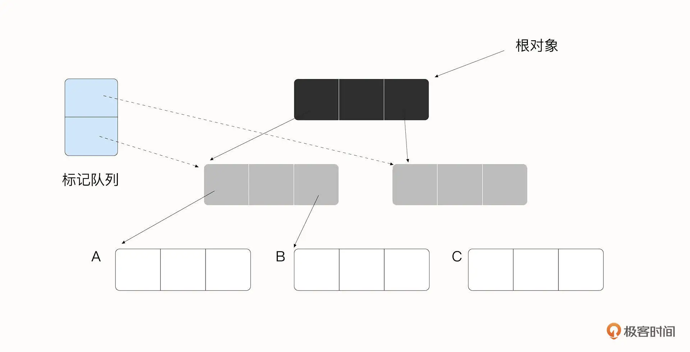

### 垃圾回收算法的演进

Go 的垃圾回收经历了长时间的演进过程。下图为 Go 1.0 的单协程垃圾回收，在垃圾回收开始阶段，我们需要停止所有的用户协程，并且在垃圾回收阶段只有一个协程执行垃圾回收。

Go 1.1 之后，垃圾回收开始由多个协程并行执行，这就大大加快了垃圾回收的速度，但是在标记阶段仍然不允许用户协程运行。

Go 1.5 对垃圾回收进行了重大更新，该版本允许用户协程与后台的垃圾回收协程同时执行，大大降低了用户协程暂停的时间（从 300ms 左右降低到 40ms 左右）。

Go 1.5 发布半年后，Go 1.6 大幅度减少了在 STW（Stop The World）期间的任务，使得用户协程暂停的时间从 40ms 左右降到了 5ms 左右。

接着，Go 1.8 使用了混合写屏障技术消除了栈重新扫描的时间，将用户协程暂停的时间降低到 0.5ms 左右。这使得 STW 的时间大大减少，在实践中，我们一般不用再考虑 STW 带来的延迟。

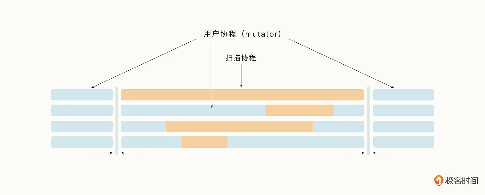

### 垃圾回收流程

Go 语言的垃圾回收循环大致会经历下图中的几个阶段。当内存到达了垃圾回收的阈值后，将触发新一轮的垃圾回收。之后会先后经历标记准备阶段、并行标记阶段、标记终止阶段和垃圾清扫阶段。在并行标记阶段，Go 语言引入了辅助标记技术，在垃圾清扫阶段，还引入了辅助清扫技术、系统驻留内存清除技术。

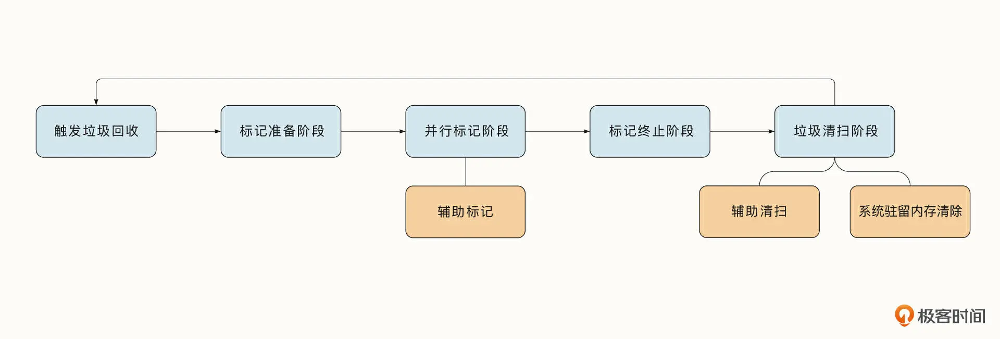

下面我们简单看一下各个阶段。

- 标记准备阶段

标记准备阶段最重要的任务是清扫上一阶段 GC 遗留的需要清扫的对象，因为使用了懒清扫算法，所以当执行下一次 GC 时，可能还有垃圾对象没有被清扫。同时，标记准备阶段会重置各种状态和统计指标，启动专门用于标记的协程，统计需要扫描的任务数量，开启写屏障，启动标记协程等。标记准备阶段会计算当前后台需要开启多少标记协程。目前，Go 语言规定后台标记的协程消耗的 CPU 应该接近 25%，也就是说，如果有 4 个逻辑处理器 P，那么会分配 1个 P 完全执行标记工作。

- 并发标记阶段

并发标记阶段会将整个程序的内存扫描一遍，识别出正在使用的内存，并间接地发现未使用的内存。

后台标记协程可以与执行用户代码的协程并行执行。Go 语言的目标是，让后台标记协程占用CPU 的时间在 25% 左右，最大限度地避免因执行 GC 而中断或减慢用户协程的执行。

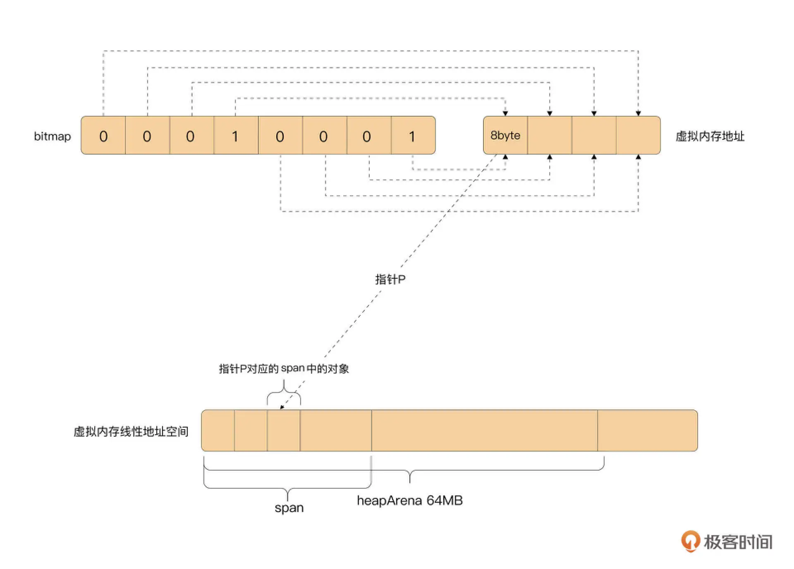

- 指针最终查找到 span 中对应的对象

- 标记终止阶段

在并发标记阶段，扫描和标记完所有灰色对象之后，就进入到了标记终止阶段。标记终止阶段主要统计一些指标，例如 GC 用时、GC 的次数，并会计算下一次触发 GC 需要达到的堆目标，关闭写屏障，并唤醒后台清扫协程开始下一阶段的清扫工作。

其中最重要任务就是计算下一次触发 GC 时需要达到的堆目标，这叫作垃圾回收的调步算法。调步算法是 Go 1.5 提出的，由于从 Go 1.5 开始使用并发的三色标记，在 GC 从开始到结束的过程中，用户协程可能被分配了大量的内存，所以在 GC 的过程中，程序占用的内存大小实际上超过了我们设定的触发 GC 的目标。为了解决这个问题，我们需要对程序进行估计，在达到目标内存之前就启动 GC，并保证在 GC 结束之后，占用内存的大小刚好在目标内存附近。

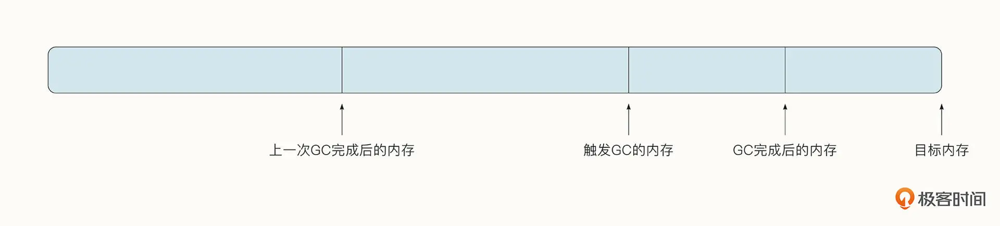

因此，调步算法最重要的任务就是估计出下一次触发 GC 的最佳时机。如果你对算法的计算规则感兴趣，可以参考《Go 语言底层原理剖析》。

- 辅助标记技术

Go 1.5 引入了并发标记后，带来了许多新的问题。例如，在并发标记阶段，扫描内存的同时用户协程也在不断被分配内存，当用户协程的内存分配速度快到后台标记协程来不及扫描时，GC 标记阶段将永远不会结束，这就无法完成完整的 GC 周期，容易导致内存泄漏。为了解决这样的问题，Go 引入了辅助标记算法。辅助标记在垃圾回收的并发标记阶段进行，当用户协程分配了超过限度的内存时，用户协程将不得不暂停并切换到辅助标记工作。

- 垃圾清扫阶段

垃圾标记工作全部完成就意味着已经追踪到了内存中所有活着的对象，之后就进入垃圾清扫阶段了。垃圾清扫阶段的目的是将垃圾对象的内存回收重用，或返还给操作系统。垃圾清扫采取了懒清扫的策略，即执行少量清扫工作后，通过 Gosched 函数让渡自己的执行权利，不需要一直执行。因此当触发下一阶段的垃圾回收后，可能存在没有被清理的内存。下一阶段的垃圾回收需要先将这些内存清理完。

- 辅助清扫技术

我们已经知道，清扫是通过懒清扫的形式进行的。因此，在下次触发 GC 时，必须将上一次GC 未清扫的 span 全部扫描一遍。如果剩余未清扫的 span 太多，会大大推迟下一次 GC 开始的时间。

为了规避这一问题，Go 语言使用了辅助清扫技术，它是在 Go 1.5 之后，和并发 GC 同时推出的。辅助清扫的意思是，工作协程必须在适当的时机执行辅助清扫工作，以避免下一次 GC发生时还有大量未清扫的 span。判断是否需要清扫的最好时机是在工作协程分配内存时。

- 系统驻留内存清除技术

此外，垃圾清扫过程中还引入过系统驻留内存清除技术。驻留内存（RSS）是进程占用的实际物理内存（RAM）。为了将系统分配的内存保持在适当的大小，同时回收不再被使用的内存，Go 语言使用了单独的后台清扫协程来清除内存。

```go
func gcenable() {
 // 启动后台清扫协程，与用户态代码并发被调度，归还从内存分配器中申请的内存
 go bgsweep(c)
 // 启动后台清除协程，与用户态代码并发被调度，归还从操作系统中申请的内存
 go bgscavenge(c)
}
```

在 Go1.12-Go1.15，Go 在释放内存的时候利用了 Linux 的 MADV_FREE 特性。 如果是MADV_FREE 标记过的内存，内核会等到内存紧张时才释放。在被释放之前，这块内存依然可以复用。

但在实践中这会导致我们看到的 RSS 指标不能完全匹配 Go 堆内存当前的占用量，给开发者造成很多困惑。在堆内存垃圾回收之后，RSS 在短期内可能降不下来，但是在重启程序后这个现象又能缓解。由于这个特性会导致我们在查看指标时无法反应真实的内存占用量，所以Go.16 之后默认就不再使用 Linux 的 MADV_FREE 特性了。

## 垃圾回收 API

下面我们来看一看如何调节以及观察 GC 的行为。

Go 暴露了一些有限的与垃圾回收相关的 API，用于调节垃圾回收的行为。 其中，Runtime.GC() 可以手动触发 GC。同时我们还可以通过 debug.SetGCPercent 设置下一次触发 GC 的目标内存大小，以此调整垃圾回收的行为。在程序启动时设置环境变量 GOGC 也能达到这个目的。

举个例子，在运行程序时设置 GOGC=200，意味着下一次触发 GC 的目标内存大小比现在多2 倍。而将 GOGC 设置为 off 甚至可以关闭 GC 的功能。

```
GOGC=off ./main
```

在程序启动时设置 GODEBUG=gctrace=1，运行时会打印出 GC 的一些关键指标。

```
GODEBUG=gctrace=1 ./project
```

打印的结果如下所示。

```
gc 3 @3.182s 0%: 0.015+0.59+0.096 ms clock, 0.19+0.10/1.3/3.0+1.1 ms cpu, 4->4->2
...
gc 2553 @8.452s 14%: 0.004+0.33+0.051 ms clock, 0.056+0.12/0.56/0.94+0.61 ms cpu,
```

打印指标的具体含义我就不再赘述了，你可以查看这篇文章。

另外，还有一个查看 GC 的利器是 go tool trace 工具，它可以用可视化的方式展示出程序堆内存的变化量。我们下节课还会在实战中看到它的用法。

## 总结

Go 语言运行时依靠细微的对象切割，极致的多级缓存，精准的位图管理实现了对内存的精细化管理以及快速的内存访问。同时 Go 采用了并发三色标记实现了内存的标记和清扫，将STW 的时间降低到了 ms 级以下，极大降低了 GC 对用户协程的影响。

Go 语言的自动内存管理机制虽然很复杂，但是它却为用户减轻了内存管理的负担。不过即便如此，我们在实践过程中也可能会遇到 GC 引发的性能瓶颈，下节课，我会详细介绍一个 GC引发严重性能问题的实际案例。

## 课后题

学完这节课，请你思考这个问题。

Go 的 GC 没有像 Java 一样的分代 GC，也没有为了解决内存碎片而压缩内存。你觉得是为什么呢？

欢迎你在留言区与我交流讨论，我们下节课见。
