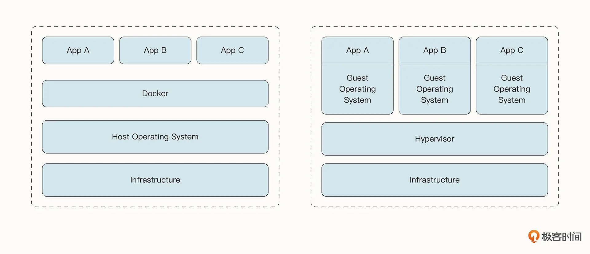
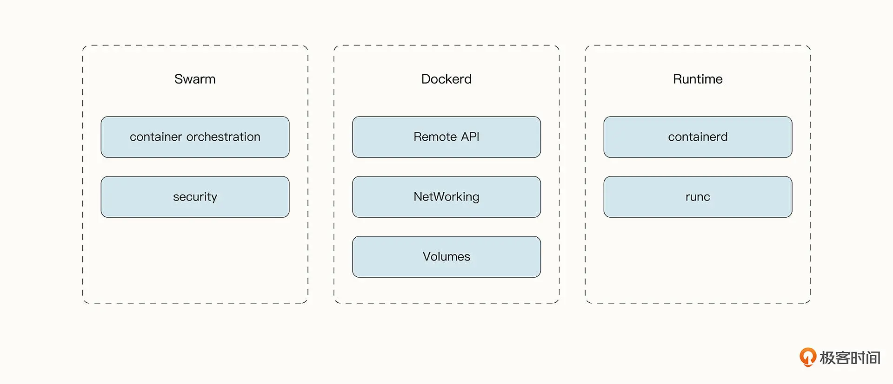
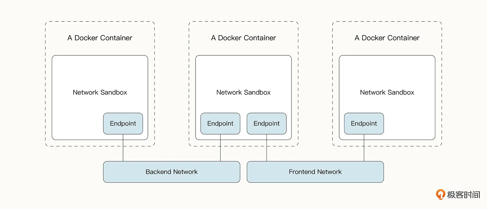
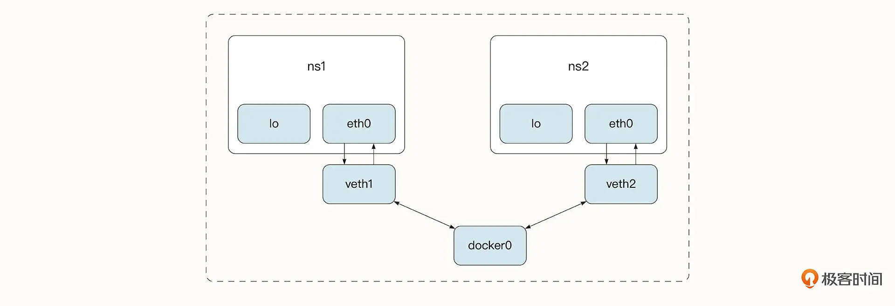

# 50 | 不可阻挡的容器化：Docker核心技术与原理

你好，我是郑建勋。

这节课，我们来看看容器化技术，并利用 Docker 将我们的程序打包为容器。

## 不可阻挡的容器化

大多数应用程序都是在服务器上运行的。过去，我们只能在一台服务器上运行一个应用程序，这带来了巨大的资源浪费，因为机器的资源通常不能被充分地利用。同时，由于程序依赖的资源很多，部署和迁移通常都比较困难。

解决这一问题的一种方法是使用虚拟机技术（VM，Virtual Machine）。虚拟机是对物理硬件的抽象。协调程序的 Hypervisor 允许多个虚拟机在一台机器上运行。但是，每个 VM 都包含操作系统、应用程序、必要的二进制文件和库的完整副本，这可能占用数十 GB。此外，每个操作系统还会额外消耗 CPU、RAM 和其他资源。VM 的启动也比较缓慢，难以进行灵活的迁移。

为了应对虚拟机带来的问题，容器化技术应运而生了。容器不需要单独的操作系统，它是应用层的抽象，它将代码和依赖项打包在了一起。多个容器可以在同一台机器上运行，并与其他容器共享操作系统内核。

容器可以共享主机的操作系统，比 VM 占用的空间更少。这减少了维护资源和操作系统的成本。同时，容器可以快速迁移，便于配置，将容器从本地迁移到云端是轻而易举的事情。



现代容器起源于 Linux，借助 kernel namespaces、control groups、union filesystems 等技术实现了资源的隔离。而真正让容器技术走向寻常百姓家的是 Docker。

Docker 既是一门技术也指代一个软件。作为一个软件，Docker 目前由 Moby 开源的各种工具构建而成，它可以创建、管理甚至编排容器。要安装 Docker 也非常简单，在 Mac 与Windows 系统下，我们可以直接使用Docker Desktop软件安装包。而在不同的 Linux 发行版上也有不同的安装方式，如果有需要你可以查看官网安装教程。

## Docker 的架构

当前 Docker 的架构可以分为 4 个部分，分别为运行时（Runtime）、守护进程（Dockerd） 、集群管理（Swarm）和客户端（Client）。

- 运行时主要分为底层运行时和更高级别的运行时两种。底层运行时称为 runC，它遵循OCI定义的运行时规范。runC 的工作是与底层操作系统交互、启动和停止容器。更高级别的运行时叫做 Containerd。Containerd 比 runC 做得更多，它负责管理容器的整个生命周期，包括拉取镜像、创建网络接口和管理较低级别的 runc 实例。

- 守护进程 (Dockerd) 位于 Containerd 之上，负责执行更高级别的任务。Dockerd 的一个主要任务是提供一个易于使用的 API 来抽象对底层容器的操作，它提供了对 Images、Volume、网络的管理。

- Docker 还原生支持管理 Docker 集群的技术 Docker Swarm。Swarm 有助于资源排版，并提供集群间交流的安全性。

- 客户端 Client 用于发送指令与 Dockerd 进行交互，最终实现操作容器的目的。



## Docker 镜像

要利用 Docker 生成容器，我们需要构建 Docker 镜像（Docker images）。Docker 镜像打包了容器需要的程序、依赖、文件系统等所有资源。镜像是静态的，有了镜像之后，借助 Docker就能够运行有相同行为的容器了。这有助于容器的扩容与迁移，使运维变得更加简单了。

而要生成镜像，我们可以书写 Dockerfile 文件，Dockerfile 文件会告诉 Docker 如何构建镜像。下面我们来看看怎么书写一个最简单的 Dockerfile 文件，它可以帮助我们生成爬虫项目的镜像。

```
FROM golang:1.18-alpine
LABEL maintainer="zhuimengshaonian04@gmail.com"
WORKDIR /app
COPY . /app
RUN go mod download
RUN go build -o crawler main.go
EXPOSE 8080
CMD [ "./crawler","worker" ]
```

让我们逐行剖析一下这段 Dockerfile 文件。

- 第一行，所有 Dockerfile 都以 FROM 指令开头，这是镜像的基础层，其余文件与依赖将作为附加层添加到基础层中。golang:1.18-alpine 是 Go 官方提供的包含了 Go 指定版本与Linux 文件系统的基础层。

- 第二行，LABEL 指令，可以为镜像添加元数据，在这里我们列出了镜像维护者的邮箱。

- 第三行，WORKDIR 指令用于设置镜像的工作目录，这里我们设置为 /app。

- 第四行，COPY 指令用于将文件复制到镜像中，在这里我们将项目的所有文件复制到了/app 路径下。

- 第五行， RUN 指令，用于执行指定的命令。在这里，我们执行 go mod download 来安装Go 项目的依赖。

- 第六行，RUN go build 用于构建项目的二进制文件。

- 第七行，EXPOSE 8080 声明了容器暴露的服务端口，它主要用于描述，没有正式的作用。

- 第八行，CMD 声明了容器启动时运行的命令，在这里我们运行的是./crawler worker。

```
接下来让我们构建镜像，下面的命令将创建一个新的镜像 crawler:latest。第一行最后的 . 是
```

在告诉 Docker 使用当前的目录作为构建的上下文环境。

```
» docker image build -t crawler:latest .
[+] Building 2.5s (10/10) FINISHED
=> [1/5] FROM docker.io/library/golang:1.18-alpine@sha256:c2bb8281641f39a32e0185
...
=> => writing image sha256:543e5f9605c19472776ba5a97c892092fd27e12a3164c4850940c
=> => naming to docker.io/library/crawler:latest
```

执行 docker image ls ，可以看到镜像已经构建完毕了。

```
» docker image ls | grep crawler
REPOSITORY    TAG   IMAGE ID       CREATED          SIZE
crawler      latest 543e5f9605c1   16 minutes ago   782MB
```

Docker 镜像由一系列的层（Layers）组成，镜像中的每一层代表 Dockerfile 中的一条指令。添加和删除文件都会产生一个新的层，每一层与前一层只存在一组差异。分层设计加速了镜像的构建和分发，多个镜像还能共享相同的层，这也可以节约磁盘空间。

要查看镜像的层，可以使用 docker image inspect 指令。如下所示，crawler:latest 镜像目前有8 层，每一层都有唯一的 SHA256 标示。

```
» docker image inspect crawler:latest
[
   {
       "Id": "sha256:543e5f9605c19472776ba5a97c892092fd27e12a3164c4850940c442b96
       "RootFS": {
           "Type": "layers",
           "Layers": [
               "sha256:ded7a220bb058e28ee3254fbba04ca90b679070424424761a53a043b9
               "sha256:5543070dee1f9b72eff0b8d84c87dd37b04899edd7afe46414ca6230c
               "sha256:e1cae8dd6f178986b987365d7702481e5bb71e020e2d44d9f8d9f4a35
               "sha256:22a177053ccef5c9de36c4060fec2b869c81511df49097f5047f65bfa
               "sha256:a849b6eb6a27ad178cc557000862c28ffd978c7712321c3b425eba0dc
               "sha256:d946471b6b8d1d07563ab6db96c96e525f0977cdb87a74592cf5aa7c8
               "sha256:abbce2bc78cffc226ed52ad907d158043aef6b92b72dba11f64ac643b
               "sha256:13cf2b5bcfa0cc96e5c3631b0dcb1b8a7b9015ebc400556b10119b03a
           ]
       },
       "Metadata": {
           "LastTagTime": "2022-12-20T10:47:44.36765779Z"
       }
   }
]
下一步，让我们用 docker run 执行容器。这里 -p 8081:8080 表示端口的映射，意思是将容
```

器的 8080 端口映射到主机的 8081 端口。

```
» docker run -p 8081:8080  crawler:latest                               jackson@b
{"level":"INFO","ts":"2022-12-20T10:56:53.420Z","caller":"worker/worker.go:101","
{"level":"INFO","ts":"2022-12-20T10:56:53.420Z","caller":"worker/worker.go:109","
{"level":"ERROR","ts":"2022-12-20T10:56:53.421Z","caller":"worker/worker.go:126",
```

不过在这里我们看到程序直接退出了，因为它无法连接 127.0.0.1:3326 的 MySQL。原来，由于容器网络具有隔离性，容器在查找 127.0.0.1 回环地址时，流量直接转发到了当前容器中，无法访问到宿主机网络。

为了让容器访问宿主机上的程序，我们可以将 MySQL 的地址修改为宿主机对外的 IP 地址，

```
例如当前我的局域网地址为192.168.0.105（你可以使用 ifconfig 指令查看本机 IP 地址）。
```

或者我们可以在 docker run 时使用–network host，取消容器与宿主机之间的网络隔离。

```bash
docker run -p 8081:8080 --network host crawler:latest
```

通过 docker exec 我们可以在正在运行的容器中运行命令，这里 -it 指的是将容器的输入输出重定向到当前的终端。如下，在容器中运行 sh 命令，之后我们可以通过命令行与容器交互。

```bash
docker exec  -it  crawler:latest sh
```

执行 docker ps 可以查看当前正在运行的容器。

```
» docker ps
CONTAINER ID   IMAGE                    COMMAND                CREATED          S
52442ef0a737   crawler:latest      "./crawler worker"       12 seconds ago   Up 1
```

## 多阶段构建镜像

镜像可以只包含与运行程序相关的文件与依赖，因此镜像大小可以变得很小。镜像变小后能加快镜像的分发与运行。但是我们之前构建的镜像却有 782MB，在生产环境下显然是无法让人满意的。

其实，我们前面构建的镜像很大，是因为我们在构建程序时包含了很多额外的环境和依赖。例如，Go 编译器的环境和 Go 项目的依赖文件。但是如果我们可以在构建完二进制程序之后，清除这些无用的文件，镜像将大大减小。

要实现这个目标，就不得不提到镜像的多阶段构建（multi-stage builds）了。

有了多阶段构建，我们可以在一个 Dockerfile 中包含多个 FROM 指令 ，每个 FROM 指令都是一个新的构建阶段，这样就可以轻松地从之前的阶段复制生成好的文件了。

下面是我们多阶段构建的 Dockerfile 文件。这里第一个阶段命名为 builder，它是应用程序的初始构建阶段。第二个阶段以 alpine:latest 作为基础镜像，去除了很多无用的依赖。我们利用COPY --from=builder，只复制了第一阶段的二进制文件和配置文件。

```
FROM golang:1.18-alpine as builder
LABEL maintainer="zhuimengshaonian04@gmail.com"
WORKDIR /app
COPY . /app
RUN go mod download
RUN go build -o crawler main.go
FROM alpine:latest
WORKDIR /root/
COPY --from=builder /app/crawler ./
COPY --from=builder /app/config.toml ./
CMD ["./crawler","worker"]
```

接下来让我们再次执行 dokcer build，会发现最新生成的镜像大小只有 41MB 了。相比最初的782MB，节省了七百多兆空间。

```
» docker images
REPOSITORY   TAG        IMAGE ID       CREATED         SIZE
crawler      local      19c35890a440   9 days ago      41MB
```

## Docker 网络原理

那 Docker 网络通信的原理是什么呢？我们在之前看到，容器中的网络是相互隔离的，容器与容器之间无法相互通信。在 Linux 中，这是通过网络命名空间（Network namespace）实现的隔离。Docker 中的网络模型遵循了容器网络模型（CNM，Container Network Model）的设计规范。如下所示，容器网络就像一个沙盒，只有通过 Endpoint 将容器加入到指定的网络中才可以相互通信。



Docker 的网络子系统由网络驱动程序以插件形式提供。默认存在多个驱动程序，常见的驱动程序有下面几个。

- bridge：桥接网络，为 Docker 默认的网络驱动。

- host：去除网络隔离，容器使用和宿主机相同的网络命名空间。

- none： 禁用所有网络，通常与自定义网络驱动程序结合使用。

- overlay：容器可以跨主机通信。要查看容器当前可用的网络驱动，可以使用 docker network ls。

```
» docker network ls
NETWORK ID     NAME           DRIVER    SCOPE
40865fd56e0d   bridge         bridge    local
1fa0c4c53670   host           host      local
25c4683eb897   none           null      local
```

要想让容器之间能够通过回环地址进行通信，除了使用和宿主机相同的网络命名空间，将容器

```
端口映射到宿主机端口之外，还可以在运行容器时指定 —net 参数。
» docker run --net=container:mysql-test   crawler:latest
```

例如，上面的命令是让 Docker 将新建容器的进程放到一个已存在容器的网络栈中，新容器的进程有自己的文件系统、进程列表和资源限制，但会和已存在的容器共享 IP 地址、端口等网络资源，两个容器可以直接通过回环地址进行通信。

而 Docker 容器默认是使用桥接网络的。虽然容器与容器、容器与宿主机之间不能够通过回环地址进行通信，但是借助容器的 IP 地址，是可以让两个容器直接通信的。例如，我们可以用下面的指令找到 MySQL 的 IP 地址。

```
» docker inspect mysql-test  | grep IPAddress
"IPAddress": "172.17.0.3",
```

接着，在我们的 crawler 容器中是可以直接 ping 通 MySQL 容器的 IP 地址的。

```
» docker run  -it  crawler:latest sh
~ # ping 172.17.0.3
PING 172.17.0.3 (172.17.0.3): 56 data bytes
64 bytes from 172.17.0.3: seq=0 ttl=64 time=1.597 ms
64 bytes from 172.17.0.3: seq=1 ttl=64 time=0.142 ms
```

这是怎么实现的呢？

以 Linux 系统为例，Docker 会在宿主机和容器内分别创建一个虚拟接口（这样的一对接口叫做 Veth Pair），虚拟接口的两端彼此连通，这就可以实现跨网络的命名空间通信了。

但是要让众多的容器能够彼此通信，Docker 还要使用 Linux 中的 bridge 技术。bridge 以独立于协议的方式将两个以太网段连接在了一起。由于转发位于网络的第 2 层，因此所有协议都可以透明地通过 bridge。当 Docker 服务启动时，会在主机上创建一个 Linux 网桥，它在 Linux中命名为 Docker0。Docker 会将 Veth Pair 的一段连接到 Docker0 上，而另一端位于容器中，被命名为 eth0，如下所示。

```
» docker run  -it  crawler:latest sh
~ # ip addr
1: lo: <LOOPBACK,UP,LOWER_UP> mtu 65536 qdisc noqueue state UNKNOWN qlen 1000
   link/loopback 00:00:00:00:00:00 brd 00:00:00:00:00:00
   inet 127.0.0.1/8 scope host lo
      valid_lft forever preferred_lft forever
2: tunl0@NONE: <NOARP> mtu 1480 qdisc noop state DOWN qlen 1000
   link/ipip 0.0.0.0 brd 0.0.0.0
3: ip6tnl0@NONE: <NOARP> mtu 1452 qdisc noop state DOWN qlen 1000
   link/tunnel6 00:00:00:00:00:00:00:00:00:00:00:00:00:00:00:00 brd 00:00:00:00:
127: eth0@if128: <BROADCAST,MULTICAST,UP,LOWER_UP,M-DOWN> mtu 1500 qdisc noqueue
   link/ether 02:42:ac:11:00:04 brd ff:ff:ff:ff:ff:ff
   inet 172.17.0.4/16 brd 172.17.255.255 scope global eth0
      valid_lft forever preferred_lft forever
```

这样，借助 Doker0 网桥就实现了容器与容器的通信，也实现了容器与宿主机、容器与外部网络的通信。因此容器内是可以访问到外部网络的。



## 总结

这节课，我们先是简单介绍了容器化的演进过程，然后重点介绍了 Docker 如何帮助我们使用容器。

容器是应用层的抽象，它将指定版本的代码和依赖项打包在了一起，并使用静态的 Dockerfile镜像来描述容器的行为。通过 Dockerfile 镜像生成的容器具有相同的行为，这是云原生时代弹性扩容服务和服务迁移的基础，极大地减少了运维的成本。通过多阶段构建镜像，我们还看到了如何减少镜像的大小，这有助于镜像的下载、分发与存储。

最后我们看到了 Docker 网络的原理，Linux 中使用了虚拟接口与 bridge 技术，实现了容器与容器、容器与宿主机之间的隔离与网络通信。

## 课后题

学完这节课，还是给你留一道思考题。

在你的理解里，Docker 和 Kubernetes 是什么关系？

欢迎你在留言区与我交流讨论，我们下节课再见！
