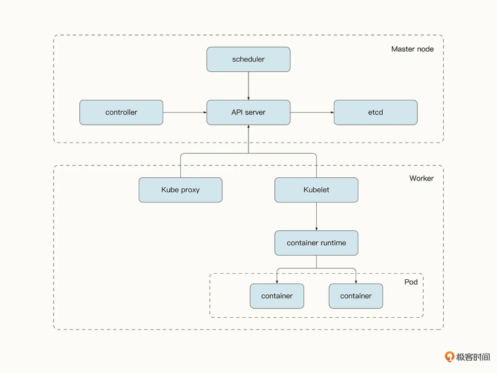
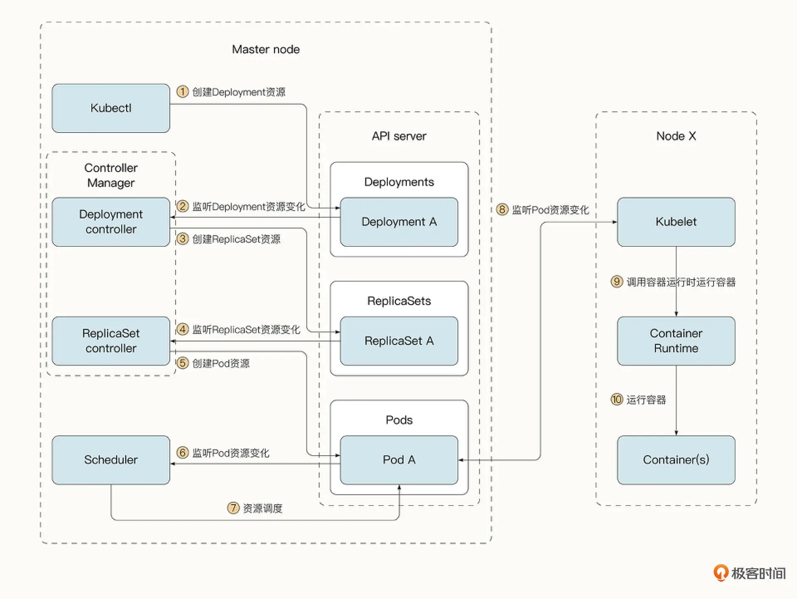
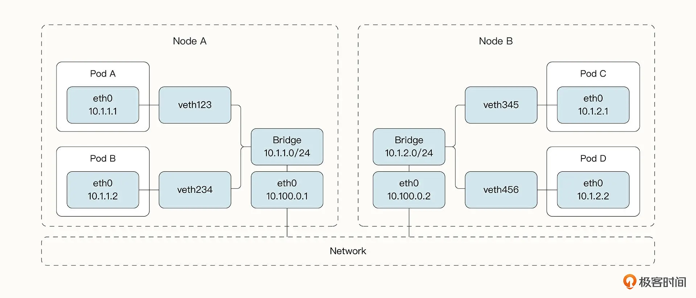

# 52-容器海洋中的舵手：Kubernetes工作机制

你好，我是郑建勋。

上节课的最后我们提到，对于大规模的线上分布式微服务项目，在实践中，我们会选择Kubernetes 作为容器编排的工具，它是云原生时代容器编排领域的霸主。这节课，让我们来看看 Kubernetes 的基本原理。

## 什么是 Kubernetes？

Kubernetes 这个名字来自希腊语，意思是舵手。它可以自动部署、扩容和管理容器化应用程序。Kubernetes 从谷歌内部对大规模容器的排版（Orchestration）中吸取经验，以谷歌内部的 Borg 和 Omega 系统为设计灵感。2014 年，Kubernetes 已经被贡献给了云原生计算基金会（CNCF，Cloud Native Computing Foundation），成为了开源项目。

和操作系统抽象了单机的资源并调度了应用程序相似，Kubernetes 是云原生时代的操作系统，它抽象了多台机器的资源，并完成了资源的灵活调度，这使我们能够轻松地管理大规模的集群。

从架构上讲，Kubernetes 的节点分为了两个部分：管理节点和工作节点。管理节点上运行的是控制平面组件，而工作节点上运行的是业务服务。

管理节点上运行的控制平面组件主要包括下面这些服务。

- API ServerAPI Server 是 Kubernetes 组件之间，以及 Kubernetes 与外界沟通的桥梁。外部客户端（例如 kubectl）需要通过 API Server 暴露的 RESTful API 查询和修改集群状态，APIServer 会完成认证与授权的功能。同时，API Server 是唯一与 etcd 通信的组件，其他组件要通过与 API 服务器通信来监听和修改集群状态。

- etcdetcd 为集群中的持久存储，Kubernetes 中的众多资源（Pod、ReplicationControllers、Services、Secrets ）都需要以持久的方式存储在 etcd 中，这样它们就可以实现故障的容错了。

- Controller ManagerController Manager 生成并管理众多的 Controller。Controller 的作用是监控感兴趣的资源的状态，并维持服务的状态与期望的状态相同。核心的 Controller 包括 DeploymentController, StatefulSet Controller 和 ReplicaSet Controller。

- SchedulerScheduler 为 Kubernetes 的调度器，它通过 API Server 监听资源的变化。当需要创建新的资源时，它负责将资源分配给最合适的工作节点。

而工作节点主要负责运行业务服务，它主要包含了 3 个组件。

- KubeletKubelet 负责注册工作节点、通过 API Server 监听被调度到该工作节点的资源，并通过容器运行时操作容器。此外，Kubelet 还会监控容器的状态和事件并上报给 API Server。

- Kube-proxyKube-proxy 负责使用 iptables 或 IPVS 规则来处理网络流量的路由和负载均衡。

- 容器运行时容器运行时用于完成对容器的创建、删除等底层操作，包括 Docker、rkt 等。

Kubernetes 中抽象出了 Pod 作为资源调度的基本单位。Pod 在容器的基础上增加了标签，具有重启策略、安全策略、资源限制、探针等功能。同时，一个 Pod 中可能包含多个容器，有时我们需要将多个容器绑定在一起作为一个 Pod。这是因为一个 Pod 中的多个容器共享相同的网络命名空间等资源，可以通过回环地址进行通信。同时，一个 Pod 中的所有容器只能够被调度到同一个工作节点中，这加快了这些容器的通信速度。

在实践中，我们一般不会直接部署 Pod，而是会通过创建 Deployment 资源，让Deployment Controller 部署并管理 Pod。这是因为 Deployment Controller 提供了 Pod 的自动扩容（Scalability）、自动修复（Self-Healing）和滚动更新（Rolling Updates）等功能。

现在我们来看一看一个 Pod 是如何启动起来的。

1. 书写描述 Deployment 资源的 yaml 文件，通过 kubectl 客户端创建 Deployment 资源。

2. Deployment Controller 监听到 Deployment 资源。

3. Deployment Controller 创建 ReplicaSet 资源。

4. ReplicaSet Controller 监听到 ReplicaSet 资源。

5. ReplicaSet Controller 创建 Pod 资源。

6. 调度器监听到新的 Pod 资源。

7. 调度器将 Pod 调度到指定工作节点。

8. 工作节点的 kubelet 监听到 Pod 资源的变化。

9. kubelet 通知容器运行时启动容器。

10. 容器运行时将容器启动起来。

## Kubernetes 网络

不过单有 Pod 还是不够的，对于微服务集群，大部分时候都需要完成 Pod 之间的网络通信。Kubernetes 的网络规范要求所有 Pod 都拥有独立的 IP 地址，并且所有 Pod 都在一个可以直接连通的、扁平的网络空间里。这意味着每个 Pod 都可以通过 IP 地址直接访问其他 Pod，它们之间不存在 NAT（网络地址转换）。我们来看一看这是如何做到的。

在 Kubernetes 中，我们可以把网络通信分为 3 种情形。

- Pod 内容器之间的通信。

- 相同 Worker Node 中 Pod 的通信。

- 不同 Worker Node 中 Pod 的通信。

首先来看一看 Pod 内容器的通信。

之前提到过，由于 Pod 中的容器共用同一个网络命名空间，因此 Pod 中的容器可以共用同一个网络栈，并通过回环地址进行通信。

而在同一个 Worker Nod 中不同的 Pod 位于不同的网络命名空间中，无法直接通信。

还记得 Docker 是如何让容器进行通信的吗？在 Linux 中，Docker 在宿主机和容器内分别创建了一个虚拟接口，虚拟接口的两端彼此连通，这就实现了跨网络命名空间的通信。为了让众多的容器能够彼此通信，Docker 使用了 Linux 中的 bridge 将多个容器连接起来。如上图所示，在 Worker Node 中的 Pod 进行通信的方式和 Docker 容器类似，只是把 Docker 中的容器换成了 Kubernetes 中的 Pod 而已。

而对于跨 Worker Node 的 Pod 通信，情况变得更加复杂。我们需要解决下面两个核心问题。

- 在整个 Kubernetes 集群中，合理分配 Pod 的 IP，不能有冲突，否则我们就无法让两个Pod 通过 IP 进行交流。

- 将 Pod IP 与 Node IP 相关联，当 Pod 发出数据后，需要有一种机制能够知道目标 Pod 所在的 Node 地址。

在谷歌的 GCE 环境中，Pod 的 IP 管理、分配以及路由都是由 GCE 完成的，但是在私有云环境，这需要我们在部署集群时实现这一功能。为了更容易地应用不同的网络插件，Kubernetes采用了 CoreOS 公司提出的 CNI 容器网络规范。CNI 定义了对容器网络进行操作和配置的规范，而具体的实现可以由不同的插件提供。知名的 CNI 插件包括下面几个。

- Calico

- Flannel

- Romana

- Weave Net

即便两个 Pod 之间可以相互通信了，我们很快又会面临新的问题。

在过去，系统管理员会在配置文件中指定服务器的固定 IP 地址，但在 Kubernetes 中，这样做是行不通的，原因主要有下面两点。

- Pod 可能随时出现和消失（这可能是因为 Pod 自动或者手动的扩容和缩容，或者因为集群节点出现了故障），客户端无法预先知道 Pod 对应的 IP 地址。

- 服务可能会发生水平扩展，而每个 Pod 都有自己的 IP 地址。客户端不应该关心背后服务的个数，也不应该保留所有 Pod 的 IP 列表。相反，所有这些 Pod 都应该可以通过单一的 IP地址进行访问。

为了解决这些问题，Kubernetes 提供了新的资源类型：Service。

Service 可以为一组提供相同服务的 Pod 提供单一、恒定的 IP 地址，只要 Service 存在，该地址就不会改变。当客户端与该 IP 地址连接时，Service 会将这些连接路由到对应的 Pod。这样，客户端就不需要众多 Pod 的具体地址了。如果我们将 Service 类型设置为 NodePort 或者LoadBalancer，还可以将 Service 暴露给外部的客户端进行访问。

Service 提供的 IP 地址是虚拟的，它没有绑定到任何的网络接口，也不会在数据包离开Worker Node 时变为网络数据包中的源 IP 或目标 IP。Service 要实现这种能力需要依靠kube-proxy。kube-proxy 通过 iptables 或者 IPVS 设置路由规则，确保发往 Service 的每个数据包都被拦截并会修改它的目标地址，因此数据包会被重定向到 Service 维护的后端 Pod 之中。

不过，虽然 Service 可以提供单一、恒定的 IP 地址，但是当服务变多之后，每一个 Service都会有自己的负载均衡器和公共 IP 地址，那么有没有办法提供一个单一的入口供外部客户端访问呢？

这就不得不提到 Kubernetes 提供的一个新的资源 Ingress 了。 Ingress 主要用于提供HTTP/HTTPS 的支持，借助 Ingress，Kubernetes 可以为后台的众多服务提供统一的接口。

## 总结

这节课，我们介绍了容器编排领域的霸主 Kubernetes。作为云原生时代的操作系统，我们看到了 Kubernetes 的架构、核心组件以及网络等相关原理。从这里，我们能够看到 Kubernetes是如何管理大规模服务的。

如果你想更深入地学习 Kubernetes，《kubernetes 权威指南》的网络原理部分和经典著作《Kubernetes in Action》都非常值得一读。

下节课，让我们进入实战环节，看看如何将我们的爬虫服务部署到 Kubernetes 当中。

## 课后题

学完这节课，照例给你留一道思考题。

在 Kubernetes 中，所有的内部组件都通过 API Server 完成资源的监听，它们为什么没有直接访问 etcd 呢？

欢迎你在留言区与我交流讨论，我们下节课见！
