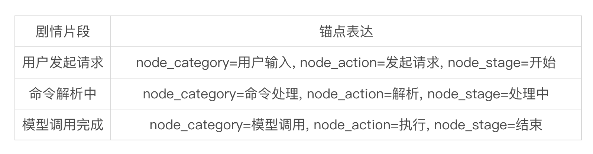
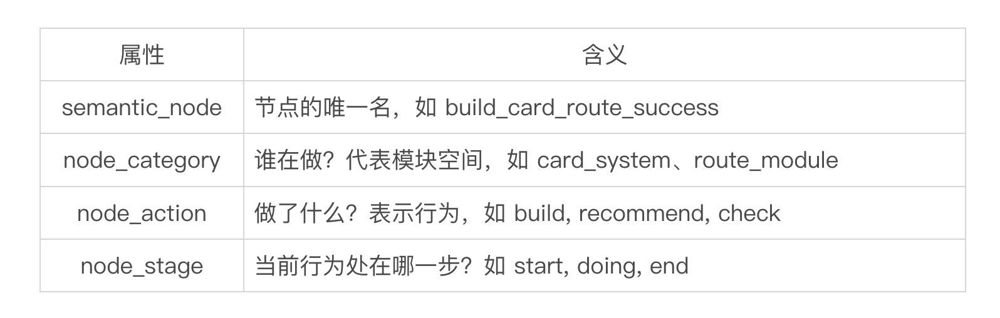
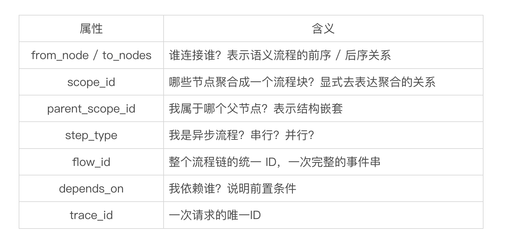
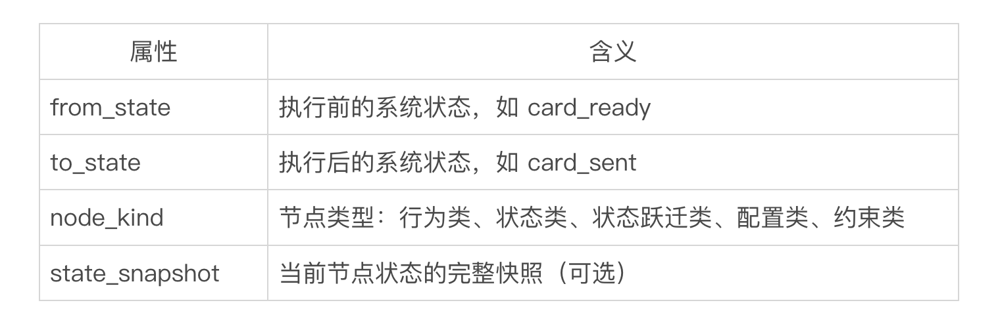
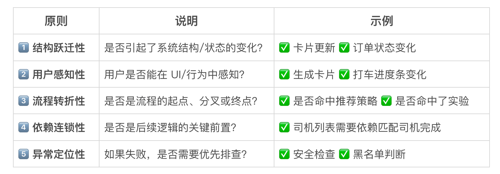
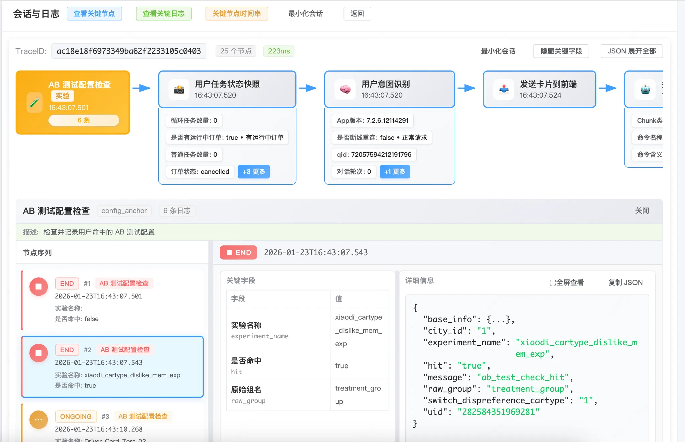
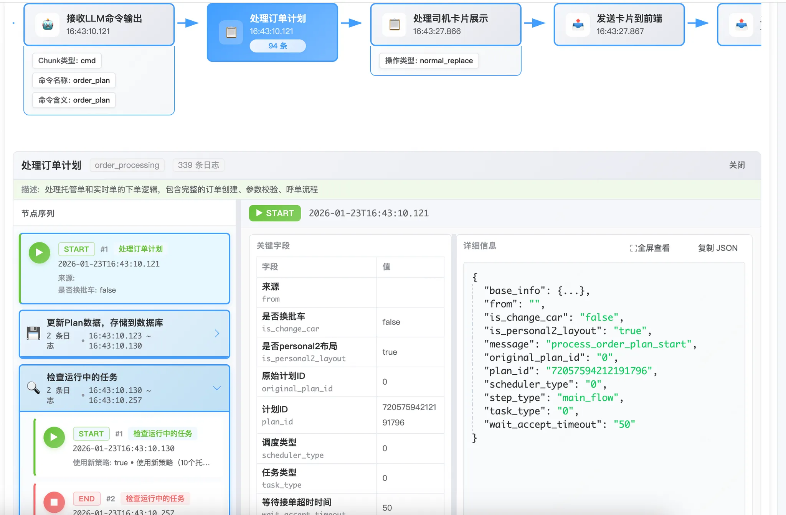
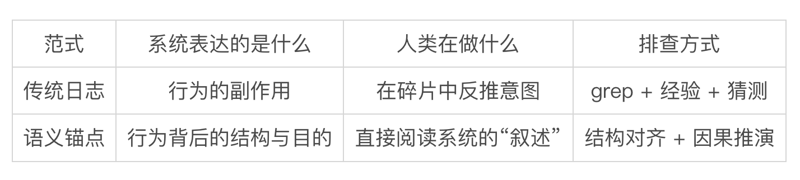

# 特别放送 | 让系统自己说话：用语义锚点颠覆传统日志范式

你好，我是郑建勋。

在深入参与复杂业务系统的过程中，我逐渐意识到真正让人疲惫的，不只是需求交织、代码难以维护，而是——当问题真的出现时，我们对系统的理解竟如此无力。

Case 排查像在海底捞针，日志信息庞杂无序，调用链条看似完整却难以还原真实意图。开发效率低下，其根源并非不够努力，而是系统的表达方式本身就不利于理解。

为了解决这个困境，我开始重新审视系统的本质 —— 系统并不只是代码堆叠的产物，而是一套 “行为 × 状态 × 意图” 共同驱动的动态结构。问题定位的痛苦，正是因为系统缺乏一种“说出自己在干什么”的能力。

于是，我提出了一个新范式：语义锚点日志体系。这不是一套新的打点方式，而是一种帮助系统“具备表达力”的设计哲学 —— 让系统像人一样，能够讲述自己的行为动机、状态转变和完整剧情。

它是我对系统复杂性顽疾开出的第一剂药方。

## 为什么传统日志排查令人痛苦？

排查一个 case 之所以令人痛苦，不仅是因为日志量太庞大，更是因为传统日志呈现的是碎片化、无语义、反结构的信息：

### 没有语义，只有“调用痕迹”

你看到类似日志：

```
call func A
chunk is here:
status: 2
但你根本不知道调用 func A 意味着什么行为，chunk 代表什么业务实体，status 2代表
```

什么，只能靠看代码、猜上下文。这种“无语义信息”的日志，就是系统在说“我做了一些事”，却不告诉你“我做了什么事、为什么做”。

### 没有上下文，只有函数调用

比如 “call func A”，传统日志打印的是函数级别的信息，它不会告诉你：

- 这个函数是谁触发的？来自哪个流程？

- 当前系统处于哪个业务阶段？

- 当前用户 / 订单 / 任务的状态是什么？

你知道“调用了 func A”，但你不知道“为什么调用它”“谁在上游调用了它”，更不知道“它的结果会影响下游什么”。上下文的缺失，让排查者像在黑暗中找线头。

### 没有结构边界，只有时间片段

即使你看到：

```
call func A
call func B
```

你也无法确定是否漏了某条调用链、是否在 A 和 B 之间还有分支、是否所有日志都已打印出来。这种非结构性表达，会让排查者产生极大的不确定感与焦虑。

### 异步 / 并发使时间线断裂

现代系统大量使用异步调用、事件驱动、并发流。不同请求之间可能交叉穿插：打印日志 A →B → C， 实际逻辑是 A → C1（异步） + B → C2（同步）

而日志时间可能是：

```
[10:00:00] call A
[10:00:01] call B
[10:00:01] call C1
[10:00:02] call C2
```

这会让你完全搞不清楚“哪条是主流程”“哪些是分支”“哪些是异步回调”“谁是因谁而生”。你试图用时间线拼出结构，而结构早已撕裂。

### 记忆负担重、全靠经验堆

你必须记住：

- 上游传了什么入参？

- 之前打印的状态是多少？

- 当前在哪个流程环节？

- 有没有某个环节没打印日志？

你不是在排查问题，而是在做“系统重建 + 业务推理”。

## 排查之痛的根源是什么？

传统排查的底层模型长这样，流程是隐性存在开发者头脑中，意图是隐藏的。

```
开发者心智模型 ─(编码)→ 代码 ─(运行)→ 日志
↑                                   ↓
└──────(阅读日志，重建模型)────────────┘
```

系统走过的流程是先存在于排查者的头脑中而不是直观显式的表达。人需要通过阅读、关联、倒推、猜测才能拼出系统的意图，这不仅极其耗费脑力、易出错、成本高，而且反人性。这在快速迭代、日志庞大且日志不规范、异步等场景下显得更加的困难。 由于意图的隐藏，不同的排查者理解日志推导出的结论可能完全不同，如果不了解相关的业务甚至可能完全难以入手。

因此排查问题不再是我去看一下哪里错了，而是我要先搞清楚系统本该怎么运行，然后再看它怎么没按那个方向走。这不是查问题，这是重建起系统的结构。排查者像一个侦探需要在日志的蛛丝马迹里重建起完整的现场。而重建现场的过程又是极度依赖排查者的经验和是否其做过相关的业务，排查成了经验 + 猜测的灾难。

### 深度隐喻：系统的沉默让人“盲人摸象”

- ❝ 传统日志是“盲人摸象”，语义锚点是“系统自己说出它是什么象” ❞

- 信息是片段式的：你看到的是“脚的一块皮肤”“鼻子的一段肌肉”“耳朵的边缘”。

- 结构无处表达：你不知道这些碎片是同一头象。

- 只能靠人拼图：你必须依赖经验、逻辑推理，去“复原象的全貌”。

- 每个人理解不同：你看到的是“大柱子”，他看到的是“软管”，最终结论可能南辕北辙。

另一种比喻是：

- ❝ 传统日志像是一串串足迹，而不是一张地图。你看到脚印，却不知道方向、目的地、旅程逻辑。 ❞

### 真正的问题不是我们不够聪明，而是系统太沉默

排查问题的痛苦并非“个人能力问题”，而是系统逃避了它本该承担的表达责任。我们发现：要理解系统，最好的方式，不是让人猜它做了什么，而是让系统自己说话。于是，我们触碰到了一个从未被严肃对待过的系统层面：系统的语言能力。

系统的复杂性，逼迫我们发明一种新的表达语言，来承载它隐藏的秩序。 而这种认知的变化，即将为我们解开系统工程中迷人的新视角。

## 语义锚点范式的核心哲学：不是日志流，而是剧情流

### 幻觉之痛：我们以为缺的是信息，其实是缺“表达维度”

排查一个系统 case 时，我们常以为痛苦来自于信息太少、日志不全，于是本能反应是“再多打一些点”。但更深层的痛苦，来自一个更隐秘的幻觉：

- ❝ 我们以为自己缺的是信息，其实我们缺的是结构维度的跃迁能力。 ❞

传统日志本质上是系统行为的副作用，它并没有表达“我是谁”“我正在干什么”“我从哪里来要到哪里去”。即使打印再多函数名、状态值和返回结果，它也只是行为碎片的堆积，而不是结构意图的表达。

这种维度上的困境就像盲人摸象——你摸到“象鼻”“象腿”“象耳朵”，但你无法知道那是一头“象”。因为没有一套结构化方式将这些碎片组合起来，告诉你它是“什么角色”“在什么剧情中”“正在做什么行为”。

于是我们开始意识到：仅靠行为痕迹的堆积，无法穿越到系统意图的表达层级。我们需要的不再是“更多日志”，而是一次根本性的范式跃迁：

- ❝ 从行为副作用 → 到语义意图的主动表达从调用路径 → 到结构剧情的可见展开❞

这正是语义锚点范式的哲学起点。

### 人的思维是“剧情流”，不是“模块流”

一个重要的洞察是：人理解系统从来不是按照“模块调用链”来思考的。

真实的排查过程更像是在头脑中展开一部电影：

- “用户发起了请求 → 进入了解析 → 调用了大模型 → 输出结果 → 回给前端。”

这条“故事线”并不是由函数名拼接而成的，而是由语义驱动的“状态 × 行动 × 目标”构成。

它本质上是一个语义因果链，每个节点都是一个“语义锚点”：



排查者会自动在脑中构建一个“起点→推进→转折→结束”的剧情链条，试图重建出系统“本该怎么走”和“为何没那么走”的路径。这说明：

-  排查者是用剧情脑而非模块脑在理解系统的。

所以我们不能只让系统吐出模块行为的“调用痕迹”，而要让它主动表达自身在结构剧情中的位置：我是谁，我在哪个阶段，我做了什么行为，我为什么这么做。

这正是语义锚点范式的第二个哲学基石：

- ❝ 系统行为不是调用树，而是一场因果张力驱动的剧情展开。 ❞

### 剧情哲学：系统是状态张力中展开的结构化意图表达

系统并非是随机发生的行为堆叠，而是由状态、张力与结构约束所共同驱动的“剧情线”。我们提出这样一套系统剧情哲学模型：

```
🎞️ 系统剧情展开图谱：状态 · 张力 · 行为 · 跃迁
 初始状态（S₀）
   ↓
🎭 剧本结构（结构图谱 G = 所有状态 × 可行动作 × 转移约束）
   ↓
🎬 行为调用（在 G 中选择路径，展开一条剧本线）
   ↓
📍 状态跃迁（S₀ → S₁ → ... Sn）
   ↓
🧠 可理解的系统语义（语义锚点串联成一条“故事线”）
```

其中每一个语义锚点，正是系统在剧情中的一次自我表达：

- 它携带状态：我当前处于什么状态（如“卡片已构建”）。

- 它体现张力：有哪些未完成的目标（如“卡片未发送”）。

- 它表达行动：为化解张力，我触发了什么行为（如“发送卡片”）。

- 它完成跃迁：我的状态因此发生了变化（如“发送中”→“发送完成”）。

这正是一个系统从“无结构调用流”跃迁为“结构化语义链”的转折点。

系统不再是沉默的函数执行机器，而是一个在结构剧情中展开意图的表达体。

- ❝ 语义锚点，不是日志点，而是系统意图的表达句子。系统不再留下足迹，而是主动讲述它在做什么。 ❞

## 结构设计：语义锚点的表达协议

### 为什么语义必须结构化？

就像一句“她哭了”并不能告诉我们是谁、为何而哭、哭了之后发生了什么，一个有效的语义锚点也不能只是行为的描述，而必须是结构位置 + 意图角色 + 状态变化的三位一体表达。我们设计语义锚点，不是为了补充一个“更清晰的打印”，而是为了完成一次根本性的跃迁：

- ❝ 从行为日志 → 到语义剧情的结构体表达 ❞

一个真正有意义的锚点，不是「函数 A 被调用了」，而是：

- 在这个节点上，谁（哪个模块）出于什么动机执行了什么行为。

- 当前行为在整个流程结构中处于什么阶段。

- 其发生是否导致系统结构的状态跃迁。

- 它与其他节点之间存在什么因果或层级关系。

因此，我们将语义锚点抽象为一组结构化语义元组，它可以被解析、聚合、可视化、重建剧情，并最终让系统自己表达“它正在做什么”。

### 基础表达协议：谁在做、做了什么、做到哪一步

我们将每个锚点抽象为以下核心三元组：



这一结构定义了最基本的“语义身份”：

- 🎭 我是谁 → 我正在做什么 → 我做到哪一步了

它相当于剧情剧本中的一行结构台词，用于定位一个行为在剧情中的“角色位点”。

### 结构关系协议：谁连接谁，为何连接

剧情不是独白，而是结构之间的联动。我们需要用流程与层级关系把每个锚点编织成一张有因果、有层级、有聚合的“剧情图谱”：



有了这些字段，系统就不再是一堆函数调用，而成为结构有向图上的路径遍历，每个流程的前后因果与并发结构都可以自动复原出来。

### 状态跃迁协议：是否完成了系统的结构变化？

系统并非在“调用函数”，而是在“推动结构状态的跃迁”。我们为每个锚点加入“状态跃迁语义”，用于表达这个节点是否真的推动了系统状态的演进：



当系统具备了结构状态 × 行为路径 × 状态转移的三元闭环，它就不再是黑盒，而是拥有了语义可追溯性。

这使得我们可以在错误发生时，直接回答：

- ❝ 系统是在什么状态中 → 做了什么 → 状态为何没跃迁成功 ❞

### 如何判断一个节点是否值得成为“语义锚点”？

并不是所有行为都需要打锚点。我们建立了一套五维过滤原则：



只有同时具备结构地位、语义意义、状态跃迁能力的节点，才有资格成为真正的语义锚点。

- ❝ 打点的目标不是打印行为，而是让系统说出它的“行为意图 + 状态跃迁 + 剧情结构”。 ❞

## 可视化维度：流程图不是调用栈，而是剧情流动图

### 从“人脑拼图”到“结构自动涌现”

传统的系统排查像是在一堆散乱的线索中拼图：你要一层层点进去看模块日志、grep trace-id、记函数名、还原链路、思考调用关系——这是“人脑补图谱”的过程。

但语义锚点的本质转变是：

- ❝流程不是调用栈的堆叠，而是剧情线的结构展开。❞❝我们不再绘图，而是让系统自己说出它的图。❞

每一个语义锚点节点自带结构信息 —— 它知道自己：

- 是什么角色（node_category）

- 做了什么动作（node_action）

- 处在哪一阶段（node_stage）

- 来自哪个前置节点（from_node）

- 属于哪个父结构（scope_id）

这就使得“流程图谱”不再是人工还原的结果，而是系统内在结构的自然展开。我们从“打印行为副作用”进化到“叙述意图结构”，从此进入了流程图自动涌现的时代。

### 协议设计：让前后端协同生成可视化语义图谱

为了支撑图谱自动化，我们设计了结构清晰、语义完备、可解释可扩展的 YAML 协议作为桥梁：

```
# ===============================
# SemanticLog 协议示例
# ===============================
nodes:
 # ------------------------------------------------
 # 语义锚点：用户意图识别
 # ------------------------------------------------
 NodeUserIntentRecognition:
   # ========= 核心身份 =========
   semantic_node: NodeUserIntentRecognition
   display_name: "用户意图识别"
   # 这个节点“在系统中是干什么的”
   description: >
     对用户输入进行意图识别，确定后续主流程
   # ========= 三元语义基础=========
   node_category: cmdin_parse      # 模块归属（结构域）
   node_action: parse_cmd_input    # 行为动词（做了什么）
   node_stage: start               # 行为阶段（生命周期） 同一个节点下可能有多个生命周期
   # ========= 节点类型（给前端 / 分析用） =========
   # behavior          行为类
   # state             状态快照
   # state_transition  状态跃迁
   # config            配置
   node_type: behavior
   # ========= 可视化 & 结构属性 =========
   is_key_node: true                # 是否关键语义锚点（默认前端高亮）
   visual_group: "意图理解流程"       #  前端分组
   visual_icon: "🧠"                # 图标
   "duration_ms": 45,              # 耗时
   # ========= 关键字段定义（只定义“语义重要字段”，每一个可能节点都不同） =========
   fields:
     user_input_type:
       display_name: "用户输入类型"
       type: enum
       format:  # 映射到对应的类型
         "1001": "普通query"
         "3001": "快捷打车"
     app_version:
       display_name: "App版本"
       type: string
   # ========= 结构依赖（因果关系） =========
   # 表示：这个节点通常发生在谁之后
   depends_on:
     - NodeQueryEntry
```

此结构具备以下优势：

- 🌐 可跨语言、跨平台解析，适合系统异构时代。

- 🧩 前端可基于结构自动生成流程图、字段卡片、异常提示。

- 📘 YAML 即注释文档，即协议即说明。

### Case 平台示例





### Case 可视化平台的未来图景：系统自己“演示剧情”

1️⃣ ⚠️ 结构差分 × 异常探测器

我们不再靠翻 error log，而是让系统自己发现结构“剧情帧”是否缺失。

- ✅ 正常流程：A → B → C → D❌ 当前 Case：A → B → ⛔（缺失 C）

系统会自动说：“我应该从 B 到 C，但没看到 X 节点，流程中断。”

📌 借助语义锚点的结构图谱，系统可以在没有报错日志的情况下自动报警：比如构建卡片

```
NodeCardBuilt 但是没有发送给前端，立刻触发异常标记。这是一种结构性异常探测，不
```

再依赖 error 日志或 panic 栈。

2️⃣ 🔍 流程对比 = “专家级认知路径”的平民化

平台可自动高亮对比「正常流程 vs 当前流程」，一眼就能看到缺失点：


- ❝ 排查不再靠记忆经验，而是靠结构推理。❞

3️⃣ 📘 系统成为自己的老师：教学能力内嵌系统结构图谱 ≠ debug 工具，而是 “结构教材”。你只需要打开任何一个 trace-id，它就是一次结构教学演示：

- 「它做了什么 → 为什么这么做 → 应该怎么做 → 哪一步漏做了」

过去系统知识“藏在老人脑子里”，现在系统自己就能说出“我错在哪里”“我本应如何运行”。

### 总结：可视化，不是为了“看”，是为了“理解”

我们不是要造一个花哨的界面，而是要构建：

- ❝ 系统的意图表达图谱，流程的因果结构地景，认知的剧情辅助设备。❞

结构图谱 ≠ 调用栈

结构图谱 = 系统行为背后的“意图地图” + “状态轨迹” + “角色互动”

你不再面对成千上万行 log，而是走入一条剧情线中，和系统一起穿越一场行为链条的微型剧场。

## 写在最后：不是更努力排查，而是让系统具备“说话能力”

我们做的，并不是“把日志打得更详细一点”。我们真正做的，是在教一个系统：

- 如何描述自己正在做什么。如何说明“我是谁”“我为什么这么做”“我现在走到哪一步”。如何把“行为”升级为“可理解的意图”。

传统日志，本质上是一种副作用记录：

- 某个函数被调用了

- 某个请求返回了

- 某段代码出错了

它只能告诉你：“事情发生了。”

但它从不告诉你：

- 我是谁？

- 我正试图完成什么目标？

- 我当前处在整个流程的哪个阶段？

- 我距离完成还差哪一步？

于是，人类被迫承担了一项隐形工作：

- 把一堆“发生过的行为”，重新翻译成“系统本来想做什么”。

这就是为什么排查总是痛苦——你不是在找 Bug，你是在替系统补全它本该自己说出的意义。

而语义锚点范式所做的，是一次角色反转：

- 不再由人类替系统“解释行为”，而是让系统自己“表达意图”。

我们给系统一套结构化的语言，让它能够说出：

- 我是谁（node_category）

- 我正在做什么（node_action）

- 我处在哪个阶段（node_stage）

- 我从哪里来，要往哪里去（from_node / to_node）

- 我是否推动了状态变化（from_state → to_state）

这不是“多打点日志”，而是让系统从一个沉默的行为生成器，升级为一个会自我叙述的意图表达体。

从“行为副作用”到“意图表达”，我们完成的，其实是一种表达层级的跃迁：



这意味着一个本质变化：

- 我们不再只是观察“系统发生了什么”，而是开始理解“系统正在试图做什么”。

这，才是真正的“系统语言能力”。不是让系统多说话，而是让它第一次——说出意义。

### 面向未来：语义锚点是 AI 协作时代的结构底座

当系统拥有了语义锚点，它不只是能“被人看懂”，而是第一次，具备了与 AI 对话、协作、审计的结构语言能力。未来的大模型将深度参与系统控制逻辑：

- 它生成策略；

- 它决策执行路径；

- 它控制核心链路行为。

但一个根本问题出现了：

- 你怎么知道模型的输出，是否真正“走完了那条正确路径”？你如何判断它有没有遗漏关键步骤、越权跳过某阶段？

传统系统无法回答这些问题。而语义锚点，恰恰给出了答案：


这不只是“让模型更可解释”，而是让整个系统更可控、更安全、更具协作性。

### 我们仍未抵达它的全部

语义锚点并不是某种“终极方案”，它只是我们试图解决系统可解释性难题时迈出的一个具体、扎实的起点。它并不神秘，也不完美，但它带来了两个微妙而重要的变化：

- 让系统的结构意图第一次变得可以被“表述”；

- 让问题的理解方式，从经验记忆走向结构推理。

而这些变化，或许正是未来系统进化的必要前提。我们开始隐约看到一些值得探索的方向：

- 如果系统能表述自身结构，它是否会涌现出对自身状态的感知与优化能力？

- 如果多个系统都使用语义锚点，它们是否能彼此交换剧情，协作调度，不再只是调用关系？

- 如果系统的每一步行为都有锚点语义，是否能深度进行性能分析 和数据分析？

- 如果我们用“语义锚点”的方式来设计系统，会不会催生出一种新的架构范式，甚至新的编程语言？

我们还不知道尽头是什么，但可以肯定的是：

- ❝ 当系统具备了表达自己的语言，它就开始拥有了进化的可能。❞

而我们，正在走在这条进化之路的前面。
