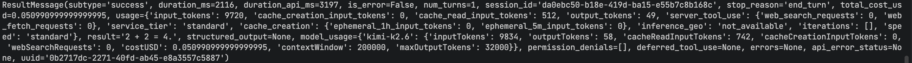
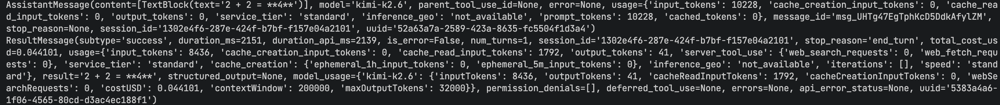
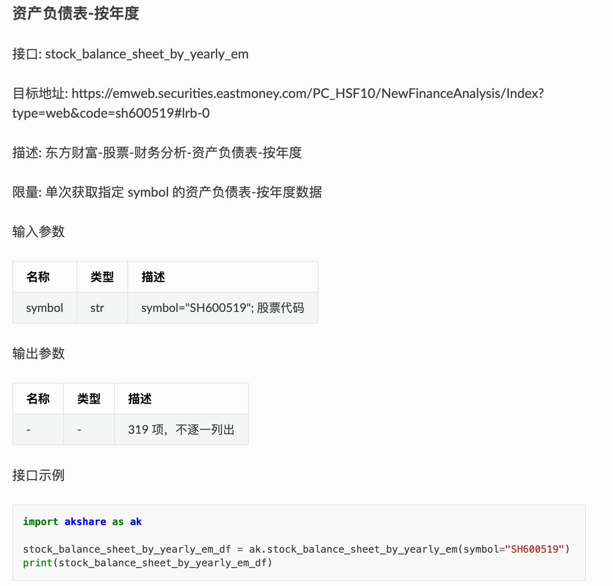
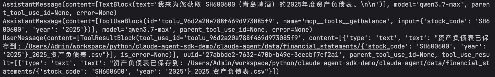
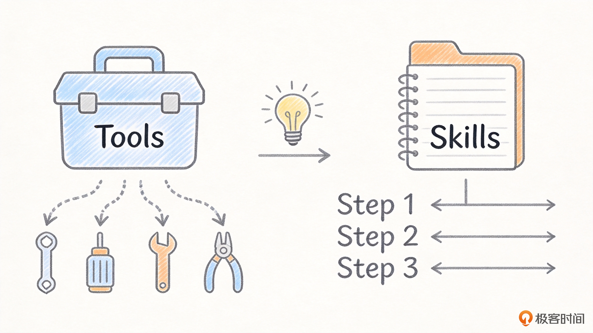

# 06 | 核心：快速构建AgentLoop并接入研报所需的工具集

你好，我是邢云阳。

技术进步让许多原本需要自行设计的方案，如今都能用更成熟的框架替代，效果也更好。上节课我们完成了理论梳理，也统一了设计思路和框架选型。那么从这节课开始，我们将进入代码实战环节，学习如何用 Claude Agent SDK 升级原有的金融研报生成项目（基于 LangGraph构建）。

## 环境搭建

按照惯例，我们还是要先搞定搭建环境这一步。Claude Agent SDK 支持 Python 与TpyeScript 两种开发语言，这两种都是做 AI 开发的首选语言。

尤其是在近一个阶段，由于 AI 项目普遍需要流式输出、并发等特性，TypeScript 语言因为在这一方面天然支持得比 Python 要好，因此像是 Claude Code、OpenClaw 都采用了TypeScript 语言进行了开发，TypeScript 的风头也更高了。

但由于很多同学是一路从 OpenAI SDK、LangChain 等走过来的，好不容易熟悉了 Python 语言，又要转 TypeScript 觉得有点压力，所以我们这个项目还是使用 Python 进行开发，等到下一个项目用 Pi-Mono 框架时，由于其仅支持 TypeScirpt，届时我们再切换到 TypeScirpt。

### 安装 Python SDK

首先安装 Python SDK，命令如下：

```
pip install claude-agent-sdk==0.1.62
```

之所以选择 0.1.62 版本是因为最新版本的 SDK 在调用工具部分的 API 接口发生了改变，导致在接入国产模型时，会报 API Error：400 bad request。因此我们只能退而求其次，选择 API接口没改变之前的版本，也就是 2026 年 1 月份左右的版本。如果你用的是 Claude 模型，版本问题可以忽略。

### 配置国内模型

由于 Claude Agent SDK 是一个闭源框架，正常来说，仅支持 Claude 自己的模型。但我们依然可以通过修改其环境变量的方式，将其修改为使用支持 Anthropic API 的国内模型，比如Kimi、MiniMax 等等。配置方法如下：

```python
from dotenv import load_dotenv
load_dotenv()
os.environ.setdefault("ANTHROPIC_BASE_URL", "https://api.kimi.com/coding/")
os.environ.setdefault("ANTHROPIC_MODEL", "kimi-k2.6")
os.environ.setdefault("ANTHROPIC_SMALL_FAST_MODEL", "kimi-k2.6")
os.environ.setdefault("ANTHROPIC_API_KEY", os.getenv("KIMI_API_KEY"))
```

一共需要配置 ANTHROPIC_BASE_URL、ANTHROPIC_MODEL、ANTHROPIC_SMALL_FAST_MODEL、ANTHROPIC_API_KEY 四个 Claude Agent SDK 的环境变量，由于我不想把 api_key 暴露在代码中，因此选择了使用 load_dotenv 从项目环境变量（.env 文件）中读取。

### Demo 测试

完成配置后，可以直接运行官网给出的示例代码测试一下是否配置成功。代码如下：

```python
import anyio
from claude_agent_sdk import query
import os
from dotenv import load_dotenv
load_dotenv()
os.environ.setdefault("ANTHROPIC_BASE_URL", "https://api.kimi.com/coding/")
os.environ.setdefault("ANTHROPIC_MODEL", "kimi-k2.6")
os.environ.setdefault("ANTHROPIC_SMALL_FAST_MODEL", "kimi-k2.6")
os.environ.setdefault("ANTHROPIC_API_KEY", os.getenv("KIMI_API_KEY"))
async def main():
   async for message in query(prompt="2+2=?"):
       print(message)
anyio.run(main)
```

代码使用了 Claude Agent SDK 提供的 query 方法，直接完成了 2 + 2 等于几的对话，query方法是 Claude Agent SDK 用于进行一次性、无状态的快捷对话的方法，不支持连续对话，追问，适用于快速完成一个一次性的任务。代码运行结果如下：



代码将输出一个结构，其中 result='2 + 2 = 4.' 为结果。

这其实就构建了一个高度封装的 Agent Loop。而我们还可以通过修改其配置项，为它注入系统提示词、配置工具、工具权限、设置工作目录等等。这就需要用到 ClaudeAgentOptions。

## ClaudeAgentOptions：为 Agent Loop 增加配置项

ClaudeAgentOptions 同样来自于 claude_agent_sdk 库，可以在调用 query 之前，要先选择ClaudeAgentOptions 中我们需要的参数进行设置。比如以下示例代码演示了对系统提示词、工具、工作目录、Loop 循环次数的配置。

```python
from claude_agent_sdk import query, ClaudeAgentOptions
options = ClaudeAgentOptions(
   system_prompt="你是一个有帮助的助手",  #系统提示词
   max_turns=3, #循环次数
   allowed_tools=["Read", "Write", "Bash"], #允许使用的工具，这几个都是内置工具
   permission_mode='acceptEdits', #设置工具权限，允许不经过人类确认，直接进行文件编辑
   cwd="/Users/Admin/workspace/python/claude-agent-sdk-demo/claude-agent" #工作目
)
```

之后，可以修改 query 方法，为其加入 options。代码如下：

```
async for message in query(prompt="在当前目录下，新建一个test.txt文件，然后写入12345",
   print(message)
```

运行后，会在当前目录下完成创建文件和写入内容的任务。

但是 query 方法由于太简单，很多特性都支持有限，比如自定义工具等，因此咱们还需要掌握另一种更加常用的 Agent Loop 构建方式，也就是 ClaudeSDKClient。

## 入门 ClaudeSDKClient

《飞驰人生 3》电影不知道大家看过没有，如果用电影中的例子做比喻。query 就相当于张弛团队使用天梯公司的车参赛一样，使用者几乎没有任何调取数据、调教赛车的权力，顶多换个轮胎（更换 Claude Agent SDK 内置工具）。而使用 ClaudeSDKClient 则相当于基于奥迪的车自己做改装，可玩性大大提升。

ClaudeSDKClient 最基础的写法如下：

```python
from claude_agent_sdk import ClaudeSDKClient
import anyio
import os
from dotenv import load_dotenv
load_dotenv()
os.environ.setdefault("ANTHROPIC_BASE_URL", "https://api.kimi.com/coding/")
os.environ.setdefault("ANTHROPIC_MODEL", "kimi-k2.6")
os.environ.setdefault("ANTHROPIC_SMALL_FAST_MODEL", "kimi-k2.6")
os.environ.setdefault("ANTHROPIC_API_KEY", os.getenv("KIMI_API_KEY"))
async def main():
   async with ClaudeSDKClient() as client:
       await client.query("2+2=?")
       # Extract and print response
       async for msg in client.receive_response():
           print(msg)
anyio.run(main)
```

代码与 query 相比是初始化了一个 ClaudeSDKClient 客户端，然后在客户端的内部调用客户端自己的 query。代码运行后的效果，这和直接使用 query 差不多。



此外，我们前面定义好的 ClaudeAgentOptions 同样可以在 ClaudeSDKClient 中使用，只需要把 options 当作参数传入到 ClaudeSDKClient() 即可，代码如下：

```
async with ClaudeSDKClient(options=options) as client:
```

了解了以上的基础写法后，后面不管用到工具还是 hooks 等，我们都是在该基础代码上的配置叠加，就比较好理解了。

## 自定义工具完成金融数据抓取

接下来，进入到项目的部分。在上节课，我们分析了金融研报的生成步骤，了解到在撰写研报之前，首先需要获取各项数据。所以在这节课，我们就将数据获取的部分定义成工具，之后接入到 Agent Loop 中。

### 代码实现

首先是获取上市公司三大会计表的工具，这部分数据可以通过免费，但今年以来，时常网络不稳定的 AKshare 进行抓取，如果想要稳定，可以使用付费的 Tushare。

比如以获取资产负债表为例，可以在 AKshare 中找到如下图所示接口文档，直接按照示例代码便可以获取指定股票代码的年度报表。



不过，我们不能直接把数据返回，因为这样会直接进入到模型的上下文窗口中，这样做的话，还没有进行后续的分析过程，就先浪费了上下文。

更好的做法是按需加载。因此，我们应该将数据抓取到指定 CSV 文件中，然后只返回文件的路径。这样，最后的工具函数的代码实现如下：

```
@tool("getbalance", "获取沪深A股公司的资产负债表，并保存到文件中，其中参数stock_code是带市场
async def get_balance_sheet_A(stock_code: str = "SH600600", year: str = "2025"):
   try:
       df_balance_sheet = ak.stock_balance_sheet_by_yearly_em(symbol=stock_code)
       # 只取REPORT_DATE是2025-12-31的数据
       df_balance_sheet = df_balance_sheet[df_balance_sheet['REPORT_DATE'] == f'
       # 获取项目根目录
       project_root = os.getcwd()
       # 创建完整的文件路径
       filepath = os.path.join(project_root, "data", "financial_statements", f"{
       # 创建目录（如果不存在）
       os.makedirs(os.path.dirname(filepath), exist_ok=True)
       # 使用指定目录保存文件
       df_balance_sheet.to_csv(filepath, index=False, encoding='utf-8-sig')
       return {
           "content": [
               {"type": "text", "text": f"资产负债表已保存到: {filepath}"}
           ]
       }
   except Exception as e:
       return {
           "content": [
               {"type": "text", "text": f"获取资产负债表失败: {e}"}
           ]
       }
```

工具代码的业务实现是调用 AKshare 的 stock_balance_sheet_by_yearly_em 接口获取指定股票的年度资产负债表数据，然后从里面摘取 2025 年度的，之后保存到当前路径下。需要注意的是作为工具函数，按照 Claude Agent SDK 的规定，工具的返回值必须采用代码 21-25 行的结构，将返回值放在字典中。之后，还需要如代码第一行所示，加上 @tool 装饰器，它的第一个参数是工具名称，第二个是工具描述，第三个是工具参数说明。

要将该工具注册到 ClaudeAgentOptions 中供模型在 Agent Loop 中使用，需要按照 ClaudeAgent SDK 的规定格式，将工具封装为一个本地的 MCP Server。具体代码如下：

```
server = create_sdk_mcp_server(
   name="financial-tools",
   version="1.0.0",
   tools=[get_balance_sheet_A]
)
```

这段代码也很简单。代码使用 claude_agent_sdk 库的 create_sdk_mcp_server 创建一个MCP Server，之后第 2 行代码定义了 MCP Server 的名称，第 3 行是版本，第 4 行是添加进MCP Server 的工具，可以添加多个，这里仅仅以上面定义的获取资产负债表的工具作为示例，需要注意的是这里填的是工具函数的名称，不是工具文档中的工具名称。

之后可以将该 MCP Server 以及其工具配置到 ClaudeAgentOptions 中，代码如下：

```
options = ClaudeAgentOptions(
   mcp_servers={"tools": server},
   allowed_tools=["mcp__tools__getbalance"]
)
```

代码第 2 行，我们通过字典的方式将 MCP Server 配置到 mcp_servers 变量中，之后在第 3行将加了 mcp__tools__ 前缀的工具配置到 allowed_tools 列表中。

需要注意的是，第 2 行的 “tools” 变量与第 3 行的 mcp__tools 中的 tools，这两个名称是一一对应的。“tools”是官方默认起的名字，但不是固定死的。如果你觉得不好听，也可以自定义，比如写成 “abc”也可以。如果第 2 行写的“abc”，则第 3 行要写成 mcp__abc__。

注意以上细节之后，其他部分就是纯粹地去写业务代码了。

### 测试

在完成代码构建后，接下来我们运行一下该代码，测试一下其效果：



从效果看，数据被成功抓取，并且写成了文件保存到了指定目录中。恭喜你进行到这里，是不是感受到了脚手架的便利？

## 总结

这节课我们快速上手了如何基于 Claude Agent SDK + 国内模型构建具备自定义工具调用能力的 Agent Loop。

要注意，使用国内模型时要选择旧的 Claude Agent SDK 版本，比如我使用的是一月份的版本，这个坑我花了一个周末才解决掉。当然随着国内模型对 Anthropic API 的不断更新支持，或许过一段时间，不兼容的地方就兼容了，你可以在具体使用时再对版本进行一下测试。

这一部分主要还是为了给你讲解 Claude Agent SDK 的开发的一些基本套路和容易出错的细节点。其实从技术角度来说，我们不一定非要把数据抓取等业务定义成工具，让模型自主去判断；而是完全可以定义成 Skills 中的一个脚本，或者是一个 CLI，这样，我们可以在 Skills 中定义好数据抓取的步骤等，之后让模型顺序调用，既精确又能节省上下文。只有当工具比较独立，不需要配合 Skills 使用时，定义成工具才会比较合适。



下一节课，我们将会把业务封装为 Skills，完成整体金融研报生成的效果，敬请期待。

## 思考题

请思考，你认为什么样的业务代码适合封装为工具，什么样的业务代码适合作为 Skills 中的一个脚本？

欢迎你在留言区展示你的思考过程，我们一起探讨。如果你觉得这节课的内容对你有帮助的话，也欢迎你分享给其他朋友，我们下节课再见！
