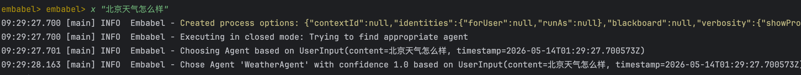
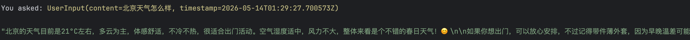

# 01 | 基于SpringBootStarter，快速实现“天气查询Agent”

你好，我是张嘉熙。

很多 Java 开发者在接触 AI Agent 时，第一反应往往是：做一个 AI Agent，必然离不开复杂的Prompt 、Python + 各种框架，以及一堆链式调用的胶水代码。

但事实并非如此。今天，我想带你看到另一种可能：用我们熟悉的 Spring Boot，像写Controller 一样写 Agent。这节课不讲概念，我们直接动手，从 0 到 1 交付一个真正能跑起来的 Java Agent。

整个过程你只需完成四步：

1. 搭建最小可运行环境

2. 接入真实的天气 API

3. 编写几个“普通方法”和“数据结构”

4. 将它变为 Agent

最终你会实现这样的效果：当用户说“帮我查一下北京天气”，系统就会准确返回当前天气、温度、湿度和简要预测。更重要的是，你写的并非传统接口，而是一个可以被 “智能调度” 的能力。

## 如何用 Java 快速创建第一个 Agent？

我们将从环境搭建、API 配置、代码实现、运行测试四个步骤，完整走完整个流程。

### 前置要求

- Java 21+

- Maven 3.9+

- Spring Boot 基础

- Embabel 0.3.5

- 本讲 GitHub 地址

### 第一步：快速搭建运行环境

为了帮助你透彻理解项目结构和依赖关系，我们从空项目开始一步步搭建。

### 从零创建 Spring Boot 项目（便于深度理解结构）

```xml
在 pom.xml 中添加 Embabel 依赖：
<dependency>
   <groupId>com.embabel.agent</groupId>
   <artifactId>embabel-agent-starter-shell</artifactId>
</dependency>
```

### 第二步：获取并安全配置 API Keys

### 获取 API Key

1. OpenWeather API Key（可选）：访问 OpenWeather 注册获取

2. LLM API Key（必选）：选择任意你喜欢的 LLM 供应商，比如 OpenAI 或 Anthropic，本课程中使用 DeepSeek

### 引入对应 LLM 供应商的依赖

```xml
<dependency>
   <groupId>com.embabel.agent</groupId>
   <artifactId>embabel-agent-starter-deepseek</artifactId>
   <version>0.3.5</version>
</dependency>
```

### 模型和 API 配置

```
配置 application.yml：
```

```yaml
spring:
 application:
   name: Embabel01
embabel:
 models:
   default-llm: deepseek-chat
 agent:
   platform:
     models:
       deepseek:
         api-key: ${DEEPSEEK_API_KEY}
openweather:
 api:
   key: ${OPENWEATHER_API_KEY}
```

### 第三步：实现天气查询 Agent

1. 定义数据结构

```
record City(String name) {
}
record WeatherData(
       String cityName,
       String country,
       double temperature,
       double feelsLike,
       String description,
       String icon,
       int humidity,
       double windSpeed,
       String sunrise,
       String sunset
) {
}
```

2. 实现天气服务

```java
@Action
public WeatherData retrieveWeather(City city) {
   if (city == null || city.name() == null || city.name().isEmpty()) {
       System.err.println("WeatherAgent: City is null or empty");
       return null;
   }
   if (openWeatherApiKey == null || openWeatherApiKey.isEmpty()) {
       System.err.println("WeatherAgent: OpenWeather API Key is not configured")
       return null;
   }
   String geoQuery = city.name();
   String geoApiUrl = String.format("https://api.openweathermap.org/geo/1.0/dire
           geoQuery,
           openWeatherApiKey);
   System.out.println("WeatherAgent: Calling geo API: " + geoApiUrl);
   GeoResponse[] geoResponses = restTemplate.getForObject(geoApiUrl, GeoResponse
   if (geoResponses == null || geoResponses.length == 0) {
       System.err.println("WeatherAgent: Geo API returned empty or null response
       return null;
   }
   GeoResponse geoResponse = geoResponses[0];
   if (geoResponse.lat == null || geoResponse.lon == null) {
       return null;
   }
   String weatherApiUrl = String.format("https://api.openweathermap.org/data/2.5
           geoResponse.lat,
           geoResponse.lon,
           openWeatherApiKey);
   OpenWeatherResponse response = restTemplate.getForObject(weatherApiUrl, OpenW
   if (response != null &&
       response.main != null &&
       response.sys != null &&
       response.weather != null &&
       response.weather.length > 0 &&
       response.wind != null) {
       return new WeatherData(
               response.name,
               response.sys.country,
               response.main.temp,
               response.main.feels_like,
               response.weather[0].description,
               response.weather[0].icon,
               response.main.humidity,
               response.wind.speed,
               formatTimestamp(response.sys.sunrise),
               formatTimestamp(response.sys.sunset)
       );
   }
   return null;
}
```

这部分代码主要就做了两件事：

- 调用外部 API，此处共调用了两个 API，先后分别用于根据城市名称查询坐标，再根据坐标查询具体的天气数据。

- 转换为业务对象。

到这里为止，我们写的仍然是普通后端代码。唯一的区别只是多了一个 @Action 的注解而已。

3. 处理用户输入

```
@Action
public City extractCity(UserInput userInput, OperationContext operationContext) {
   return operationContext.ai().withLlm(LlmOptions.fromCriteria(ModelSelectionCr
           """
                   Extract the city name from this user input.
                   - city name: the name of the city
                   User input: %s""".formatted(userInput.getContent()),
           City.class
   );
}
```

这里的逻辑也很容易理解，我们写了一段 Prompt 并让 LLM 按照 City 这个结构来返回数据，其他的 UserInput、OperationContext 等我们暂时可以不去管，只要知道这是框架封装好的类，我们在处理用户输入时就这样去用就好了。

4. 实现 WeatherAgent，并对用户进行响应

```java
@Agent(description = "Generate a weather info on user input")
public class WeatherAgent {
// ... 省略上文已经提到的逻辑和非核心逻辑
@AchievesGoal(description = "generate weather related response to user, based on
@Action
public String reply(UserInput userInput, WeatherData weatherData, Ai ai) {
   var reply = ai
           .withAutoLlm()
           .generateText(String.format("""
                           Generate a friendly weather response for the user bas
                           # Weather Data
                           City: %s
                           Country: %s
                           Temperature: %.1f°C
                           Feels like: %.1f°C
                           Condition: %s
                           Humidity: %d%%
                           Wind Speed: %.1f m/s
                           Sunrise: %s
                           Sunset: %s
                           # User input
                           %s
                           """,
                   weatherData.cityName(),
                   weatherData.country(),
                   weatherData.temperature(),
                   weatherData.feelsLike(),
                   weatherData.description(),
                   weatherData.humidity(),
                   weatherData.windSpeed(),
                   weatherData.sunrise(),
                   weatherData.sunset(),
                   userInput.getContent()
           ).trim());
   return reply;
}
}
```

最后一步，我们看到最外层的一个类，这个类上面有一个 @Agent 注解，表明这不是一个普通的类，而是一个 agent，同时我们又看到一个新的 reply 方法，这个方法仍然有 @Action 注解，不同的是，它还多了 @AchievesGoal 注解，表明这就是我们 agent 的要实现的目标。这个方法里的逻辑仍然很简单，又是一段 Prompt 让 LLM 生成对用户的回复而已，只是 Prompt里传入的之前生成好的天气数据与用户的输入，仅此而已。

可能有些同学看到这里会冒出一个想法：这不就是写了一些带有特定注解的普通方法吗？

确实，从代码上看，它和传统的 Service 没有太大的区别。

但关键在于这三个注解：

- @Agent

- @Action

- @AchievesGoal

它们做了一件非常重要的事情：把这个类和这些方法，从“逻辑实现”变成了“可被系统调度的能力”。

在传统系统中：你必须手动写调用链。而在 Agent 系统中：你只需要声明“我能做什么”，系统会自动决定“什么时候调用你”。

你不再写流程，而是定义能力。这就是 Agent 与传统方法的本质区别。

5. 创建应用主类

```java
@SpringBootApplication
class Embabel01Application {
   public static void main(String[] args) {
       SpringApplication.run(Embabel01Application.class, args);
   }
}
```

### 第四步：运行项目

```
配置 .env 文件中的 API Key（也可以在 IDE 中配置）。
```

2. 启动应用：

```
./mvnw spring-boot:run
```

3. 使用内置 Shell 交互：





到这里，你已经完成了一件非常值得骄傲的事情：用 Java 写出了一个真正能工作的智能体！

你没有写任何调度逻辑，没有处理复杂的状态管理，甚至不用关心 LLM 怎么调用——你只需要定义好 @Agent、@Action 和 @AchievesGoal，系统就已经能“理解并调用你的能力”。这就是 Embabel Agent Framework 的魔力所在：让你专注于业务逻辑，把思考交给框架。

但这仅仅是开始。你可以把这套模式复制到任何需要“智能决策“的场景，比如：

- 智能客服 ：自动理解用户问题，调用知识库或工单系统生成回复

- 代码助手 ：分析代码需求，调用代码生成 API，自动审查和优化

- 数据分析 ：理解自然语言查询，调用数据库或 BI 工具生成报告

- 自动化运维 ：解析运维告警，自动执行修复脚本或创建工单

- 教育辅导 ：理解学生问题，调用题库和课程资源生成个性化解答

- 电商导购 ：理解用户需求，调用商品数据库推荐最合适的产品

- 医疗辅助 ：分析症状描述，调用医疗知识库提供初步建议

- ……

```
这些场景看似千差万别，但核心模式是一致的。你刚才用 @Agent、@Action、
@AchievesGoal 写出的天气查询 Agent，就是这个模式的第一个落地作品。
```

从这一刻起，你已经不是“写接口的人”，而是“定义能力的人”。任何业务需求，你都可以先问自己：如果让一个智能体来完成，它需要哪些 Action？它的目标是什么？ 一旦想清楚，用注解声明出来，框架就会帮你搞定调度。

## 本讲小结

今天这一讲，我们完成了迈向 Java 智能体世界的第一步，这是从传统 Spring Boot 应用到 AI原生应用的重要起点。

我们体会到了声明式 Agent 的魅力，将熟悉的 Spring Boot 开发模式迁移到了智能体开发中。通过 @Agent、@Action、@AchievesGoal 三个核心注解，像写 Controller 一样简单地创建Agent，业务逻辑和 Agent 逻辑清晰分离，代码结构优雅。

我们搭建了完整的项目骨架，实现了领域模型、天气服务、WeatherAgent，并通过真实运行验证了整个流程。这背后真正的变化是：

- 你不再写死调用流程

- 而是定义系统“可以做什么”

- 让 Agent 自己决定“怎么做”

这，就是 Agent 编程范式的本质转变。

这节课我们解决了能不能的问题，但前面还有一个更加棘手、更加现实的问题等着我们： 为什么大多数 Agent 框架都在 Python 生态？Java 在 AI 时代难道只能当被 Python 调用的老代码？ 下一节课，我们就来正面回答这个问题。

- 本讲 GitHub 地址

## 思考题

动手实操：为你的天气 Agent 添加未来 3 天的天气预报功能。

提示：

- 使用 OpenWeather 的 forecast API

- 扩展 WeatherResponse 结构

- 在 Service 中解析返回数据

如果用户说：“北京天气怎么样，如果下雨就提醒我带伞”，你会怎么设计 Agent？

提示：

- 是否需要新增 Action？

- 如何表达“条件判断”？

- 是否需要多个步骤（查询天气 → 判断 → 返回建议）？

欢迎你把你的想法和实现代码分享到留言区，我们一起交流讨论。如果你觉得这节课的内容对你有帮助的话，也欢迎你分享给其他朋友，我们下节课再见！
