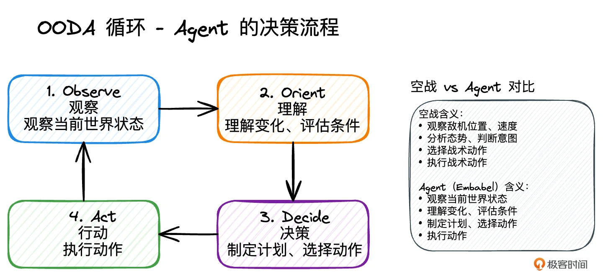
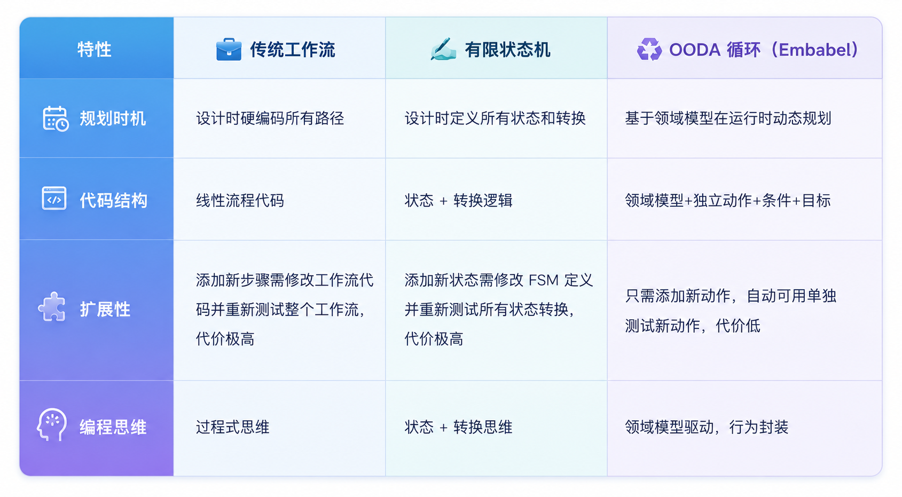
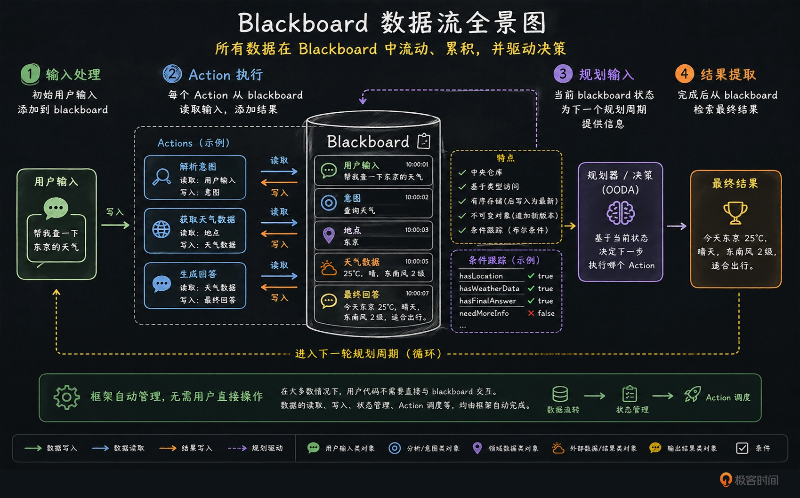
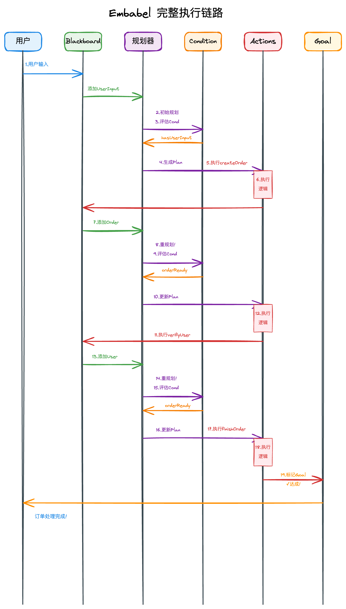

# 03 | Embabel核心模型：从OODA到Actions、Conditions、Goals

你好，我是张嘉熙。

上一讲我们论证了 JVM 是企业级 Agent 的最佳技术栈。但明天来到公司，你能否用熟悉的Spring Boot 快速搭一个生产级 Agent？

直接用 Spring AI 得自己硬编码规划逻辑，用 LangChain4j 的 ReAct 模式又慢又贵。我们需要

```
一个原生为 JVM 设计的框架——Embabel，你只需在领域模型里写上 @Action
@Condition 和 @Goal，它就会自动规划执行，还能复用现有的代码资产。这一讲，我们就
```

来搞懂 Embabel 的核心模型。

## Embabel 是什么：JVM 原生 Agent 的答案

JVM 生态成熟、风险可控，但在 LLM 如日中天的今天，仍然缺一座连接传统系统与智能能力的桥梁——而 Embabel，正是当下最合适的选择。

### Embabel 核心定位

Embabel 是 Spring 创始人 Rod Johnson 打造的 JVM 原生 Agent 框架。我们可以用一句话来定义它：Embabel 就是声明式编程 + 自动规划的在 JVM 上运行的 Agent 框架。

```
你在领域模型即 Java Bean 里写 @Action（做什么）、@Condition（什么时候可以
```

- 做），@Goal（目标是什么），它用 OODA 循环自动规划执行 Agent。

### 选 Embabel 的 3 个核心理由

1. 比 Python 更企业级，强类型加测试友好。Embabel 一切基于 Domain Model，不用 Map或 String，享受完整重构支持，单元测试友好，Mock 容易，开发、维护成本最低，可复用当前已有的构建在 JVM 之上的业务系统，符合企业级开发规范。

2. 比 Spring AI 更高层，不用硬编码流程。Spring AI 就像 Servlet API，只是封装了底层HTTP 调用，你得自己写流程控制；而 Embabel 就像 Spring MVC，用声明式的 @Action和 @Goal，框架自动规划。

3. 比 LangChain4j 更快更省钱，规划默认不靠 LLM（当然这个也支持）。LangChain4j 用ReAct 模式，每次决策都要问 LLM，又慢又贵；而 Embabel 默认用 GOAP 算法做规划，这是游戏行业验证过的 AI 算法，不是每次都问 LLM，规划用算法，执行按需调 LLM，成本更低、速度更快。

Embabel 的出现，让 Java 智能体开发达到了新的高度，它不是 Spring AI 的同类竞品，也不是简单的 Java 版 LangChain，而是真正从企业级需求出发设计的全新框架。

## OODA 循环：Agent 的规划引擎

Embabel 的核心执行模型是 OODA 循环（Observe-Orient-Decide-Act）。OODA 循环由美国空军传奇飞行员 John Boyd 在 20 世纪 60 年代提出，核心观点是决策时间比飞机速度和火力更重要。

### 为什么说 OODA 更适合 Agent？

Agent 就像在业务战场上作战的“战斗机”，用户输入、系统状态、外部数据都在不断变化，它需要快速适应环境并重新规划决策，这正是 OODA 循环擅长的领域。

我们可以通过一张图片来领会 OODA 的关键四步，这不是线性流程，而是循环。环境变了，计划也跟着变。每做完一件事就重新观察、理解、决策。



### 传统工作流 vs 有限状态机 vs OODA 循环

那 OODA 循环和传统的工作流的区别在哪里，它有哪些优势呢？让我们用一个具体的例子来对比三种方案。

场景： 处理用户的"修改收货地址"请求，其中第 3 步（调用仓库系统）会超时。

### 方案 1：传统工作流（硬编码）

代码实现：

```java
public void updateAddressWorkflow(Order order, Address newAddress) {
   // Step 1: 验证用户身份
   verifyUser(order.getUserId());
   // Step 2: 验证新地址
   validateAddress(newAddress);
   try {
       // Step 3: 调用仓库系统修改地址
       updateShippingAddress(order.getId(), newAddress);
       // Step 4: 通知用户成功
       notifyUserSuccess(order.getUserId());
   } catch (WarehouseTimeoutException e) {
       // 哦，超时了！那我们创建工单吧
       createServiceTicket(order, newAddress);
       notifyUserTicketCreated(order.getUserId());
   }
}
```

这种方式的问题很明显。所有路径都需要提前硬编码，每新增一个异常场景都要修改代码，步骤之间的依赖关系不清晰，而且难以复用单个步骤。

### 方案 2：有限状态机（FSM）

状态定义：

```java
public enum AddressUpdateState {
   INIT,          // 初始状态
   USER_VERIFIED, // 用户已验证
   ADDRESS_VALID, // 地址已验证
   UPDATING,      // 正在更新
   TICKETING,     // 创建工单中
   COMPLETED      // 完成
}
```

状态转换逻辑：

```java
public class AddressUpdateFSM {
   private AddressUpdateState currentState = AddressUpdateState.INIT;
   public void handleEvent(AddressUpdateEvent event) {
       switch (currentState) {
           case INIT:
               if (event == USER_VERIFIED) {
                   currentState = AddressUpdateState.USER_VERIFIED;
               }
               break;
           case USER_VERIFIED:
               if (event == ADDRESS_VALID) {
                   currentState = AddressUpdateState.ADDRESS_VALID;
               }
               break;
           case ADDRESS_VALID:
               if (event == UPDATE_SUCCESS) {
                   currentState = AddressUpdateState.COMPLETED;
               } else if (event == UPDATE_FAILED) {
                   currentState = AddressUpdateState.TICKETING;
               }
               break;
           case TICKETING:
               if (event == TICKET_CREATED) {
                   currentState = AddressUpdateState.COMPLETED;
               }
               break;
           // ... 更多状态转换
       }
   }
}
```

有限状态机的问题也不少，所有状态和转换都需要提前定义，状态定义和业务逻辑耦合，新增状态需要修改 FSM 核心代码，而且难以扩展和复用。

### 方案 3：OODA 循环（Embabel 用的方案）

不需要预先定义状态或者工作流路径，只需要定义 Embabel 核心概念，就能进行智能规划。

伪代码实现：

```java
// Domain Model
public class AddressUpdateRequest {
   private final Order order;           // 用户的订单信息
   private final Address newAddress;    // 用户想要修改的新地址
   private boolean userVerified;        // 用户身份是否已验证
   private boolean addressValidated;    // 新地址是否已验证
   // ... 其他状态
}
//  注意：这节课暂时忽略@Agent相关代码，后面章节会讲到
//  动作（可复用！），用@Action注解标记单个可执行步骤
@Action
public void verifyUser(AddressUpdateRequest request) {
   // 验证用户身份
   verifyUser(request.getOrder().getUserId());
   // 更新领域模型状态
   request.setUserVerified(true);
}
@Action
public void validateAddress(AddressUpdateRequest request) {
   // 验证新地址
   validateAddress(request.getNewAddress());
   // 更新领域模型状态
   request.setAddressValidated(true);
}
@Action
public void updateShippingAddress(AddressUpdateRequest request) {
   // 调用仓库系统修改地址
   updateShippingAddress(request.getOrder().getId(), request.getNewAddress());
}
@Action
public void createServiceTicket(AddressUpdateRequest request) {
   // 创建工单（仓库超时的备选方案）
   createServiceTicket(request.getOrder(), request.getNewAddress());
}
// 条件，用@Condition注解标记控制流程的阀门
@Condition
public boolean canUpdateAddress(AddressUpdateRequest request) {
   // 只有用户已验证且地址已验证，才能执行更新
   return request.isUserVerified() && request.isAddressValidated();
}
// 目标，用@AchievesGoal标记想要达成的状态
@AchievesGoal
@Action
public boolean addressUpdated(AddressUpdateRequest request) {
   // 目标达成：地址已更新成功，或者创建了工单作为备选方案
   return request.getOrder().getAddress().equals(request.getNewAddress())
       || request.getServiceTicket() != null;
}
```

Embabel 自动处理：OODA 循环会自动观察当前状态，理解目标和已完成的步骤，动态规划下一步（不需要你写路径或状态），执行动作，然后重复直到目标达成。



OODA 循环让你的 Agent 像一个可靠且聪明的员工，不是一个死板的机器人，也不是一个聪明的疯子。死板的机器人只会按你写好的剧本一步步走，遇到剧本里没写的情况就卡住。聪明的疯子有时候会表现的很聪明，但是这种聪明并不稳定，时不时就会发疯。可靠且聪明的员工具备确定的目标、真正的规划能力、灵活适应变化的能力。

那么我们怎么让这个员工理解你的业务呢？你需要给它一套工具箱、一套判断标准、一个目标、一本业务手册、一个执行流程，而这就是 Embabel 的五大核心概念。

## Embabel 核心概念

根据 embabel-agent 官方文档，Agent 模型由五个核心概念组成：Action → Condition →Goal → Domain Model → Plan。这节课我们暂时跳过后两个概念（05、06 章会讲到），重点聚焦在前三个概念上。

### Action（动作）：Agent 的执行单元

Action 是 Agent 可以执行的单个步骤，基于 Domain Model 定义输入和输出。

```
官方 Java 注解方式：在 Java 中，你不需要直接实现 Action 接口，而是使用 @Action 注解
```

来标记方法。

Action 的实际例子（来自官方 Java 示例）：

```
// 简单的Action示例：获取用户的星座运势
@Action
public Horoscope retrieveHoroscope(StarPerson starPerson) {
   // 调用星座服务获取今日运势
   return new Horoscope(horoscopeService.dailyHoroscope(starPerson.sign()));
}
```

另一个更完整的例子（带 LLM 调用）：

```
// 使用LLM解析用户输入，提取用户信息的Action
@Action
public PersonImpl extractPerson(UserInput userInput, OperationContext operationCo
   // 从OperationContext获取AI服务
   return operationContext.ai()
           .withLlm(LlmOptions.fromCriteria(ModelSelectionCriteria.getAuto()))
           .createObjectIfPossible(
               """
               Create a person from this user input, extracting their name:
               %s""".formatted(userInput.getContent()),
               PersonImpl.class
           );
}
Action 的设计非常符合 Java 开发者的直觉。首先，它就是一个使用 @Action 注解的方法而
```

已。完全基于强类型，方法参数就是输入，基于 Domain Model，方法返回值就是输出，也基于 Domain Model。Action 可以用于执行 Domain Model 的代码逻辑，也可以调用 LLM，甚至你还可以调用其他 agent 作为一个子进程。

对于调用 LLM，我们往往需要同时使用一些工具比如网络搜索等，这种 Action 中的工具调用也是完全支持的。

接下来我们看一个带有 LLM 调用且使用工具的 Action 例子，这里我们可以用 toolGroups 将一组 tool 绑定在某个特定的 Action 上。通过这种绑定，精准控制了 LLM 调用工具的范围，避免因为工具过多，导致 LLM 准确性下降。

```xml
// toolGroups指明Action执行需要用到的工具
   @Action(toolGroups = {CoreToolGroups.WEB})
   public RelevantNewsStories findNewsStories(
           StarPerson person,
           Horoscope horoscope,
           Ai ai) {
       var prompt = """
               %s is an astrology believer with the sign %s.
               Their horoscope for today is:
                   <horoscope>%s</horoscope>
               Given this, use web tools and generate search queries
               to find %d relevant news stories summarize them in a few sentence
               Include the URL for each story.
               Do not look for another horoscope reading or return results direc
               find stories relevant to the reading above.
               For example:
               - If the horoscope says that they may
               want to work on relationships, you could find news stories about
               novel gifts
               - If the horoscope says that they may want to work on their caree
               find news stories about training courses.""".formatted(
               person.name(), person.sign(), horoscope.summary(), storyCount);
       return ai
               .withDefaultLlm()
               .createObject(prompt, RelevantNewsStories.class);
   }
```

不过，Action 可能会存在副作用，比如数据库变更操作、外部系统调用等等。这一点你要特别注意。@Action 还有更多属性可以配置，具体内容你可以看一下官方文档。

### Condition（条件）：控制流程的阀门

Condition 就是那些在执行 Action 或判定 Goal 完成之前，需要先进行验证的条件。每次执行Action 后，都需要重新评估这些条件。

在 Action 注解中，支持用 pre 和 post 属性来配置 Conditon。

pre：除了输入类型之外，执行操作之前必须满足的前提条件列表。

post：除了输出类型之外，在执行操作后可能满足的后置条件列表。

```
@Action(post = {"condition1"})
public PackageInput createInput(String content) {
   return new PackageInput(content);
}
```

注意：Condition 应该专注于条件判断逻辑，任何其他可能具有副作用的行为，比如修改数据库，服务调用，都应该完全避免。

### Goal（目标）：Agent 想要达成的状态

Goal 是 Agent 试图达成的状态。达成 Goal 需要执行 Actions，并且需要满足前置Conditions。具体来说，就是同时使用 @AchievesGoal 和 @Action，表明达到了特定目标。

Goal 的设计很有意思——它不是单独写的，而是直接加在 Action 上的 @AchievesGoal 注解，这意味着某个 Action 完成后，对应的 Goal 也就达成了。

Goal 的实际例子（来自官方 Java 示例）：

在 Java 中，Goal 通过 @AchievesGoal 注解标记在 Action 上：

```xml
// 这个Action达成了"生成有趣的文章"的目标
@AchievesGoal(
   description = "Write an amusing writeup for the target person based on their
)
@Action
public Writeup writeup(
       StarPerson person,
       RelevantNewsStories relevantNewsStories,
       Horoscope horoscope,
       OperationContext context) {
   // 配置LLM参数，设置较高的温度（更有创造性）
   var llm = LlmOptions.fromCriteria(ModelSelectionCriteria.getAuto())
       .withTemperature(0.9);
   // 格式化新闻项，准备提示词
   var newsItems = relevantNewsStories.getItems().stream()
       .map(item -> "- " + item.getUrl() + ": " + item.getSummary())
       .collect(Collectors.joining("\n"));
   // 构建LLM提示词
   var prompt = """
       Take the following news stories and write up something
       amusing for the target person.
       Begin by summarizing their horoscope in a concise, amusing way, then
       talk about the news. End with a surprising signoff.
       %s is an astrology believer with the sign %s.
       Their horoscope for today is:
           <horoscope>%s</horoscope>
       Relevant news stories are:
       %s
       Format it as Markdown with links.""".formatted(
       person.name(), person.sign(), horoscope.summary(), newsItems);
   // 调用LLM生成文章
   return context.ai().withLlm(llm).createObject(prompt, Writeup.class);
}
在 @AchievesGoal 注解中，有一个需要特别注意的点：如果你的 Agent 需要被 MCP 客户
端远程调用，你可以为它开启导出能力——也就是在这里注解中配置 @Export(remote =
true)。
@AchievesGoal(export = @Export(remote = true))
   @Action
   Book writeBook(BookRequest request, BookOutline outline, OperationContext con
       // 并行执行章节创作
       var chapters = context.parallelMap(outline.chapterOutlines(),
           config.maxConcurrency(),
           chapterOutline -> writeChapter(request, outline, chapterOutline, cont
       return new Book(request, outline.title(), chapters);
   }
```

每个 Agent 至少需要一个带有注解的操作 @AchievesGoal，来定义 Agent 工作的完成状态。

## 这些概念如何配合工作？

在理解这些概念如何流转之前，我们先来思考一个关键的问题：一个 Agent 在执行过程中，数据到底放在哪里？

- 用户输入放哪儿？

- 中间结果放哪儿？

- 每一步的执行状态怎么保存？

在 Embabel 里，这一切都由一个核心组件来负责：Blackboard（黑板）。

### Blackboard 设计模式

Blackboard 是 Embabel 中的共享内存系统，维护整个 Agent 过程执行期间的状态。你可以把它想象成 Agent 的工作台，所有需要的数据、中间结果都放在这里。每个 Action 执行时从这里取需要的输入，执行完后把输出放回去。

我们来看一下 Blackboard 的几个核心特性。

1. 一个“中央仓库”：所有数据只放一个地方。好处是不会到处传参数、状态不会丢失、所有Action 都能访问。

2. 按类型找数据：不用字符串 key，而是用“对象类型”。比如你可以说：我要找“天气请求”“搜索结果”，本质是面向对象，而不是拼字符串。

3. 自动帮你选最新数据：Blackboard 是有顺序的，后写入的数据，会覆盖旧的使用优先级。比如：第一次查天气（旧）第二次查天气（新），系统默认用最新的。

4. 数据一旦写入，就不能改：只能新增，这样做可以防止数据被误改，还可以追溯整个过程，非常适合 AI 推理链。

5. 帮你记录任务条件：Blackboard 里还会存一些“条件判断”。比如：有没有拿到天气数据？用户有没有登录？这些信息可以决定下一步做什么。

要想理解 Blackboard，一定要看懂它的“数据流”。

- 输入处理：初始用户输入添加到 blackboard

- Action 执行：每个 Action 从 blackboard 读取输入，添加结果

- 状态演变：blackboard 累积代表演变状态的对象

- 规划输入：当前 blackboard 状态为下一个规划周期提供信息

- 结果提取：完成后从 blackboard 检索最终结果

大多数时候用户代码不需要直接与 blackboard 交互，框架会自动管理它。



### 场景示例

假设你正在开发一个电商平台的订单处理系统，用户通过简单的文本输入（例如 user-456 我要下单）来提交订单请求。系统需要：

1. 从用户输入中提取用户 ID 并创建订单

2. 自动验证用户身份

3. 完成订单处理流程

```java
// ==================== Domain Model：强类型领域对象 ====================
record UserInput(String content) {}
record Order(String orderId, String userId) {}
record User(String userId, boolean verified) {}
record ProcessedOrder(String orderId) {}
// ==================== Agent：智能代理主体 ====================
@Agent(description = "订单处理代理")
public class OrderProcessingJava {
   // ==================== Condition：前置/后置条件检查 ====================
   @Condition(cost = 0.0) // 最低成本优先检查
   public boolean hasUserInput(UserInput userInput) {
       return userInput != null;
   }
   @Condition(cost = 0.1)
   public boolean userVerified(User user) {
       return user != null && user.verified();
   }
   @Condition(cost = 0.2)
   public boolean orderReady(Order order, User user) {
       return order != null && userVerified(user);
   }
   // ==================== Action：可执行动作单元 ====================
   @Action(post = {"orderReady"})
   public Order createOrder(UserInput userInput, OperationContext context) {
       return new Order("ORDER-123", userInput.content().split(" ")[0]);
   }
   @Action(post = {"userVerified"})
   public User verifyUser(Order order) {
       return new User(order.userId(), true);
   }
   // ==================== Goal：目标达成标记 ====================
   @AchievesGoal(description = "订单已处理完成")
   @Action(pre = {"orderReady"})
   public ProcessedOrder finishOrder(Order order, User user) {
       return new ProcessedOrder(order.orderId());
   }
}
```

### 完整执行链路



步骤 1：用户输入

用户输入“user-456 我要下单”，系统将用户输入作为 UserInput 对象自动添加到 Blackboard中，此时 Blackboard 内容为 [0] UserInput(“user-456 我要下单”) ，目标设定为“订单已处理完成”。

步骤 2：初始规划

规划器开始分析当前 Blackboard 状态（只有 UserInput），并检查所有可用的 Action、Condition 和 Goal。规划器优先评估低成本的 Condition： hasUserInput cost=0.0（只检查内存对象），确认成立。接着，规划器通过分析 Action 的输入 / 输出类型依赖关系，自动生成执行计划： [createOrder → verifyUser → finishOrder]。

步骤 3：执行第一个 Action

规划器选择执行 createOrder Action，该 Action 的输入来自 Blackboard[0] 的 UserInput 对象。执行后，createOrder 输出 Order(“ORDER-123”, “user-456”) 对象，该对象被自动添加到Blackboard。同时，由于 post = {“orderReady”} ， orderReady Condition 被标记为成立，此时 Blackboard 内容为 [0] UserInput, [1] Order。

步骤 4：重规划（状态已改变）

由于 Blackboard 状态发生了变化（新增了 Order 对象），规划器触发重规划机制。规划器重新评估 Condition 成本： orderReady cost=0.2（需要检查两个对象）， hasUserInput cost=0.0（仍然成立）。规划器发现 createOrder 已执行完成，因此更新 Plan 为： [verifyUser →finishOrder]。

步骤 5：执行第二个 Action

规划器选择执行 verifyUser Action，该 Action 的输入来自 Blackboard[1] 的 Order 对象。执行后， verifyUser 输出 User(“user-456”, true) 对象，该对象被自动添加到 Blackboard。同时，由于 post = {“userVerified”} ， userVerified Condition 被标记为成立，此时 Blackboard 内容为[0] UserInput, [1] Order, [2] User。

步骤 6：重规划（状态又改变，检查前置条件）

由于 Blackboard 状态再次发生变化（新增了 User 对象），规划器再次触发重规划机制。规划器检查 finishOrder 的前置条件 pre = {“orderReady”} ，评估 orderReady Condition（cost=0.2），确认条件已满足，因此更新 Plan 为：[finishOrder]。

步骤 7：执行第三个 Action（达成 Goal！）

规划器选择执行 finishOrder Action，该 Action 的输入来自 Blackboard[1] 的 Order 对象和Blackboard[2] 的 User 对象。执行后， finishOrder 输出 ProcessedOrder(“ORDER-123”) 对象，该对象被自动添加到 Blackboard。由于该 Action 带有 @AchievesGoal 注解，目标"订单已处理完成"标记为达成！

## 本讲小结

这节课我们学会了 Embabel 核心模型，这是掌握 Embabel 框架的关键一步。

1. 理解 OODA 循环

我们了解了 OODA 循环模型。它让 Agent 变成了靠谱且聪明的员工，环境变了，计划也跟着变，每做完一件事就重新观察、重新理解、重新决策。

2. 掌握 Action、Condition、Goal、Blackboard 等核心概念我们建立了完整的概念体系：Action 是能做什么（可执行动作单元），Condition 是什么时候能做（控制流程的阀门），Goal 是要做成什么（目标达成标记）。通过 Blackboard 设计模式，所有组件像专家围在黑板前协作，观察→理解→决策→行动，反复循环直到目标达成。

3. 看清与传统方案的差异

我们对比了三种方案：传统工作流硬编码所有路径难以扩展，有限状态机预先定义所有状态耦合严重，而 Embabel 用 OODA 循环实现动态规划，自动适应，零代码修改就能应对变化。

下节课，我们将探索 Embabel 与 Spring 的关系，看看如何把这个强大的框架无缝融入现有系统。

## 思考题

使用 Embabel 实现一个简单的智能图书借阅 Agent，功能包括：用户用自然语言输入，比如“我想借一些科幻小说”，Agent 能理解并搜索相关图书；自动检查图书是否可借；自动避免重复借过的书；完成借书流程。

这个场景将完美体现 OODA 循环的优势：环境是动态的，图书库存会变、用户借过的书会变，Agent 需要不断观察、理解、决策、行动！

### 参考思路

1. 请先定义 Domain Model，包括图书、用户、借书请求这三个核心对象。提示：用 Javarecord 来定义，每个对象包含必要的属性，比如图书要有 ID、书名、分类、作者、是否可借；用户要有 ID、姓名、已借图书 ID 列表；借书请求要有用户和查询内容。

2. 基于上面的 Domain Model，定义几个核心 Action：解析查询、搜索图书、检查图书是否可借、过滤用户已借过的书、执行借书、返回结果。提示：用 @Action 注解标记这些方法，给每个 Action 设置合理的 cost，比如涉及 LLM 解析查询的 cost 可以高一些，而检查内存属性的 cost 为 0。

3. 最后定义 Condition 和 Goal。Condition 需要判断用户是否有查询、图书是否可借、用户是否没借过这本书；Goal 是用户成功借到书或者 Agent 给出合理回复。提示：Condition 用

- @Condition 注解，Goal 可以通过在 Action 上用 @AchievesGoal 来标记。

### 提问

1. 想象一下，如果用 LangChain4j 实现同样的功能，你需要写什么样的“思考→行动”Prompt？对比 Embabel 的方式，你觉得哪种方式更可控、更易维护？

2. 假设书店搞活动，新增了一个“会员优先借书”的规则，用 Embabel 的话你需要改什么？如果是传统的工作流代码，你需要改什么？

3. 回顾一下 OODA 循环的四个步骤，在这个智能图书借阅场景里，每个步骤分别对应什么？

欢迎你把自己实现的代码链接分享到留言区，如果这节课的内容对你有帮助的话也欢迎你分享给需要的朋友，我们下节课再见！
