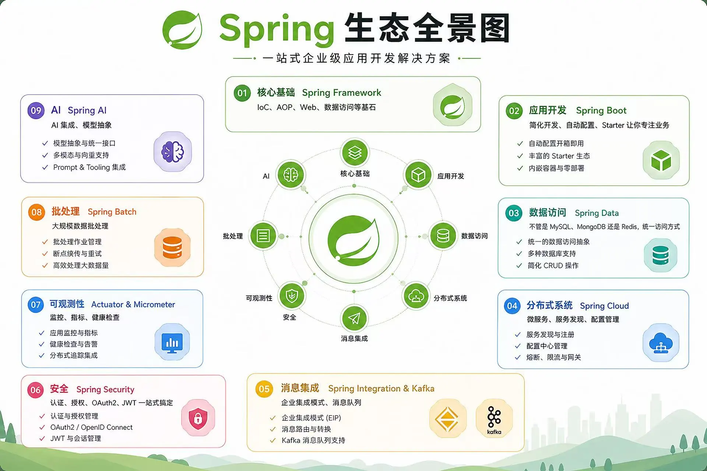
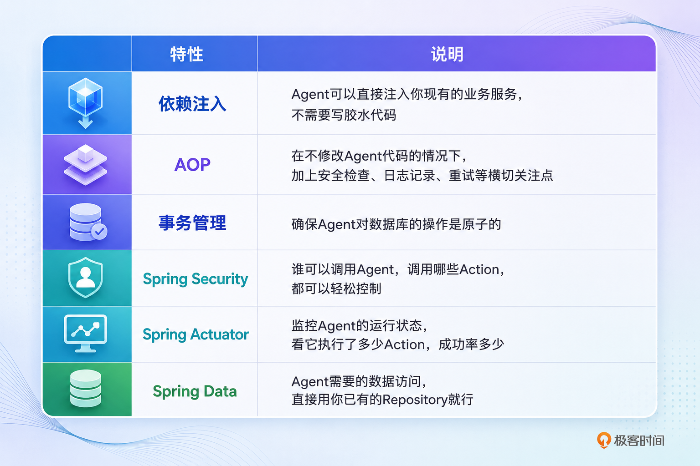
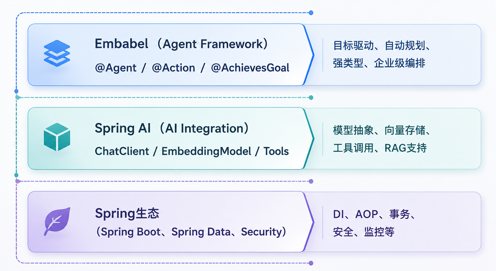
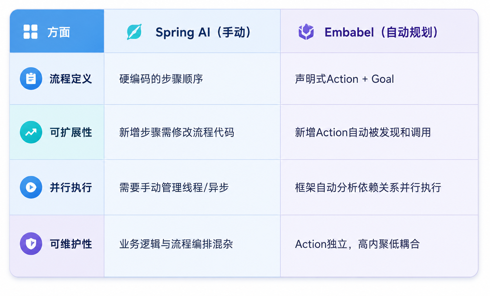

# 04 | Spring生态整合：站在Spring、SpringAI肩膀上

你好，我是张嘉熙。

作为 Java 开发者，你一定对 Spring 生态有很深的感情，我们用 Spring Boot 快速搭建项目，用 Spring Data 访问数据库，用 Spring Security 保护应用安全等等。20 年来，Spring 生态已经成为企业级开发的事实标准。

而现在，AI 浪潮早已扑面而来。作为 Java 开发者，我们有一个天然的优势：我们不需要从零开始学习一套全新的生态系统。Spring 生态已经在扩展，Spring AI 作为基础设施层加入进来，而 Rod Johnson 又带来了 Embabel——一个站在 Spring AI 肩膀上的智能体框架。

这节课我就来为你解答几个关于 Spring 的关键问题：

- Spring 生态在 AI 时代有什么独特价值？

- Spring AI 的定位是什么，它解决什么问题？

- 为什么在 Spring AI 之上还需要 Embabel？

- 如何用这一套技术栈构建企业级智能体？

## Java 开发者已经拥有了最强大的 AI 底座

作为 Java 开发者，我们如何用自己最熟悉的技术栈（Spring 生态）来拥抱 AI，而不是被迫转去学习一套完全陌生的东西？这节课我就来带你俯瞰 Spring 生态，看看我们手里有哪些“底牌”。

### Spring 生态：企业级武器库

Spring 生态远不止是一个 IoC 容器——它是一个完整的企业级开发生态系统。



- Spring生态全景图

### Spring 生态的真正价值是什么？

在我看来，Spring 生态的真正价值不在于它提供了多少功能，而在于两个核心点：一是降低认知负担，你不需要学 10 种不同的数据访问方式，Spring Data 用一套统一的抽象解决了这个问题。同样，Spring Security 用一套方式解决了各种安全场景。

其次是渐进式能力叠加，你可以先只用 Spring Boot，然后需要数据访问时加 Spring Data，需要安全时加 Spring Security，需要微服务时加 Spring Cloud。每一步都是渐进的，不会让你重写代码。

这两个特点在 AI 时代尤其重要——AI 技术发展太快，我们需要一个稳定的底座来承载这些变化。

### Spring 生态为智能体提供的核心能力

对于智能体开发来说，Spring 生态提供的这些能力都是现成可用的：



这些能力不是我们为了 Agent 才去学的，我们早就会了！这就是 Spring 生态的威力。

## Spring AI：AI 集成的基础设施层

现在，让我们来深入了解一下 Spring AI。注意，Spring AI 是基础设施层，不是应用框架层。这个定位对后面的学习很重要。

### Spring AI 解决什么问题？

想象一下，如果你要直接写代码调用 OpenAI 的 API，你需要处理 API 认证、处理各种模型参数、解析 JSON 响应、处理流式输出、换模型提供商时（比如从 OpenAI 换到 Anthropic）重写一堆代码。

Spring AI 就是来解决这些问题的，它提供了一套统一的抽象，让你可以用同样的代码调用不同的 AI 模型。它的核心设计理念是：

- 将 Spring 生态系统设计原则（如可移植性和模块化设计）应用于 AI 领域，并推广使用POJO（Plain Ordinary Java Object，简单的 Java 对象 / 普通 JavaBeans）作为 AI 领域应用程序的构建块。

这句话很重要——这意味着 Spring AI 是用 Java 开发者熟悉的方式在做 AI。

### Spring AI 的核心能力：基础设施层该做的事

Spring AI 提供的这些能力，都是基础设施层该做的：

- 多模型提供商支持：OpenAI、Anthropic、Amazon Bedrock、Google Vertex AI、Ollama……你用同一套 API 可以调用所有这些模型。想换模型？改个配置就行。

- 统一抽象接口：就像 JDBC 统一了数据库访问，Spring AI 统一了 AI 模型访问。不管你用哪家的模型，API 都是一样的。

- 向量数据库集成：支持 10+ 向量数据库。你想做 RAG？Spring AI 帮你搞定文档加载、分块、向量化、相似度搜索这一套流程。

- 工具 / 函数调用：让 LLM 调用你现有的函数和 API。

- Spring Boot 自动配置：加个依赖，配置个 API Key，就能用了，这就是 Spring 的味道。

## Embabel：站在 Spring AI 之上的智能体编排框架

现在我们已经了解了 Spring AI，接下来看 Embabel。它是站在 Spring AI 肩膀上的智能体编排框架。

### 层次架构图：从下到上看清楚



从架构图可以清楚看到这个分层：

最底层是 Spring 生态，我们已经拥有的一切。中间层是 Spring AI，AI 集成的基础设施层。最上层是 Embabel，智能体编排的应用框架层。

### 为什么需要 Embabel？

Rod Johnson 在介绍 Embabel 时说：

- 在我创立 Spring Framework 以来，我从未如此确信需要一个新项目。

这句话分量很重。为什么 Rod Johnson 认为我们需要一个独立的 Agent 框架，而不是直接用Spring AI？让我用更通俗的方式解释一下 Rod Johnson 的 7 个理由：

1. 可解释性：当 Agent 做了一个决定，你需要知道它为什么这么做。如果只是让 LLM 自己决定，那就是黑盒。Embabel 提供了可解释的规划过程。

2. 可发现性：你有 10 个工具，LLM 怎么知道该用哪个？Embabel 有一套机制来确保正确的工具被发现和使用。

3. 模型混合：你不一定什么都用最新最强的模型。简单任务可以用本地模型（Ollama），省钱还保护隐私；复杂任务再用更强模型，Embabel 帮你做这种混合。

4. 护栏注入：你不会想让 Agent 想做什么就做什么——比如不能让它随便删除数据。Embabel 让你在流程的任何点都能加上安全限制。

5. 流程执行管理：Agent 执行失败了怎么办？重试？回滚？Embabel 提供了这种弹性。

6. 大规模可组合：未来不会是单个 Agent，而是多个 Agent 协作——就像现在的微服务一样。Embabel 为这种可组合性设计。

7. 与敏感系统的安全集成：你的数据库里有客户数据。你真的想让 LLM 直接写数据库吗？Embabel 让你安全地连接这些敏感系统。

这 7 个理由，其实都是企业级应用的需求。AI 很酷，但企业级 AI 应用更需要的是安全、可靠、可维护、可解释。这正是 Spring 生态一直擅长的，也是 Embabel 要继承和发扬的。

### 代码对比：手动编排 vs 自动规划

让我们用一个简单的例子来直观感受一下，Spring AI 手动编排与 Embabel 自动规划的差异。

Spring AI（手动编排）

```java
@Service
public class SpringAIWeatherService {
   private final ChatClient chatClient;
   private final WeatherApiClient weatherApi;
   public SpringAIWeatherService(ChatClient chatClient,
                             WeatherApiClient weatherApi) {
       this.chatClient = chatClient;
       this.weatherApi = weatherApi;
   }
   public String getWeatherResponse(String city) {
       // 步骤1：先调用天气API
       WeatherData weather = weatherApi.fetch(city);
       // 步骤2：构建提示词
       String prompt = String.format(
           "用自然语言描述天气: %s", weather);
       // 步骤3：调用LLM
       return chatClient.prompt(prompt).call().content();
   }
}
```

用 Spring AI，你需要自己写流程的每一步：先做什么，再做什么。

Embabel（自动规划）

```java
@Agent(description = "天气查询智能助手")
public class WeatherAgent {
   @Autowired
   private WeatherApiClient weatherApi;
   @Action
   public WeatherData fetchWeather(String city) {
       return weatherApi.fetch(city);
   }
   @AchievesGoal(description = "查询天气成功")
   @Action
   public String generateReport(WeatherData weather,
                              OperationContext context) {
       String prompt = String.format("描述天气: %s", weather);
       return context.ai().withDefaultLlm().createText(prompt);
   }
}
```

用 Embabel，你只需要定义你有什么 Action（能力），以及你想达成什么 Goal（目标）。然后Embabel 自动规划：需要调用哪些 Action，按什么顺序调用。

这个区别很重要，这正是 Spring Framework 相对于直接写 JDBC 代码的区别：声明式 vs 命令式。

## 在 Embabel 中使用 Spring AI：集成初体验

让我们看一个完整的 RAG 应用示例，展示 Spring AI 和 Embabel 如何协同。注意我们先将重点放在理解两者的依赖关系上。实际上，Embabel 对 Spring AI 已经做了深度的封装，用户可以在对 Spring AI 几乎完全无感知的情况下，用 Embabel 提供的更优雅的方式来达到同样的效果，细节我们在后面的核心篇会讲到。

```java
@Configuration
public class AIConfig {
   private final Logger logger = LoggerFactory.getLogger(AIConfig.class);
   /**
    * 配置嵌入模型
    *
    * <p>使用简单的随机嵌入实现，适用于开发和测试环境。
    * 在生产环境中，建议使用真实的嵌入服务（如 OpenAI、DeepSeek 等）。</p>
    *
    * @return EmbeddingModel 实例
    */
   @Bean
   public EmbeddingModel embeddingModel() {
       return new SimpleEmbeddingModel();
   }
   /**
    * 配置向量存储
    *
    * <p>使用 Spring AI 的 SimpleVectorStore，这是一个内存中的向量存储实现。
    * 它依赖于嵌入模型来生成文档向量。</p>
    *
    * @param embeddingModel 嵌入模型
    * @return VectorStore 实例
    */
   @Bean
   public VectorStore vectorStore(EmbeddingModel embeddingModel) {
       return SimpleVectorStore.builder(embeddingModel).build();
   }
   /**
    * 配置文本分割器
    *
    * <p>使用 TokenTextSplitter，基于 token 数量分割文档，
    * 确保每个文档片段适合嵌入模型的输入限制。</p>
    *
    * @return TextSplitter 实例
    */
   @Bean
   public TextSplitter textSplitter() {
       return new TokenTextSplitter();
   }
   /**
    * 简单的嵌入模型实现
    *
    * <p>生成随机的 384 维向量，用于开发和测试。
    * 注意：在生产环境中应替换为真实的嵌入服务。</p>
    */
   private static class SimpleEmbeddingModel implements EmbeddingModel {
       /**
        * 为多个文本生成嵌入向量
        *
        * @param texts 文本列表
        * @return 嵌入向量列表
        */
       @Override
       public List<float[]> embed(List<String> texts) {
           List<float[]> embeddings = new ArrayList<>();
           for (String text : texts) {
               embeddings.add(embed(text));
           }
           return embeddings;
       }
       /**
        * 为单个文本生成嵌入向量
        *
        * @param text 文本内容
        * @return 384 维嵌入向量
        */
       @Override
       public float[] embed(String text) {
           float[] embedding = new float[384];
           for (int i = 0; i < embedding.length; i++) {
               embedding[i] = (float) Math.random() * 2 - 1;
           }
           return embedding;
       }
       /**
        * 为 Document 对象生成嵌入向量
        *
        * @param document 文档对象
        * @return 嵌入向量
        */
       @Override
       public float[] embed(Document document) {
           return embed(document.getText());
       }
       /**
        * 获取嵌入向量的维度
        *
        * @return 向量维度（384）
        */
       @Override
       public int dimensions() {
           return 384;
       }
       /**
        * 处理嵌入请求
        *
        * @param request 嵌入请求
        * @return 嵌入响应
        */
       @Override
       public EmbeddingResponse call(EmbeddingRequest request) {
           List<Embedding> embeddings = new ArrayList<>();
           int index = 0;
           for (String text : request.getInstructions()) {
               float[] embedding = embed(text);
               embeddings.add(new Embedding(embedding, index++, null));
           }
           return new EmbeddingResponse(embeddings);
       }
   }
@Agent(description = "企业知识库智能问答系统")
public class EnterpriseKnowledgeBaseAgent {
   /** 文档服务，用于文档检索 */
   private final DocumentService documentService;
   /** 公司政策服务，用于政策查询 */
   private final CompanyPolicyService policyService;
   /**
    * 构造函数，注入依赖服务
    *
    * @param documentService 文档服务
    * @param policyService 公司政策服务
    */
   public EnterpriseKnowledgeBaseAgent(DocumentService documentService, CompanyP
       this.documentService = documentService;
       this.policyService = policyService;
   }
   /**
    * 搜索相似文档
    *
    * <p>根据用户输入在向量存储中搜索相似文档。</p>
    *
    * @param userInput 用户输入
    * @return 搜索结果，包含查询和匹配的文档列表
    */
   @Action
   public SearchResult searchSimilarDocuments(UserInput userInput) {
       List<DocumentService.DocResult> similarDocs = documentService.searchSimil
       return new SearchResult(userInput.getContent(), similarDocs);
   }
   /**
    * 查询公司政策
    *
    * <p>使用 AI 从用户输入中提取政策类型，然后查询相应的政策信息。</p>
    *
    * @param userInput 用户输入
    * @param context 操作上下文，包含 AI 工具
    * @return 政策信息
    */
   @Action
   public CompanyPolicyService.PolicyInfo queryCompanyPolicy(UserInput userInput
       // 使用 AI 从用户输入中提取政策类型
       String policyType = context.ai().withAutoLlm().generateText(
           """
           从用户输入中提取政策类型，只返回政策类型名称，不要解释。
           可能的政策类型包括：vacation（假期）、overtime（加班）、travel（出差）、training
           用户输入：%s
           """.formatted(userInput.getContent())
       );
       // 处理空结果
       if (policyType == null || policyType.isEmpty()) {
           policyType = "unknown";
       }
       // 查询政策信息
       return policyService.getPolicy(policyType);
   }
   /**
    * 回答用户问题
    *
    * <p>基于检索到的文档和政策信息，使用 AI 生成最终回答。
    * 这是代理的核心目标方法。</p>
    *
    * @param userInput 用户输入
    * @param searchResult 文档搜索结果
    * @param policyInfo 政策信息
    * @param ai AI 工具
    * @return 最终回答
    */
   @AchievesGoal(description = "基于知识库回答用户问题")
   @Action
   public String answerQuestion(UserInput userInput, SearchResult searchResult,
                                CompanyPolicyService.PolicyInfo policyInfo, Ai a
       // 构建上下文信息
       StringBuilder contextBuilder = new StringBuilder();
       // 添加文档检索结果
       if (searchResult != null && searchResult.results() != null) {
           for (DocumentService.DocResult doc : searchResult.results()) {
               contextBuilder.append(doc.content()).append("\n");
           }
       }
       // 添加政策信息
       if (policyInfo != null && !Constants.NO_POLICY_FOUND.equals(policyInfo.co
           contextBuilder.append("相关政策：").append(policyInfo.content()).append
       }
       // 构建提示词
       String prompt = String.format(
           "基于以下上下文回答用户问题：\n\n" +
           "上下文：\n%s\n\n" +
           "用户问题：%s",
           contextBuilder.toString(),
           userInput.getContent()
       );
       // 使用 AI 生成回答
       return ai.withAutoLlm().generateText(prompt);
   }
   /**
    * 搜索结果记录
    *
    * @param query 查询文本
    * @param results 匹配的文档列表
    */
   public record SearchResult(String query, List<DocumentService.DocResult> resu
}
```

注：GitHub 地址

### 工作流对比

两种开发方式的本质差异：一边是以 Spring AI 为代表的手动流程编排，另一边是以Embabel 为代表的自动规划式 Agent 架构。

在 Spring AI 的模式下，开发者需要提前把整个流程一步步写死，从流程定义开始就是“硬编码顺序”，一旦业务变化，比如增加一个步骤，就必须回过头修改流程代码。同时，并发执行也需要手动去管理线程或异步逻辑，代码里既包含业务逻辑，又夹杂着流程控制，久而久之会变得复杂且难以维护。

而 Embabel 走的是另一条路径，它不再强调流程本身，而是通过声明式的方式定义 Action 和Goal，让系统在运行时自动完成规划。当新增能力时，只需要添加新的 Action，它就可以被自动发现并参与执行，无需改动原有流程。在执行层面，框架会自动分析各个 Action 之间的依赖关系，并行调度执行，不再需要开发者手动处理并发细节。同时，由于每个 Action 都是独立模块，整体结构更加清晰，实现了高内聚、低耦合，维护成本显著降低。

本质上，这种对比体现的是开发范式的转变：从“以流程为中心的手工编排”，转向“以目标为中心的自动规划”。



## 本讲小结

今天这一讲，我们梳理了 Spring 生态、Spring AI 和 Embabel 三者的关系，这是用 Java 技术栈构建企业级 AI 应用的关键一步。

我们建立了清晰的分层架构：最底层是 Spring 生态（企业级能力底座），中间层是 Spring AI（AI 集成的基础设施层），最上层是 Embabel（智能体编排的应用框架层）。这个分层就像Http -> Servlet → Spring MVC 一样，各司其职，各展所长。

现在，我们已经从理论层面掌握了如何用 Spring 生态构建企业级 AI 应用。下一节课，我们将正式进入本课程的核心篇，深入学习强类型领域建模，这是 Java 相对于 Python 的一个独特优势。

## 思考题

1. 动手实操：用 Spring AOP 为你的 Agent 添加性能监控和日志记录

2. 深入思考：为什么层次架构在技术演进中如此重要？Spring → Spring AI → Embabel 这个分层，和 Http -> Servlet → Spring MVC 有什么相似之处？

3. 实践设计：如果要将 Agent 集成到你现有的 Spring Boot 微服务架构中，你会如何设计？

欢迎你把自己的思考分享到留言区，如果这节课的内容对你有帮助的话也欢迎你分享给需要的朋友，我们下节课再见！
