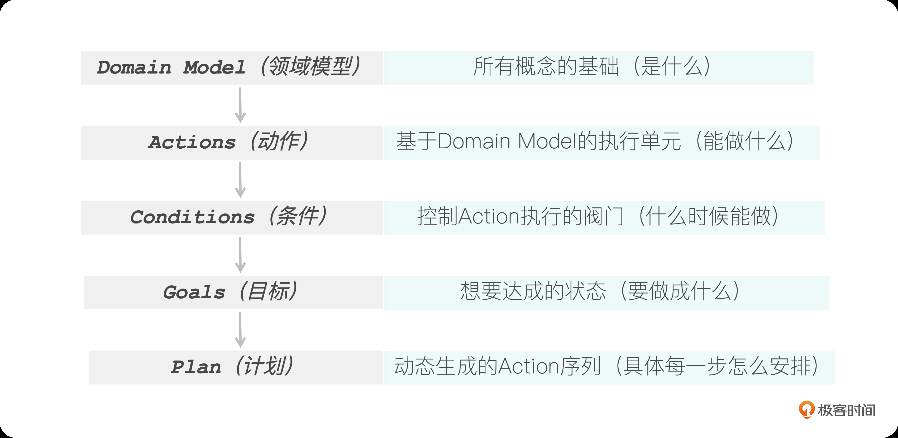
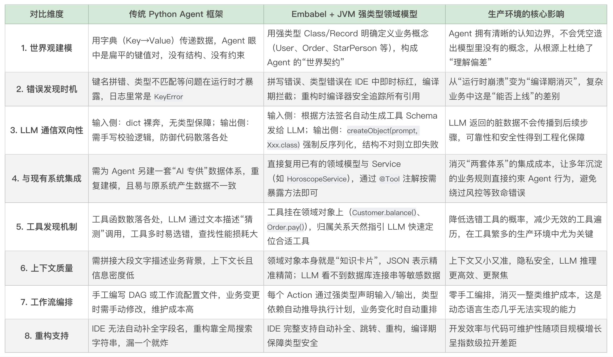

# 05 | Java的绝招：强类型领域建模是复杂业务的关键

你好，我是张嘉熙。

前几节课，我们已经了解了 Embabel 中的 Action、Condition、Goal，以及 Spring AI 和Embabel 之间的关系。今天，我们要进入 Embabel 真正的核心地带，讨论一个比“调用模型”更底层的问题：Embabel Agent 到底如何“理解世界”？

这个问题听起来有些抽象，但非常关键。就拿电商系统来说吧，无论一个电商 Agent 看起来多智能，它最终都必须理解：

- 什么是用户？

- 什么是订单？

- 用户有哪些能力？

- 订单里哪些信息允许被外部访问？

也就是说：在 Embabel 的设计中，Agent 必须先拥有一套“世界认知”，才可能真正参与业务。而 Embabel 给出的答案，就是领域模型（Domain Model）。当 Agent 从原型走向生产，从简单 Demo 走向复杂业务时，真正的决胜因素变了——类型安全、可维护性、与现有系统的深度集成，恰恰是 Java 和强类型领域模型的拿手好戏。

## 什么是领域模型？

领域模型是用代码把“业务世界”表达出来。现实业务世界里有什么，代码里就对应有什么对象。比如一个电商系统里有 User、Order、Product、Coupon、Payment，这些都属于领域模型，因为它们代表的是：“业务世界中的核心概念”，而不是技术概念。

比如下面的代码对 User 定义了一个领域模型：

```java
public class User {
   private String userId;
   private String name;
   private String email;
   // 余额，单位：分
   private long balance;
   // 构造方法、getter 略...
   /** 领域行为：充值 */
   public void deposit(long amount) {
       if (amount <= 0) throw new IllegalArgumentException("充值金额必须大于0");
       this.balance += amount;
   }
   /** 判断是否能支付某金额 */
   public boolean canAfford(long amount) {
       return this.balance >= amount;
   }
}
```

注意，这个类有两个特点：

- 它承载数据：userId、name、email 描述了“一个用户是什么”。

```
它封装行为：deposit()  和  canAfford()  描述了“一个用户能做什么”，并把“充值金额
```

- 不能为负”“付钱前先检查余额”这些业务规则写进了领域模型内部。

在 Embabel 中，领域模型就是由强类型类（如 Java Class / Kotlin Class）定义的一组业务对象，它们既承载数据又能封装行为，构成 Agent 理解世界的“统一契约”。

## 从“面向对象”说起

作为 JVM 开发者，我们有一个根深蒂固的习惯：接到需求时，不是先写方法，而是先去找（或新建）对应的类；不是先铺业务逻辑，而是先确认领域模型里有没有现成的行为可以复用。

```
举个例子，如果需求是“实现用户退款”，你不会直接写一个  userRefund  的方法。你会先看
有没有现成的 User 类， User  类上或者对应的 UserService 类上有没有现成的或类似的
```

方法。

这就是面向对象的本质：先有对象，再谈对象的行为。

Embabel 正是把这套方法论带进了 AI Agent 开发。在 Embabel 中，领域模型就是 Agent 世界里的“对象”，我们用强类型的 Java Class 或 Kotlin Class，把业务世界中的“用户”“订单”“地址”等概念固定下来。有了这些对象，后续的一切，Action（能做什么）、Condition（什么时候能做）、Goal（要做成什么），才有了可以依附的实体。

然而，过去大多数 Python Agent 框架恰恰跳过了这一步。它们习惯用字典（字符串 Key-Value）或者字符串传递数据。整个世界在 Agent 眼中是一堆扁平的键值对或文本，没有结构，没有约束，也没有内化的业务规则。

这套经典的面向对象的成熟方法论，在 AI Agent 领域被长期忽视。让 AI Agent 直接操作 JVM上已有的领域模型，不只是锦上添花，更是用 AI 快速触达并赋能企业核心业务的最优路径。Embabel 的出发点，就是把这层被忽略的“世界建模”重新捡起来，将 JVM 生态里几十年沉淀下来的领域驱动设计，变成 Agent 的认知骨架。

## Embabel 五大核心概念的层次关系

在继续深入了解 Domain Model 之前，我们先看清 Embabel 中五大核心概念之间的层次关系。

Embabel 用这五个概念模型化了整个 Agent 行为：



在 Embabel 框架中，我们可以清晰地看到，Domain Model 定义了 Agent 世界的统一契约：Actions 的输入输出、Conditions 的评估依据、Goals 的达成状态、乃至 Plan 的 Action 序列全都遵循这套契约。

一个普通的 Java Bean 就是一个 Domain Model。它用类型安全的方式定义了 Agent 世界中的基础概念，就连 Action、Condition、Goal 本身也是 Agent 这个特殊的 Domain Model 里的一部分。

Embabel 鼓励用 Java Class（包括 Java Record）或 Kotlin Class 来构建领域模型，这确保了Embabel 的项目总是类型安全的、可靠的，并且经得起重构考验。

## 领域集成上下文工程

Rod Johnson 在他的Blog中创造性地提出了一个很务实的理念——领域集成上下文工程（DICE, Domain-Integrated Context Engineering）。名字听起来学术，但其实非常接地气。

传统上下文工程主要研究“怎样把更好的上下文喂给大模型”，用 Andrej Karpathy 的话说是“为下一步操作填充恰当信息的精妙艺术与科学”。这当然重要，但 Rod Johnson 发现它留下了两个关键问题。

### 问题一：LLM 通信的双向性

我们既要管“发给模型什么”，也要管“模型返回的东西能不能被系统安全、准确地执行”。如果模型返回的是一段不可靠的文本或结构随意的 JSON，后续代码就得写大量防御逻辑，甚至根本执行不下去。

Embabel 是如何解决这个的呢？

```
以 Embabel 官方提供的这个 Java 示例来说，在 findNewsStories 方法中生成发给 LLM
的提示词时，提示词内的占位符和特定的领域模型字段一一对应。比如 person.name(),
person.sign(), horoscope.summary()，提示词的拼装逻辑是：“从 StarPerson 类
里的 name，sign 字段和 Horoscope 类里的 summary 字段取值”。这是用强类型领域模型
```

明确定义了“提示词参数的具体构成和对应类型”。如果向提示词传递的参数类型不对，编译期就会立即报错，不会像 Python 一样在运行时才发现问题。

LLM 返回给我们的那一侧，通过

```
ai.withDefaultLlm().createObject(prompt,RelevantNewstories.class) 这
样的调用，模型生成的文本会被立即反序列化成强类型的  RelevantNewstories  实例。如
```

果模型返回的 JSON 结构不对、字段类型错误，反序列化直接失败，Agent 流程不会带着脏数据继续前进。

这就像两个系统之间通过一份共享的接口定义进行对接。领域模型在双方之间充当了那唯一的一份语言契约，它既定义了请求的 Schema，也保证了响应的合规性。双向通信的答案，就是让领域模型成为双向的共同语言。

### 问题二：Agent 与现有业务系统的联系

企业里早已存在大量经过打磨的领域模型和业务服务。那不是没用的老代码或需要绕开的障碍，而是现成的高精度业务知识库。对于具有复杂业务逻辑和大量现存领域模型的企业级应用来说，如果我们凭空再造一套“AI 专供”的数据结构，不仅重复劳动，还会丢掉原有领域模型里沉淀的业务约束，导致 Agent 的决策脱离真实系统可以执行的边界——这简直是噩梦，代价高昂且充满风险。

```
举个例子：你的系统里有一个  User  领域模型，它不光有  balance  和  canAfford()，
```

还关联着数据库映射、风控检查、账务流水。如果为了引入 Agent 而重新写一套“AI 版”的数据结构，那些已经沉淀在原有模型里的业务约束就很可能会被丢掉。Agent 可能生成一个绕过风控的支付计划，或者调用一个现实中不允许的操作。

Embabel 的做法完全相反：它让你直接复用现有的领域模型，让 Agent 成为这些成熟业务对

```
象的操作者。你只需在  @Action  方法里调用已有的 Service 或领域方法，Agent 的每一个
```

决策步骤，都会自动受到这些方法内部业务规则的约束。

这就是 DICE 理念的真正威力：不是让 AI 在业务的空地上重新造轮子，而是把 AI 直接接入已经运转良好的业务系统。你现有的领域模型，就是你最大的 AI 资产。

## 领域模型的深层价值

领域模型作为传统软件工程的经典概念，远远超越了普通数据结构的意义，在 AI Agent 时代依然焕发着不可替代的价值。通过 DICE（领域集成上下文工程），“填充上下文窗口这门微妙的艺术和科学”将不再那么微妙，而更加科学。除了我们上面提到的，领域模型的其他优势还有很多：用 SQL 等方式搜索持久化后的领域对象比向量搜索更精确；领域模型本身更易于测试，调试，观测。而在 Embabel 的设计中，领域模型还隐藏着更深层的价值…

### 领域对象 = 天然的知识卡片

```
每个领域模型本身就是某项业务知识的精炼载体。一个  User  对象，包含了姓名、邮箱、余
额、偏好，这本身就是一张高价值的“知识卡片”。还有  User  和  Order  等对象之间的关联
```

关系，也让这张卡片上的内容更加丰富。

对 LLM 来说，这意味着两件事：

```
上下文精准：给模型看一个  User  对象的 JSON 表示，比给它一大段描述文字要精确得
```

- 多，也短得多。尤其是在需要多步流程的复杂业务中可以高效操控上下文，避免质量下降与成本飙升。

- 隐私安全：LLM 不需要看到用户的全部隐私数据，只能看到我们设置为 public 的数据。这一点在调用第三方 LLM API 时会很重要。

通过领域对象，我们可以非常便捷地最小化上下文、最大化精度，同时将敏感数据隔绝在LLM 之外。这是一个非常经典而又高效的设计。

### 领域方法 = 自带的工具发现机制

领域模型内部不仅有字段（属性），还可以有领域方法来封装“行为”。这些行为天然归属于某个领域对象的范围之内，这一特点恰好可以辅助解决 Agent 工具使用中的可发现问题。

```
Embabel 把工具直接挂在领域对象上，比如 User  有  balance()  工具，Order  有
 pay()  工具。模型在调用工具时会很自然地理解有哪些工具可用，迅速找到合适的工具，因
```

为工具和对象的归属关系本身就是一种隐式的指引。这种归属关系极大降低了 LLM 选错工具的几率以及查找工具的性能损耗。在企业级复杂业务场景下，工具往往数量庞大，Python 的Agent 工具发现机制经常因此陷入查找效率低下、甚至难以匹配合适工具的困境——而这一问题，领域模型却能自然而然地化解。

我们来看 Embabel 官方示例中 Customer 领域对象定义：

```java
// 领域对象：客户，通过@Tool注解暴露方法给LLM调用
@Entity
public class Customer {
   private String name;
   private LoyaltyLevel loyaltyLevel;
   private List<Order> orders;
   // 领域行为，同时也是工具
   @Tool(description = "Calculate the customer's loyalty discount percentage")
   public BigDecimal getLoyaltyDiscount() {
       return loyaltyLevel.calculateDiscount(orders.size());
   }
   // 领域行为，同时也是工具
   @Tool(description = "Check if customer is eligible for premium service")
   public boolean isPremiumEligible() {
       return orders.stream()
           .mapToDouble(Order::getTotal)
           .sum() > 1000.0;
   }
   public void updateLoyaltyLevel() {
       // Internal business logic
   }
}
这就是 Embabel 支持的 tool object 模式。将 Customer 领域对象作为工具对象提供，使
LLM 能够调用其带有 @Tool 注解的方法。LLM 可以访问
customer.getLoyaltyDiscount() 和 customer.isPremiumEligible()。但是注意
updateLoyaltyLevel 方法没有 @Tool 注解所以不会被 LLM 调用。
@Action
public Recommendation generateRecommendation(Customer customer, OperationContext
   var prompt = String.format(
       "Generate a personalized recommendation for %s based on their profile",
       customer.getName()
   );
   return context.ai()
   // 通过withToolObject显示指定customer作为tool object可以被LLM调用
       .withToolObject(customer)
       .withDefaultLlm()
       .createObject(prompt, Recommendation.class);
}
领域对象通过  @Tool 注解将自己的方法暴露给 LLM，再结合 withToolObject 方法，让
```

LLM 可以直接调用领域对象内特定的业务逻辑。开发者通过选择性地添加注解，精确控制哪些领域方法允许 LLM 调用，哪些保持私有。

对比一下其他框架的做法：它们通常需要你单独编写工具方法，手动声明参数和返回值的JSON Schema。而在 Embabel 里，你只需在已有的领域方法上加一个注解。

### 类型依赖关系 = 自动规划的根基

现在我们进入 Embabel 另一个令人惊叹的部分。Domain Model 不只是为了类型安全——它直接驱动了 Agent 的核心能力：规划（Planning）。这里的秘密就在于：类型即契约。

每一个 Action 都清晰地声明了它的“前置条件”（通过输入参数类型）和“后置效果”（通过返回类型）。一个 Action 需要 Order 对象作为输入，那就意味着：只有在 Order 对象已经产生之后，这个 Action 才应该被执行。框架根据类型依赖自动推导执行顺序，不需要开发者手动编排。

我们看一个典型的代码示例：

```
@Action
public Blog fetchArticle(UserInput input) { /* ... */ }         // 步骤1
@Action
public SocialMediaPost generatePost(Blog blog) { /* ... */ }    // 步骤2（自动排在步
@Action
@AchievesGoal
public ReviewedPost reviewPost(SocialMediaPost post) { /* ... */ }  // 步骤3（最终目
```

开发者并没有写：先执行 A，再执行 B，最后执行 C。但 Embabel 仍然知道：UserInput–Blog–SocialMediaPost–ReviewedPost。因为类型关系，本身就是执行顺序。开发者没有写任何一行编排代码，只需根据类型签名，框架就能自动推断出执行计划。如果你从零开始设计过复杂工作流，那你一定懂得这有多方便。

## 本讲小结

这一讲，你拿下了 Embabel 最硬核的根基——领域模型。学完这一讲的内容，相信你对那句“生产环境，属于 JVM”有了更深刻的理解。

1. 你掌握了 Agent 世界的“造物主视角”

在 Embabel 中，Domain Model 就是世界的契约。你用强类型的 Class（或 Java Record）定义“有什么”，后面的 Action、Condition、Goal、Plan 就自动有了依附。先定义世界，再让世界动起来——这是你关于超越 Python 框架的第一层认知。

2. 你获得了三个“自动生效”的超级能力

- 领域对象自动变成知识卡片，喂给 LLM 的上下文又小又准；

- 领域方法加个 @Tool，直接变成 LLM 可调用的工具，精准暴露特定的方法；

- 更炸裂的是：你不用写一行编排代码，类型依赖自动等于执行计划。输入类型是谁，前面必须产出什么，顺序自然就出来了。

3. 你看到了 Embabel 后来居上的底气

Python 框架还在运行时爆炸，你在编译期就把错误消灭了；别人另起炉灶重新建模，你直接复用沉淀多年的业务资产；别人手工编排工作流，你的框架自己就会基于类型搞定。



下节课，我们趁热打铁，进入 Plan——看框架如何动态编织你的 Agent 行动路径。

## 思考题

请动手完成以下练习，真正掌握本讲内容。

1. 领域模型定义

假设你正在构建一个“图书借阅助手”，请使用 Java records 定义以下领域模型：

```
Book：包含 id、title、author、available 字段
Borrower：包含 id、name、maxBorrowLimit 字段
LoanRecord：包含 borrower、book、dueDate 字段
并为一个 Borrower 添加一个领域方法 canBorrow()，返回 boolean，判断当前借阅人是
否还可以借书（简单起见，假设只要当前有借书记录的数量不超过 maxBorrowLimit 即
```

可）。

2. 工具暴露

```
为你定义的 Borrower 的 canBorrow() 方法加上合适的 Embabel 注解，使其能被 LLM 作
```

为工具调用，并写一段文字描述这个工具的功能。

3. 规划推演

定义两个 Action：

```
searchBook(UserQuery query)：接收用户的查询条件，返回一个 List<Book>
createLoan(Borrower borrower, Book book)：接收借阅人和一本书，返回
LoanRecord（假设已经有库存判断）。若 Agent 的最终目标是得到一个 LoanRecord，
```

- 请根据类型依赖关系推导出框架可能会自动生成的执行计划，并说明需要额外提供的参数是从哪里来的。

4. 对比思考

```
假设你用 Python Agent 框架实现同样的“图书借阅助手”，在 searchBook 和 createLoan
```

两者之间传递数据时，你可能会遇到哪些由于缺少强类型而带来的问题？（至少写出两点）

欢迎你把自己实现的代码链接分享到留言区，如果这节课的内容对你有帮助的话也欢迎你分享给需要的朋友，我们下节课再见！
