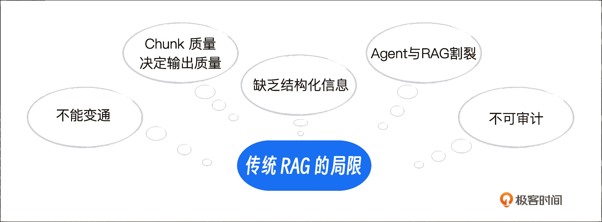
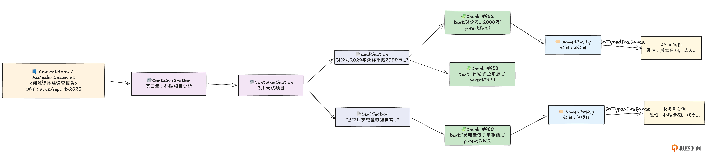
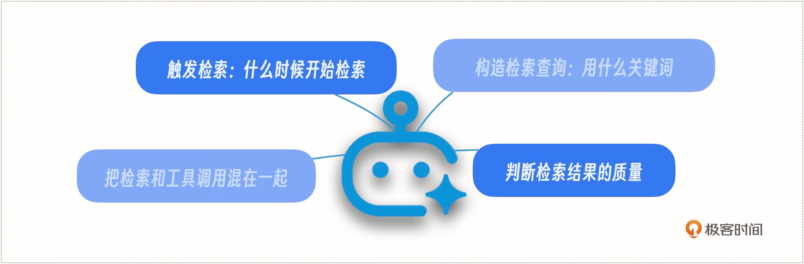
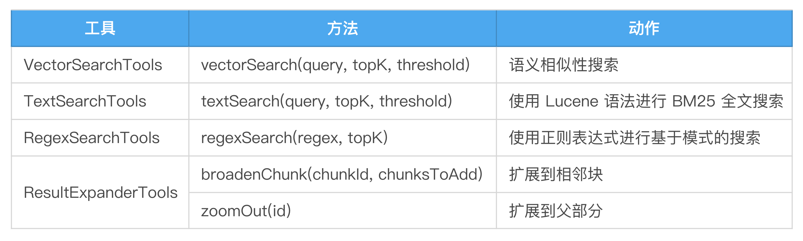

# 08 | Embabel与RAG集成：让Agent真正“读懂”你的私有知识

你好，我是张嘉熙。

我们都知道，LLM 的训练数据有特定范围，有截止日期，它不知道你的公司内部的产品文档、请假政策和今天刚刚发布的行业报告。RAG（Retrieval-Augmented Generation）就是为了解决这个问题而诞生的，它让 LLM 在回答问题之前，先去外部知识库中检索相关信息，用检索结果增强提示词，从而给出准确、有据可查的回答。

但传统 RAG 有一个根本问题，它的检索过程是一个硬编码的线性 Pipeline：用户提问 → 向量检索 → 拼接提示词 → LLM 回答。这种“一问一答”的模式在面对复杂问题时往往力不从心，它不知道什么时候该多搜几次，也不知道怎么主动调整搜索策略。

这就是 Embabel 引入 Agentic RAG 的原因。Embabel 的 RAG 实现，不是简单地在外面挂一个向量数据库，而是让 LLM 掌控检索过程：自主决定什么时候搜索、用什么搜索、以及如何利用搜索结果。这一讲我们就来深入拆解 Embabel 的 RAG 集成方式。

## 传统 RAG 的局限：Pipeline 式检索

LlamaIndex 是传统 RAG 范式的典型代表，它是一个数据优先的框架，专门为 Pipeline 式的检索模式设计。工作流程非常直观：

```
用户提问 → 向量数据库检索相似chunk → 将chunk拼入提示词 → LLM生成回答
```

举个例子：用户问“退货政策是什么？”，系统在 FAQ 知识库中找到最相似的几条记录，塞进提示词，LLM 据此回答。如果知识库里确实有准确的答案，这种模式效果不错——简单、直接、低成本。

但随着 Agent 应用场景从“简单问答”走向“复杂业务决策”，传统 RAG 的 Pipeline 检索模式开始暴露根本性问题：



其一，流程僵化、不知变通，请求仅触发一次检索且无纠错机制，答案质量完全押注在“单发”检索的运气上。

其二，输出质量高度受制于分块与上下文扩展策略，需针对每个数据集精细调优，且内容结构一旦变化策略就容易失效。

其三，返回的是文本碎片而非结构化实体，难以回答“某客户最近三笔订单”这类业务问题。

其四，LLM 与 RAG 深度割裂，RAG 只作为外部组件被动响应，既无法根据检索结果调整后续动作，也感知不到 LLM 的执行上下文。

其五，全链路不可审计，回答出错时很难区分是检索未命中关键块，还是大模型理解有偏差，整个 Pipeline 如同黑箱。

要解决上面这些问题，我们从两个方面入手，一个是优化知识构建过程；另一个是重构 RAG的检索过程，从 Pipeline 式检索升级到智能化代理化的检索。下面我们分别来看。

## 知识构建：内容模型与 Ingestion 机制

很多 RAG 系统对数据摄入（Ingestion）的理解非常简单粗暴：把文档切成大小差不多的文本块（Chunk），给每个块算个向量，存进向量数据库，完事。这就像把一本书撕成纸屑，然后期望每次提问（相似度搜索）都能恰好捡起对的那一片——运气好的时候还行，运气不好就抓瞎。知识本身是有结构的，为什么存进 RAG 之后就变成了一地碎片？

Embabel 设计了一套超越平面存储的分层内容模型，以及一套将原始文档“翻译”成这套模型的摄入机制。前者定义了知识的理想形态，后者铺设了通往这种形态的工程路径，两者实际上是一体两面。

### 一张图看懂分层内容模型

Embabel 的内容模型做了特别的设计：不仅仅构建了可供向量检索的神经末梢（Chunk），还构建了多层次的文档骨骼结构，让向量搜索和结构导航完美联动。

为了便于理解，我们适当简化了 Embabel 的内容模型（原内容模型），如下所示。



这张图里有三条信息流，恰好对应 Embabel Agent 分层模型的核心设计：

左侧的文档骨骼：从 NavigableDocument 到 ContainerSection 再到 LeafSection，严格保持了文档的原始层级。这不是装饰，而是让 LLM 能够准确“翻到第三章、找到 3.1 节、查看那两段文字”。

中间的检索神经：每个 LeafSection 的真实文本被切割成若干 Chunk。每个 Chunk 都能通过 parentId 锚定回它对应的 LeafSection。于是，向量搜索定位到某个 Chunk 时，系统瞬间就能知道它属于哪份文档、哪一章、哪一节，并可以通过 pathFromRoot 算出完整路径。

右侧的知识节点：从 Chunk 中提炼出的 NamedEntity，不再是散落的关键词，而是有类型契约的领域对象（如“公司”、“项目”）。通过 toTypedInstance() 实例化，它们可以直接变成包含业务属性的实例，供 LLM 进行结构化推理。我们可以猜到，我们甚至还可以构建出实体之间的依赖关系图。

表面上这张图只是一个静态的数据模型，但它实际上为 RAG 的动态探索预埋了三条“跑道”：

- 纵深跑道：Chunk → LeafSection → ContainerSection → NavigableDocument，支持从细节到全局的关联。

- 横向跑道：同一 ContainerSection 下的多个 LeafSection 和它们的 Chunk，支持相邻内容的横向关联。

- 跳跃跑道：NamedEntity 之间隐含的关系（如“公司”与“项目”的申请关系），支持从一块内容跳到另一块看似不相关但实体相连的内容，拼出隐藏的逻辑链。

正是这些预埋的“跑道”，让后续的 Agentic RAG 能够像侦探一样，在知识库中自由穿行、主动追问，而不是只能做一次性相似度搜索。

### Ingestion 机制

Ingestion（数据摄入）不是搬运，而是对知识的结构化翻译。翻译的质量，决定了后续所有检索和生成的天花板。Embabel 提供了一条精密的 Pipeline（与检索不同，对于 Ingestion 这种步骤确定的批处理逻辑来说，Pipeline 仍然是需要的）来处理数据摄入。

1. 结构化“拆开”文档

Embabel 选择了 Apache Tika 来解析文档，但它用的不是普通的“提取所有文字”模式，而是TikaHierarchicalContentReader。这个选择极为关键。

普通的 Tika 用法只是把 PDF 或 Word 文档转成一大段连续文本，原本的标题、段落、列表结构全部丢失。TikaHierarchicalContentReader 做的事情则精细得多：它试图还原文档的层级结构——哪部分是标题，哪部分是章节，哪部分是正文段落。

注意，拆分到 Chunk 层级时，每个 Chunk 都牢牢携带 parentId，直指生出它的LeafSection。于是，沿 pathFromRoot 可以随时还原出完整的文档路径——“报告 → 第三章→ 3.1 节 → 这段文字”。这就像给每一张便签纸条都写上了它所属的书名、章、节和页码。

这里直接呼应了上文中我们讨论的“分层知识模型”。你喂进去的不再是一堆无序的文字碎片，而是一棵有组织、可导航的文档树。有了这棵树，LLM 才能在后续进行各种高级操作。解析阶段多保留一分结构，检索阶段可能就多三分精准。

2. 给 Chunk 注入“场景记忆”

把长文档切成小块（Chunking）是 RAG 的常规操作。但大多数系统只关注“切多大、重叠多少”这两个参数。Embabel 的点睛之笔在于 ChunkTransformer——在分块之后、存储之前，给每个块注入“出身信息”。

官方文档中举了一个很精妙的例子。一个数据块里写着：

```
与基准相比，该方法可将性能提高 40%。
```

如果这就是你存进向量库的全部内容，那这个块基本是废的。没人知道“该方法”指什么，“基准”是什么。

Embabel 默认的 AddTitlesChunkTransformer 解决了这个问题。它会自动把这个块变成：

- 标题：性能优化指南

```
# URI：https://docs.example.com/performance
# 章节：缓存策略
与基准相比，该方法可将性能提高 40%。
```

这一步，把“死块”变成了“活块”。它本质上是在做一种无损的元数据注入：把原本属于父节点（标题、URI、章节名）的信息，“遗传”给了每个子节点（Chunk）。当你对“缓存策略”做语义搜索时，这个富含上下文的块更容易被命中；当 LLM 读到这个块时，它不用猜测背景，直接就能理解含义。

更妙的是，在需要的时候（多数场景用 AddTitlesChunkTransformer 就够了），你还可以链式组装多个 Transformer，流水线式给数据块添加业务元数据，如文档类型、所属部门、安全级别。这已经超出了简单的“数据准备”，上升到了数据治理的层面。

## 侦探式推理：Agentic RAG

Agentic RAG 的核心理念非常简洁：好比一个手拿放大镜（工具）、能自由穿梭于图书馆的侦探（LLM）。它不相信“一次检索就能命中答案”，而是坚信：好的答案源于迭代、探索和上下文追溯。在 Embabel 的设计中，原生支持 Agentic RAG, 使得 LLM 能够完全自主地控制文档检索过程，而不是将检索视为一个僵化的处理步骤。

这意味着什么？



- LLM 自主决定什么时候检索，不是每个问题都要检索。简单问题 LLM 自己就会回答，只有遇到不确定的内容才触发检索。

- LLM 自主构造检索查询，不是把用户的原始问题直接丢给向量数据库，而是思考“我应该搜什么关键词才能找到最相关的信息”。

- LLM 自主判断检索结果够不够用，如果第一次检索不满意，换一个查询再搜；如果结果很好，直接进入下一步。

- LLM 可以把检索和工具调用混在一起，先检索文档，发现需要查数据库验证，再去调数据库工具，交叉验证后才生成最终回答。

### Embabel Agentic RAG 的完整执行流程

Embabel Agentic RAG 的执行流程如下：

```
用户提问 ("Embabel的GOAP规划器是怎么工作的？")
   ↓
LLM推理：这个问题需要检索知识库 → 决定启动检索
   ↓
工具调用：sources_vectorSearch({"query":"GOAP goal oriented action planning","topK"
   ↓
框架执行：LuceneSearchOperations执行向量搜索 → 返回相关chunks
   ↓
LLM评估：检索结果质量不错，但还需要更精确 → 构造更具体的查询
   ↓
工具调用：sources_textSearch({"query":"\"GOAP\" AND (planner OR planning) AND deter
   ↓
框架执行：LuceneSearchOperations执行全文搜索 → 返回精确匹配的chunks
   ↓
LLM评估：现在信息充足 → 综合多次检索结果，生成最终回答
   ↓
```

- 返回给用户

我们可以看到，Embabel Agentic RAG 先执行了一次向量搜索，然后根据结果“微调查询”，又执行了一次全文搜索，这次还使用了 AND 和 OR 布尔操作符来精确锁定内容。

而 Embabel 的系统提示词中明确告诉 LLM：“继续搜索直到问题被回答，或者你不得不放弃。要富有创意，尝试不同类型的查询。要彻底，尝试不同的方法。如果实在没有用，请报告说找不到答案”。

这就是 Agentic RAG 与传统 RAG 的本质区别：不是“一个请求一个回答”，而是完全基于 LLM和工具的“侦探式探索”，LLM 对检索过程拥有完全控制权。

### ToolishRag：RAG 工具的统一外观

要实现“侦探式探索”，关键在于一个叫做 ToolishRag 的类。这个类里包含了下面即将讲到的SearchOperations，并将它们打包成 LLM 工具。这一点其实可以从 ToolishRag 这个名字猜出来——Toolish 意为基于工具的。

你可以看一下 ToolishRag 公开给 LLM 的工具。



ToolishRag 自身就是一个用于工具暴露的外观（Facade），它能对外提供一致的接口（Facade 设计模式）。下面我们看看这个官方示例中的片段，了解 ToolishRag 的使用。

```javascript
/**
* 响应用户消息的动作。
* canRerun = true 表示该动作可被重复执行（如因重新规划等原因再次调用），
* trigger = UserMessage.class 表示当工作内存中出现 UserMessage 类型的事实时触发此动作。
*/
@Action(canRerun = true, trigger = UserMessage.class)
void respond(Conversation conversation, ActionContext context) {
   // 通过上下文获取 AI 接口，构建包含工具、系统提示的对话请求，并生成助手消息
   var assistantMessage = context.ai()
           // 指定使用 properties 中配置的聊天语言模型
           .withLlm(properties.chatLlm())
           // 请注意此处：将 toolishRag 作为 LlmReference 注入，使 LLM 可以访问 RAG 工
           .withReference(toolishRag)
           // 使用 "ragbot" 渲染器对最终回复进行格式化（如 Markdown 渲染、资产链接处理等）
           .rendering("ragbot")
           // 基于当前会话和系统提示模板生成回复，同时将 properties 作为模板变量传入
           .respondWithSystemPrompt(conversation, Map.of(
                   "properties", properties
           ));
   // 将生成的助手消息添加到会话历史中，并通过上下文的消息通道发送给用户
   context.sendMessage(conversation.addMessage(assistantMessage));
}
```

### SearchOperations：搜索功能的标签接口

SearchOperations 是搜索功能的最外层的标签接口，它将底层存储机制进行了统一抽象，具体实现会根据自身功能实现它下面的一个或多个子接口。这种设计使得每种搜索功能只需专注实现自己的专属能力，比如对向量数据库进行相似度搜索，对 Lucene 进行文本检索等。

举个例子，对于向量搜索，就存在一个实现了 SearchOperations 接口的 VectorSearch 子接口。

```java
public interface VectorSearch extends SearchOperations {
   <T extends Retrievable> List<SimilarityResult<T>> vectorSearch(
       TextSimilaritySearchRequest request,
       Class<T> clazz
   );
}
```

而在 VectorSearch 子接口下面，我们又能看到一个 SpringVectorStoreVectorSearch 类。

```java
/**
* 实现 {@link VectorSearch} 接口，适配 Spring AI 的 {@link VectorStore}，
* 使 Embabel 可以无缝对接任何 Spring AI 支持的向量数据库。
*/
public class SpringVectorStoreVectorSearch implements VectorSearch {
   // 被适配的 Spring AI 向量存储实例
   private final VectorStore vectorStore;
   /**
    * 构造注入，接收 Spring AI 的 VectorStore 实现。
    * @param vectorStore 具体的向量存储实例（如 Pinecone、Weaviate、pgvector 等）
    */
   public SpringVectorStoreVectorSearch(VectorStore vectorStore) {
       this.vectorStore = vectorStore;
   }
   /**
    * 执行向量相似度搜索，并返回匹配的相似度结果列表。
    *
    * @param request 搜索请求，包含查询文本、相似度阈值、返回数量等参数
    * @param clazz   结果对象的目标类型，需实现 {@link Retrievable}
    * @param <T>     结果类型泛型
    * @return 按相似度排序的结果列表
    */
   @Override
   public <T extends Retrievable> List<SimilarityResult<T>> vectorSearch(
           TextSimilaritySearchRequest request,
           Class<T> clazz) {
       // 将 Embabel 的搜索请求转换为 Spring AI 的 SearchRequest
       SearchRequest searchRequest = SearchRequest
           .builder()
           .query(request.getQuery())                          // 查询文本
           .similarityThreshold(request.getSimilarityThreshold()) // 相似度阈值
           .topK(request.getTopK())                            // 返回结果数量
           .build();
       // 调用底层 VectorStore 执行相似度搜索，得到 Spring AI 的 Document 列表
       List<Document> results = vectorStore.similaritySearch(searchRequest);
       // 将 Document 列表转换为 Embabel 的 SimilarityResult 列表（省略具体转换逻辑）
       // ... convert results
   }
}
```

看到这里，你是否有似曾相识之感。我们在04 讲介绍 Embabel 和 Spring AI 的依赖关系时，代码示例就是通过直接调用 Spring AI 中的 VectorStore 来处理向量存储，和这里的逻辑其实是一样的。正如我们现在看到的，Embabel 已经统一封装好了这些底层搜索逻辑，在绝大多数时候其实并不需要直接调用 Spring AI，直接用 Embabel 中的封装好的更高层次抽象就好，比如 VectorSearch。

我们继续往下层来看，Embabel 的 RAG 存储层也是可插拔的，目前主要支持以下几种存储。

- Lucene：本地高性能全文与向量搜索

- Neo4j：图数据库驱动的 RAG

- PostgreSQL + pgvector：关系型数据库中的混合搜索

- Spring AI VectorStore 适配器：你可以接入 Pinecone、Weaviate、Milvus、Chroma、Redis、MongoDB Atlas 等数十种向量数据库

如果这些还不能满足你的需求，Embabel 还支持我们实现自己的 RAG 存储。比如你们公司在用某种上面没提到的向量数据库，那你可以自己实现 VectorSearch 这个子接口进行自定义拓展。

## 本讲小结

这一讲，我们看穿了传统 RAG 的致命软肋，一次性检索、碎片化存储、LLM 与知识库割裂。同时，一步步重建整个范式。

你建造了一座结构化的知识库，而不是满地纸屑。通过分层内容模型，你让文档保留了骨骼（章节层级）和神经末梢（Chunk），并给每一个“Chunk”都打上了出身的烙印。Ingestion 不再是粗糙的搬运，而是一条精密的 Pipeline：拆骨骼、切神经、注入场景记忆。

你赋予 LLM 侦探般的自主权。它不再被动接受一次检索的结果，而是自己决定何时搜、搜什么、搜得够不够。向量搜索、全文检索、正则匹配、上下文扩展，这些工具任由 LLM 在探索中自由组合，反复追问，直到拼出完整的证据链。

你拥有了一套可插拔、可扩展的搜索军火库。ToolishRag 把一切复杂性封装成统一的工具外观，SearchOperations 让你的存储层随意切换：Lucene、Neo4j、pgvector，或者通过Spring AI 接入任何你想要的向量数据库。

我们把企业知识真正变成了可推理、追溯、交叉验证的活的记忆，具备了用 Embabel 构建生产级 Agentic RAG 系统的核心能力。下一讲，我们将学习核心篇的最后一个核心知识点，全面深入了解 Embabel 的规划器生态。

## 思考题

1. Embabel 的分层内容模型为文档保留了“骨骼”，又为 Chunk 注入了“场景记忆”。请设想一个需要跨章节推理的问题（如“对比第三章和第五章的实验结论”），描述 LLM 如何利用parentId、pathFromRoot 和 AddTitlesChunkTransformer 注入的上下文，一步步完成检索和推理。如果去掉这些设计，RAG 检索会退化到哪里？

2. 阅读 Embabel agent 源码（0.3.5 版本），深入分析 SearchOperations 接口及其底层实现，画出完整的依赖关系图，思考一下 SearchOperations 底层都有哪些子接口，哪些实现类，他们分别都是做什么的，如果要你来设计 SearchOperations 接口的底层实现，你会怎么做。

欢迎你把你的设计分享到留言区，也欢迎你把这节课的内容分享给需要的朋友，我们下节课再见！
