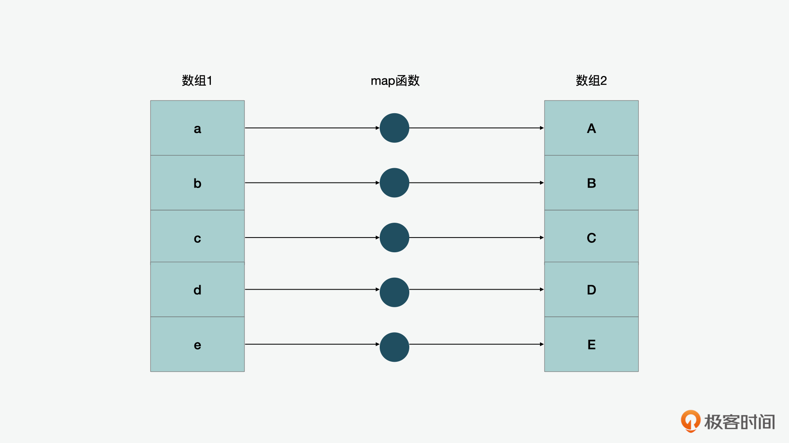
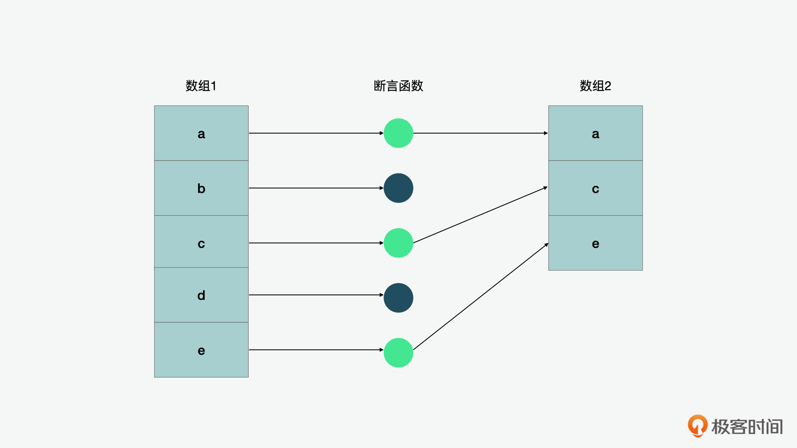
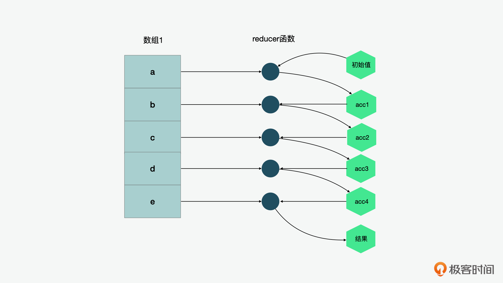

# 05 | map、reduce和monad如何围绕值进行操作？

你好，我是石川。

上节课里，我们在学习组合和管道的工作机制的时候，第一次认识了 reducer，同时在讲到transduce 的时候，也接触到了 map、filter 和 reduce 这些概念。那么今天这节课，我们就通过 JS 中数组自带的功能方法，来进一步了解下 transduce 的原理，做到既知其然，又知其所以然。

另外，我们也看看由 map 作为 functor 可以引申出的 monad 的概念，看看它是如何让函数间更好地进行交互的。

## 数据的核心操作

那在正式开始之前，我先来说明下这节课你要关注的重点。课程中，我会先带你通过JavaScript 本身自带的映射（map）、过滤（filter）和 reduce 方法，来了解下这几种方法对值的核心操作。同时呢，我也给你解答下上节课提出的问题，即如何通过映射和过滤来做到reduce。作为我们后面讲到 functor 和 monad 的基础。

好，下面我们就从 map 开始讲起。

### map 映射和函子

我们经常听说，array.map 就是一个函子（functor），那什么是一个函子呢？

实际上，函子是一个带运算工具的数据类型或数据结构值。举个常用的例子，在 JavaScript中，字符串（string）就是一个数据类型，而数组（array）既是一个数据类型也是一个数据结构，我们可以用字符串来表达一个单词或句子。而如果我们想让下图中的每个字母都变成大写，那么就是一个转换和映射的过程。



我们再用一段抽象的代码来表示一个字符串的映射函子 stringMap。可以看到，stringMap 可以把字符串 Hello World! 作为输入，然后通过一个 uppercaseLetter 工具函数的转换，对应返回大写的 HELLO WORLD!。

```
stringMap( uppercaseLetter, "Hello World!" ); // HELLO WORLD!
```

类似地，如果我们有一个数组的映射函子 arrayMap，也可以把数组 [“1”,“2”,“3”] 中每个字符串的元素转化成整数，然后再对应输出一个整数数组 [1, 2, 3]。

```
["1","2","3","4","5"].map( unary( parseInt ) ); // [1,2,3,4,5]
```

### filter 过滤和筛选

说完了函子，我们再来看看过滤器（filter）和断言（predicate）。

filter 顾名思义，就是过滤的意思。但要注意一点，filter 可以是双向的，我们可以过滤掉（filter out）不想要的东西，也可以筛选出（filter in）出想要的东西。

然后再来看断言。我们上节课在说到处理输入参数的工具的时候，也接触过断言，比如identity 就可以看作是断言。在函数式编程中，断言就是一个个的筛选条件，所以在过滤器中，我们经常会使用断言函数。



举个例子，假如有一个用来判断“一个值是不是奇数”的 isOdd 函数，它是一个断言，而它的筛选条件就是筛选出数组中的单数。所以，如果用它来筛选 [1,2,3,4,5]，得到的结果就是[1,3,5]。

```
[1,2,3,4,5].filter( isOdd ); // [1,3,5]
```

在 Javascript 中也有自带的 some() 和 every() 断言方法。它们的作用就是可以判断数组中的一组元素是不是都符合判断条件。

比如在下面一列包含了 [1,2,3,4,5] 这几个数字的数组中，如果我们要判断它的每一个元素是不是都小于 6，结果就是 true。如果我们要判断它们是不是都是奇数，结果就是 false，因为这里面既有奇数，也有偶数。

```javascript
let arr = [1,2,3,4,5];
arr.every(x => x < 6)      // => true，所有的值都小于6
arr.every(x => x % 2 === 1) // => false，不是所有的数都是奇数
```

类似地，some() 可以帮助我们判断这组数组中有没有一些小于 6 的数字或者奇数。这时，这两个判断返回的结果都是 true。

```javascript
let arr = [1,2,3,4,5];
arr.some(x => x < 6)      // => true，a里面有小于6的数字
arr.some(x => x % 2 === 1)  // => true，数组a里面有一些奇数
```

虽然 some() 和 every() 都是 JavaScript 自带的断言方法，但是对比 filter() ，它们就显得没有那么“函数式”了，因为它们的返回值只是一个 true 或 false，而没有像 filter 一样返回一组数据作为输出，继续用来进行后续一系列的函数式的操作。

### reduce 和缩减器

最后我们再来说说 reduce。实际上，缩减（reduce）主要的作用就是把列表中的值合成一个值。如下图所示：



在 reduce 当中，有一个缩减器（reducer）函数和一个初始值。比如在下面的例子中，初始值是 3，reducer 函数会计算 3 乘以 5 的结果，再乘以 10，得出的结果再乘以 15，最后归为一个结果 2250。

```
[5,10,15].reduce( (arr,val) => arr * val, 3 ); // 2250
```

而缩减 reduce 除了能独立来实现以外，也可以用映射 map 和过滤 filter 的方法来实现。这是因为 reduce 的初始值可以是一个空数组[]，这样我们就可以把迭代的结果当成另一个数组了。

我们来看一个例子：

```javascript
var half = v => v / 2;
[2,4,6,8,10].map( half ); // [1,2,3,4,5]
[2,4,6,8,10].reduce(
   (list,v) => (
       list.push( half( v ) ),
       list
   ), []
); // [1,2,3,4,5]
var isEven = v => v % 2 == 0;
[1,2,3,4,5].filter( isEven ); // [2,4]
[1,2,3,4,5].reduce(
   (list,v) => (
       isEven( v ) ? list.push( v ) : undefined,
       list
   ), []
); // [2,4]
```

可以发现，这里我故意利用了一个副作用。通过第一节课的学习，我们知道 array.push 是一个非纯函数的方法，它改变了原数组，而不是复制后修改。而如果我们想完全避免副作用，可以用 concat。但是，我们也知道 concat 虽然遵循的是纯函数、不可变的原则，但是有一点是我们需要注意的，就是它在面对大量的复制和修改时会产生性能上的问题。所以估计到这里，你也猜到了在上节课中，我们提到的 transducer 的原理了。

是的，这里我们就是故意利用了副作用来提高性能！

你或许会认为，这样是不是就违背了纯函数和不可变的原则？实际上是也不是，因为在原则上，我们做的这些变化都是在函数内部的，而我在前面说过，需要注意的副作用一般多是来自外部。

所以在这个例子中，我们没有必要为了几乎没有负面影响的副作用而牺牲性能。而 transducer正是利用了副作用，才做到的性能提升。

## 单子 monad

好，现在让我们回到课程一开始提到的问题：monad 和 functor 有什么区别呢？

在开篇词我们也提到过，函子（functor）其实就是一个值和围绕值的一些功能。所以我们知道，array.map 可以被看做是一个 functor，它有一组值，而如 map 这样的方法可以作用于数组里面的每一个值，提供了一个映射的功能。而 monad 就是在 functor 的基础上，又增加了一些特殊功能，其中最常见的就是 chain 和应用函子（applicative)。下面我就带你具体看看。

### array 作为 functor

前面我们说过，array.map 就是一个函子，它有一个自带的包装对象，这个对象有类似 map这样的映射功能。那么同样地，我们也可以自己写一个带有映射方法的 Just Monad，用它来包装一个值（val）。这个时候，monad 相当于是一个基于值形成的新的数据结构，这个数据结构里有 map 的方法函数。

```javascript
function Just(val) {
   return { map };
   function map(fn) { return Just( fn( val ) ); }
}
```

可见，它的使用方式就类似于我们之前看到的 array.map 映射。比如在下面的例子里，我们用map 将一个函数 v => v * 2 运用到了 Just monad 封装的值 10 上，它返回的就是 20。

```javascript
var A = Just( 10 );
var B = A.map( v => v * 2 ); // 20
```

### chain 作为 bind、flatMap

再来说说 chain。

chain 通常又叫做 flatMap 或 bind，它的作用是 flatten 或 unwrap，也就是说它可以展开被Just 封装的值 val。你可以使用 chain 将一个函数作用到一个包装的值上，返回一个结果值。如下代码所示：

```javascript
function Just(val) {
   return { map, chain };
   function map(fn) { return Just( fn( val ) ); }
    // aka: bind, flatMap
   function chain(fn) { return fn( val ); }
}
```

我再举个例子，我们用 chain 方法函数把一个加一的函数作为参数运用到 monad A 上，得到了一个 15+1=16 的结果，那么之后返回的就是一个 flatten 或 unwrap 展开的 16 了。

```javascript
var A = Just( 15 );
var B = A.chain( v => v + 1 );
B;          // 16
typeof B;   // "number"
```

### monoid

OK，既然说到了 chain，我们也可以看一下 monoid。

在上节课我们说过函数组合 compostion。而在组合里，有一个概念就是签名一致性的问题。举个例子如果前一个函数返回了一个字符串，后一个函数接收的输入是数字，那么它们是没办法组合的。所以，compose 函数接收的函数都要符合一致性的 fn :: v -> v 函数签名，也就是说函数接收的参数和返回的值类型要一样。

那么，满足这些类型签名的函数就组成了 monoid。看到这个公式你是不是觉得很眼熟？没错，它的概念就是基于我们之前说到过的 identity 函数。在 TypeScript 中，identity 也是泛型使用中的一个例子。比如在 C# 和 Java 这样的语言中，泛型可以用来创建可重用的组件，一个组件可以支持多种类型的数据。 这样用户就可以以自己的数据类型来使用组件。它的基本原理也是基于这样的一个 identity 函数。

```javascript
function identity<T>(arg: T): T {
   return arg;
}
```

identity 在 monad 中有一个用处，就是如果把 identity 作为一个参数，可以起到观察 inspect的作用。比如，我们先用 Just 来封装 15 这个值，然后调用 chain 的方法时，把 identity 作为参数，返回的就是一个 flatten 或 unwrap 展开的 15。所以我们可以看出，它也这里也起到了一个 log 的作用。

```javascript
var A = Just( 15 );
A.chain (identity) // 返回 15
```

### applicative

最后，我们再来看应用函子（applicative），简称 ap。

ap 的作用其实也很简单。应用函子，顾名思义，它的作用是可以把一个封装过的函数应用到一个包装过的值上。

```javascript
function Just(val) {
   return { map, ap };
   function map(fn) { return Just( fn( val ) ); }
   function ap(anotherMonad) { return anotherMonad.map( val ); }
}
```

再来看一个例子，可以看到，ap 把 monad B 里的值取出来，通过 monad A 的映射把它应用到了 monad A 上。因为映射接受的值类型是函数，所以这里我们传入的是柯里化的 add 函数，它先通过闭包的记忆功能，记住第一个参数 6，之后再加上传入的 10，最后输出的结果就是 16。

```javascript
var A = Just( 6 );
var B = Just( 10 );
function add(x,y) { return x + y; }
var C = A.map( curry( add ) ).ap( B );
C.chain(identity); // 返回 16
```

如果我们把上面几个功能加在一起，其大致实现就如下所示：

```javascript
function Just(val) {
   return { map, chain, ap, log };
   // *********************
   function map(fn) { return Just( fn( val ) ); }
   // aka: bind, flatMap
   function chain(fn) { return fn( val ); }
   function ap(anotherMonad) { return anotherMonad.map( val ); }
   function log() {
       return `simpleMonad(${ val })`;
   }
}
```

说到函子和应用函子，我们也可以看一下，在数组中，有一个 array.of 的工厂方法，它的作用是接收一组参数，形成一个新数组。

```javascript
var arr = Array.of(1,2,3,4,5); // 返回：[1,2,3,4,5]
```

在函数式编程中，我们称实现了 of 工厂方法的函子是 pointed 函子。通过 pointed 函子，我们可以把一组值放到了一个数组的容器中，之后还可以通过映射函子对每个值做映射。而应用函子，（applicative functor）就是实现了应用方法的 pointed 函子。

## 总结

今天这节课，我们学习了函数式编程中针对数组的几个核心操作，解答了上节课中的如何通过映射和过滤做到 reduce 的问题，同时也更深入地理解了 reducer 和 transduce 的原理。

并且现在我们知道，array.map 其实就是一个 functor，它包含了 map 功能，可以围绕一个数组中的每个值进行操作，返回一个新的数组。而 monad 可以说是基于函子增加了一些特殊的功能。当然了，不同的 monad 也可以相互组合，比如 just 加上 nothing，也就是一个空值单子，可以组成 maybe monad 来处理空值的异常。

另外说到了函子和单子，在函数式编程当中其实还有 either、IO 之类的概念。其中 either 是用来代替比如 if else 或者是 try catch 的条件运算，它的 value 里保存的是一个值；而 IO 可以用来延迟函数的执行，它的 value 里面存储的是一个函数。这里我就不多说了，感兴趣的话，你也可以去深入了解下。

## 思考题

从函数式编程的思维视角来看，你觉得 JavaScript 中的 promise 算是 monad 吗？

欢迎在留言区分享你的思考和答案，也欢迎你把今天的内容分享给更多的朋友。
