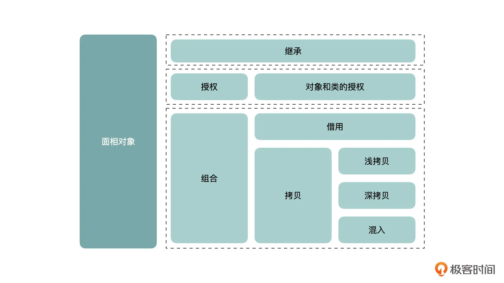
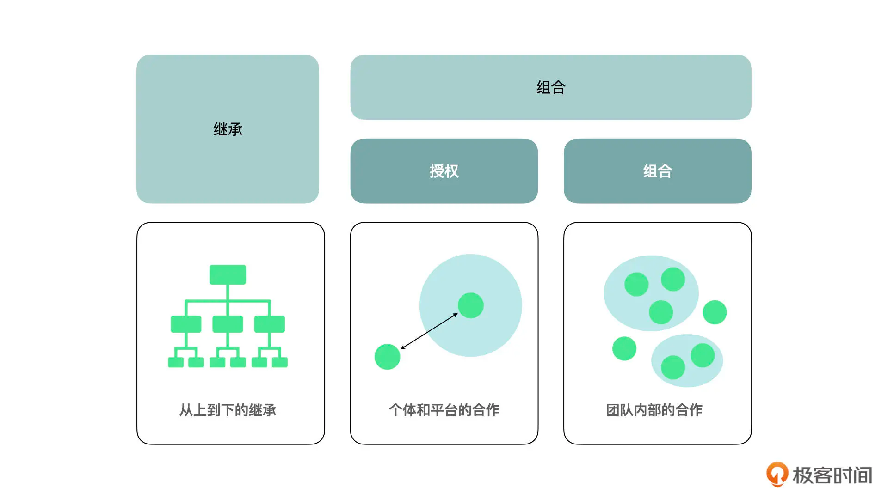
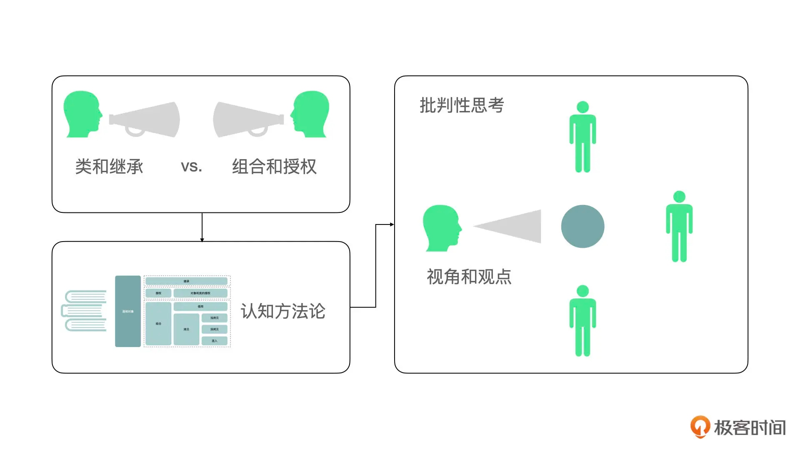

# 08 | 深入理解继承、Delegation和组合

你好，我是石川。

关于面向对象编程，最著名的一本书就数GoF（Gang of Four）写的《设计模式：可复用面向对象软件的基础》了。这本书里一共提供了 23 种不同的设计模式，不过今天我们不会去展开了解这些细节，而是会把重点放在其中一个面向对象的核心思想上，也就是组合优于继承。

在 JS 圈，有不少继承和组合的争论。其实无论是继承还是组合，我们都不能忘了要批判性地思考。批判性思考的核心不是批判，而是通过深度思考核心问题，让我们对事物能有自己的判断。

所以，无论是继承还是组合，都只是方式、方法，它们要解决的核心问题就是如何让代码更加容易复用。



那么接下来，我们就根据这个思路，看看 JavaScript 中是通过哪些方法来解决代码复用这个问题的，以及在使用不同的方法时它们各自解决了什么问题、又引起了什么问题。这样我们在实际的业务场景中，就知道如何判断和选择最适合的解决方式了。

## 继承

在传统的 OOP 里面，我们通常会提到继承（Inheritance）和多态（Polymorphism）。继承是用来在父类的基础上创建一个子类，来继承父类的属性和方法。多态则允许我们在子类里面调用父类的构建者，并且覆盖父类里的方法。

那么下面，我们就先来看下在 JavaScript 里，要如何通过构建函数来做继承。

### 如何通过继承多态重用？

实际上，从 ES6 开始，我们就可以通过 extends 的方式来做继承。具体如下所示：

```python
class Widget {
 appName = "核心微件";
 getName () {
   return this.appName;
 }
}
class Calendar extends Widget {}
var calendar = new Calendar();
console.log(calendar.hasOwnProperty("appName")); // 返回 true
console.log(calendar.getName()); // 返回 "核心微件"
calendar.appName = "日历应用"
console.log(typeof calendar.getName); // 返回 function
console.log(calendar.getName()); // 返回 “日历应用”
```

接着来看多态。从 ES6 开始，我们可以通过 super 在子类构建者里面调用父类的构建者，并且覆盖父类里的属性。可以看到在下面的例子里，我们是通过 super 将 Calendar 的appName 属性从“核心微件”改成了“日历应用”。

```python
class Widget {
 constructor() {
   this.appName = "核心微件";
 }
 getName () {
   return this.appName;
 }
}
class Calendar extends Widget {
 constructor(){
   super();
   this.appName = "日历应用";
 }
}
var calendar = new Calendar();
console.log(calendar.hasOwnProperty("appName")); // 返回 true
console.log(calendar.getName()); // 返回 "日历应用"
console.log(typeof calendar.getName); // 返回 function
console.log(calendar.getName()); // 返回 “日历应用”
```

在一些实际的例子，如 React 这样的三方库里，我们也经常可以看到一些继承的例子，比如我们可以通过继承 React.Component 来创建一个 WelcomeMessage 的子类。

```python
class WelcomeMessage extends React.Component {
 render() {
   return <h1>Hello, {this.props.name}</h1>;
 }
}
```

## 授权

说完了继承，我们再来看授权这个方法。

什么是授权（Delegation）呢？我打个比方，这里的授权不是我们理解的作为领导（父类）给下属（子类）授权，而是作为个体对象可以授权给一个平台或者他人来一起做一件事。

就好像我和极客时间合作，我的个人精力和专业能力只允许我尽量做好内容，但是我没有精力和经验去做编辑、后期和推广等等，这时就授权给极客时间相关的老师来一起做，我在这件事、这个过程中只是专心把内容的部分做好。

### 如何通过授权做到重用？

在前面的例子中，结合我们在第 1 讲里提到的基于原型链的继承，我们会发现使用JavaScript 无论是通过函数构建也好，还是加了语法糖的类也好，来模拟一般的面向对象语言，比如 Java 的类和继承，对于有些开发者来说是比较反直觉的。在使用的时候需要大量的思想转换，才能把 JavaScript 的底层逻辑转换成实际呈现出来的实现。

那么有没有一种方式可以让代码更直观呢？这种方式其实就是通过原型本身来做授权会更符合直觉。从 ES5 开始，JavaScript 就支持了 Object.create() 的方法。下面我们来看一个例子：

```javascript
var Widget = {
 setCity : function(City) {this.city = City; },
 outputCity : function() {return this.city;}
};
var Weather = Object.create(Widget);
Weather.setWeather = function (City, Tempreture) {
 this.setCity(City);
 this.tempreture = Tempreture;
};
Weather.outputWeather = function() {
 console.log(this.outputCity()+ ", " + this.tempreture);
}
var weatherApp1 = Object.create(Weather);
var weatherApp2 = Object.create(Weather);
weatherApp1.setWeather("北京","26度");
weatherApp2.setWeather("南京","28度");
weatherApp1.outputWeather(); // 北京, 26度
weatherApp2.outputWeather(); // 南京, 28度
```

可见，我们创建的 Weather 天气预报这个对象，授权给了 Widget，让 Widget 在得到授权的情况下，帮助 Weather 来设定城市和返回城市。Widget 对象在这里更像是一个平台，它在得到 Weather 的授权后为 Weather 赋能。而 Weather 对象可以在这个基础上，专注于实现自己的属性和方法，并且产出 weatherApp1 和 weatherApp2 的实例。

当然也有开发者认为 class 的方式没有什么反直觉的，那授权同样可以通过 class 来实现。比如我们如果想在上一讲提到过的集合（Set）和字典（Map）的基础上，加上计数的功能，可以通过继承 Set 来实现。但是我们也可以反之，在把部分功能授权给 Map 的基础上，自己专注实现一些类似 Set 的 API 接口。

```sql
class SetLikeMap {
   // 初始化字典
   constructor() { this.map = new Map(); }
   // 自定义集合接口
   count(key) { /*...*/ }
   add(key) { /*...*/ }
   delete(key) { /*...*/ }
   // 迭代返回字典中的键
   [Symbol.iterator]() { return this.map.keys(); }
   // 部分功能授权给字典
   keys() { return this.map.keys(); }
   values() { return this.map.values(); }
   entries() { return this.map.entries(); }
}
```

## 组合

说完了授权，我们再来看看组合。当然上面我们说的授权，广义上其实就是一种组合。但是这种组合更像是“个体和平台的合作”；而另一种组合更像是“团队内部的合作”，它也有很多的应用和实现方式，我们可以来了解一下。



### 如何通过借用做到重用？

在 JavaScript 中，函数有自带的 apply 和 call 功能。我们可以通过 apply 或 call 来“借用”一个功能。这种方式，也叫隐性混入（Implicit mixin）。比如在数组中，有一个原生的 slice 的方法，我们就可以通过 call 来借用这个原生方法。

如下代码示例，我们就是通过借用这个功能，把函数的实参当做数组来 slice。

```javascript
function argumentSlice() {
   var args = [].slice.call(arguments, 1, 3);
   return args;
}
// example
argumentSlice(1, 2, 3, 4, 5, 6); // returns [2,3]
```

### 如何通过拷贝赋予重用？

除了“借力”以外，我们还能通过什么组合方式来替代继承呢？这就要说到“拷贝”了。这个方法顾名思义，就是把别人的属性和方法拷贝到自己的身上。这种方式也叫显性混入（Explicitmixin）。

在 ES6 之前，人们通常要偷偷摸摸地“抄袭”。在 ES6 之后，JavaScript 里才增加了“赋予”，也就是 Object.assign() 的功能，从而可以名正言顺地当做是某个对象“赋予”给另外一个对象它的“特质和能力”。

那么下面，我们就先看看在 ES6 之后，JavaScript 是如何名正言顺地来做拷贝的。

首先，通过对象自带的 assign()，我们可以把 Widget 的属性赋予 calendar，当然在 calendar里，我们也可以保存自己本身的属性。和借用一样，借用和赋予都不会产生原型链。如以下代码所示：

```javascript
var widget = {
 appName : "核心微件"
}
var calendar = Object.assign({
 appVersion: "1.0.9"
}, widget);
console.log(calendar.hasOwnProperty("appName")); // 返回 true
console.log(calendar.appName); // 返回 “核心微件”
console.log(calendar.hasOwnProperty("appVersion")); // 返回 true
console.log(calendar.appVersion); // 返回 “1.0.9”
```

好，接着我们再来看看在 ES6 之前，人们是怎么通过“抄袭”来拷贝的。

这里实际上分为“浅度拷贝”和“深度拷贝”两个概念。“浅度拷贝”类似于上面提到的赋予 assign这个方法，它所做的就是遍历父类里面的属性，然后拷贝到子类。我们可以通过 JavaScript中专有的 for in 循环，来遍历对象中的属性。

细心的同学可能会发现，我们在第 2 讲中说到用拷贝来做到不可变时，就了解过通过延展操作符来实现浅拷贝的方法了。

```javascript
// 数组浅拷贝
var a = [ 1, 2 ];
var b = [ ...a ];
b.push( 3 );
a;  // [1,2]
b;  // [1,2,3]
// 对象浅拷贝
var o = {
   x: 1,
   y: 2
};
var p = { ...o };
p.y = 3;
o.y;  // 2
p.y;  // 3
```

而在延展操作符出现之前，人们大概可以通过这样一个 for in 循环做到类似的浅拷贝。

```javascript
function shallowCopy(parent, child) {
 var i;
 child = child || {};
 for (i in parent) {
   if (parent.hasOwnProperty(i)) {
     child[i] = parent[i];
   }
 }
 return child;
}
```

至于深度拷贝，是指当一个对象里面存在嵌入的对象就会深入遍历。但这样会引起一个问题：如果这个对象有多层嵌套的话，是每一层都要遍历吗？究竟多深算深？还有就是如果一个对象也引用了其它对象的属性，我们要不要也拷贝过来？

所以相对于深度拷贝，浅度拷贝的问题会少一些。但是在第 2 讲的留言互动区，我们也说过，如果我们想要保证一个对象的深度不可变，还是需要深度拷贝的。深度拷贝的一个相对简单的实现方案是用 JSON.stringify。当然这个方案的前提是这个对象必须是 JSON-safe 的。

```javascript
function deepCopy(o) { return JSON.parse(JSON.stringify(o)); }
```

同时，在第 2 讲的留言区中，也有同学提到过另外一种递归的实现方式，所以我们也大致可以通过这样一个递归来实现：

```javascript
function deepCopy(parent, child) {
 var i,
 toStr = Object.prototype.toString,
 astr = "[object Array]";
 child = child || {};
   for (i in parent) {
     if (parent.hasOwnProperty(i)) {
       if (typeof parent[i] === "object") {
         child[i] = (toStr.call(parent[i]) === astr) ? [] : {};
               deepCopy(parent[i], child[i]);
       } else {
         child[i] = parent[i];
       }
     }
 }
 return child;
}
```

### 如何通过组合做到重用？

上面我们说的无论是借用、赋予，深度还是浅度拷贝，都是一对一的关系。最后我们再来看看，如何通过 ES6 当中的 assign 来做到组合混入，也就是说把几个对象的属性都混入在一起。其实方法很简单，以下是参考：

```javascript
var touchScreen = {
 hasTouchScreen : () => true
};
var button = {
 hasButton: () => true
};
var speaker = {
 hasSpeaker: () => true
};
const Phone = Object.assign({}, touchScreen, button, speaker);
console.log(
 hasTouchScreen: ${ Phone.hasChocolate() }
 hasButton: ${ Phone.hasCaramelSwirl() }
 hasSpeaker: ${ Phone.hasPecans() }
);
```

### React 中的组合优于继承

在 React 当中，我们也可以看到组合优于继承的无处不在，并且它同样体现在我们前面讲过的两个方面，一个是“团队内部的合作”，另一个是“个体与平台合作”。下面，我们先看看“团队内部的合作”的例子，在下面的例子里，WelcomeDialog 就是嵌入在 FancyBorder 中的一个团队成员。

```xml
function FancyBorder(props) {
 return (
   <div className={'FancyBorder FancyBorder-' + props.color}>
     {props.children}
   </div>
 );
}
function WelcomeDialog() {
 return (
   <FancyBorder color="blue">
     <h1 className="Dialog-title">
       Welcome
     </h1>
     <p className="Dialog-message">
       Thank you for visiting our spacecraft!
     </p>
   </FancyBorder>
 );
}
```

另外，我们也可以看到“个体与平台合作”的影子。在这里，WelcomeDialog 是一个“专业”的Dialog，它授权给 Dialog 这个平台，借助平台的功能，实现自己的 title 和 message。这里就是用到了组合。

```xml
function Dialog(props) {
 return (
   <FancyBorder color="blue">
     <h1 className="Dialog-title">
       {props.title}
     </h1>
     <p className="Dialog-message">
       {props.message}
     </p>
   </FancyBorder>
 );
}
function WelcomeDialog() {
 return (
   <Dialog
     title="Welcome"
     message="Thank you for visiting our spacecraft!" />
 );
}
```

## 总结

这节课，我们了解了通过 JavaScript 做到代码复用的几种核心思想和方法，从传统的继承，到 JavaScript 特色的授权以及组合等方式都有分析。虽然我说授权和组合优于继承，但实际上它们之间的关系不是非黑即白的。

我们看到在前端圈，有很多大佬比如道格拉斯·克罗克福德（Douglas Crockford）和凯尔·辛普森（Kyle Simpson），都是基于授权的对象创建的积极拥护者；而像阿克塞尔·劳施迈尔博士（Dr. Axel Rauschmayer）则是基于类的对象构建的捍卫者。

我们作为程序员，如果对对象和面向对象的理解不深入，可能很容易在不同的论战和观点面前左摇右摆。而实际的情况是，真理本来就不止一个。我们要的“真理”，只不过是通过一个观察角度，形成的一个观点。这样，才能分析哪种方式适合我们当下要解决的问题。这个方式，只有在当下，才是“真理”。而我们通过这个单元整理的方法，目的就是帮助我们做到这样的观测。



## 思考题

在前面一讲中，我们试着通过去掉对象私有属性的语法糖，来看如何用更底层的语言能力来实现类似的功能。那么，今天你能尝试着实现下 JS 中的类和继承中的 super，以及原型和授权中的 Object.create() 吗？

欢迎在留言区分享你的答案、交流学习心得或者提出问题，如果觉得有收获，也欢迎你把今天的内容分享给更多的朋友。我们下节课见！
