# 18-TurboFan如何用图做JS编译优化？

你好，我是石川。

今天我们来看下图（graph）这种数据结构，图是一个抽象化的网络结构模型。你可能会问有什么算法应用会用到图这种结构吗？其实很多，像我们经常用的社交媒体（比如国内的微博、微信，或者国外的脸书、领英）中的社交图谱，都可以通过图来表达。另外，图也能用来表达现实世界中的路网、空网以及虚拟的通信网络。

图在 JS 引擎的编译器中作用是非常大的。如果说整个 V8 的编译器 TurboFan 都基于图也毫不夸张。我们既可以通过图这种数据结构，对编译的原理有更深的理解，在我们了解编译的同时，又可以对相关的数据结构和算法有更深入的认识。

## 图的结构

下面我们先来看一下图的结构吧。图就是由边（edge）连接的节点（vertax），任何一个二分的关系都可以通过图来表示。

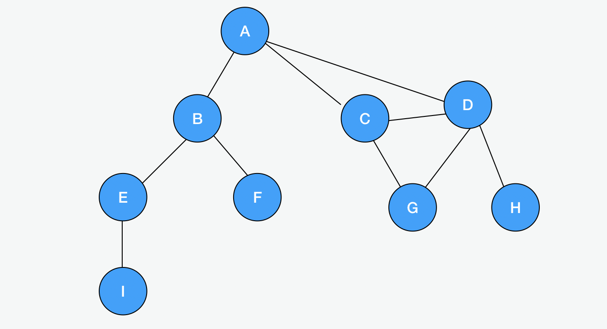

那我们说的 TurboFan 是怎么利用图来做编译的呢？在开始前，我们先来了解下编译流程和中间代码。

## 编译流程：中间代码

IR，也就是中间代码（Intermediate Representation，有时也称 Intermediate Code，IC）。从概念层面看，IR 可以分为 HIR（Higher IR）、MIR（Middle IR）和 LIR（Lower IR），这几种高、中、低的中间代码的形式。

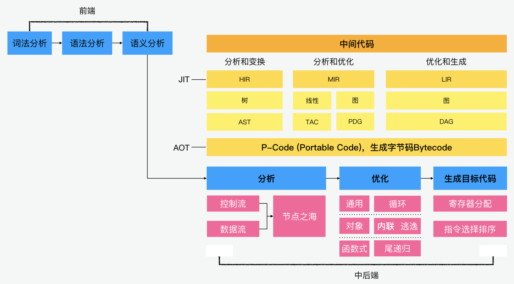

从上面的图中，我们可以看到在整个编译过程中，可以把它分成前中后三个端。前端主要做的是词法、语法和语义的分析，这个我们在之前的章节也有讲过。中端会做相关的优化工作，最后后端的部分就生成了目标代码。

前面我们说了，中间代码可以分为高、中、低三个不同的抽象层次。HIR 主要用于基于源语言做的一些分析和变换，比较典型的例子就是用于语义分析的的 AST（Abstract Syntax Parser）语法树。MIR 则是独立于源语言和 CPU 架构来做一些分析和优化，比较典型的例子就是三地址代码 TAC（Three Address Code）和程序依赖图 PDG（Program Dependency Graph），它们主要用于分析和优化算法的部分。LIR 这一层则是依赖于 CPU 架构做优化和代码生成，其中比较典型的例子就是有向无环图 DAG（Directed Ayclic Graph），它的主要目的是帮助生成目标代码。

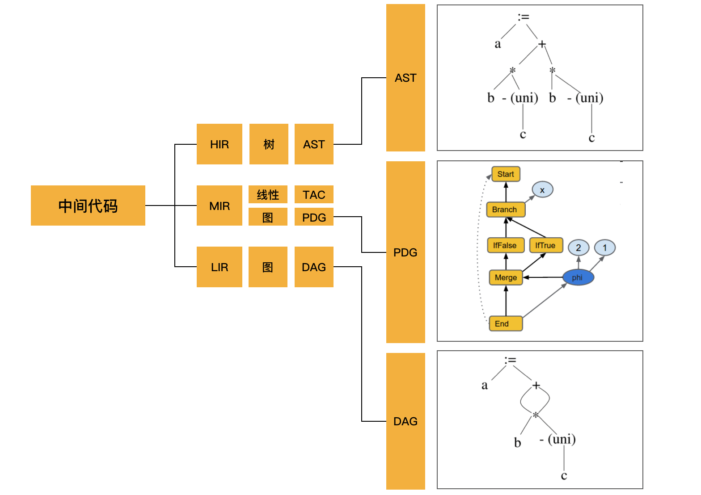

在编译流程中分析的这一段里，有一个重要的分析就是控制流分析（CFA，Control FlowAnalysis）和数据流分析（DFA, Data Flow Analysis），而我们后面要说的节点之海（SoN，Sea of Node）就是可以同时反映数据流和控制流的一种数据结构，节点之海可以减少 CFA 和DFA 之间的互相依赖，因而更有利于全局优化。

在编译流程中优化的这一段里，也有几个重要的概念，分别是通用优化、对象优化和函数式优化。比如循环优化就属于通用的优化；内联和逃逸属于关于对象的优化。对于函数式编程而言，比较重要的就是之前，我们在说到迭代和递归的时候，提到过的循环和尾递归的优化。

在流程中最后生成目标代码的这一段里，重点的任务是寄存器分配和指令的选择和排序。

今天，我们重点来看一下在分析过程中，图和节点之海的原理，以及为什么说节点之海有利于全局的优化。

## 中端优化：分析和优化

下面我们从中端的优化说起，通过 IR 的结构你可能可以看出，“中间代表”可能是比“中间代码”更准确的一种描述。因为 IR 更多的是以一种“数据结构”的形式表现，也就是我们说的线性列表、树、图这些数据结构，而不是“代码”。今天我们重点说的这种数据结构呢，就是TurboFan 用到的节点之海 （SoN，Sea of Node）。

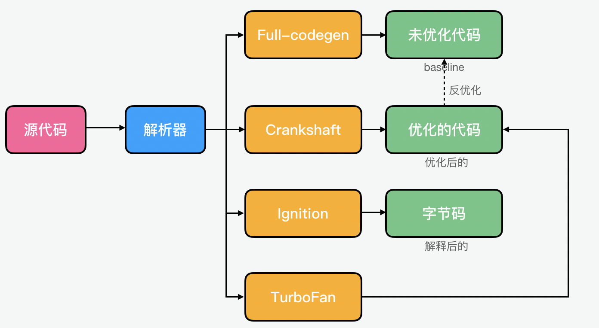

性能一直是 V8 非常关注的内容。节点之海（SoN）的概念首次提及，是 HotSpot 创始人 CliffClick 在一篇 93 年的论文中提出的。V8 的前一代 CrankShaft 编译器是基于 HotSpot C1 实现的，V8 现在用的 TurboFan 编译器是基于第二代 HotSpot C2 实现的升级版。TurboFan 使用了优化了的 SoN IR 与流水线相结合生成的机器码，比使用 CrankShaft JIT 产生的机器码质量更高。与 CrankShaft 相比，TurboFan 采用了更多的优化和分析，比如控制流的优化和精确的数值范围分析，所有这些都是以前无法实现的。节点之海的加入更有利于做全局优化。下面我们就来了解一下节点之海的结构和格式。

### SoN 结构：格式和表达

首先我们可以看一下 SoN 的结构，整个的 SoN 只有节点和边构成。除了值以外，所有的运算也都是用节点来表示的。在 TurboFan 的可视化工具 Turbolizer 中，使用了不同颜色来区分不同类型的节点。浅蓝色就代表了值，深蓝色代表了中间层的操作，例如运算。就像下面的加法运算，边是用来表示运算之间的依赖关系，表达的是 5+x。这种依赖也就限制了先后顺序，比如 5+x 的加法运算是依赖 5 和 x 两个值节点的，所以我们在顺序上可以允许 5 和 x 是先后关系，但是必须出现在加法运算前。

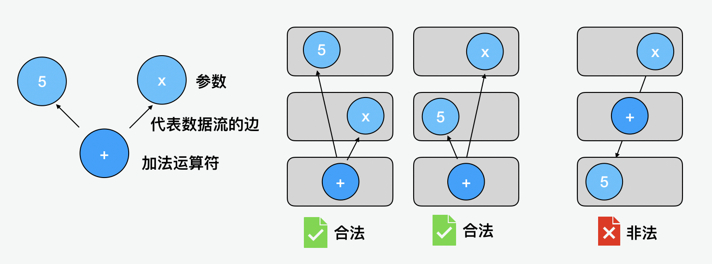

SoN 的格式：静态单赋值

说完了结构，我们再来看看格式。SoN 是符合静态单赋值（SSA，static single assignment）格式的。什么是静态单赋值呢？顾名思义，就是每个变量只有唯一的赋值。比如下面的例子里，第一个操作是 x 等于 3 乘以 7，之后我们给 x 加 3。这时，x 变量就出现了两次。所以TurboFan 在创建图的时候会给本地变量做重命名，在改完之后就是 3 这个值的节点同时有两个操作符指向它，一个是乘以 7 的结果，一个是结果再加上 3。在 SoN 中没有本地变量的概念，所以变量被节点取代了。

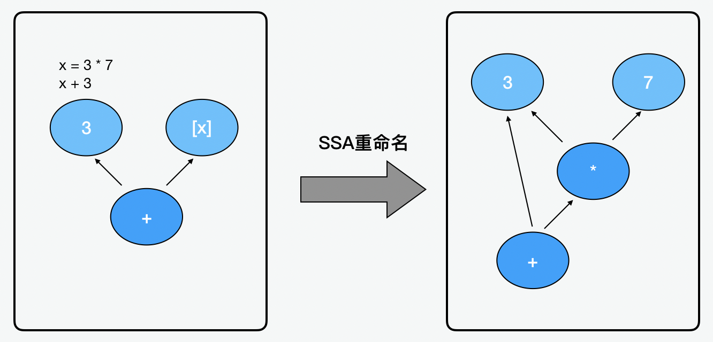

### 数据流表达

我们前面说过，在分析的过程中，有一个重要的分析就是控制流分析（CFA，Control FlowAnalysis）和数据流分析（DFA, Data Flow Analysis）。在数据流中，节点用来表达一切运算，包括常量、参数、数学运算、加载、存储、调用等等。

关于数据流的边，有两个核心概念，一是实线边表达了数据流的方向，这个决定了输入和输出的关系，下面实线表达的就是运算输出的结果。二是虚线边影响了数据流中的相关数据的读写状态，下面虚线边表示运算读写状态的指定。

关于 WAW（Write-After-Write，写后再写）、WAR（Write-After-Read，先读后写）和 RAW（Read-After-Write，先写后读）的读写状态，我们可以看看是如何实现的。我们可以看到SoN 中的虚线边可以用来表达不同读写状态的影响。比下面 obj 对象的 val 属性状态是可变的，完成加 val 加 3 的操作后，通过先读再写存入，之后的结果值先写后读。

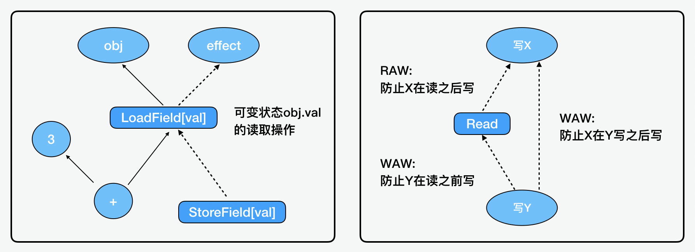

### 控制流表达

我们前面说过，从数据流的角度来看，节点和边表达了一切。而在控制流中，这种说法也是同样成立的。通过下面的例子，我们可以看到，控制中的节点包括开始、分支、循环、合并以及结束等等，都是通过节点来表示。

在 Turbolizer 的可视化图中，用黄色节点代表了控制流的节点。下面是几个单纯看数据流的例子，我们可以看到从最简单的只包含开始结束的直线程序，到分支到循环都可以通过节点之海来表达。

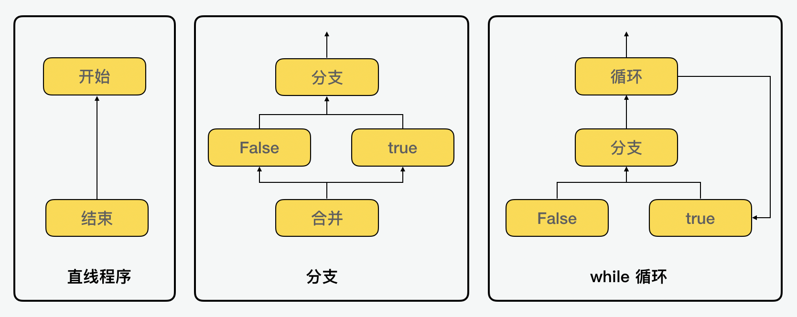

下面我们来看看在和数据流结合后的一个最简单的例子。这里我们看到了，为了区分不同类型的边，可以通过黑色实线、灰色实线和虚线边分别代表控制流、数据流和影响关系。

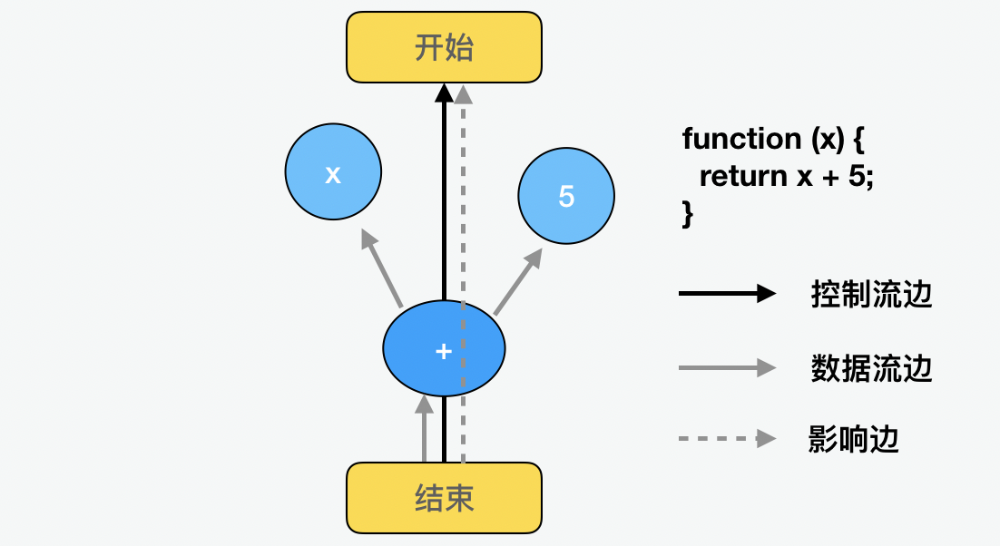

最后，我们再加上合并，可以看到一个更完整的例子。这里你会看到一个 phi 指令，这个指令是做什么的呢？它会根据分支判断后的实际情况来确定 x 的值。因为我们说过，在 SSA（静态单赋值）的规则中，变量只能赋值一次，那么我们在遇到分支后的合并，就必须用到 phi。

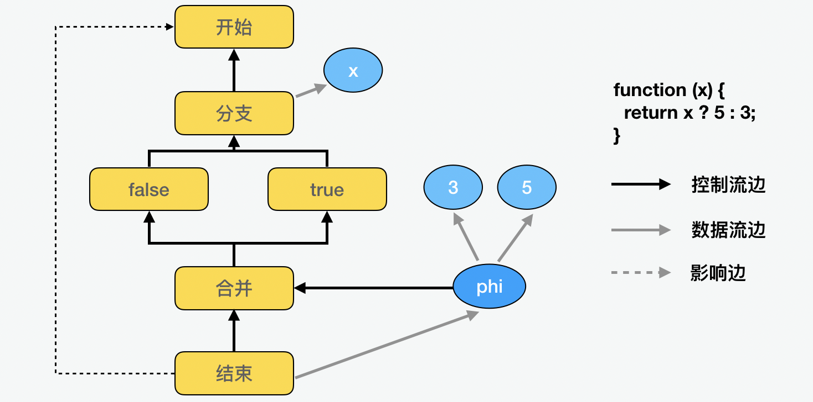

### 分析：变量类型和范围

我们讲了中间代码的重要作用是分析和优化，为什么要做变量类型和范围的分析呢？这里主要要解决三个问题。第一，我们说 JavaScript 是动态而不是静态类型的，所以虽然值有固定的数据类型，可变量是没有固定的数据类型的。举个例子，我们可以说 var a = 25，25 本身是不变的数字类型，但是如果我们说 a + “years old”， 那么变量 a 的类型就变成了字符串。第二，所有的数学运算都是基于 64 比特的，然而在实际的应用中，大多数的程序其实用不了这么多比特，大多都小于 32 比特，并且这里还有很多如 NaN、Infinity、-Infinity、-0.0 等特殊的值。第三，是为了支持如 asm.js 这样的 JS 子集中的注释，以及将上一点提到的如 NaN、Infinity这些特殊值截断成 0 整数这样的需求。

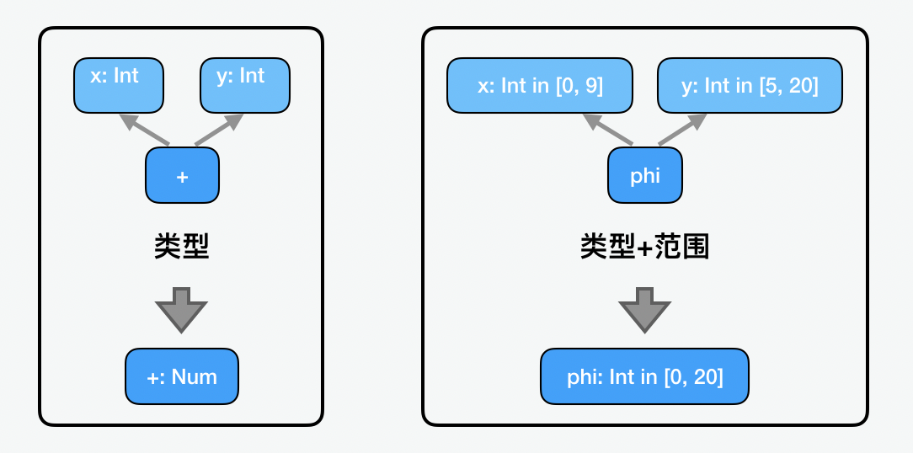

### 优化：基于节点海的优化

说完以上这三点我们要做变量类型和范围的分析。我们再来说说优化，几乎所有的优化都是在节点上完成的，如果一个节点可以被访问到就代表是活的，如果节点不能从结束节点访问到就是死节点，包含死的控制、效果和运算。它们在编译过程中大多数的阶段是看不到死节点的，并且无效节点也不会被放到最后的调度里。

优化的算法就太多了，下面我们说几种核心的优化方案。

### 方案一：常量提前，简化计算

在优化的方案中，最基本的就是常量提前和简化计算的优化方式了。

在常量提前中，比较经典的优化就是常数折叠（constant folding），顾名思义，就是把常数加在一起，比如在下面的第一个例子中，我们把 3+5 的操作直接折叠为 8。

在简化计算中，比较有代表性的例子就是强度折减（strength reduction）。比如在下面的第二个例子中，x+0 和 x 没有区别，就可以简化成 x。再比如下面第三个例子中，可以把 x*4 改为x<<2 这样的移位运算。

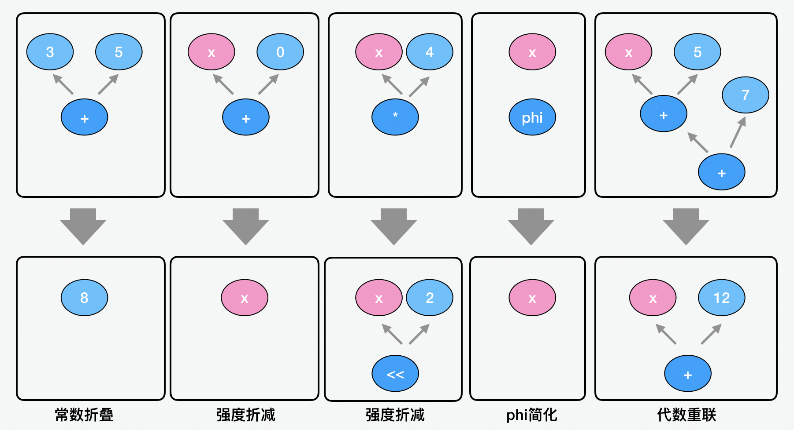

### 方案二：去重计算

在去重计算中，最常见的是值编号（value numbering）。意思就是在系统里把等于相同的值赋予同一个编号。比如当 sin、加法以及 LoadField 的运算的结果值是一样的时候，那么就只记录一次即可。

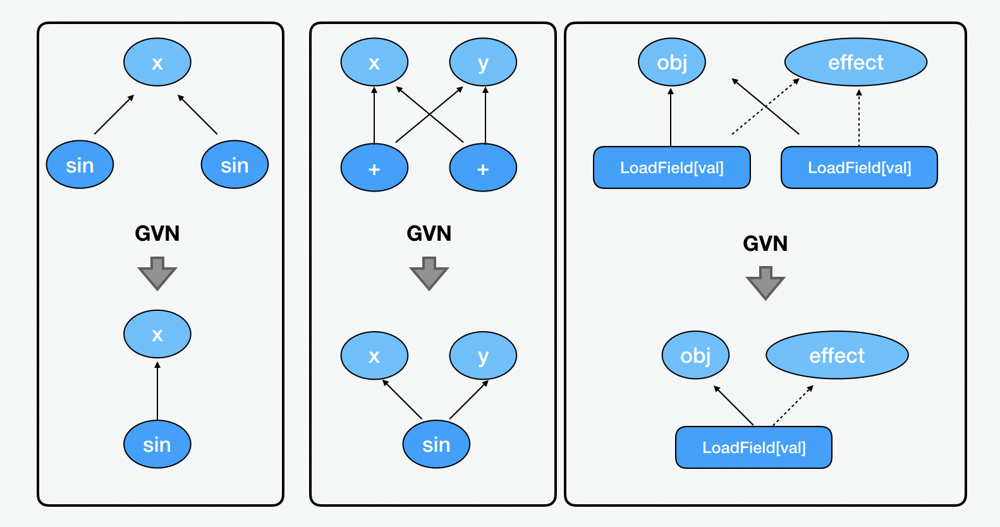

### 方案三：控制流优化

针对控制流，也有很多不同的优化方式。下面是几个例子，包含了分支折叠、合并折减、控制折减。通过这几个例子就可以看到，无论流程本身，还是流程中的分支和合并在优化后，都简化了很多。

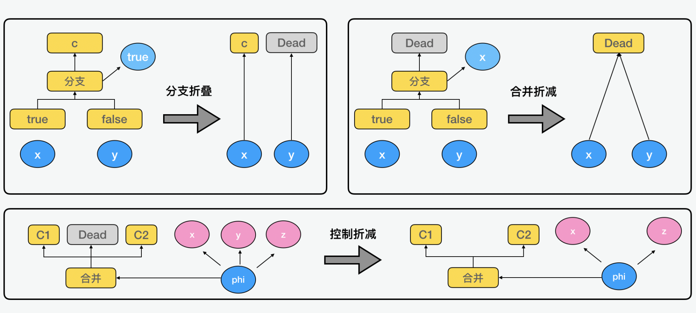

### Lowering：语言的层级

前面我们看到了，TurboFan 的 Tubolizer 会用不同颜色来表示不同类型的节点。包括代表值的浅蓝色节点、代表流程的黄色节点，以及代表运算的深蓝色语言节点，除了深蓝色以外，还有两种语言的节点，一种是上层的红色的 JavaScript 语言的节点，还有就是更接近底层的机器语言的绿色节点。基本上层级越高，对人来说可读性就越高；层级越低，则越接近机器语言。

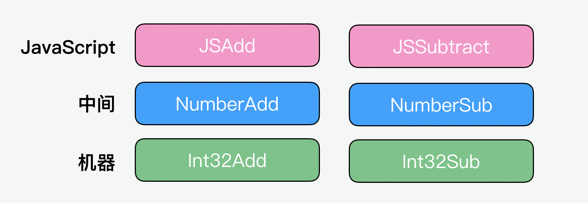

我们把这种由高到低的过程，叫做 lowering。所以优化的过程，也会是一个不断 lowering 折减的过程。

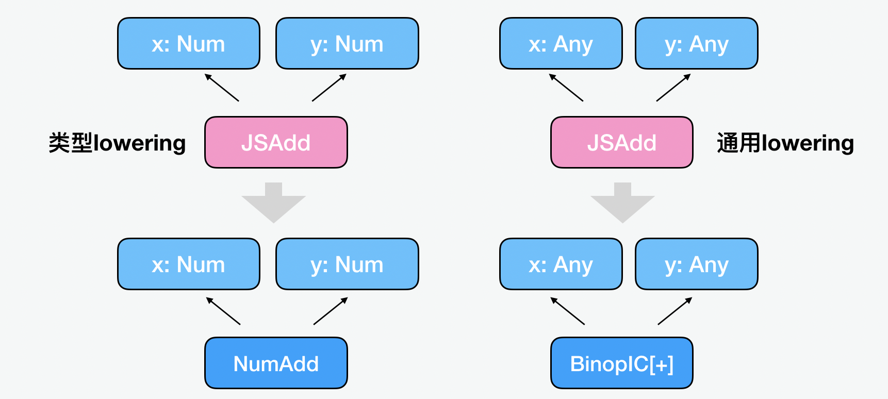

### 后端优化：指令和寄存

关于中端优化的部分先讲到这，下面我们再来看看后端优化，如何生成目标代码，涉及到寄存器分配和指令选择排序。

### 指令排序

先说说指令排序。SoN 节点之海最后排序的结果会被放入一个 CFG（Control Flow Graph）程序控制图。这里有三个概念，第一是控制支配，第二是减少寄存压力，第三是循环优化。

首先我们来看第一点，在这个过程中，首先是把固定的节点比如 phi、参数等都放到 CFG中。

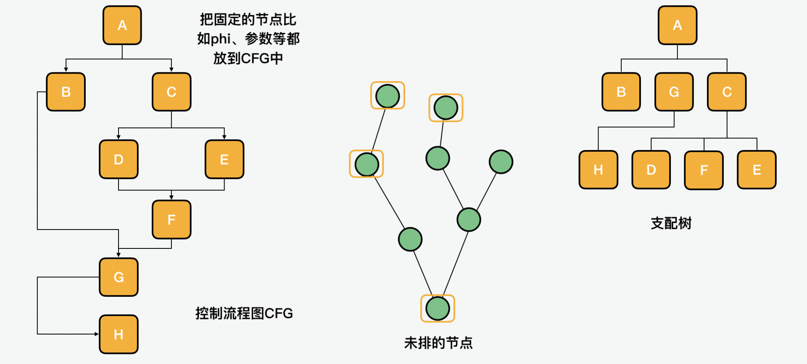

之后会用到支配树来计算支配关系，接着会把剩余的节点按照支配关系从 SoN 节点之海输出，输入到 CFG 程序控制图中。

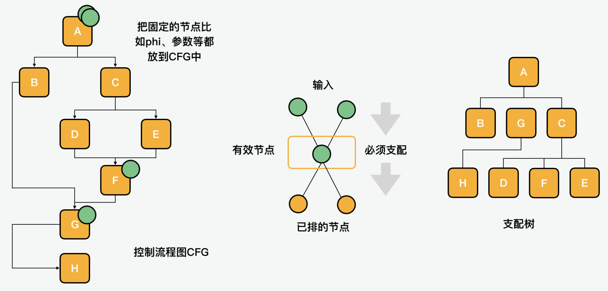

第二点，那么在编译过程中如何缓解寄存压力呢？我们前面说的 SSA 也是通过支配树来实现的。排序后，节点之海完全变成了一个程序控制图。

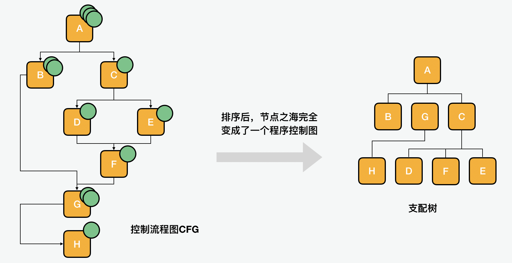

最后我们来看第三点，循环优化。在这个过程里尽量对循环中的代码做提升，这个过程叫做Loop Invariant Code Motion，也就是我们常说的 hoisting。你可能问这个过程在哪儿？其实这一步在分析优化的时候已经做了，在这里，只是纳入了优化后的结果。

### 指令选择

下面我们再来看看指令选择。从理论上讲，指令选择可以用最大吞噬。

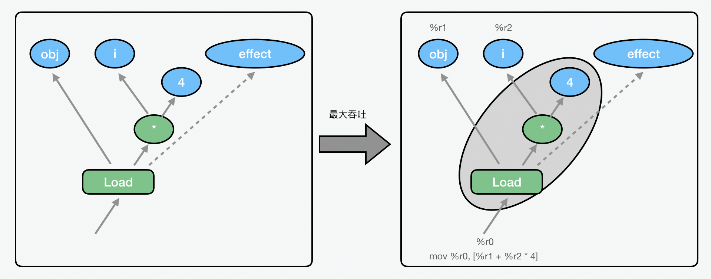

但是实际上指令选择的顺序，是从程序控制图中相反的顺序，也就是从基本块儿中自下而上地移动标的位置。

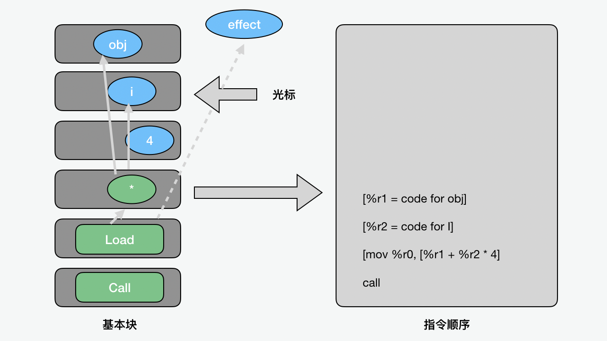

### 寄存器分配

前面，我们说过，在分析和优化结束后，在编译过程的后端，要最后生成机器码，这个过程中，一件主要的工作就是寄存器的分配。TurboFan 使用线性扫描分配器和实时范围分割来分配寄存器和插入溢出代码。SSA 形式可以在寄存器分配之前或之后通过显式移动进行解构。

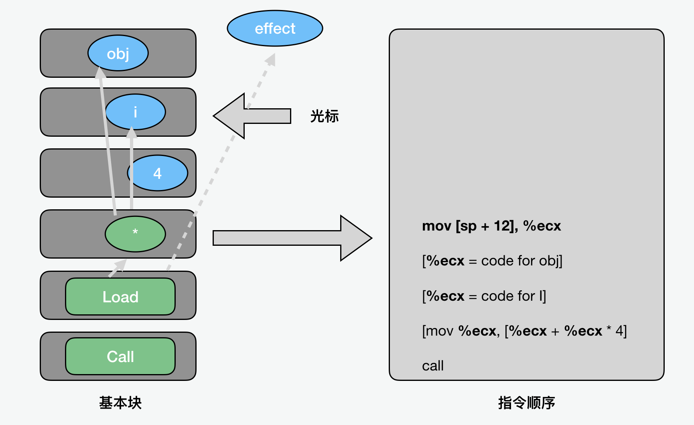

寄存器分配的结果是用真实寄存器代替虚拟寄存器的使用，并在指令之间插入溢出代码。

## 总结

这一讲可以算是比较硬核了，但是如果你能读到这里，证明你已经坚持下来了。从 V8 对节点之海的运用，我希望你不仅是了解了这种数据结构，更是对整个编译的流程有了更深入的理解。而且在这个过程中，我们也可以看到，我们写的代码在编译过程中最后被优化的代码不一定是一开始写的代码了。这既说明了我们在写代码的时候可以更关注可读性，因为我们没有必要为了机器会优化的内容而操心，从另外一个角度来看呢，有些开发者对性能有极度的追求，也可能写出更接近优化后的代码，但这样做是会牺牲一些可读性的。

## 思考题

如果你有用过 Java 的 Graal 会发现这个编译器的 IC 用的也是基于 SoN 的数据结构。那么你能说出 HotPot、Graal 以及 TurboFan 在 SoN 上的相同和不同之处吗？

期待在留言区看到你的分享，我们一起交流讨论。另外，也欢迎你把今天的内容分享给更多的朋友。我们下期再见！

## 参考

- TurboFan JIT Design by Ben L. Titzer from Google Munich
