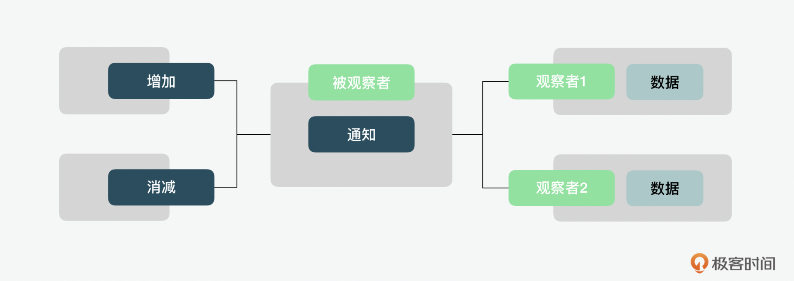
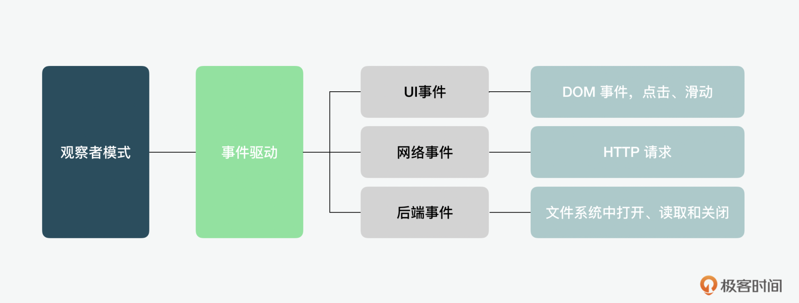
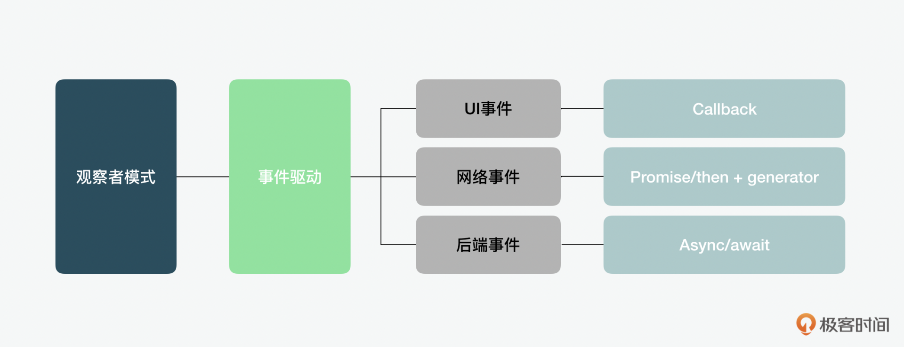
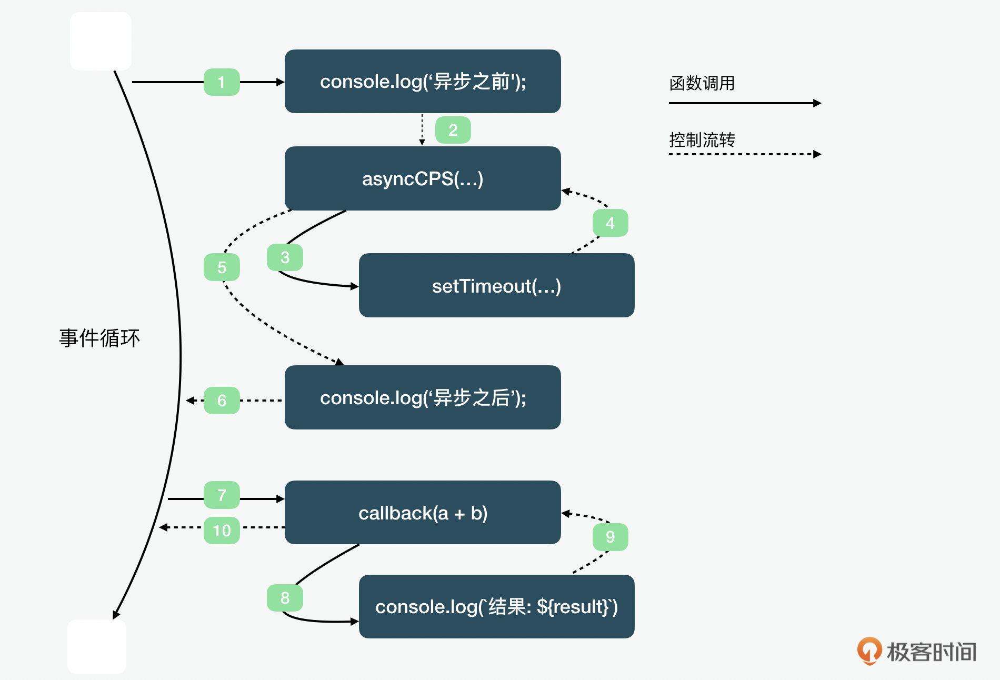
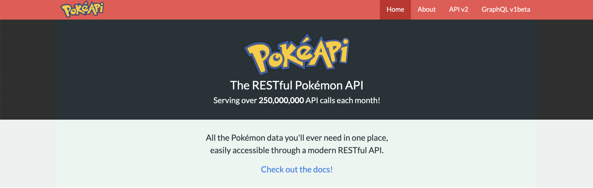

# 24-行为型：通过观察者、迭代器模式看JS异步回调

你好，我是石川。

说完了创建和结构型的设计模式，这一讲，我们来学习行为型的设计模式。我们前面说前端编程是事件驱动（event driven）的，之所以这么说，是因为前端编程几乎离不开用户和应用的交互，通常我们的程序会根据用户的屏幕点击或者页面滑动操作，而做出相应的反应。这一点从我们前面讲到的 React 和 Vue 的例子中也可以发现，响应式编程（reactiveprogramming）的思想对前端应用设计有着很强的影响。

今天我们会讲到行为型设计模式中的观察者模式，它是事件驱动在设计层面上的体现。通过这一讲的内容，你也可以更了解 JS 开发中事件驱动和异步的特性。

## 事件驱动

说到事件驱动，就离不开两个主要的对象，一个是被观察对象 change observable，一个是观察者 observer。被观察对象会因为事件而发生改变，而观察者则会被这个改变驱动，做出一些反应。



我们可以通过上图一个简单的例子来了解下这种模式。假设我们有两个观察者 1 和 2，它们的初始值分别是 11 和 21。observable 是被观察对象，这个时候如果被观察对象做出了增加 1的行为，观察者 1 和 2 的值就会更新为 12 和 22。下面我们可以看看它的实现，通常一个被观察者的实现是模版式的；而观察者则是根据不同的反应需求，来设计不同的逻辑。

```sql
class Observable {
 constructor() {
   this.observers = [];
 }
 subscribe(func) {
   this.observers.push(func);
 }
 unsubscribe(func) {
   this.observers = this.observers.filter(observer => observer !== func);
 }
 notify(change) {
   this.observers.forEach(observer => {observer.update(change);});
 }
}
class Observer {
 constructor(state) {
   this.state = state;
   this.initState = state;
 }
 update(change) {
   let state = this.state;
   switch (change) {
     case 'increase':
       this.state = ++state;
       break;
     case 'decrease':
       this.state = --state;
       break;
     default:
       this.state = this.initState;
   }
 }
}
// 使用
var observable = new Observable();
var observer1 = new Observer(11);
var observer2 = new Observer(21);
observable.subscribe(observer1);
observable.subscribe(observer2);
observable.notify('increase');
console.log(observer1.state); // 12
console.log(observer2.state); // 22
```

在这个事件驱动的案例里，用到的就是观察者（observer）模式。观察者模式是行为型模式当中的一种，并且算是出镜率最高的、被谈及最多的一种模式了，它是事件驱动在设计层面的体现。事件驱动最常见的就是 UI 事件了，比如有时我们需要程序根据监听触屏或滑动行为做出反应。除了 UI 事件驱动，还有两个事件驱动的场景使用频率非常高，就是网络和后端事件。



我们先说网络事件，这是观察者模式使用频率非常高的一个场景，原因是我们现在大多的应用都是通过 XHR 这种模式，动态加载内容并且展示于前端的，通常会等待客户端请求通过网络到达服务器端，得到返回的状态，然后再执行任何操作。这就需要我们通过观察者模式来订阅不同的状态，并且根据状态做出不同的行为反应。

另外一个场景是后端事件，比如在 Node.js 当中，观察者模式也是非常重要的甚至可以说是最核心的模式之一，以至于被内置的 EventEmmiter 功能所支持。举个例子，Node 中的“fs”模块是一个用于处理文件和目录的 API。我们可以把一个文件当做一个对象，那么当它被打开、读取或关闭的时候，其实就是不同的状态事件，在这个过程中，如果要针对这些不同的事件做通知和处理，就会用到观察者模式。

## 事件驱动和异步

我们前面说了观察者模式通常和事件驱动相关，那它和异步又有什么关系呢？

这个关系不难理解，一些计算机程序，例如科学模拟和机器学习模型，是受计算约束的，它们连续运行，没有停顿，直到计算出结果，这种是同步编程。然而，大多数现实世界的计算机程序都是异步的，也就是说这些程序经常不得不在等待数据到达或某些事件发生时停止计算。Web 浏览器中的 JavaScript 程序通常是事件驱动的，这意味着它们在实际执行任何操作之前会等待用户点击。或者在网络事件或后端事件中，也是要等待某个状态或动作才能开启程序运行。

所以回到上面的问题，观察者模式和异步的关系在于：事件就是基于异步产生的，而我们需要通过观察对基于异步产生的事件来做出反应。



JavaScript 提供了一系列支持异步观察者模式的功能，分别是 callback、promise/then、generator/next 和 aync/await。下面，让我们分别来看看这几种模式吧。

## Callback 模式

在 JavaScript 中，回调模式（callback pattern） 就是我们在一个函数操作完时把结果作为参数传递给另外一个函数的这样一个操作。在函数式编程中，这种传递结果的方式称为连续传递样式（CPS，continous passing style）。它表示的是调用函数不直接返回结果，而是通过回调传递结果。作为一个通用的概念，CPS 不代表一定是异步操作，它也可以是同步操作。下面，我们可以针对同步和异步分别来看一下。

### 同步 CPS

我们先来看看同步的 CPS。下面的这个加法函数你应该很容易理解，我们把 a 和 b 的值相加，然后返回结果。这种方式叫做直接样式（direct style）。

```javascript
function add (a, b) {
 return a + b;
}
```

那如果用 callback 模式来做同步 CPS 会是怎样呢。在这个例子里，syncCPS 不直接返回结果，而是通过 callback 来返回 a 加 b 的结果。

```javascript
function syncCPS (a, b, callback) {
 callback(a + b);
}
console.log('同步之前');
syncCPS(1, 2, result => console.log(`结果: ${result}`));
console.log('同步之后');
// 同步之前
// 结果: 3
// 同步之后
```

### 异步 CPS

下面我们再看看异步的 CPS。这里最经典的例子就是 setTimeout 了，通过示例代码，你可以看到，同样的，异步 CPS 不直接返回结果，而是通过 callback 来返回 a 加 b 的结果。但是在这里，我们通过 setTimeout 让这个结果是在 0.1 秒后再返回，这里我们可以看到在执行到setTimeout 时，它没有在等待结果，而是返回给 asyncCPS，执行下一个 console.log(‘异步之后’) 的任务。

```javascript
function asyncCPS (a, b, callback) {
 setTimeout(() => callback(a + b), 100);
}
console.log('异步之前');
asyncCPS(1, 2, result => console.log(`结果: ${result}`))
console.log('异步之后');
// 异步之前
// 异步之后
// 结果: 3
```

在上面的例子中，其函数调用和控制流转顺序可以用下图表示：



你可能会有疑问，就是在同步 CPS 的例子中，这种方式有没有意义呢？答案是没有。因为我们上面只是举个例子来看同步 CPS 是可以实现的，但其实如果函数是同步的，根本没有用CPS 的必要。使用直接样式而不是同步 CPS 来实现同步接口始终是更加合理的实践。

### 回调地狱

在 ES6 之前，我们几乎只能通过 callback 来做异步回调。举个例子，在下面的例子中，我们想获取宝可梦的 machineInfo 机器数据，可以通过网上一个公开的库基于 XMLHttpRequest 来获取。



需要基于这样一个链条 pockmon=>moveInfo=>machineInfo。

```javascript
(function () {
 var API_BASE_URL = 'https://pokeapi.co/api/v2';
 var pokemonInfo = null;
 var moveInfo = null;
 var machineInfo = null;
 var pokemonXHR = new XMLHttpRequest();
 pokemonXHR.open('GET', `${API_BASE_URL}/pokemon/1`);
 pokemonXHR.send();
 pokemonXHR.onload = function () {
   pokemonInfo = this.response
   var moveXHR = new XMLHttpRequest();
   moveXHR.open('GET', pokemonInfo.moves[0].move.url);
   moveXHR.send();
   moveXHR.onload = function () {
     moveInfo = this.response;
     var machineXHR = new XMLHttpRequest();
     machineXHR.open('GET', moveInfo.machines[0].machine.url);
     machineXHR.send();
     machineXHR.onload = function () { }
   }
 }
})();
```

你可以看到，在这个例子里，我们每要获取下一级的接口数据，都要重新建立一个新的 HTTP请求，而且这些回调函数都是一层套一层的。如果是一个大型项目的话，这么多层的嵌套是很不好的代码结构，这种多级的异步嵌套调用的问题也被叫做“回调地狱（callback hell）”，是使用 callback 来做异步回调时要面临的难题。 这个问题怎么解呢？下面我们就来看看 promise和 async 的出现是如何解决这个问题的。

## ES6+ 的异步模式

自从 ES6 开始，JavaScript 中就逐步引入了很多硬核的工具来帮助处理异步事件。从一开始的 Promise，到生成器（Generator）和迭代器（Iterator），再到后来的 async/await。回调地狱的问题被一步步解决了，让异步处理重见阳光。下面，我们从 Promise 开始，看看这个问题是怎么一步步被解决的。

### Promises

自从 ES6 之后，JavaScript 就引入了一系列新的内置工具来帮助处理异步事件。其中最开始的是 promise 和 then. 我们可以用 then 的连接方式，在每次 fetch 之后都调用一个 then 来进行下一层的操作。我们来看这段代码，这里减少了很多 XMLHttpRequest 的代码，但是仍然没有脱离一层层的调用。所以这种代码也不优雅。

```javascript
(function () {
 var API_BASE_URL = 'https://pokeapi.co/api/v2';
 var pokemonInfo = null;
 var moveInfo = null;
 var machineInfo = null;
 var showResults = () => {
   console.log('Pokemon', pokemonInfo);
   console.log('Move', moveInfo);
   console.log('Machine', machineInfo);
 };
 fetch(`${API_BASE_URL}/pokemon/1`)
 .then((response) => {
   pokemonInfo = response;
   fetch(pokemonInfo.moves[0].move.url)
 })
 .then((response) => {
 moveInfo = response;
 fetch(moveInfo.machines[0].machine.url)
 })
 .then((response) => {
 machineInfo = response;
 showResults();
 })
})();
```

### 生成器和迭代器

那么怎么才能像同步的方式一样来执行异步的调用呢？在 ES6 版本中，在引入 Promise 和then 的同时，也引入了生成器（Generator）和迭代器（Interator）的概念。生成器是可以让函数中一行代码执行完后通过 yield 先暂停，然后执行外部代码，等外部代码执行中出现 next时，再返回函数内部执行下一条语句。是不是很神奇！这个例子中的 next 其实就是行为型模式中的迭代器模式的一种体现。

```javascript
function* getResult() {
   var pokemonInfo = yield fetch(`${API_BASE_URL}/pokemon/1`);
   var moveInfo = yield fetch(pokemonInfo.moves[0].move.url);
   var machineInfo = yield fetch(moveInfo.machines[0].machine.url);
}
var result = showResults();
result.next().value.then((response) => {
   return result.next(response).value
}).then((response) => {
   return result.next(response).value
}).then((response) => {
   return result.next(response).value
```

### async/await

但是使用 next 也有问题，就是这样的回调链条也会非常的长。意识到了 promise/then 的问题后，在 ES8 的版本中，JavaScript 又引入了 async/await 的概念。这样，每一次获取信息的异步操作如 pokemonInfo、moveInfo 等都可以独立通过 await 来进行，写法上又可以保持和同步类似的简洁性。下面，我们来看看：

```javascript
async function showResults() {
 try {
   var pokemonInfo = await fetch(`${API_BASE_URL}/pokemon/1`)
   console.log(pokemonInfo)
   var moveInfo = await fetch(pokemonInfo.moves[0].move.url)
   console.log(moveInfo)
   var machineInfo = await fetch(moveInfo.machines[0].machine.url)
   console.log(machineInfo)
 } catch (err) {
   console.error(err)
 }
}
showResults();
```

## 总结

今天，我带你通过观察者和迭代器等模式了解了异步编程的设计模式。可以说事件驱动、响应式编程、异步编程包含了 JavaScript 中很大一部分设计模式的核心概念。所以这篇文章虽然篇幅不大，但是确实是了解和应用 JavaScript 的核心非常重要的内容。

当然，异步编程是一个很大的话题，我们今天一次也讲不完，后面我们还会用一讲内容继续来看异步中的并行和串行开发，并且在讲到多线程的时候，我们会更深入理解异步的实现逻辑。

## 思考题

最后给你留一道思考题，前面我们说 CPS 就是回调，那反之，我们可以说回调就是 CPS吗？

欢迎在留言区分享你的答案、交流学习心得或者提出问题，如果觉得有收获，也欢迎你把今天的内容分享给更多的朋友。我们下期再见！
