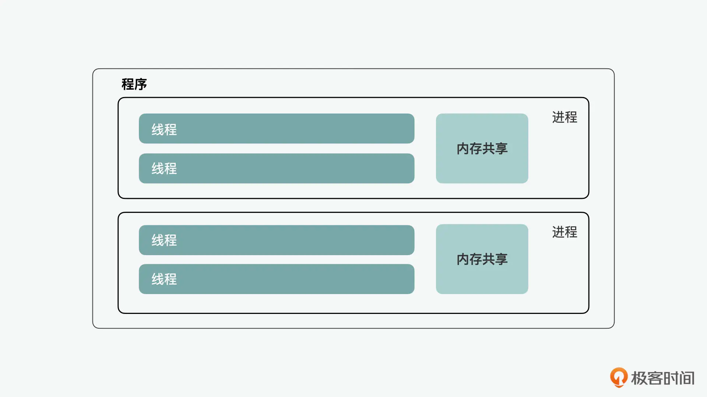
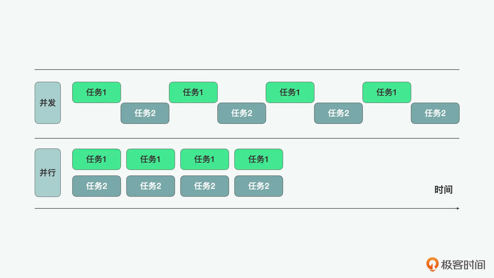
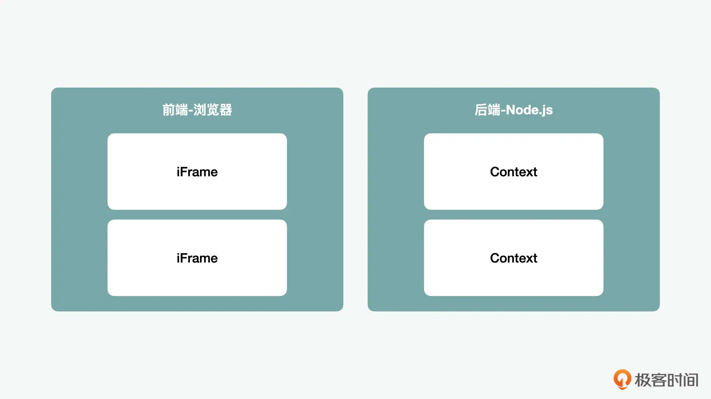
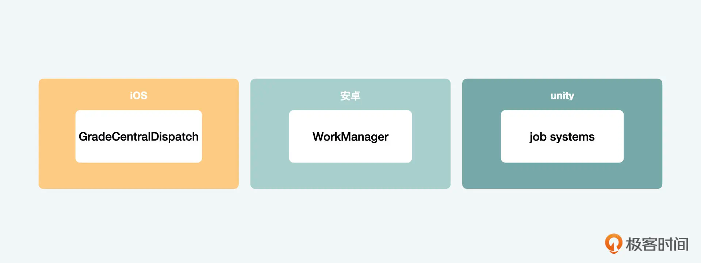
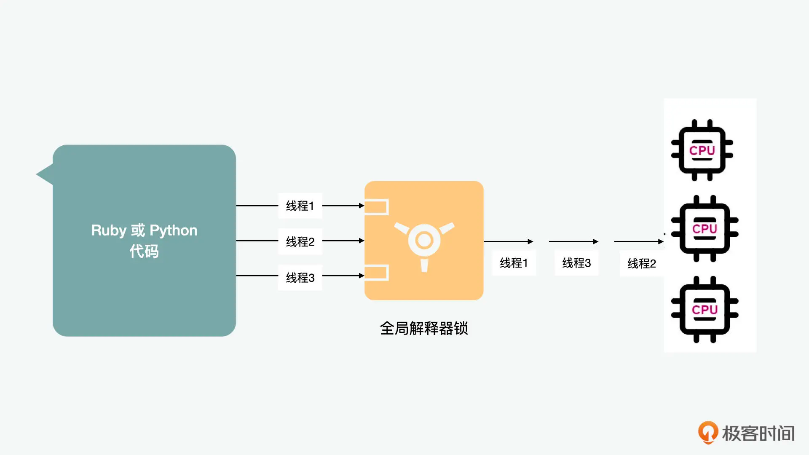
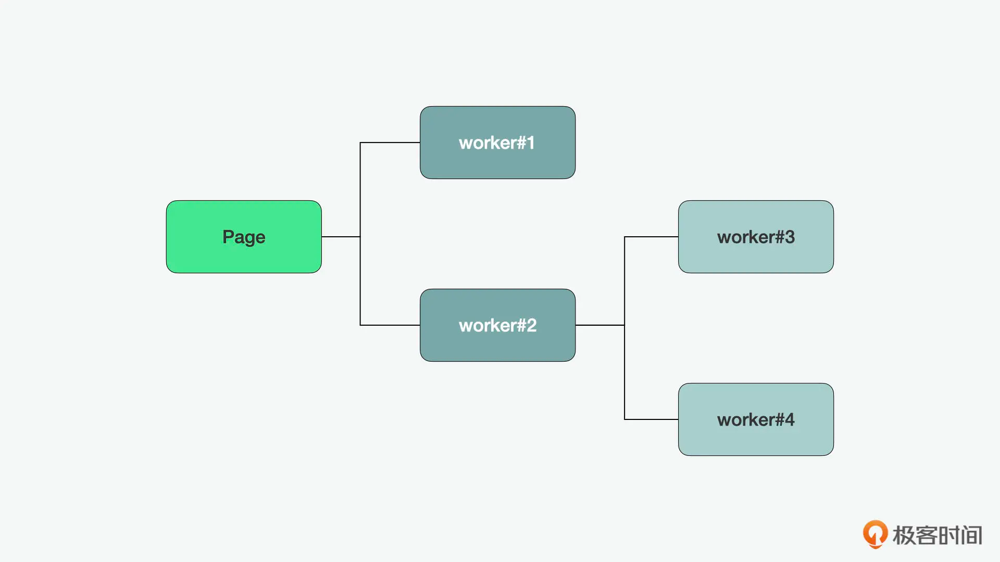
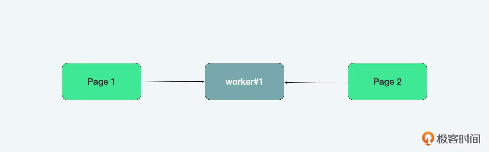
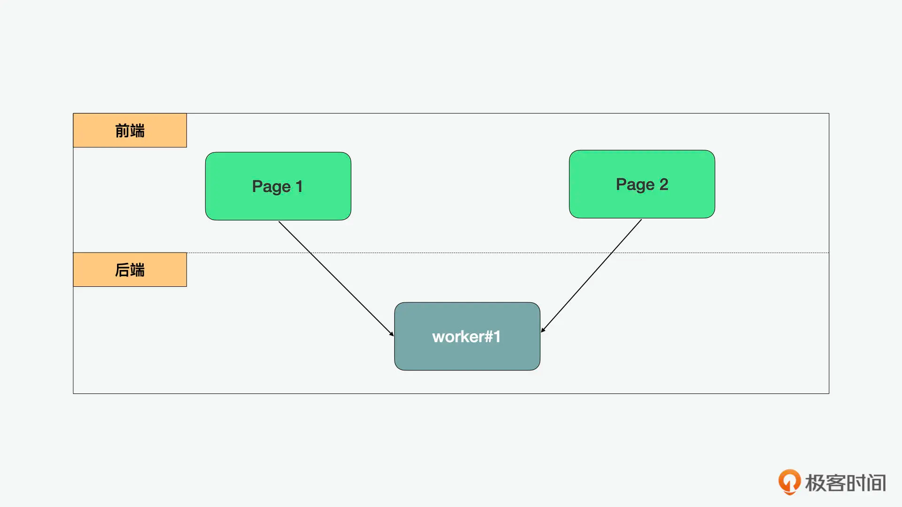

# 27 | 性能：如何理解JavaScript中的并行、并发？（上）

你好，我是石川。

在上一个单元，我们在 JS 之道的编程模式和 JS 之法的语法、算法的基础上，又学习了 JS 之术的设计模式，从今天开始，我们将开启 JS 之术非功能性优化篇。从前面的学习中，我们可以看到，无论是编程模式、算法还是设计模式都不是独立存在，而是一环扣一环的。那我们今天要讲到的并行、并发，其实也是延续上一讲提到的异步编程模式。

所以，今天，就让我们了解下并行、并发和异步编程的关系，以及多线程开发在 JS 中的实现。

## 线程 vs 进程、并行 vs 并发

在说到 JavaScript 中的并发和并行前，我们先来看看程序、线程和进程之间的关系。在一个程序当中，可以有多个进程。在一个进程里，也可以有多个线程。内存在进程间是不共享的，而在线程里，是可以共享的。通过下图，你可以有更直观的理解。



并发是同一时间段进行的任务，而并行是两个在同一时刻进行的任务。除非是多核 CPU，否则如果只有一个 CPU 的话，多线程本身并不支持并行，而只能通过线程间的切换执行来做到并发。从下图中，你可以对并发和并行有更直观的认识。



## 前后端语言如何支持线程并行开发

如果单从语言的层面来看，JavaScript 本身没有线程的规范，也没有内置的对外暴露给开发者用来创建线程的接口。所以 JavaScript 本身的执行是单线程的，也就是说 JavaScript 的执行环境中只有一个虚机、指令指针和垃圾回收器。即使是在不同的 realms 中，如浏览器端不同的 iframe 或服务器端不同的 context 中，也都只有一条 JavaScript 指令在同一时间内执行。以此我们可以看出，JavaScript 本身并不是多线程友好的。



这一点和其它的前端语言很不同，我们知道在 iOS、安卓和 unity 的开发中，开发者分别有GradeCentralDispatch、WorkManager 和 Job System 这些支持并行开发的强大工具包。之所以这些语言不仅支持多线程，还助力并行的开发，是因为这些语言所编写的程序都和前端用户有深度的交互。特别在 unity 的例子里，需要大量的 3D 运算，所以必须非常重视性能，让应用快速地做出响应。JavaScript 同样作为前端语言，在这方面对比其它的前端语言显得有些不足。



和前端不同，在很多的后端高级语言，如 Ruby 或 Python 中，无论 CPU 是单核还是多核，线程都是被全局解释器锁（GIL，global interpreter lock）限制并行的，而只支持并发。所以在做多线程开发的时候，一定要注意并行是否受限制，因为如果并行受限，只允许并发的话，那么线程间切换的成本可能高于它带来的好处。在 JavaScript 的环境中，并没有限制线程的 GIL锁，但是 JS 也有自己的限制，就是它会限制对象在线程间直接的共享，所以这从某个角度来讲也影响了线程在前端的使用。



## JavaScript 中的多线程并行开发

从上面的例子中，我们可以看到，前端语言对线程和并行的支持，总体要优于后端。而JavaScript 虽然自带函数式编程的支持，而且在这几年加强了响应式编程的设计思想，但是在多线程和并行开发方面的能力还是有缺失的，但是这并不代表多线程在前端完全不能实现。下面，我们就来看看并行开发在 JavaScript 中实现的可能性。

### JavaScript 中的异步

先思考一个问题，为什么我们在开篇说并行开发和异步编程相关呢？因为近些年中，JavaScript 中大多数的所谓“多任务处理”，都是通过将任务拆分成任务单元后异步执行的。这些不同的任务可以被看做是某种“并发”。

这里的任务拆分，就是通过我们上节讲过的事件 callback 回调和 promise，将任务分成异步的任务单元。即使是 await，底层用的也是 callback 回调。除了网络，我们上一讲说的用户事件和 timeout 等也是同样的任务拆分原理。既然是异步回调，我们知道这种 callback 带来的并发并不是并行的，也就是说当回调中的代码在执行的时候，是没有其它代码在执行的。换句话说，在异步的场景中，同一时间只有一个调用栈。

我们说在前端的体验中，最重要的是流畅度（smoothness）和响应度（responsiveness）。那这两个度如何量化呢？

一般响应度衡量的是我们的程序能不能在 100ms 之内反应，而流畅度衡量的是每秒 60 帧（fps）的渲染。所以 1000ms 除以 60 帧，也就是说我们有约 16.6ms 来渲染每一帧，这个16.6ms 在前端叫做帧预算。但实际这些工作都是浏览器做的，作为实际的开发者，我们的核心工作是监测用户对页面元素的行为、触发事件、运行相关的事件处理器、对样式进行计算、渲染布局等。

在之前的响应式编程和设计模式中，我们花了大量的时间学习了如何通过异步的方式和分段渐进的方式，让应用“并发”处理一些任务，从而更快地响应和按需渲染，这些优化也只能从一定程度上解决性能上的问题。因为浏览器的 UI 主线程是帧同步（lock step）的，就如前面所说，也就是说只有一个 JavaScript 指令结束后，下一个指令才能执行，所以异步也是有成本的，再加上不同浏览器可能会有不同程度的支持，所以响应和渐进式的设计只能解决一部分性能问题。也就是说响应和渐进式仍然是在串行的基础上操作，而不是在并行的基础上实现的。

### JavaScript 中用 Web Worker 支持并行

而要真正做到并行开发，实现质的变化，就要用到 WebWorker。它可以打破帧同步，允许我们在和主线程并行的工作线程上执行其它的指令。这里你可能会有疑问，我们前面不是说JavaScript 不支持多线程吗？那为什么这里又出现了支持的 Web Worker 了？这是因为和其它语言不同的是，JavaScript 确实没有一个统一的线程实现。

我们知道的 Chrome、Safari 和 FireFox 等浏览器都有自己的虚机来实现 JavaScript。这和我们在前端用到的文件系统、网络、setTimeout、设备等功能一样，都是由嵌入环境的 Node 或浏览器虚机提供，而不是语言本身提供的。所以多线程的接口也是一样，也是由浏览器提供的。而浏览器或虚机提供的支持多线程的 API 就是 Web Worker。它是由万维网联盟（W3C）和网页超文本应用技术工作小组定义（WHATWG）而不是 TC39 定义的。

要创建一个 Web Worker 非常简单，我们只需要类似下面的一个 new 语句。之后，如果可以通过 postMessage 在 main.js 和 worker.js 之间传递信息，双方也可以通过 onMessage 来接收来自对方的消息。

```javascript
// main.js
var worker = new Worker('worker.js');
worker.postMessage('Hello world');
worker.onmessage = (msg) => {
 console.log('message from worker', msg.data);
}
// worker.js
self.onmessage = (msg) => {
 postMessage('message sent from worker');
 console.log('message from main', msg.data);
}
```

在 JavaScript 中，有几种不同的工作线程，分别为 dedicated worker、shared worker 和service worker。我们可以分别来看看它们的作用。这里我们先来看看 dedicated worker。

dedicated worker 只在一个 realm 中可以使用。它也可以有很多的层级，但是如果层级过多，可能会引起逻辑的混乱，所以在使用上还是要注意。



和 dedicated worker 相对的是 shared worker，顾名思义，如果说 dedicated 是专属的，那么 shared 则是可共享的，所以 shared worker 可以被不同的标签页、iframe 和 worker 访问。但 shared worker 也不是没有限制，它的限制是只能被在同源上跑的 JavaScript 访问。在概念上，shared worker 是成立的，但是目前支持 shared worker 的虚机或浏览器非常少，并且几乎没法 polyfill，所以在这里我们就不做深入的讲解了。



最后，我们再来看看 service worker，它既然叫做服务，那就和后端有关。它的特点就是在前端的页面都关闭的情况下，也可以运行。我们之前一讲提到响应式设计模式的时候，说过的预缓存和服务器推送等概念，离不开 service worker 的身影。它可以在首次收到浏览器请求时将加载的和可以缓存的内容一同推送给前端做预缓存，当前端再次发起请求时，可以先看是否有缓存，只有在没有的情况下，再从服务端请求。通过这种模式，我们可以大大提高 Web 应用的性能。



## 信息传递模式

JavaScript 要实现多线程的并行开发，最核心的就是要做到信息在主线程和工作线程间的交互，下面我们就来看看如何通过 Web Worker 定义和 JS 引擎提供的接口做到这一点。

### 结构化拷贝算法

JavaScript 的设计是帧同步（lock step）的，也就是说在 main.js 所运行的 UI 主线程上，同时只有一个 JavaScript 指令可以执行。这样做是为了让前端能把重点放在渲染和用户交互的工作上，而不需要将太多的精力放在和 Worker 的互动上。但这样的设计也带来一些弊端，比如JavaScript 的虚机设计通常不是线程安全（thread safe）的。一个线程安全的数据结构可以在Worker 间共享，通过互斥锁（mutex），可以保证不同线程同时访问修改一个数据的时候可以避免竞争条件（race condition）引起的副作用。

而因为在 JavaScript 的虚机是非线程安全的，也不存在互斥锁。所以为了数据的安全，对象数据在 Worker 间是不共享的。如果说数据是不能共享的，那我们之前看到的 postMessage中，数据在 JavaScript 的环境中主线程和工作线程间为什么能传递呢？

这是因为在前面 postMessage 例子中的信息传递，不是直接的访问，而是通过先拷贝再传递的方式。这里使用到的一个拷贝算法就是类似我们之前说到的深拷贝，也叫做结构化拷贝（structured clone）。也就是说我们想要通过 worker.js 来直接访问和控制 UI 主线程中的main.js 中的数据是不可能的。这种通过结构化的拷贝，让 main 和 Worker 能在环境之间通信的方法，叫做信息传递（message passing）。

### 请求和反馈模式

在我们前面讲到的 hello world 的例子中，传递的只是字符串，这么看来可能也没什么问题。但是当我们要传递更复杂的数据结构时，就会出现问题了。

比如如果我们需要传递的是下面这样一个带有参数的函数调用，在这个时候，我们需要先将函数调用转化为一个序列，也就是一个对应的是我们的本地调用远程过程调用，叫做 PRC（Remote Procedure Call）。基于 postMessage 异步的特性，它返回的不是一个结果，而是一个 await 的 promise。

```
isOdd(3);
is_odd|num:3
worker.postMessage('is_odd|num:3');
worker.postMessage('is_odd|num:5');
worker.onmessage = (result) => {
 // 'true'
 // 'false'
};
```

也就是说，在 worker.js 做完计算之后，会将结果返回。这时，会有另外一个问题，就是如果我们有很多个不同的请求，怎么能知道返回的结果和请求的对应关系呢？

为了解决这个问题，我们可以用 JSON 格式的 JSON-PRC。结构化拷贝算法支持除了Symbol 以外的其它类型的原始数据，这里包含了布尔、null、undefined、数字、BigInt 和我们用到的字符串。结构化拷贝算法也可以支持多种的数据结构，包括数组、字典和集合等。还有就是用来存储二进制数据的 ArrayBuffer、ArrayBufferView 和 Blob 也可以通过postMessage 传递。ArrayBuffer 也可以解决数据传递中性能的问题，但是函数（function）和（class）类是不能通过 postMessage 来传递的。

```
// worker.postMessage
{"jsonrpc": "2.0", "method": "isOdd", "params": [3], "id": 1}
{"jsonrpc": "2.0", "method": "isEven", "params": [5], "id": 2}
// worker.onmessage
{"jsonrpc": "2.0", "result": "false", "id": 2}
{"jsonrpc": "2.0", "result": "true", "id": 1}
```

### 命令和派发模式

上面我们看到了请求和反馈间的映射，下面，我们再来看看命令和派发的映射。比如我们有两个功能，一个是判断奇数，另外一个是判断偶数，但是这两个数据是在两个不同代码路径上的，这个时候，我们也需要某种方式的映射。这里可以使用字典，或者更简单的对象结构也能够支持指令中这种映射关系。这种通过开发者自己实现的一个来保证指令派发的逻辑就叫做command dispatcher 模式。

```javascript
var commands = {
 isOdd(num) { /*...*/ },
 isEven(num) { /*...*/ }
};
function dispatch(method, args) {
 if (commands.hasOwnProperty(method)) {
   return commands[method](...args);
 }
 //...
}
```

通过上述结构化拷贝算法，再加上请求和反馈，以及命令和派发模式，就可以通过 JS 引擎提供的 Web Worker 接口，在主线程和工作线程间实现信息的传递了。

## 总结

今天，我们了解了线程和进程、并行和并发的区别，也对比了前后端的不同语言对多线程并行开发的支持。针对 JavaScript，我们也看到了多线程开发中核心的信息传递机制，包括结构化拷贝算法，以及基于 postMessage 自身的不足，如何通过 JSON-RPC 和 command dispatch的方式来解决相关的问题。

## 思考题

这道思考题也是下一讲的铺垫。我们课程中说，在信息传递层面，我们可以使用 ArrayBuffer来提高性能，你知道它是如何做到的以及背后的原理吗?

欢迎在留言区分享你的答案、交流学习心得或者提出问题，如果觉得有收获，也欢迎你把今天的内容分享给更多的朋友。我们下节课再见！
