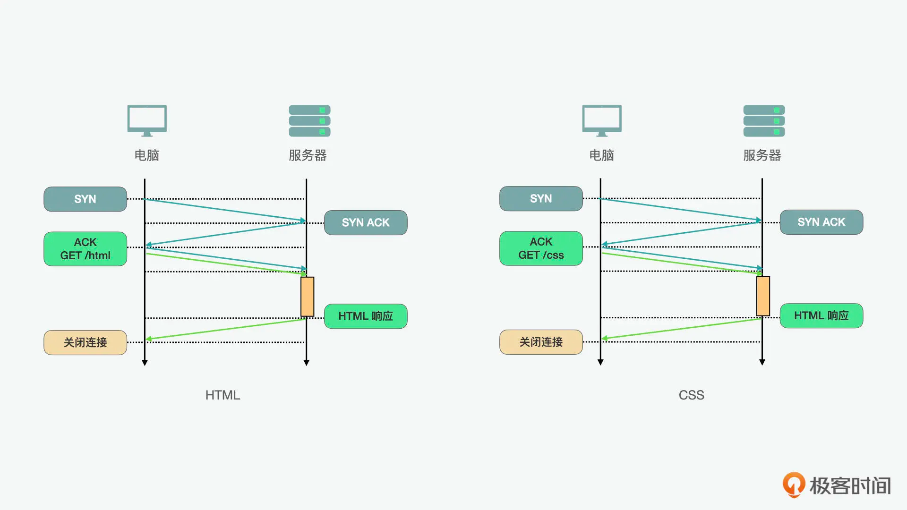
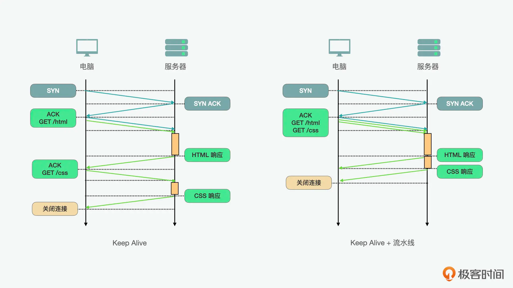
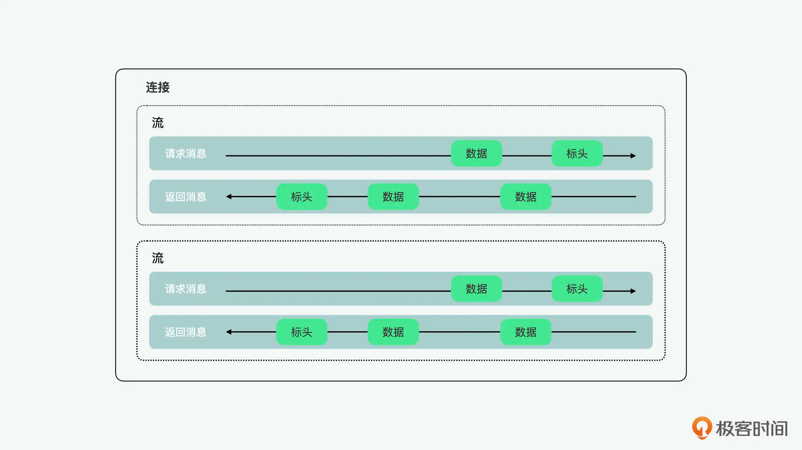
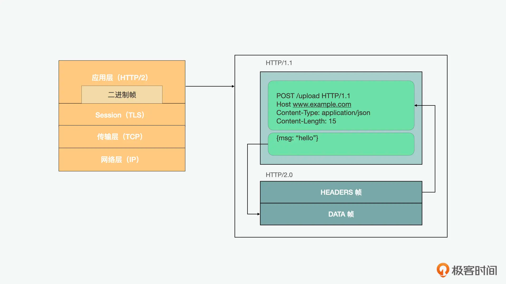
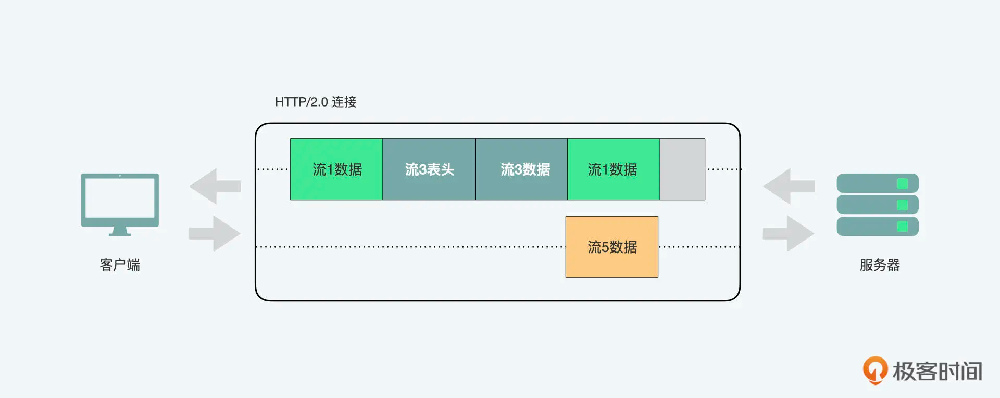
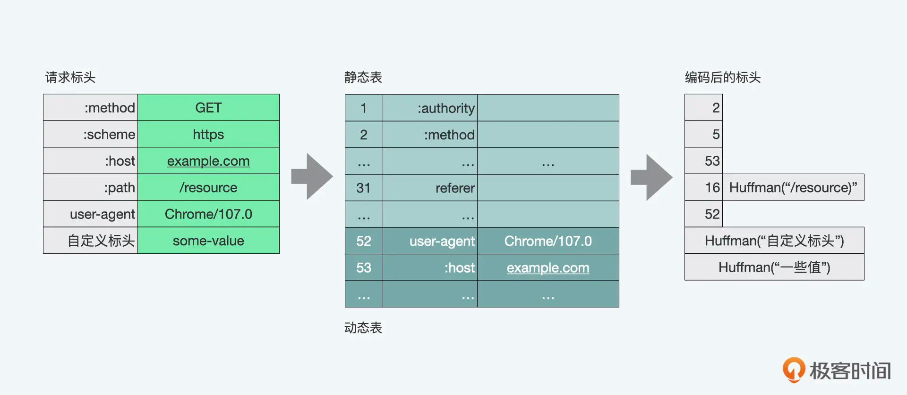
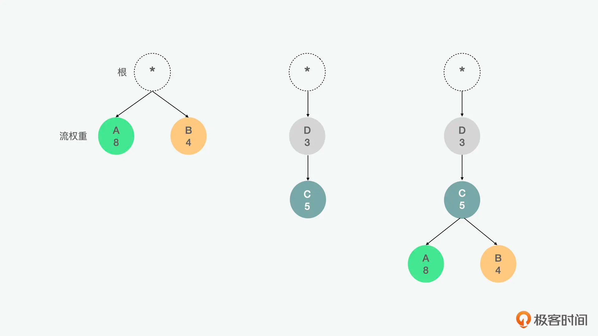
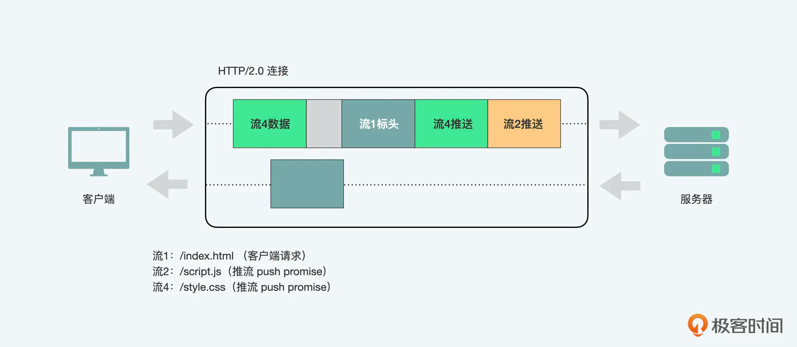
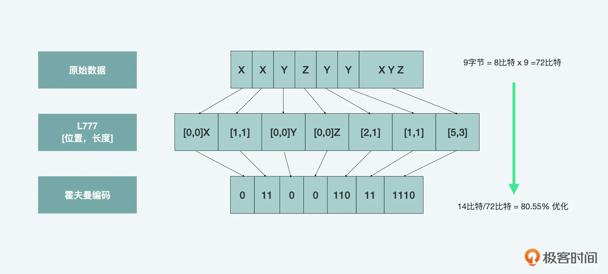

# 30 | 网络：从HTTP-1到HTTP-3，你都需要了解什么？

你好，我是石川。

说到 HTTP 你可能并不陌生，但是你真的确定你对它有所了解吗？或者你可能会觉得了解它对前端开发没什么用。但实际上，对 HTTP 的理解可以帮助我们更好地制定前端应用层性能优化的策略。

所以今天，我们就来看看不同的 HTTP 版本。对于 HTTP/1 的不足之处，我们能做哪些优化；对于 HTTP/2 的优点，我们如何加以利用；对于 HTTP/3，我们又可以有哪些期望。下面，我们就先从 HTTP 的前世今生开始说起吧。

## HTTP/1.0

HTTP 最早的版本是 1991 年由万维网之父蒂姆·伯纳斯 - 李（Tim Berners-Lee）定义的，这个 HTTP/0.9 的版本起初只有一页纸一行字的描述。HTTP/0.9 仅支持 GET 方法，仅允许客户端从服务器检索 HTML 文档，甚至都不支持任何其他文件格式或信息的上传。

之后的 HTTP/1 是从 1992 年开始草拟到 1996 年定版的，这个版本的协议就包含了更多的我们如今耳熟能详的元素和功能，比如我们常用的 headers、errors、redirect 都是在这个版本中出现了。但是它仍然有几个核心问题：一是没有办法让连接在不同请求间保持打开；二是没有对虚拟服务器的支持，也就是说在同一个 IP 上没有办法搭建多个网站；三是缺乏缓存的选项。

时隔半年，紧跟其后出现的就是 HTTP/1.1，它的出现解决了上述问题。但是相比互联网的使用者日益增加和 Web 应用的不断兴起，HTTP 的标准在之后的近二十年里却几乎止步不前。在这期间，一些瓶颈没有得到进一步的解决，造成的问题日益凸显。

这些性能上的瓶颈可以归为几个方面：

- 延时，也就是一个 IP 包从一点到另外一点间的时长。而且当我们考虑往返时间（RTT）的时候，要计算两倍的延时；一个 HTTP 请求又可能都包含多个往返时间，这时延时会进一步增加。

- 带宽，这就好比我们每天开车的路一样，车道越窄，车流越大，越有可能造成阻塞，而多车道的道路，通常会减少通勤时间。

- 连接时间，一次网络连接要经过三次握手，第 1 次是客户端对服务器端发起的同步请求，第 2 次是服务器发给客户端的获知，第 3 次是客户端发给服务器端的获知。

- TLS 协商时间，这个是为了建立 HTTPS 的安全连接所需要的在三次握手基础上的额外处理时间。

与此同时，开发者就想出了一系列的“曲线救国”的方案。这里包含了利用 HTTP 的流水线，使用域名分片，捆绑资源以减少 HTTP 请求，内联较小的资源等等。下面，我们可以看看在这一时期，人们所使用的一些性能优化方案。

### 持久 HTTP 加流水线

首先我们来看看持久 HTTP 加流水线的方案。在下面的例子里我们看到，如果前端想要请求HTML 和 CSS 这两个资源，在先后请求的情况下，我们要建立两次连接。每次 3 次握手的话，两次请求就是一共 6 次握手。显然这么操作是很费时的。

持久 HTTP（Keep Alive）允许我们在多个应用程序请求之间重用现有连接。通过对持久HTTP 的使用，我们可以减少握手的时间。但它仍然不是最优解，因为使用持久 HTTP，也就意味着客户端上有严格的先入先出（FIFO）排队顺序，第一个请求先发送，等待完整响应，然后再发起下一个请求。从下图（左），我们可以看到它的流程。

为了能更进一步优化，HTTP 流水线则可以在持久 HTTP 的工作流上做一个优化，也就是将FIFO 队列从客户端（请求队列）改到服务器（响应队列）。从上图（右）中，我们可以看出它的流程。对比在左图中持久 HTTP 的例子，CSS 的请求要等到 HTML 的请求返回后再进行；而在右图 HTTP 的工作流的例子中，我们可以看到两个请求可以同时进行。这就进一步大大减少了总时长。

但是在使用持久 HTTP 加流水线的时候，因为连接是一直开放的，要特别注意安全性，使用HTTPS 的连接。在一些实际的案例中，比如苹果的 iTunes 就通过这种方式提高了应用的性能。

### 域名分片

另外一个非常常见的在 HTTP/1.1 时代的性能优化方案是域名分片，它的核心是通过建立更多的子域名来对资源进行加载。为什么要这么做呢？

我们可以以高速公路为例，在 HTTP/1.1 中，一个主机只能有 6 个 TCP 连接，也就相当于 6车道。当我们想在同一时间让更多的资源加载，就可以创建多个主机，这样就可以有更多的TCP 连接。比如我们如果有 3 个子域名，就是 3 乘以 6，等于 18 条车道，这样在同一时间就有更多的资源可以加载。但是这个方案也不是一劳永逸的，每个新的主机名都需要额外的DNS 查找，为每个额外的 socket 消耗额外资源，而且需要开发手动管理资源的分片位置和方式。所以在使用的时候还是要综合考虑。

### 捆绑资源以减少 HTTP 请求

另外一个 HTTP/1.1 时代的科技与狠活儿就是资源捆绑，在图片层面使用的是 CSS 精灵（CSS sprite），JS 或 CSS 类的文件则用的是打包的技术。CSS 精灵的实现是将不同的图片元素整合在一张图加载，通过 CSS 控制显示的位置。JS 或 CSS 类的文件打包就是将不同的CSS 和 JS 文件打包成一个，来减少请求。

同样的，这些方法有利有弊，这样的优化虽然减少了请求和返回的数量，但是同时也造成了一些问题。比如捆绑后的资源可能并不是在当前页面都受用的，这样就可能造成资源的浪费。所以，在使用这种优化方案的时候，也要结合实际场景考虑。

### 内联较小的资源

最后，我们再来看看内联。使用数据 URI，我们可以在页面对较小的资源做内联。这样，可以减少请求的数量。同样，这种方式是一把双刃剑，如果什么资源都加载到页面里，也会增加一次性加载的负担。所以通常的最佳实践是 1~2KB 大小的数据，可以用这种方式来内联，但是如果是过于大的资源，则不适合用这种方式了。

## HTTP/2.0

说完了 HTTP/1.1 时代的历史和性能优化，下面，我们再来看看 HTTP/2.0 时代。你可能会问，为什么 HTTP 在 1.1 版之后，这么长时间都没有什么变化呢？这是因为它的升级成本太高了，要考虑到浏览器、服务器、代理，还有其它的中间件都需要协调才能完成切换，这就代表着各种兼容性问题可能会导致应用的服务中断。所以整个行业没有什么动力去推动改革。

但是在 2009 年的时候，谷歌的两位工程师 Mike Belshe 和 Roberto Peon 提出了一个HTTP/1.1 的替代方案，叫做 SPDY，谐音就是 speedy，也就是速度的意思。SPDY 起初并没有要替代并成为 HTTP/1.1 的升级版，但是由于它更适应现代 Web 应用的开发需求，到 2012年，SPDY 已经迅速得到了主流浏览器如 Chrome、火狐和友朋的支持，而且相关的互联网公司如 Google、Facebook、Twitter 的后端服务器和代理也在同一时间做出了支持。

这时，负责维护 HTTP 标准的 IETF 坐不住了，从 2012 年到 2015 年间开始定义了一系列的对 HTTP/2 的改进，主要包括了：通过完整的请求和响应的多路复用，减少延迟；通过压缩HTTP 头字段来最小化协议开销；增加对“请求优先级”和对“服务器推送”的支持。

在 2015 年 HTTP/2 正式推出后，SPDY 也就退出历史舞台了。当然 SPDY 和 HTTP/2 并不是竞争的关系，相反 SPDY 在整个过程中体现了排头兵和“小白鼠”的精神，在无数次实验中，检验每个优化概念在具体实施中的表现和效果。IETF 也本着开放的态度，将 SPDY 中很多的元素纳入了最终的标准。那 HTTP/2 为了实现上述功能都做了哪些改变呢？下面，我们就具体来看看。

### HTTP/2.0 的特点

在 HTTP/2 中，最核心的概念就是二进制帧层（binary framing layer），它规定了 HTTP 消息如何在客户端和服务器之间封装和传输。

在了解它之前，我们要先了解几个概念，就是流、消息和帧。流是建立连接中的双向字节流，可以携带一条或多条消息。消息是映射到逻辑请求或响应消息的完整帧序列。帧是 HTTP/2 中最小的通信单元，每个单元都包含一个帧头，它标识帧所属的流。

总的来说，二进制帧层中的“层”，指的是 socket 和对外暴露的 HTTP 接口之间的部分。HTTP/2 将 HTTP/1.x 协议通信明文中的换行改为了二进制编码帧的分段，然后将分段映射到指定的流的消息中，所有这些消息都可以在单个 TCP 连接中复用。这是支持 HTTP/2 协议提供的所有其他功能和性能优化的基础。

这样的设计使得客户端和服务器都必须使用新的二进制编码机制来相互解析，也就是说HTTP/1.x 客户端无法理解 HTTP/2 的服务器，反之亦然。这也就是我们之前说的导致HTTP/1.1 裹足不前的原因之一。下面我们就具体看看 HTTP/2 具备哪些新特性。

### 请求和响应多路复用

对于 HTTP/1.x，每个连接一次只能传递一个响应，如果客户端希望发出多个并行请求以提高性能，则必须使用多个 TCP 连接。这样不仅会导致前端阻塞，而且还会造成底层 TCP 连接的低效使用。

HTTP/2 中新的二进制帧层消除了这些限制，而且因为 HTTP 消息被分解为了独立的帧，所以它们之间可以进行交织，然后在另一端重新组合来实现完整的请求和响应复用。在上图中，我们可以看到同一连接中的多个流，客户端正在向服务器传输流 5 的 DATA 帧，而服务器正在向客户端传输流 1 和 3 交织的帧序列。因此，有三个并行流正在传输。

这种方式可以带来一系列的好处：

- 它可以避免阻塞，允许多个请求并行交错和响应；

- 它可以使用单个连接并行传递多个请求和响应，删除前面我们说过的不必要的 HTTP/1.x 解决方案，如连接文件、图像精灵和域碎片；

- 通过消除不必要的延迟并提高可用网络容量的利用率，降低页面加载时间。

### 标头压缩

每个 HTTP 传输都包含一组标头，用于描述传输的资源及其属性。在 HTTP/1.x 中，这类元数据是纯文本的形式，每次传输会增加 500～800 字节的开销，而如果使用的是 HTTP cookie，有时还会增加到上千字节。

为了减少这样的开销并提高性能，HTTP/2 使用 HPACK 压缩格式压缩请求和响应标头的数据，该格式使用了两种看上去很简单但强大的技术：一是它允许通过静态霍夫曼代码对传输的头部字段进行编码，从而减小了它们各自传输的大小；二是它要求客户端和服务器维护和更新先前看到的标头字段的索引列表（即建立共享压缩上下文），可以作为更加高效编码的参考。

HPACK 有静态和动态两个表。静态的是一些常用的标头元素；动态表开始是空的，后面根据实际的请求来增加。如果想更深入理解霍夫曼算法的同学，也可以参考隔壁班黄清昊老师算法课中的《哈夫曼树：HTTP2.0 是如何更快传输协议头的？》。

### 请求优先级

因为上面我们看到，HTTP/2 中传递的信息可以被分割成多个单独的帧，并且允许来自多个流的帧被复用，那么考虑到客户和服务器端对帧进行交叉和传递的顺序，HTTP/2 标准允许每个流定义 1～256 之间的权重和依赖性。

这里面，流的依赖性和权重是一个“优先级树”型的结构，这个树表达了客户端希望如何接收响应。反过来，服务器可以通过控制 CPU、内存和其他资源的分配，使用这些信息来确定流处理的优先级，并且一旦响应数据可用，就可以分配带宽，以最优的方式向客户端传递高优先级响应。

比如在上面的例 1 中，流 A 和流 B 平级，A 的权重为 8，B 的权重为 4，因此，A 应分配 2/3可用资源，B 应获得剩余的 1/3。在例 2 中，C 依赖于 D，因此，D 应该在 C 之前获得全部资源分配。以此类推，在第 3 个例子中，D 应先于 C 获得全部资源分配，C 应先于 A 和 B 获得全部资源分配，A 应获得可用资源的 2/3，B 应获得剩余的 1/3。

### 服务器推送

HTTP/2 的另一个强大的新特性是服务器能够为单个客户端请求发送多个响应。也就是说，除了对原始请求的响应之外，服务器还可以向客户端推送额外的资源，而客户端不必特意请求每个资源。

为什么我们在浏览器中需要这样的机制呢？因为一个典型的 Web 应用程序可能就会由几十个资源组成，因此，不需等待客户端请求就将资源推送到客户端，可以消除额外的延迟。

其实我们前面说过的，通过数据 URI 将 CSS 或 JavaScript 资源手动内联到文档中得到的结果就类似服务器推送的结果了，但服务器推送具有几个额外的优势：

- 客户端可以缓存推送的资源；

- 推送的资源可以跨不同页面重用；

- 推送的资源可以与其他资源一起复用；

- 推送的资源可以由服务器确定优先级；

- 客户端也可以拒绝推送的资源。

在使用服务器推送时，需要注意的是基于前端浏览器的安全限制，要求推送资源必须遵守同源策略。同源是个术语，这里的源是来源，也就是说服务器必须保障提供的内容具有权威性。

### HTTP/2.0 的优化

通过 HTTP/2 上述的优势，我们可以看到，与其说我们需要优化，不如说针对 HTTP/1.1 可以反优化。也就是说我们前面说的域名分片、捆绑资源、CSS 精灵、内联资源都是可以省掉的了，但是这不代表说我们不需要任何的优化了。

因为有一些优化是不基于任何 HTTP 版本都可以采用的。从应用实现的角度来看，就包含了客户端的缓存、资源的压缩、减少无用的请求字节、并行请求和返回的处理。基于技术重要性和产生的影响，下面我们可以重点看看缓存和压缩。

### 客户端的缓存

首先，我们可以说最快的网络请求是没有请求。所以我们可以缓存先前下载数据，这样客户端在后续访问中可以使用资源的本地副本，从而消除请求。我们可以通过 Cache-Control 标头指定资源的缓存生存期，再通过 Last Modified 和 ETag 标头提供验证机制。

### 资源的压缩

虽然利用本地缓存，客户端可以避免在每个请求中获取重复内容。但是，如果必须提取资源，或者资源已过期、是新的，或者无法缓存，则应以最小字节数传输。压缩常用的方法有 Gzip和 Brotli 压缩。

Gzip 压缩格式已经有近 30 年历史了，几乎所有主要浏览器都支持 Gzip。它是一种基于Deflate 算法的无损算法。Deflate 算法本身对输入数据流中的数据块使用的是 LZ77 算法和霍夫曼编码的组合。LZ77 算法识别重复的字符串，并将其替换为反向引用，反向引用是指向先前出现的位置的指针，后跟字符串的长度。随后，霍夫曼编码识别了常用的引用，并将其替换为具有较短比特序列的引用。较长的位序列用于表示不常用的引用。

之后，在 2012 年，Google 推出了一个 Zopfli 压缩算法，它的优势是可以生成更小的 Gzip 兼容文件。但相比 Deflate/Gzip，它的速度较慢，所以更适合静态压缩。

再之后，到了 2015 年，谷歌又推出了 Brotli 算法和压缩数据格式。与 GZip 一样，Brotli 也是一种基于 LZ77 算法和霍夫曼编码的无损算法。此外，它使用二阶上下文建模，以类似的速度产生更密集的压缩。上下文建模是一种允许在同一块中对同一字母表使用多个霍夫曼树的功能。Brotli 还支持较大的反向引用窗口，并具有静态字典。这些特性有助于提高其作为压缩算法的效率。Brotli 现在受到主要服务器、浏览器和托管提供商、中间件（包括阿里云和 AWS等）的支持。

## HTTP/3

说完了 HTTP/1 和 HTTP/2，我们再来看看 HTTP/3。HTTP/3 的前身，快速 UDP 互联网连接（QUIC，Quick UDP Internet Connections）是由谷歌于 2012 年推出的。它不再通过 TCP，而是通过用户数据报协议（UDP，User Datagram Protocol）进行传输。

同为传输层的协议，相比较 TCP，UDP 更加简便和快速。你可能会觉得 UDP 是不可靠的，因为它缺少稳定性。而 QUIC 针对这个问题对 UDP 做了改良，让它可以像 TCP 一样避免丢包问题，让传输的内容使命必达。从传输的对象来看，QUIC 传输的是包和帧，一个包里可以有多个帧。从安全层面来看，QUIC 内置了 TLS 协议，所以不需要额外再添加相关的功能。另外一个变化是，头部压缩算法从 HTTP/2 中的 HPACK 升级成了 HTTP/3 中的 QPACK 来解决头部阻塞问题。

QUIC 被谷歌用于 YouTube 等网站。虽然 QUIC 从未获得过广泛使用，但它促进了 HTTP/3标准委员会的团队工作，并帮助指导委员会利用 UDP 作为协议的基础层。另外，它还将SSL/TLS 安全性内置到了 QUIC 协议中，并引领 HTTP/3 将其也内置到协议。在 HTTP/3 开发过程中，其他公司已经开始实施 QUIC 协议。其中一个值得注意的例子是 Cloudflare。最终，HTTP/3 在今年（2022 年）6 月正式定版了。

## 总结

通过这一讲，我们看到了 HTTP 的前世今生，以及在这个过程中，对前端开发的影响。我们发现，HTTP/2 推出后的接受度并不高，之后推出的 HTTP/3 似乎也有待市场的验证。所以很多开发者认为，这些技术似乎没有在真正意义上发挥到作用。

我认为有些技术是厚积薄发的，比如我们看到很多大厂像苹果、谷歌等一直走在前面去实践。主要是他们的业务可以形成规模化，所以这些性能优化可以给他们带来可观的影响，但是对于小一些的应用，似乎这些影响就没有这么明显了。

但是我认为这些会随着时间而改变。这有点像 5G 一样，似乎 5G 还没有火起来，6G 的标准已经在制定了。它虽然在民间应用上较少，但在 2B 业务上已经有很大的应用市场了。而且有些技术是要随着配套的相关技术，如基础设施、算力和人们习惯的改变而产生规模效应的。

随着流媒体、元宇宙和 Web3.0 概念的兴起，我们对网络的要求只会变得更高，所以结合我们前面说的并发、并行的发展，未来某一天一定会引爆这些技术的普及。但是如果我们不能忍受它爆发前的寂寞，因此而放弃理解和尝试，可能就会在它们到来时错失把握机会的能力。所以我认为虽然 HTTP/2 和 HTTP/3 可能不是前端开发中实际用到的技术，但是对前端开发和服务器端如 Node.js 的开发还是有着深刻影响，值得我们学习和了解。

## 思考题

前面，我们说 HTTP/3 使用 QPACK 替代了 HTTP/2 的 HPACK，而起到了性能优化的效果，那么你知道它是通过改进哪些算法来实现性能优化吗？

欢迎在留言区分享你的答案、交流学习心得或者提出问题，如果觉得有收获，也欢迎你把今天的内容分享给更多的朋友。我们下节课再见！
