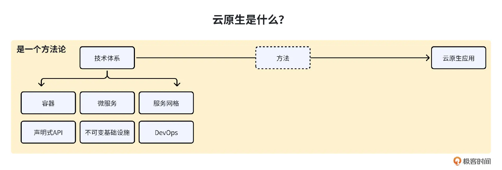

# 01 | 究竟什么是云原生？

你好，我是孔令飞。

在日常工作中，或者一些技术峰会上，你经常会听到“当前我们正处在云原生时代”、“开发云原生应用”、“采用云原生架构”等表述，这些表述中频繁出现“云原生”三个字，会让你意识到云原生的重要性，并有种想学习云原生技术的想法。事实上，当前我们正处在云原生时代，学习云原生相关技术，对于我们的职业发展确实会有非常大的帮助。

那什么是云原生呢？网上有很多介绍文章，这些文章对云原生的解释基本都是准确的，而且比较相似。不过这节课我将会用更准确、更全面、逻辑性更强的思路来给你详细讲解下什么是云原生，作为第一节课，我们去达成这样一个共识，也是很有必要的。

其实，云原生目前没有一个官方的定义，其定义也会因时间、组织的不同而在不断变化。云原生一直在发展变化之中，解释权不归某个人或组织所有。这里我们先来看下 Pivotal 公司和云原生计算基金会 CNCF 是如何定义云原生的。

## 云原生的起源

云原生是一种技术理念，严格来说，云原生的理念不是一个新的东西，很早就存在。但是云原生概念的首次提出，是由 Pivotal 公司的 Matt Stine 于 2013 年提出的。之后有很多公司和团队对云原生下过定义，包括 2015 年由 Google 主导成立的云原生计算基金会（CNCF）。

在这些定义中，比较受欢迎、有影响力的定义是 Pivotal 公司和 CNCF 对云原生的定义。二者均在不同阶段，对云原生有不同的定义。

接下来，我们来看下二者对云原生的定义，并进行总结和完善，尝试给出一种更加通用的定义。

### 云原生计算基金会（CNCF）

在介绍 CNCF 对云原生的定义之前，我先来介绍下 CNCF。

2015 年，随着大量组织和服务开始采用云原生系统，云原生计算基金会（CNCF）应运而生。作为 Linux 基金会创建的一个项目，CNCF 是一个旨在促进云原生技术采用的开源软件基金会。时至今日，CNCF 共拥有 400 多名成员，其中既有公有云技术提供商，也有企业软件公司和技术初创企业，例如 Microsoft、Oracle、VMware 和 Intel 等均为 CNCF 白金成员。

CNCF 旨在确保云原生技术可访问、可用和可靠。它孵化了一个专门面向 Kubernetes、Prometheus 和 CoreDNS 等项目的社区，为各种致力于构建（支持在微服务架构下编排容器的）可持续环境的组织提供支持。

这里多说一句，迁移至云原生系统，对于企业而言可能是一个艰难的过程，但最终绝对是“物有所值”。这不仅仅意味着重新设计应用，还意味着革新企业的结构和文化，最终推动企业向前发展。借助 CNCF 全景图，企业可以逐步采用云原生技术。不过，按照这一路线图，企业要采用更复杂的软件来交付微服务、无服务器函数、基于事件的流以及其他类型的云原生应用。

### Pivotal 公司的定义

Pivotal 公司的 Matt Stine 于 2013 年首次提出云原生（CloudNative）的概念：云原生是一种利用云计算交付模型的优势来构建和运行应用程序的方法。

2015 年，云原生刚推广时，Matt Stine 在《迁移到云原生架构》一书中定义了符合云原生架构的几个特征：

1. 符合 12 模式（Twelve-Factor App）：云原生应用架构的模式集合。

2. 微服务架构（Microservice）：一种软件架构，用来构建一个功能独立并且可以独立开发、部署、维护的应用。

3. 自助服务敏捷基础设施（Self-Service Agile Infrastructure）：用于快速、可重复和一致地提供应用环境和服务的平台。

4. 面向 API 接口的通信（API-based Collaboration）：服务之间的交互基于接口，而不是本地方法调用。

5. 抗脆弱性（Anti-Fragility）：系统能抵御高负载。

到了 2017 年，Matt Stine 在接受 InfoQ 采访时又重新将云原生架构归纳为：

- 模块化

- 可观察性

- 可部署性

- 可测试性

- 可替换性

- 可处理

而 Pivotal 最新官网对云原生概括为 4 个要点：

- DevOps

- 持续交付

- 微服务

- 容器

### CNCF 的定义

2015 年 Google 主导成立了云原生计算基金会（CNCF），起初 CNCF 对云原生（CloudNative）的定义如下：云原生包含了一组应用的模式，用于帮助企业快速、持续、可靠、规模化地交付业务软件。云原生由微服务架构、DevOps 和以容器为代表的敏捷基础架构组成。

上述定义中包含了以下 4 个核心技术栈：

- 容器化

- 微服务

- DevOps

- 持续交付

到了 2018 年，随着近几年来云原生生态的不断壮大，所有主流云计算供应商都加入了该基金会，且从 Cloud Native Landscape 中可以看出，云原生有意蚕食原先非云原生应用的部分。

CNCF 基金会中的会员以及容纳的项目越来越多，该定义已经限制了云原生生态的发展，因此CNCF 为云原生进行了重新定义：云原生技术有利于各组织在公有云、私有云和混合云等新型动态环境中，构建和运行可弹性扩展的应用。云原生的代表技术包括容器、服务网格、微服务、不可变基础设施和声明式 API。这些技术能够构建容错性好、易于管理和便于观察的松耦合系统。结合可靠的自动化手段，云原生技术使工程师能够轻松地对系统作出频繁和可预测的重大变更。

上述定义中包含了以下 5 个核心技术：

- 容器

- 微服务

- 服务网格

- 不可变基础设施

- 声明式 API

## 什么是云原生？

结合 Pivotal 公司和 CNCF 对云原生最新的定义，我们不难总结出二者的以下共同点：

- 云原生技术基于云计算中的某些核心技术，通过一些方法、手段，来构建一个可扩展、弹性的应用程序。

- 随着云计算技术的发展，构建云原生技术的技术也在不断的发展、变化。

- Pivotal 公司和 CNCF 定义的云原生技术中分别包含了不同的核心技术，这些技术都可以用来构建一个可扩展、弹性的应用。

为了能够更全面的说明云原生中的核心技术体系，我们不妨整合 Pivotal 公司和 CNCF 定义中的核心技术。

这里，我对以上两种定义进行总结和完善，给出一个更加通用的云原生定义：云原生（CloudNative）是一种软件开发和部署的方法论，旨在充分利用云计算的优势，提供高度可扩展、可伸缩、可观测、可维护、自动化、高稳定性的应用程序。使用云原生方法论所构建出来的应用，我们可以称为云原生应用。

该方法论可以指导我们基于哪些核心技术栈，采用什么样的方法，来构建什么样的应用。

1. 核心技术栈

整个云原生技术栈是围绕着 Kubernetes 来构建的，具体包括了以下核心技术栈：

- 容器：以 Kubernetes 作为资源编排调度引擎，提供容器化的计算资源。

- 微服务：一种软件架构思想，用来构建功能独立且可独立开发、部署、维护的云原生应用。我们可以使用微服务框架来构建一个微服务，例如：Spring Cloud、go-micro 等。

- 服务网格：建立在 Kubernetes 之上，作为服务间通信的底座，提供强大的服务治理功能。

- 声明式 API：一种编程模型，其中开发人员只需描述所需的结果，而不需要详细指定如何实现。通过声明式 API，开发人员可以将重点放在定义所需的目标和结果上，而不是关注底层的实现细节。在声明式 API 中，开发人员使用一种描述性的语言或格式来定义他们想要的结果，然后交给系统或框架来实现。系统或框架负责解析和执行这些声明，以实现所需的结果。这种方式可以提高开发效率，减少繁琐的编码工作，同时也提供了更高的抽象层次，使代码更易于理解和维护。

- 不可变基础设施：一种新的软件部署模式，应用实例一旦被创建，便只能重建不能更新，是现代运维的基础。

- DevOps：一种软件开发和运维的方法论和实践，旨在通过改进开发和运维团队之间的协作和沟通，实现快速、可靠和持续交付软件的目标。

2. 采用的方法

一切能够利用云原生核心技术栈构建云原生应用的方法、手段，都可以归属到此方法中。本课程介绍的开发技术、构建方法和思路也都属于此方法。这些方法论的核心是将应用程序设计为弹性和可扩展的微服务，并将它们部署在容器中，以便于管理和快速部署，借助容器、Kubernetes 提供的能力，实现降本增效的目的，并提高应用的稳定性和承载能力。

3. 构建的应用（云原生应用）

应用程序使用云原生技术改造自己，并借助云原生的能力，可以使自己具备自动扩缩容、发布自动化、高度的自愈能力、全访问的观测能力和开放标准等优秀能力。

## 什么是云原生应用？

在学习云原生的过程中，有很多文章会持续提到另外一个概念：云原生应用。这里，我也来介绍下什么是云原生应用。

云原生应用是一种构建和部署在云环境中的应用程序，它充分利用了云计算的特性和优势，以及云基础设施提供的各种服务和资源。云原生应用的设计和架构，考虑了云环境的弹性、可扩展性、容错性和自动化等特点，以实现高效的开发、部署和运维。

云原生应用程序具有以下特点：

- 自动扩缩容（弹性）：云原生应用采用微服务架构，基于 Docker、Kubernetes、Serverless等技术栈来部署，使云原生应用程序可以根据负载的变化自动扩展和收缩，以适应不同的工作负载需求。

- 发布自动化：云原生应用程序通过 DevOps、持续集成、GitOps 等技术栈，可以实现应用配置、部署等自动化。通过自动化，极大地提高了迭代速度和发布效率，减少了开发者的工作量。

- 高度的自愈能力：借助声明式 API、不可变基础设施、Kubernetes 的自愈能力，云原生应用可以实现故障快速隔离和修复，极大地提升了云原生应用的稳定性和容错能力。

- 全方位的观测能力：借助云原生中的可观测技术栈，例如：Prometheus、OpenTelemetry、Elastic 等，全方位监控云原生应用程序，及时感知和预知故障点，从而使我们能够及时修复问题，并预防潜在的问题，从侧面提升了应用的稳定性和产品体验。

- 开放标准和互操作性：利用开放标准和互操作性，实现应用程序的跨平台和跨云厂商运行，降低了应用程序的依赖性和迁移成本。

## 课程总结

这节课我们详细介绍了什么是云原生。云原生（Cloud Native）是一种软件开发和部署的方法论，旨在充分利用云计算的优势，提供高度可扩展、可伸缩、可观测、可维护、自动化、高稳定性的应用程序。

云原生包含了一系列的技术体系、方法论和云原生应用。其中，最为关键的是云原生技术栈，因为这是我们实现云原生理念的前提。云原生中的核心技术栈如下：

- 容器

- 微服务

- 服务网格

- 声明式 API

- 不可变基础设施

- 持续集成

- DevOps

另外，这节课我们也介绍了什么是云原生应用。云原生应用是一种构建和部署在云环境中的应用程序，它充分利用了云计算的特性和优势，以及云基础设施提供的各种服务和资源。更简单点说，使用云原生方法论所构建出来的应用，我们就可以称之为云原生应用。

## 课后练习

1. 请查看 CNCF 全景图，了解其中包含的技术栈和开源项目。

2. 请思考下，当前最火的 AI Infra 属于云原生吗？

欢迎你在留言区与我交流讨论，如果今天的内容让你有所收获，也欢迎转发给有需要的朋友，我们下节课再见！
