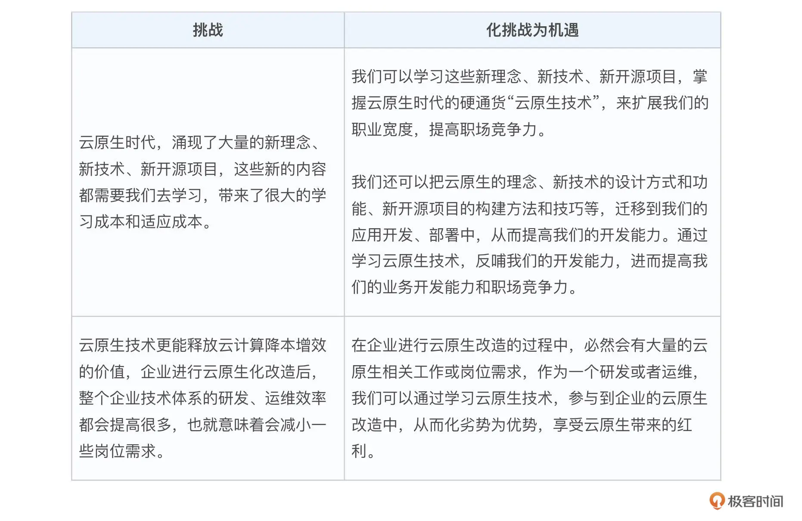
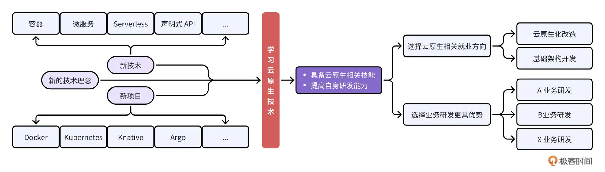

# 04 | 为什么要学习云原生技术及开发？

你好，我是孔令飞。

在前面几节课中，我分别介绍了云原生是什么，以及云原生中的核心技术栈。可以看到，云原生有很多新的技术理念和技术栈，这些技术栈相比于传统的技术栈，设计更加先进，功能更加复杂。但这仍然阻挡不了越来越多的开发者学习云原生技术，越来越多的企业采用云原生技术。

那么，为什么我们要“迎难而上”呢？云原生技术究竟为我们带来了哪些价值，使它如此炙手可热？我们为何要投入时间和精力去学习云原生？在本节课中，我将为你一一解答这些问题。

## 云原生能给企业带来什么？

前面两节课，我介绍了很多跟云原生相关的技术栈，围绕着这些技术栈，社区也有非常多的开源项目，来帮助我们实现这些技术栈。这些开源项目和技术栈之间相辅相成，二者共同协作，共同推动云原生理念的落地。而这些理念会给我们的业务带来非常多的好处。

云原生具有哪些优势，具体要看你采用了哪些云原生技术，每个云原生技术都具有一些优点，不同云原生技术组合在一起，又会产生一些新的优点，这些优点的合集，你可以认为就是云原生的优势。从整体上来说，有以下四个最核心的优势：

1. 降低成本：这里包括了资源成本和人力成本。比如，通过 Kubernetes 技术，可以让我们更好地部署业务，并借助于 Kubernetes 提供的运维能力，减少运维成本和人力投入。再比如说，以前业务是部署在物理机和虚拟机上，资源的分配粒度很粗，进而导致资源的利用率很低。那么现在我们将业务部署在 Docker 上，Docker 对资源的划分粒度更细，这就进一步提高了资源的利用率，从而降低资源的成本。

2. 提升效率：云原生可以显著提高企业的研发效率、交付效率、运营效率。比如，应用通过容器化部署实现了不可变基础设施这样一套理念，那么它的交付就可以非常简单、快速，我只需要做镜像，交付镜像后它就可以运行在每一个地方。再比如说运维，当我们的软件本身通过声明式 API 实现了自运维的能力，那么它已经降低了我们业务运维的难度。

3. 提升业务的承载力：通过微服务、分布式，并借助 Kubernetes、Serverless 等技术栈的快速扩缩容和弹性能力，可以使我们的业务能够快速水平扩容，应对业务高峰，提高业务应用的承载能力。

4. 提升业务的稳定性：Kubernetes 最核心的一个优势之一，是通过健康检查、不可变基础设施、声明式 API 和故障隔离等技术，确保我们的应用始终处在一个预期的健康状态，这可以极大地提高应用的稳定性和容错性。另外，在云原生技术栈中，也包含了很多可观测性相关的技术栈，例如人尽皆知的 Prometheus、OpenTelemetry、Elastic、Fluentd 等。这些可观测性技术栈，能够及时感知到业务故障，及时介入修复，从侧面提高业务的稳定性。

简单概括下，云原生能够在降本增效的同时，确保我们的应用处在一个很好的状态（稳定性 +承载力）。

## 云原生时代存在哪些机遇和挑战？

在我看来，云原生时代是一个挑战与机遇并存的年代。解决、利用好这些挑战，就可以化挑战为机遇，让你在云原生时代更具竞争力。



## 云原生带来新的就业机会

云原生时代，大量新的技术架构、开源项目共同实现云原生的理念，这就导致企业会额外多出很多组件，增加了维护成本。为了节省成本、提高效率，企业通常会选择将这些基础能力下沉，通过中台的形式对外提供各种能力。这些特点也产生了一个新的就业方向：基础架构开发。基础架构开发岗位通常出现在公有云、私有云、研发效能、技术中台、基础架构等团队。

相较于业务开发来说，基础架构开发更聚焦于技术本身，当然技术最终是要服务于业务的。对于刚毕业或者技术能力需要提升的开发者来说，也许一开始选择基础架构的就业方向会更好，因为基础架构开发，能够更好地帮助开发者打磨自己的研发能力，为以后转向业务开发做好技术储备。另外基础架构开发，相较于业务开发来说，跟业务解耦，后期可以无缝转型为业务开发。

基础架构开发相较于业务开发更普适，在没有一个好的业务抱大腿的情况下，打好技术基础，以后及时转型业务开发，也没有任何难点。但是如果一开始从事的是业务开发，但是业务发展不好，未来跳槽找工作从事其他业务方向，可能会因为技术能力不过硬，或者技术能力更偏向于业务，局限于 CURD，导致找工作的竞争力下降。

## 云原生赋能业务开发

在我看来，学习云原生技术还有一个非常实用的好处，就是可以降低你的开发难度、提高开发效率。首先，我们要明白，云原生中有很多优秀的开源项目，这些项目的代码设计和实现都非常优秀，功能非常全，很值得我们去借鉴学习。

所以，在实际开发中，当我们遇到一个功能需求或者开发疑问，都可以尝试从这些开源项目的源代码中找答案，并迁移代码为己所用。

降低开发难度：业务架构不知道如何设计？业务功能不知道如何开发？可以阅读优秀开源代码的实现，借鉴其中的优秀代码实现，迁移为业务代码，以降低我们的代码开发难度。例如：开发业务代码，需要不断循环去执行一个函数，我们不知道如何实现此功能。这时候，我们可以参考 Kubernetes 仓库中的相关实现，例如（见文件 pkg/volume/fc/attacher.go）：

```
err = wait.PollImmediate(10*time.Second, 2*time.Minute, func() (bool, error) {
   detachError = detacher.manager.DetachDisk(*unMounter, devName)
   if detachError != nil {
       klog.V(4).Infof("fc: failed to detach disk %s (%s): %v", devName, deviceM
       return false, nil
   }
   return true, nil
})
这里，wait.PollImmediate 函数声明为PollImmediate(interval, timeout
time.Duration, condition ConditionFunc) error。根据函数的注释可知，该函数
每隔 interval 时间间隔，执行 ConditionFunc 类型的函数，直到该函数返回 true 或
error，或者运行时间达到 timeout 才退出。通过学习、借鉴、迁移 Kubernetes 的相同功
```

能实现，我们可以用优质的代码实现期望的功能，既降低了开发难度，又提高了代码质量。

提高开发效率：在上面的例子中，我们可以直使用 k8s.io/apimachinery/pkg/util/wait 包中的

```
PollImmediate 函数，不用自己实现，极大地提高了我们的开发效率。
```

另外，如果想使云原生开源项目中的优秀代码为我们所用，我们还需要学会并理解以下两点：

- 学会代码搜索：要知道如何借助于 Linux 的 grep 等文本查找工具，搜索合适的关键字，找到我们需要的同类功能的设计和实现。至于如何搜索，没有特别多的技巧，多使用同类关键字搜搜，孰能生巧。

- 通用功能谁都需要：你可以认为一些通用的功能，例如：IP 校验、缓存、循环执行等，有极大的概率也是云原生项目需要的，所以只要我们会搜索，都能从这些优质的开源项目中找到同类的代码实现。

云原生开源项目很多，这里建议优先学习、熟悉 Kubernetes 的源码，让 Kubernetes 仓库中或者周边生态中的代码，成为我们的御用代码仓库。

## 云原生的未来

云原生技术的未来发展充满了无限的可能性。整个云计算或者云原生是由三部分组成的：最底层的计算资源、应用生命周期管理层、最上层的应用软件架构。所以，接下来，我们会从这三个维度来分别看下云原生的未来。

Kubernetes 统治力进一步加强。云原生的基座 Kubernetes 当前已经是容器编排领域的事实标准，在未来，其在容器编排领域的统治力会进一步加强，会有越来越多的企业将其业务云原生化，并将微服务型业务整体搬迁到 Kubernetes 上。当前，字节、腾讯、阿里等一线大厂，已经将其很多微服务业务 100% 迁移到了以 Kubernetes 为基座的容器云平台上。也就是说，企业的云原生化程度会进一步加强。

资源 Serverless 化愈发明显。在未来，云资源会越来越 Serverless 化。也就是说对于业务团队来说，只用关注自身的业务开发，不需要再去关注底层资源的管理和运维，只需要按需申请需要的资源即可。比如，当前腾讯云、阿里云等头部云厂商都推出了弱化节点运维的节点池产品功能，以此来弱化 Kubernetes 节点的运维。再比如，各大云厂商也都提供了 ServerlesssKubernetes，让用户可以购买一个无需运维的 Kubernetes 集群。

向多云多集群趋势演进。Kubernetes 除了提供 Serverless 化的资源，支撑 Serverless 化的应用之外，Kubernetes 越来越像一个云操作系统，变得越来约扁平化。什么意思呢？比如说，之前我们的 K8s 可能部署在阿里云、腾讯云、IDC 机房中，从网络、存储、到资源调度都是相互割裂的，但是在未来，腾讯云、阿里云、IDC 机房的 K8s 会相互协调、统一调度。在使用者看来，就像是使用同一个 K8s 一样，应用可以在多个集群中统一调度、统一部署，相互之间可以像在一个 K8s 集群内服务一样，方便地进行相互通信。其实这就是现在的云计算演进形态：分布式云。

所谓的分布式云，是指云服务提供商将公共云服务（通常包括必要的硬件和软件）分布在不同的物理位置（即边缘），服务的所有权、运营、管理、更新和发展仍由原始公共云服务商负责。云计算厂商，之所以能够将公共服务分布在不同的物理位置，核心是因为 Docker 提供了一致的应用部署能力，K8s 提供了一致的容器编排能力。

另外，随着业务规模的增长，单个集群满足不了企业需求，企业会将业务拆分到多个集群，Kubernetes 多集群管理能力会进一步加强，作用变得越来越重要。

出现越来越多的 Operator 应用。未来也会有越来越多的软件 Operator 化。Operator 是Kubernetes 里面的一个核心思想，它代表着我的任何一个应用和它所需要的能力都可以定义成为一个 Kubernetes 的 API 对象，通过一个叫做 Controller 的机制去实现各种业务逻辑，这个 Operator 化带来的一个直接结果就是，我的应用本身是高度自动化的，包括自愈、可靠性、运行的确定性。

AI 赋能。云原生受益于 AI 技术的发展，会有越来越多的云原生产品和技术，尝试利用 AI 提供的能力，来让自身更加智能化，例如借助 AI 实现智能运维。另外，云原生作为 AI 的重要基座能力，也会不断完善和加强。

## 课程总结



云原生时代诞生出了大量的新理念、新技术、新的开源项目，这些技术栈能够让企业以低成本、高效率的方式对外提供一个稳定、可扩展的产品。

因为云原生技术能够给企业带来很多实实在在的收益，所以大量企业都在采用云原生技术改造企业的应用和企业技术栈，这就导致企业内部需要大量的云原生技术人才来构建企业内部的云原生技术体系，这对 IT 开发者来说既是一个挑战，也是一个机遇。

通过学习云原生技术提高自己的研发能力，不仅能够使自己具备一身过硬的技术本领，建立自己的核心竞争力。还能参与到云原生化的浪潮中去，拓宽自己的职业选择范围，享受云原生时代的技术红利。

## 课后练习

1. 业务开发和基础架构开发的优缺点都有哪些？该如何选择？

2. 云原生具体是如何赋能我们的业务开发能力的？

欢迎你在留言区与我交流讨论，如果今天的内容让你有所收获，也欢迎转发给有需要的朋友，我们下节课再见！
