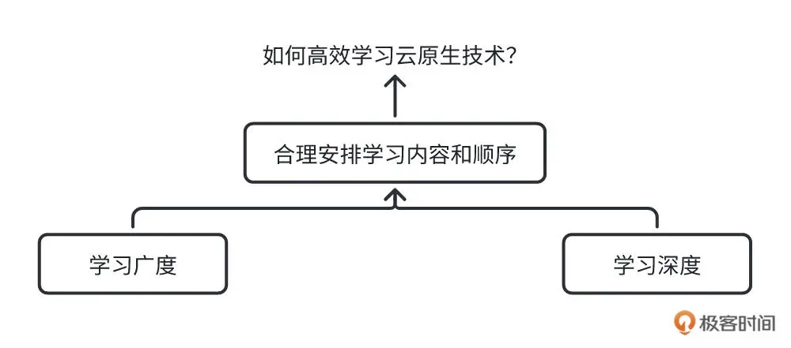
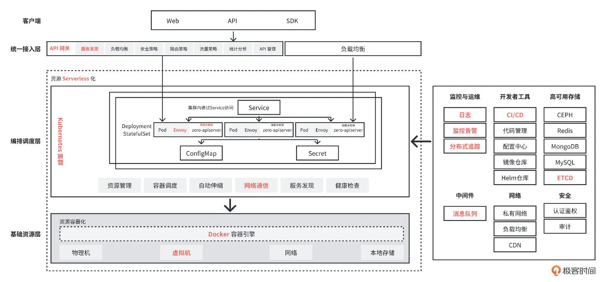
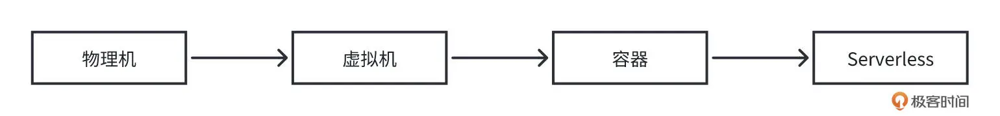
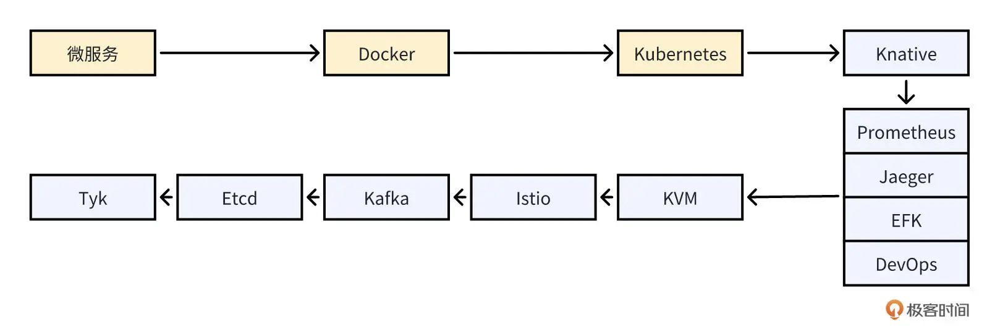

# 05 | 如何学习云原生技术？

你好，我是孔令飞。

前面几节课，我详细介绍了什么是云原生技术，以及为什么要学习云原生相关的开发技术。可以看到，云原生有很多新技术、新理念、新的开源项目，每一个点都可能有很多知识需要我们去学习，那么我们该如何高效地学习云原生技术呢？

在我看来，学习一门技术，既要有广度，又要有深度。广度可以让我们站在更高的视角通透、全面的去认识一门技术；深度可以让我们深入细节，知道每一个技术具体是如何构建的，可以真正帮助我们落地云原生技术，并且能协助我们更好地理解这些技术原理。

那么，如何学习云原生技术，才能同时兼具广度和深度呢？本节课，我就来跟你分享一下，我认为好的学习方法和路线，希望能为你提供帮助。

## 如何学习云原生技术？

在广度化和深度化的学习过程中，如果能够合理安排学习内容、学习顺序和学习方法，就能够高效地学习云原生技术，当然广度 + 深度本身也是一种高效的学习方法。

比方说，你可以灵活采用并行学习的方式：先去掌握一些基础的核心技术栈，因为这些知识通常能奠定一个好的基础。而对于非基础的技术栈，则选择尝试穿插学习。这样既能提升学习效率，又能通过内容的切换来调整节奏，有效缓解学习过程中的疲劳感。

提示：以下的学习内容、书籍、顺序，均是我的通用建议，不是标准答案。你完全可以根据自己的实际情况选择适合自己的学习方法。

## 如何进行广度学习？

如何在学习云原生技术时具备广阔的视野？云原生技术内容繁多，若想要扩展广度，早期应避免过度深入某一技术领域，而是从整体入手，系统性梳理云原生技术的核心技术栈，选择经典教材进行学习，因为相比于阅读源码、实战来说，阅读一门书籍或学习一门课程是形成全局视角最高效的方式。

为了便于统一描述，这里将图书、视频课程、图文专栏等学习媒介统称为教材。在选择学习媒介的过程中，通常建议优先考虑图书，因为相比于图文专栏、视频课程，图书从内容质量、知识密度上来说都要更专业一些。当然，有些图文专栏的内容质量与图书相当，这类高质量的专栏同样值得选择。

另外，在学习的过程中，为了能够更全面的掌握一门技术，建议至少学习一门 / 一本经典的教材，如果有精力，建议再学习一门 / 一本同类的其他课程。当然，如果你感兴趣或者有精力，可以学习更多的同类经典教材。

### 通过云原生架构了解云原生核心技术栈

这里，我通过解读一个业界标准、完整的云原生架构，来让你了解整个云原生体系中有哪些核心内容，进而总结出我们应该学习哪些核心的云原生技术栈。

提示：因为云原生技术栈内容很多，我们没必要、也不可能把所有技术栈全学了，我们可以先学习一些核心、重要、高频使用的技术栈，其他技术栈可以在工作过程中根据需要和个人爱好慢慢补全。

一个完整的云原生架中包含的内容比较多，要想解释清楚云原生架构中的组件、功能及每个组件的交互方式，需要很长的篇幅，不太适合在这节课中详细介绍。为了提前让你知道我们应该学习哪些云原生核心技术栈，这里我基于云原生架构图，将这些核心技术栈用粗体红色字体进行标识。

### 如何广度学习云原生技术栈？

作为一个研发，我们首先是要开发一个应用。而云原生时代，应用都在微服务化，所以我们应该首先学习微服务技术栈。这里我给你推荐一本优秀的微服务书籍《微服务设计》。

另外，云计算最核心的功能是对外提供灵活、弹性化的计算资源，随着云计算的发展，资源的提供形态也在逐渐往前演进，其演进路线如下：

虽然资源演进形态在往前进化，但是这些资源形态在云原生时代是以分层的形式同时存在。如果想透彻学习云原生技术，首先应该学习云计算最核心的资源虚拟化技术：虚拟机、容器、Serverless。

如何学习这些技术呢？我们可以阅读相关的虚拟化原理类的书籍，也可以通过一些具体的虚拟化落地项目来学习这些技术。针对每一项技术，我推荐的教材和学习顺序如下：

- 虚拟机（虚拟化技术）：

- 系统虚拟化 : 原理与实现

- KVM 虚拟化技术 : 实战与原理解析

- 虚拟化技术原理与实现（建议选学）

- Linux KVM 虚拟化架构实战指南（建议选学）

- 容器：

- Docker 容器与容器云（第 2 版）

- 《Kubernetes 权威指南：从 Docker 到 Kubernetes 实践全接触》（第 5 版）

- 《基于 Kubernetes 的容器云平台实战》 （建议选学）

- etcd（Kubernetes 强依赖 etcd，所以这里也建议学习 etcd 技术）

- 网络通信：在 Kubernetes 中，网络通信需要满足其网络模型，如果想掌握好Kubernetes，还需要掌握好 Kubernetes 中的网络通信原理，我们可以通过学习 Flannel来了解 Kubernetes 中的网络通信原理

- Serverless:

- Serverless 架构：无服务器应用与 AWS Lambda

- Knative Documentation;

上面，我们学习了云原生的应用层和资源层的核心技术。接下来，还应该学习应用声明周期管理相关的技术栈：

- 监控告警：监控告警业界的事实标准是 Prometheus，所以我们可以通过 PrometheusDocumentation 来学习监控告警以及 Prometheus。

- 调用链追踪：调用链追踪业界用的最多的是 Jaeger，所以我们可以通过 JaegerDocumentation 来学习调用链追踪以及 Jaeger。

- 消息队列：我们可以通过学习 Kafka 来学习消息队列，Kafka 参考资料为《ApacheKafka 实战》

提示：如果你有精力，还可以再学习下日志、DevOps 相关的技术栈。

在我们的服务开发部署上线后，还需要访问应用，这里我还建议学习应用接入层相关的技术栈，推荐的学习教材如下：

- API 网关：可以通过 Tyk 网关的具体实现来学习 API 网关相关技术，Tyk 网关可通过官网文档 Tyk Open Source 进行学习。

- 服务注册 / 服务发现：在服务之间调用过程中，为了实现负载均衡、访问对端服务等目的，我们需要上报服务的后端实例，这就需要进行服务注册 / 服务发现。所以，我们也需要学习服务注册 / 服务发现相关的技术。我们可以通过学习 Consul 分布式服务发现和配置管理工具，Consul 学习文档为 Consul Documentation。

- 服务网格：微服务架构中的网络通信、安全性和可观察性等会有很多挑战，为了解决这些挑战，云原生时代为此诞生了一个新的核心技术栈：服务网格。我们可以通过《云原生服

- 务网格 Istio：原理、实践、架构与源码解析》来学习服务网格和其落地项目 Istio。

上面，我给出了一个业界标准、全面的云原生架构，并从中分析出了我们需要重点学习的云原生技术栈，并推荐了相关的教材。通过这些教材的学习，可以让我们对云原生技术有个相对全面的学习，也就是具备了云原生技术的广度。但是，我们还应该合理安排学习顺序，以寻求更高的学习效率，下面是我推荐的学习顺序。

## 如何进行深度学习？

在快速学习云原生的核心技术栈后，我们已经掌握了云原生技术的基本原理、实现方法等，对云原生技术有了较为全面的理解。然而，这些技术该如何真正动手实现呢？你可能还是一头雾水，不知从何入手。

所以接下来，我们需要拓宽云原生技术的深度。通过选择一些核心的云原生技术栈进行深入学习，最终让这些技术对于我们来说，变成可落地、可实现的。

那么，具体该怎么做呢？在我看来，最有效的方式是阅读源码 + 实战。通常来说，这种方式需要投入更多的时间和精力，因此我们需要对核心技术栈进行筛选，优先选择重要的部分去学习。我认为，可以首先学习云原生的基石技术——阅读 Docker + Kubernetes 的源码，并进行相关实战。

- Docker + Kubernetes 操作实战：

- Docker 实战：可以学习 Docker 技术入门与实战（第 3 版），根据其中的指引，安装Docker 并执行书中的命令；

- Kubernetes 实战：可以根据 follow-me-install-kubernetes-cluster 教程，一步一步搭建一个 Kubernetes 集群。搭建好集群之后，可以创建一个应用并访问，体验整个Kubernetes 核心部署流程。

- 学习Kubernetes源码：

- 教材学习：Kubernetes 源码的学习，你可以直接学习咱们这门课；

- 你也可以自行阅读以下 Kubernetes 核心组件的源码：kube-apiserver、kube-scheduler、kube-proxy、flannel。

- 学习 Kubernetes 开发：可以加入我的「云原生 AI 实战营」知识星球，该星球中包含了高质量的 Kubernetes 开发体系课，以及 AI Infra 开发实战课（LLMOPS 平台、声明式实现）。

## 其他学习建议

云原生技术是一个快速发展的领域，需要持续学习和实践。在上述方法之外，你还可以通过以下方式来持续学习和实践云原生技术。

- 关注行业动态：及时了解云原生技术的最新动态和发展趋势，可以通过订阅技术博客、关注社交媒体、参加技术会议等方式来获取信息。

- 参与社区讨论：加入云原生技术的社区，参与讨论和交流，了解其他开发者的经验和观点。还可以通过技术论坛、社交媒体或开发者社区等渠道来参与讨论。

- 参与社区贡献：参与云原生技术的社区贡献，可以与其他开发者交流和分享经验，提升自己的技能和知识储备。还可以参与开源项目的开发、提交 bug 修复和功能改进等。

- 继续学习和实践：持续学习和实践是保持对云原生技术深入理解和掌握的关键。可以选择学习新的云原生工具和框架，尝试新的应用场景和解决方案，不断提升自己的技能和经验。

## 课程总结

学习云原生技术，需要建立基础知识体系，学习 Kubernetes 和容器编排工具，了解云原生应用架构，并通过实践项目不断提升技能和经验。持续学习和实践是保持对云原生技术深入理解和掌握的关键。通过以上学习路径和方法，开发者可以逐步掌握云原生技术的核心概念和实践技巧，提升自己在云计算领域的竞争力。

## 课后练习

1. 如何学习云原生技术？

2. 如何学习 Kubernetes 编程？

欢迎你在留言区与我交流讨论，如果今天的内容让你有所收获，也欢迎转发给有需要的朋友，我们下节课再见！
