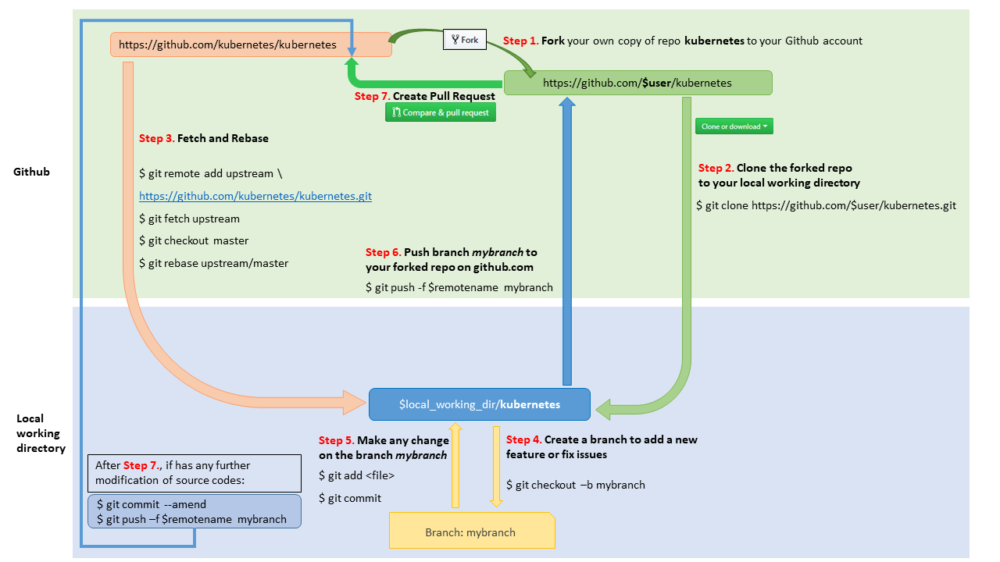
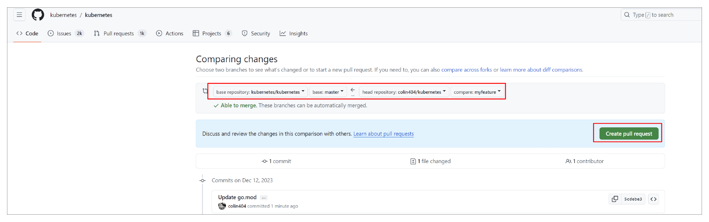

# 07 | 如何给Kubernetes社区贡献源码？

你好，我是孔令飞。

本节课，我来介绍下 Kubernetes 的源码贡献流程，其实就是标准的 GitHub 工作流。如果你想给 Kubernetes 贡献源码，需要遵照 Kubernetes 的源码贡献流程。另外，因为 Kubernetes的 GitHub 工作流非常规范且详细，所以对于我们自己设计 GitHub 工作流也是很有参考意义的。OneX 项目的 GitHub 工作流，就参考了 Kubernetes 的工作流设计和步骤。

接下来，我们就详细看下 Kubernetes GitHub 工作流的具体操作。

## Kubernetes 项目工作流设计

Kubernetes 项目遵循标准的 GitHub 工作流，Kuberntes 社区给出了一个流程图，详细的说明了整个流程。流程图如下：



- 图片来源网络

接下来，我们来看一下具体的操作流程。

## 步骤 1：在 GitHub 上 Fork Kubernetes 项目

具体操作如下：

1. 访问 https://github.com/kubernetes/kubernetes

2. 点击右上角的 Fork 按钮，Fork Kubernetes 项目

## 步骤 2：克隆 Fork 项目到本地

执行以下命令，将 Fork 项目克隆到本地指定的路径：

```
$ export working_dir="$(go env GOPATH)/src/github.com/colin404" # 设置 kubernetes
$ export user=<your github profile name> # 注意，这里需要设置 user 为你的 GitHub 用户名
$ mkdir -p $working_dir
$ cd $working_dir
$ git clone https://github.com/$user/kubernetes.git # 克隆 Fork 的 kubernetes 项目到
$ cd $working_dir/kubernetes
$ git remote add upstream https://github.com/kubernetes/kubernetes.git # 添加一个名
$ git remote set-url --push upstream no_push # 设置永不向 upstream 推送代码变更
$ git remote -v # 确认远程仓库设置正确
```

在 GitHub 中，“上游”（upstream）通常指代原始仓库，而 “origin” 指代你 Fork 出来的仓库。通过这种方式，你可以方便地与原始仓库保持同步，同时在自己的仓库中进行修改和开发。

另外，要禁止向 upstream 推送代码，如果想给 upstream 仓库提交代码贡献，需要通过 PR的方式，这个后面会介绍。

## 步骤 3：同步上游 master 分支最新代码

在创建工作分支之前，我们还需要将本地的主分支更新到最新的状态，更新方法如下：

```
$ cd $working_dir/kubernetes # 切换到 kubernetes 项目仓库所在的目录
$ git fetch upstream # 从远程仓库 upstream 中获取最新的更改，但不会自动合并到你的当前分支
$ git checkout master # 切换到本地的 master 分支
$ git rebase upstream/master # 同步 upstream/master 分支的最新变更到本地的 master 分支
```

注意：主分支可能被命名为 main 或 master，具体取决于代码仓库，kubernetes 项目的主分支名为 master。

在创建一个新的修复分支或者新功能分支时，要确保基于 upstream 最新的 master 代码来创建，这样能够基于最新的代码来开发，并且可以尽最大可能降低未来分支代码合并到上游master 分支时的代码冲突。

## 步骤 4：创建一个工作分支

基于本地 master 分支，创建本地的工作分支：

```
$ git checkout -b feature-myfeature
之后，我们就可以在 feature-myfeature 分支，开发代码、编译代码、 测试代码。
```

这里要注意，在基于本地 master 分支创建工作分支之前，要确保执行步骤 3，确保本地master 分支代码跟上游 master 分支代码是一致的。

另外，这里要注意 Kubernetes 的分支命名规则为：

```
feature-xxx：功能分支
fix-xxx：修复分支
release-xxx：发布分支
```

## 步骤 5：在工作分支变更代码

之后，我们就可以基于工作分支来开发 Kubernetes 源码。在开发过程中，我们可以根据需求提交代码变更。这里建议的流程如下：

1. 修改代码

```
执行 git add添加期望的变更内容
执行 git commit -m "some useful commit message"
如果你需要更多的变更，变更完之后，可以执行 git commit --amend 命令，来将变更
```

- 内容追加到上一次的提交中

```
# 代码变更
$ git add <expected changes>
$ git commit --amend
```

```
关于 git commit --amend 的详细介绍，你可以可参考：amend your previous commit
```

另外，我们需要定期确保分支代码和上游的 master 代码的一致性。原因上面其实有介绍，就是确保我们基于最新的代码来开发，这样可以尽最大可能避免未来合并到上游 master 分支时的潜在冲突。

保持同步的方法也很简单，就是首先切换到工作分支，然后执行下述命令：

```
$ git checkout feature-myfeature
$ git fetch upstream
$ git rebase upstream/master
注意，不要使用 git pull 来代替 git fetch 和 git rebase，因为 git pull 会进行
```

合并，并产生一个合并提交记录，这会使 Kubernetes 仓库的提交历史变得混乱，并且这也违反了提交记录应该遵循整洁和清晰的原则。

```
你还可以使用以下两种方法来同步上游的 master 代码（两种方法都是确保git pull 时使用
rebase 而不是 merge）：
```

方法 1：

```
$ git config branch.autoSetupRebase always # 该命令实际上是通过修改 .git/config 配置来
$ git pull upstream master
```

方法 2：

或者直接执行以下命令：

```
$ git pull --rebase upstream master
```

## 步骤 6：将变更推送到远端仓库

代码开发完之后，就可以将开发分支推送到远端仓库，命令如下：

```
$ git push -f origin feature-myfeature
```

## 步骤 7：创建一个 Pull Request

可以遵循以下步骤，来创建一个 PR（Pull Request）。

```
访问 Fork kubernetes GitHub 仓库：https://github.com/<user>/kubernetes
```

2. 点击 Pull requestss -> New pull request



提交的时候要注意：

```
base repository 选择 kubernetes/kubernetes，base 选择 maser；
head repository 选择 <user>/kubernetes，compare 选择 feature-myfeature；
```

- 再次检查变更 Diff；

- 点击 Create pull request 创建 PR。

### 进行代码审查

PR 提交后，会被分配给一个或多个代码审阅者（reviewers），这些审阅者会对代码进行彻底的审查，尝试从中找到错误的变更、可以改进的代码、不符合风格的代码、以及任何不符合要求的代码变更。

```
如果代码审查后，发现你的代码需要重新改进，你可以重新在 feature-myfeature 分支修
改代码，并推送到 feature-myfeature 分支。
```

这里建议每个 PR 不要包含很多代码变更，这样的 PR 很难审查，会导致你的 PR 被合入master 的进度变得很缓慢。

### 压缩提交

在代码 review 后，我们需要压缩我们的提交记录，以准备最终的 PR 合并。

我们应该确保最终的提交记录是有意义的（要么是一个里程碑，要么是一个单独、完整的提交），通过合理的提交记录，来使我们的变更变得更加清晰。

在合并 PR 之前，以下类型的提交应该被压缩：

- 修复 / 审查反馈

- 拼写错误

- 合并和变基

- 进行中的工作

我们应该确保 PR 中的每一个提交都能够独立编译，并通过测试（这不是必须的）。我们还应该确保合并提交记录被删除，因为这些提交无法通过测试。你可以阅读 interactive rebase来了解更多压缩提交的知识。

压缩提交的具体操作流程如下：

1. 检查你的开发分支。

```
$ git status
```

输出类似于：

```
On branch your-contribution
Your branch is up to date with 'origin/your-contribution'.
使用特定的提交哈希开始交互式变基，或者从你的最后一个提交使用 HEAD~<n> 进行倒数
计数，其中 <n> 表示在变基中要包括的提交数量。
$ git rebase -i HEAD~3
```

输出类似于：

```
pick 2ebe926 Original commit
pick 31f33e9 Address feedback
pick b0315fe Second unit of work
# Rebase 7c34fc9..b0315ff onto 7c34fc9 (3 commands)
#
# Commands:
# p, pick <commit> = use commit
# r, reword <commit> = use commit, but edit the commit message
# e, edit <commit> = use commit, but stop for amending
# s, squash <commit> = use commit, but meld into previous commit
# f, fixup <commit> = like "squash", but discard this commit's log message
...
```

3. 使用命令行文本编辑器，将要压缩的提交中的单词 “pick” 更改为 “squash”，然后保存你的更改并继续进行变基。

```
pick 2ebe926 Original commit
squash 31f33e9 Address feedback
pick b0315fe Second unit of work
...
```

保存之后，输出应该类似于：

```
[detached HEAD 61fdded] Second unit of work
Date: Thu Mar 5 19:01:32 2020 +0100
2 files changed, 15 insertions(+), 1 deletion(-)
...
Successfully rebased and updated refs/heads/master.
```

4. 强制推送你的更改到远程分支。

```
$ git push --force-with-lease
```

对于诸如自动文档格式化之类的大规模自动修复，工具变更使用一个或多个提交，最后使用一个提交来批量应用修复，这样可以使审阅变得更容易。

手动压缩提交的替代方法，是使用在 GitHub 中配置的 Prow 和 Tide 自动化：在你的 PR 中添

```
加一个带有 /label tide/merge-method-squash 的评论将触发自动化，以便 GitHub 在
```

PR 获得批准后，将你的提交压缩到目标分支上。这种方法简化了对 Git 不太熟悉的人的工作，但在某些情况下最好还是在本地进行压缩。审阅者会注意到这一点，并要求手动压缩。

通过在本地压缩，你可以控制工作的提交消息，并将大型 PR 分解为逻辑上独立的更改。例如：你有一个 PR，代码已经开发完成，并且有 24 个提交，你对此进行变基，简化更改为两个提交。这两个提交中的每一个，代表一个单一的逻辑更改，并且每个提交消息都总结了更改内容。审阅者看到现在一组更改变得更加易懂，并批准了你的 PR。

## 其他后续操作

上面，我们已经按照 Kubernetes 源码的 GitHub 工作流，完成了 PR 的提交。之后 PR 便交给 Kubernetes 项目维护者进行代码 Review。Review 通过后，PR 会被合并到 Kubernetesmaster 分支。在这个过程中，还可能需要你合并提交你的代码，你也可能需要撤销你的提交。

下面我就来介绍下合并提交和撤销提交的流程。

### 合并提交

当你收到 Review 和 Approval 的通知后，说明你的提交已经被压缩（squashed），PR 已经准备好被合并到 master 分支了。

当 Reviewer 和 Approver 批准你的 PR 之后，PR 会被自动合并到 master 分支。如果你没有压缩你的提交， Kubernetes 项目的维护者可能会在批准 PR 之前要求你压缩你的提交。

### 撤销提交

你可以执行以下命令来回滚一个提交。

- 创建一个分支，并同步最新的上游代码。

```
# 创建一个分组
$ git checkout -b revert-myrevert
# 同步最新的上游代码
$ git fetch upstream
$ git rebase upstream/master
```

- 如果你想要撤销的提交是一个合并提交，请使用以下命令：

```
# SHA 是你希望恢复的合并提交的哈希值
$ git revert -m 1 <SHA>
```

- 如果这是一个单独的提交，请使用以下命令：

```
# SHA 是你希望恢复的单独提交的哈希值
$ git revert <SHA>
```

- 这将创建一个新的提交来撤销这些更改，将这个新的提交推送到你的远程仓库。

```
$ git push <your_remote_name> revert-myrevert
最后，基于 revert-myrevert 分支提交一个 PR。
```

## 课程总结

这节课我详细介绍了 Kubernetes 的 GitHub 工作流程及具体的操作流程。这些工作流程，在你的项目开发中也可以参考使用。OneX 项目的工作流设计就借鉴了 Kubernetes 的 GitHub工作流设计。

## 课后练习

1. 根据 Kubernetes GitHub 工作流，尝试给 Kubernetes 贡献一个 PR。

2. 为什么在创建本地工作分支前，本地的 master 分支代码要跟上游 master 分支代码进行同步？

欢迎你在留言区与我交流讨论，如果今天的内容让你有所收获，也欢迎转发给有需要的朋友，我们下节课再见！
