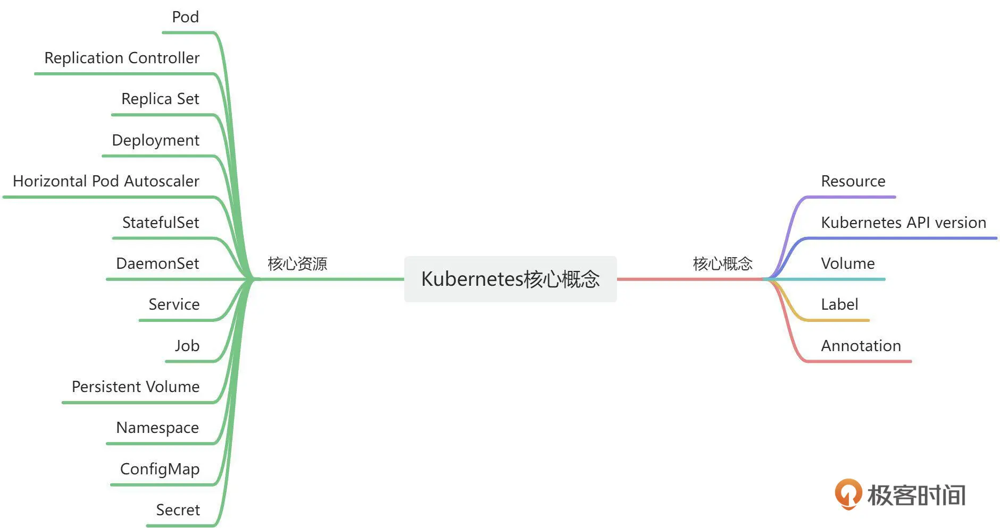
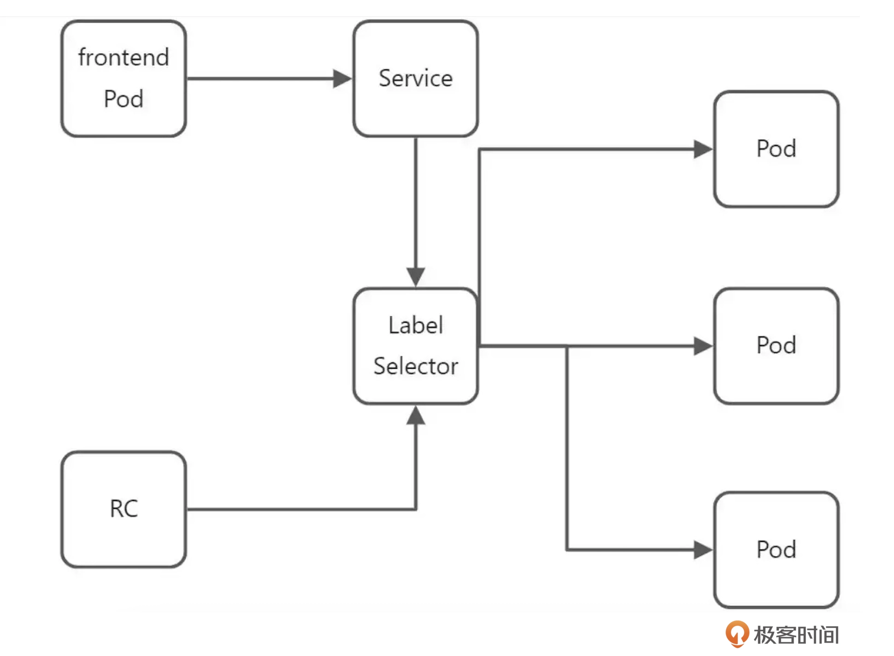

# 09 | Kubernetes核心概念和资源介绍

你好，我是孔令飞。

上一节课，我们学习了 Kubernetes 架构及核心组件的功能。本节课，我将会详细介绍Kubernetes 中的核心资源和核心概念，让你对 Kubernetes 有更全面的了解。

Kubernetes 中涉及到的核心资源和核心概念如下：



请注意，Kubernetes 核心概念是区别于核心资源的。

- 核心概念：不是 REST 资源，没有单独的 API 接口可供操作。这些概念存在于 Kubernetes中，用来完成其对应的功能。功能可以是多方面的，例如：标注某个资源类别、指定某个API 接口的版本、或者指定某部分功能等。

- 核心资源：就是标准的 REST 资源，可以通过 API 接口对这些 REST 资源进行 CURD 等操作。

## Kubernetes 中的核心概念

Kubernetes 中有很多核心概念，这里我们会挑重点的讲。

- Resource

- Kubernetes API version

- Volume

- Label

- Annotation

### Resource

Kubernetes 中的大部分概念如 Node、Pod、Replication Controller、Service 等都可以被看做一种资源对象，几乎所有资源对象都可以通过 Kubernetes 提供的 kubectl 工具（或 API 编程调用）执行增、删、改、查等操作，并将其保存在 etcd 中持久化存储。

Kubernetes 其实是一个高度自动化的资源控制系统，通过跟踪对比 etcd 库里保存的“资源期望状态”与当前环境的“实际资源状态”的差异，来实现自动控制和自动纠错的高级功能。

### Kubernetes API version

查看可用的 API Version 命令：

```
$ kubectl api-versions
acme.cert-manager.io/v1
admissionregistration.k8s.io/v1
admissionregistration.k8s.io/v1alpha1
admissionregistration.k8s.io/v1beta1
...
K8s 官方将 api version 分成了以下三大类型：
```

- Alpha：未经充分测试，可能存在 bug，功能可能随时调整或删除。

- Beta：经过充分测试，功能细节可能会在未来进行修改。

- Stable：稳定版本，将会得到持续支持。

### Volume

Volume 是 K8s 抽象出来的对象，用于解决 Pod 中的容器运行时文件存放的问题以及多容器数据共享的问题。Pod 可以同时使用任意数量的 Volume 类型。临时卷类型的生命周期与 Pod相同，但持久卷的生命周期与 Pod 无关。当 Pod 不再存在时，Kubernetes 会销毁临时卷，不过 Kubernetes 不会销毁持久卷。对于给定 Pod 中任何类型的卷，在容器重启期间数据都不会丢失，也就是说数据卷的生命周期与容器无关。Volume 的核心是一个目录，其中可能存有数据，Pod 中的容器可以访问该目录中的数据。所采用的特定的 Volume 类型将决定该目录是如何形成的，使用何种介质保存数据，以及目录中存放的内容。

Volume 支持多种 Volume 类型，例如：cephfs、configMap、csi、downwardAPI、emptyDir、fc（fibre channel）、gcePersistentDisk、glusterfs、hostPath、iscsi、local、nfs、persistentVolumeClaim、projected、secret、rbd 等。

Volume 的使用比较简单，通常情况下，我们在 Pod 上声明一个 Volume，然后在容器里引用该 Volume 并挂载到容器的某个目录上即可，例如：

```
template：
 metadata：
       labels:
         app: myapp
 spec:
       volumes:
         - name: datavol
               emptyDir: {}
       containers:
       - name: nginx
         image: nginx
         volumeMounts:
               - mountPath: /mydata
                 name: datavol
```

### Label

Label（标签）是 Kubernetes 系统中另外一个核心概念。一个 Label 是一个 key=value 的键值对，其中 key 与 value 由用户自己指定。Label 可以被附加到各种资源对象上，例如：Node、Pod、Service、RC 等。

一个资源对象可以定义任意数量的 Label，同一个 Label 也可以被添加到任意数量的资源对象上。通过给指定资源对象绑定 Label 从而实现资源对象的分组管理，方便 Kubernetes 进行资源分配、调度和部署等工作。

通过给指定的资源对象绑定一个或多个不同的 Label 来实现多维度的资源分组管理功能，以便灵活、方便地进行资源分配、调度、部署等管理工作。例如：

```
版本标签：release:stable、release:beta；
环境标签：environment:dev、environment:qa、environment:production。
```

通过 Label 为资源对象贴上相对应的标签，随后通过 Label Selector（标签选择器）查询和筛选拥有某些 Label 的资源对象。当前有两种 Label Selector 表达式：

```
基于等式：name=myweb，env != production；
基于集合：name in (myweb，myweb1)，name not in (myweb，myweb1)。
```

可通过多个 Label Selector 表达式的组合实现复杂的条件选择，多个表达式之间用 “，” 分隔，条件之间是 “AND” 关系，即同时满足多个条件。

```
# 该片段表示：选择标签 key值为 app，value值为 myweb的资源
selector:
 app: myweb
# 该片段表示：选择标签 key值为 app且value值为 myweb
# 且 key 值为tier 且 value值 in （frontend，backend）
selector：
matchLabels:
 app: myweb
matchExpressions:
 - {key: tier, operator: In, values: [frontend,backend]}
 # 或使用以下写法
 - key: tier
   operator: In # In, NotIn, Exists and DoesNotExist
 values: ["frontend","backend"]
```

### Annotation

Annotation（注解）与 Label 类似，也是使用 key/value 键值对的形式进行定义。不同的是Label 是 Kubernetes 对象的元数据（metadata），并且用于 Label Selector。Annotation 则是用户任意定义的附加信息，以便于外部工具查找。

## Kubernetes 中的核心资源

在介绍完 Kubernetes 中的核心概念后，我们来看看 Kubernetes 中的核心资源。

Kubernetes v1.31.1 版本一共有 67 种资源，这些资源可以通过以下命令获取：

```
$ kubectl api-resources|egrep 'k8s.io| v1| batch'
mutatingwebhookconfigurations                                           admission
validatingadmissionpolicies                                             admission
validatingadmissionpolicybindings                                       admission
...
$ kubectl api-resources|egrep 'k8s.io| v1| batch'|wc -l
67
这里要注意，使用 kubectl api-resources 命令会列出 Kubernetes 集群中所有已安装的
REST 资源，例如：kubeflow.org 的 pytorchjobs。需要通过 egrep 'k8s.io| v1|
batch' 命令过滤出 Kubernetes 自有的 REST 资源。
```

可以看到，Kubernetes 的资源有很多，我们挑核心的来讲。

### Pod

Pod 是 Kubernetes 最重要的基本概念，也是 Kubernetes 的最小调度单位。每个 Pod 都有一个特殊的被称为“根容器”的 Pause 容器。除此之外，每个 Pod 还包含了一个或多个紧密相关的用户业务容器。

为什么 Kubernetes 会这么设计呢？

- 在实际情况下，存在多个紧密相关的业务容器需要部署为一组容器，那么 Pod 支持将多个容器部署在一个 Pod，Pod 里的多个业务容器共享 pause 的 IP 和 Volume，解决了密切关联的容器之间的通信问题、数据共享问题。

- 一个 Pod 里面包含多个业务容器，在这种情况下，Kubernetes 无法对 Pod 这个整体的状态做出正确的判断，所以引入了 Pause 根容器，以 Pause 根容器的状态来代表 Pod 的状态。例如：Pod 是否死亡的问题。

Kubernetes 为每个 Pod 都分配了唯一的 IP 地址，称之为 Pod IP。一个 Pod 里的多个容器共享 Pod IP 地址。

Kubernetes 要求底层网络支持集群内任意两个 Pod 之间的 TCP/IP 直接通信。例如：flannel、Open vSwitch 等。因此，我们需要记住一个 Pod 里的容器与另外主机上的 Pod 容器能够直接通信。

Pod 有两种类型：

- 普通 Pod：Pod 被创建后，会被存放到 etcd 中，随后被调度到具体的 node 节点上运行。在默认情况下，当 Pod 里的某个容器停止运行时，Kubernetes 会自动检测到这个问题并重新启动这个 Pod，如果 Pod 所在 Node 机器出现宕机，就会将这个 Node 上的 Pod 重新调度到其他 Node 上。

- 静态 Pod：静态 Pod 被存放到某个具体的 Node 上的具体文件当中，并且只在该 Node 上启动、运行，不能被调度到其他节点。例如：master 节点组件均是以静态 Pod 的方式运

```
行，文件存放目录为 /etc/kubernetes/manifests/。
```

另外，对于绝大多数容器来说，一个 CPU 的资源配额相当大，所以在 Kubernetes 里通常以千分之一的 CPU 配额为最小单位，用 m 来表示。通常一个容器的 CPU 配个被定义为 100～300m，即占用 0.1～0.3 个 CPU。

```
spec:
 containers:
 - name: db
   image: mysql
   resources:
     requests:
       memory: "64Mi"
       cpu: "250m"
     limits:
       memory: "128Mi"
       cpu: "500m"
```

通常，Requests 被设置为一个较小的值，表示容器在平时的工作负载情况下的资源需求，而limits 被设置为峰值负载情况下资源占用的最大值。

### Replication Controller

Repliacation Controller（简称 RC），简单地说，RC 定义了一个期望的场景，即声明某种 Pod的副本数量在任何时刻都符合某一个预期值。所以 RC 的定义包括：

- Pod 期待的副本数；

- 用于筛选目标 Pod 的 Label Selector；

- 当 Pod 的副本数量少于期望值时，用于创建 Pod 的模板。

RC 定义如下所示：

```
apiVersion: v1
kind: ReplicationController # 副本控制器 RC
metadata:
 name: myhello-rc # RC名称，全局唯一
 labels:
       name: myhello-rc
spec:
 replicas: 5 # Pod副本期待数量
 selector:
       name: myhello-pod
 template:
       metadata:
         labels:
               name: myhello-pod
       spec:
         containers: # Pod 内容的定义部分
         - name: myhello #容器的名称
               image: long-xu/hello:1.0.0 #容器对应的 Docker Image
               imagePullPolicy: IfNotPresent
               ports:
               - containerPort: 80
               env: # 注入到容器的环境变量
               - name: env1
                 value: "k8s-env1"
               - name: env2
                 value: "k8s-env2"
```

我们定义一个 RC 后，Kubernetes 的 controller manager 组件会定时巡检目标 Pod 的副本数量是否与预期数量一致。当实际副本数量大于预期数量，则关闭一些目标 Pod；当实际副本数量小于预期数量，则通过 RC 中 Pod 的定义模板创建一些新的目标 Pod。

### Replica Set

Replica Set 是 Kubernetes 1.2 版本中引入的一个新概念，Replica Set 为 RC 的升级版本。二者的区别在于：RC 的 Label Selector 只支持基于等式的表达式，而 RS 的 Label Selector 支持基于集合的表达式；在线编辑 RS 后，RS 会自动更新 Pod，而 RC 的修改不会自动更新现有 Pod。

RC（Replica Set）的作用如下：

- 通过定义 RC/RS 来自动创建 Pod 以及实现 Pod 副本数量的自动控制；

- 通过 Label Selector 机制筛选目标 Pod；

- 通过改变 RC/RS 所定义的副本数量，来实现 Pod 所对应服务的伸缩；

- 通过改变 RC/RS 模板中的镜像，可以实现 Pod 的升级操作。

### Deployment

Deployment 是 Kubernetes 在 1.2 版本中引入的概念，用于更好地解决 Pod 的部署、升级、回滚等问题。

Deployment 内部会自动创建 RS，用于实现 Pod 的副本控制。Deployment 相较于 RC/RS 有以下优势：

- Deployment 资源对象会自动创建 RS 资源对象来完成部署，对 Deployment 的修改和发布会产生新的 RS 资源对象，为新的发布版本服务。

- Deployment 支持查看部署进度，以确定部署操作是否完成。

- 更新 Deployment，会触发部署从而更新 Pod，而 RC 的更新不会自动触发 Pod 的更新，RS 可以触发 pod 更新。

- Deployment 支持 Pause 操作，暂停之后对 Deployment 的修改不会触发发布动作。当完成修改之后可以通过 Resume 操作来发布新的 Deployment。

- Deployment 支持回滚操作，可以回滚到上一个版本或者回滚到指定的发布版本。

- Deployment 支持重新启动操作，重新启动会触发 Pod 的更新。

- Deployment 会自动清理不再需要的 RS。

### Horizontal Pod Autoscaler

Horizontal Pod Autoscaler（简称 HPA），其主要作用是用于 Pod 横向自动伸缩。根据追踪和分析指定 RC/RS 控制的所有目标 Pod 的负载变化情况，来确定是否需要针对性地调整目标Pod 的副本数量。

### StatefulSet

在 Kubernetes 系统中，Pod 的管理对象 RC、Deployment、DaemonSet 和 Job 等都是面向无状态的服务。但现实中有很多服务是有状态的，StatefulSet 就是用来管理有状态应用的Pod。和 Deployment 类似，StatefulSet 也是通过 Label Selector 来管理一组相同定义的Pod。但和 Deployment 不同的是，StatefulSet 为它的每一个 Pod 都维护了一个唯一的 ID。虽然每一个 Pod 都是基于相同的定义文件而创建的，但是它们之间不能相互替换，即无论怎么调度，每个 Pod 都有一个永久不变的 ID。

那么哪些情况下应该使用 StatefulSet 呢？

- 需要稳定的、唯一的网络标识的应用程序；

- 需要稳定的持久化存储的应用程序；

- 需要有序的部署、更新和缩放的应用程序。

使用上又有哪些限制呢？

- Pod 的存储必须由 PersistentVolume 驱动；

- 删除或收缩 StatefulSet 不会删除关联的存储卷；

- 需要使用 Headless Service 来负责 Pod 的网络标识，因此需要创建 Headless Service；

- 删除 StatefulSet 时，不能保证删除它管理的 Pod，可以通过调整副本数量为 0 来实现。

常见的有状态应用程序有：MySQL 集群、MongoDB 集群、kafka 集群等。

### DaemonSet

DaemonSet 确保全部（或者某些）节点上运行一个 Pod 的副本。当有节点加入集群时，也会为它们新增一个 Pod。当有节点从集群移除时，这些 Pod 也会被回收。删除 DaemonSet 将会删除它创建的所有 Pod。

DaemonSet 的一些典型用法如下：

- 在每个节点上运行集群守护进程；

- 在每个节点上运行日志收集守护进程；

- 在每个节点上运行监控守护进程。

一种简单的用法是，为每种类型的守护进程在所有的节点上都启动一个 DaemonSet。 一个稍微复杂的用法是，为同一种守护进程部署多个 DaemonSet，每个具有不同的标志，并且对不同硬件类型具有不同的内存、CPU 要求。

### Service

Service 服务也是 Kubernetes 里的核心资源对象之一，其主要作用是将运行在一组 Pods 上的应用程序公开为网络服务，这其实就是我们经常提起的微服务。通过 Service 资源对象定义一个 Service 的访问入口地址。前端应用通过访问这个入口，从而访问其背后的一组有 Pod 副本组成的集群实例。Service 所针对的目标 Pods 集合通常通过 Label Selector 来确定，具体如下图所示：



即 Service 一旦被定义，就被分配了一个不可变更的 Cluster IP，在整个 Service 的生命周期内，该 IP 地址都不会发生改变。

### Job

Job 即工作任务，Job 会创建一个或者多个 Pods，来执行工作任务。Job 会跟踪记录成功完成的 Pod 数量，当成功完成的数量达到了指定的成功个数时，Job 结束。当执行过程中 Pod出现失败的情况，Job 会创建新的 Pod 来替代该 Pod。删除 Job 的操作会清除所创建的全部Pods。挂起 Job 的操作会删除 Job 的所有活跃 Pod，直到 Job 被再次恢复执行。Job 通常为单次任务，如果需要运行定时 Job 则应该使用 CronJob。

### Persistent Volume

持久卷（PersistentVolume，PV）是集群中的一块存储，可以由管理员事先供应，或者使用存储类（Storage Class）来动态供应。持久卷是集群资源，就像节点也是集群资源一样。PV 持久卷和普通的 Volume 一样，也是使用 Volume 插件来实现的，只是它们拥有独立的生命周期。

Pod 通过 PersistentVolumeClaim（PVC）来申领 PV 作为存储卷使用。集群会通过 PVC 找到其绑定的 PV，并将该 PV 挂载到 Pod。

下面是一个 NFS 类型的 PV 的一个 YAML 定义文件，声明了 8Gi 的存储空间。

```yaml
apiVersion: v1
kind: PersistentVolume
metadata:
 name:pv0001
spec:
 capacity:
       storage: 8Gi
 accessModes:
       - ReadWriteOnce
 nfs:
       path: /somepath
       server: 192.168.0.106
```

PV 的 accessModes 属性如下：

- ReadWriteOnce：读写权限，只允许被单个 Node 挂载；

- ReadOnlyMany：只读权限，允许被多个 Node 挂载；

- ReadWriteMany：读写权限，允许被多个 Node 挂载。

如果某个 Pod 需要申请某种类型的 PV，则需要先定义一个 PersistentVolumeClaim 对象。

```
apiVersion: v1
kind: PersistentVolumeClaim
metadata:
 name: myclaim
spec:
 accessModes:
       - ReadWriteOnce
 resources:
       requests:
         storage: 8Gi
```

然后，在 Pod 的 Volume 定义中引用 PVC 即可。

```
volumes:
 - name: mypd
 persistentVolumeClaim:
   claimName: myclaim
```

最后说说 PV 的状态，PV 的状态包括以下几种：

- Available：空闲状态；

- Bound：已经绑定到某个 PVC 上；

- Released：对应的 PVC 已经被删除，但资源还没有被集群回收；

- Failed：PV 自动回收失败。

### Namespace

Namespace（命名空间）是 Kubernetes 系统中的另一个非常重要的概念，主要提供资源隔离。通过命名空间，你可以将同一个集群中的资源划分为相互隔离的组。统一命名空间下的资源名称必须唯一，但是不同命名空间下的资源名称可以一样。命名空间的作用仅针对那些带有命名空间的资源对象，例如：

Deployment、Service、Pod、RC 等。对集群对象不适用，例如：Node、Namespace、PV等。

### ConfigMap

ConfigMap 用于将其他资源对象所需要使用的非机密配置项的数据保存在键值对中。例如：应用程序的配置文件。如此一来，就可以集中管理集群所使用的所有配置项。

### Secret

在 Kubernetes 中，Secret 对象用于存储敏感信息，比如密码、OAuth 令牌和 SSH 密钥。这些信息通常不以明文形式存储在代码或配置文件中，因此 Kubernetes 提供了 Secret 来确保这些数据的安全性。

尽管 Secret 提供了敏感信息的存储和简化访问，但它们并不是完全加密的。Kubernetes 中的Secret 在以下方面并不够安全：

- Secret 默认以 Base64 编码存储，而 Base64 编码并非加密；

- 除非启用了加密存储，否则 Secret 在 etcd 数据库中以明文形式存储，可能会导致数据泄露。

为了确保在 Kubernetes 中存储的 Secret 完全加密，可以采取这两种方案。

1. 启用 etcd 的加密

Kubernetes 允许对存储在 etcd 中的 Secret 数据进行加密。通过配置 Kubernetes API 服务器以启用这种加密，Secret 可以在 etcd 中以加密形式存储。

配置步骤如下：

```
创建加密配置文件（例如 encryption-config.yaml）：
kind: EncryptionConfiguration
apiVersion: v1
resources:
 - resources:
     - secrets
   providers:
     - aescbc:
         key: <your-base64-encoded-key>
         # 密钥和加密操作
     - identity: {}
这里的 <your-base64-encoded-key> 是用于加密的密钥，需要使用适当的算法生成。
```

- 修改 API 服务器启动参数，在 Kubernetes API 服务器的启动参数中添加以下内容：

```
--encryption-provider-config=/path/to/encryption-config.yaml
```

- 重新启动 API 服务器。

2. 使用外部密钥管理系统

除了 etcd 加密外，另一个常见方案是使用外部密钥管理系统（如 HashiCorp Vault、AWSSecrets Manager 或 Azure Key Vault）来管理和存储敏感信息。这些系统提供了更高级的安全性能和访问控制。

## 课程总结

本节课，我们详细介绍了 Kubernetes 中的核心资源和核心概念。这些核心资源和核心概念如下图所示：

## 课后练习

1. 请列举 Kubernetes 中的核心概念及其功能。

2. 请列举 Kubernetes 中的核心资源及其功能。

欢迎你在留言区与我交流讨论，如果今天的内容让你有所收获，也欢迎转发给有需要的朋友，我们下节课再见！
