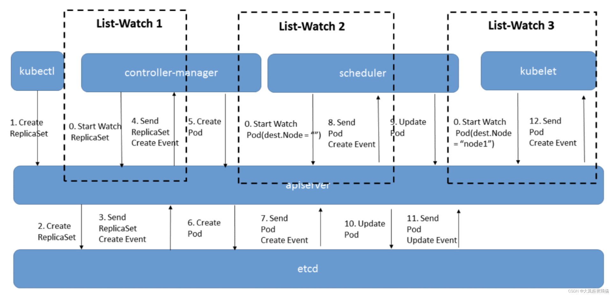
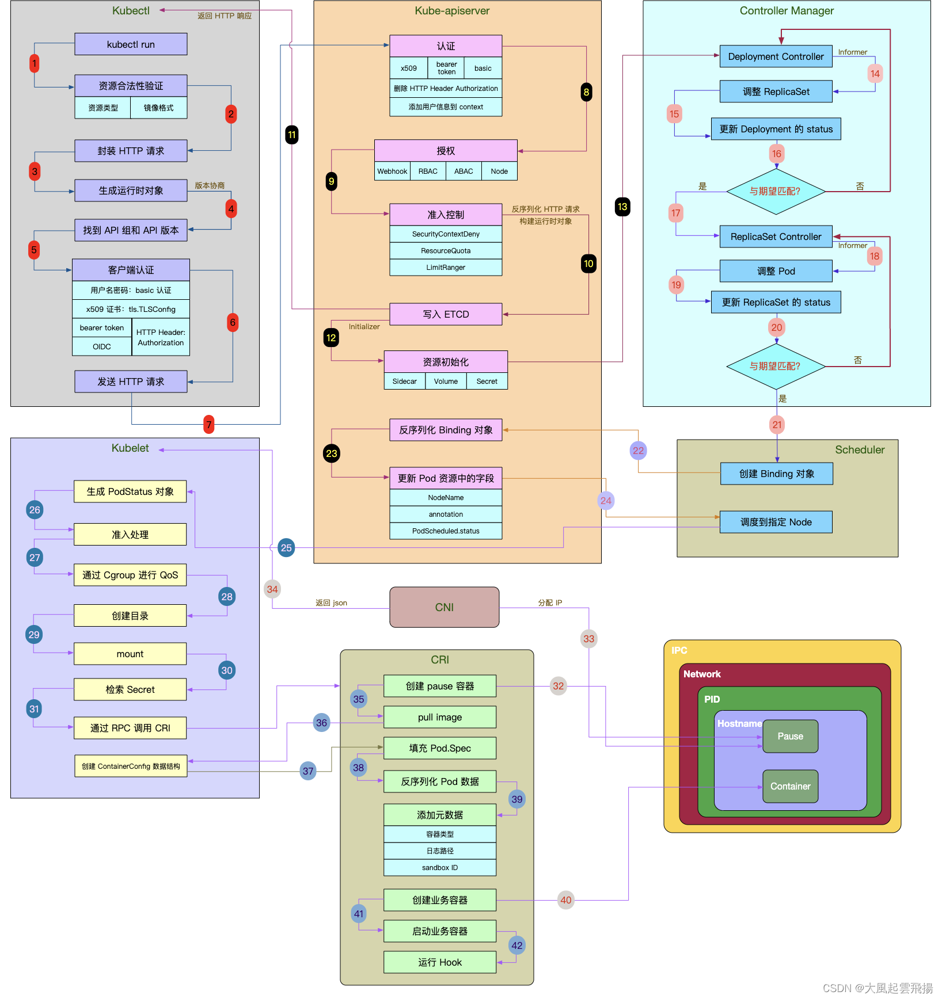
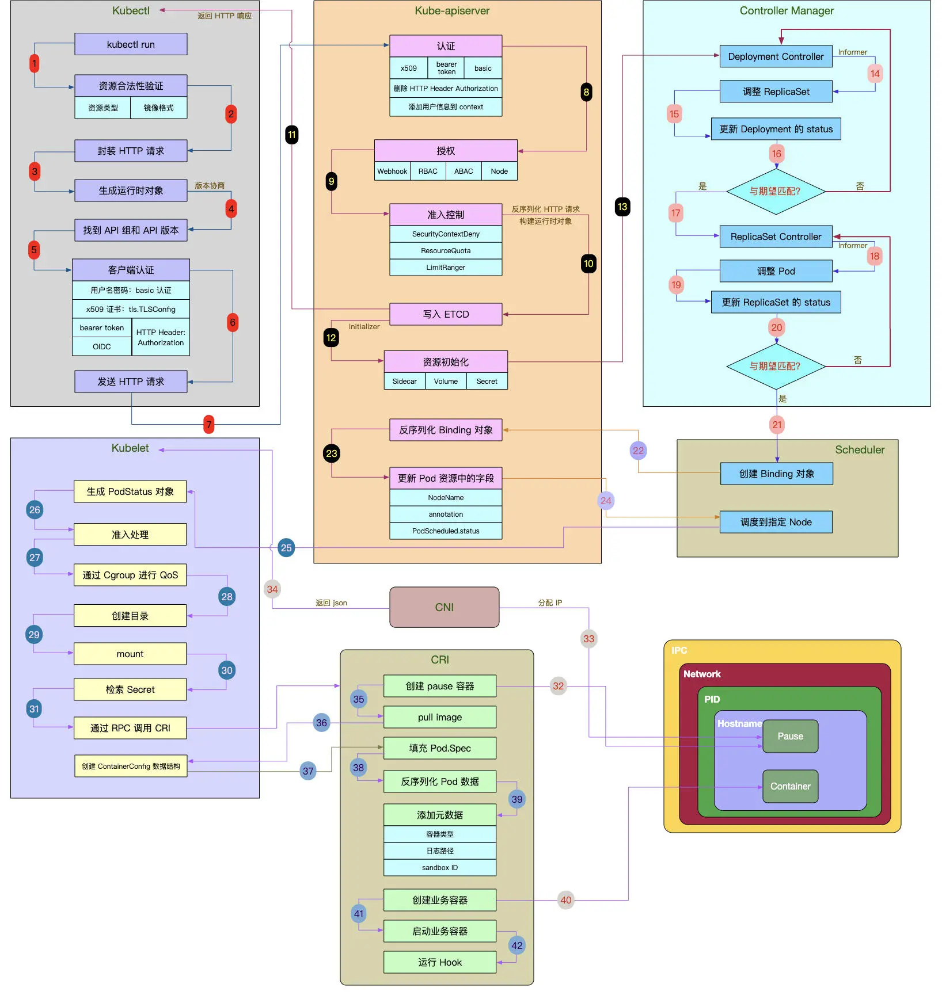

# 10 | 通过Pod创建流程来了解Kubernetes

你好，我是孔令飞。

前两节课，我们分别学习了 Kubernetes 的架构及核心组件功能、Kubernetes 中的核心资源和核心概念，相信你已经建立起了基本的认知框架。但学完这些内容后，你可能仍然无法知道Kubernetes 具体是如何工作的。

因此，本节课会从运行层面介绍 Kubernetes 的运行机制，通过一个经典的例子——Pod 创建流程，为你展示 Kubernetes 中各个组件的功能和交互，带你了解 Kubernetes 的工作原理。

## Kubernetes 创建 Pod 流程

在 Kubernetes 中，我们可以通过多种方式来创建一个 Pod，例如：创建一个裸 Pod、创建Deployment、创建 ReplicaSet、创建 CronJob、创建 Job 等。为了简洁、全面介绍Kubernetes 的资源处理流程，这里我通过创建一个 ReplicaSet 来看看 Kubernetes 具体如何创建 Pod。

创建流程如下：



- 图片来自网络

接下来，我们结合上面的流程图详细拆解各个步骤的具体执行内容。

## 步骤 0：kube-controller-manager Watch kube-apiserver

首先，在启动 kube-controller-manager 时，kube-controller-manager 会跟 kube-apiserver 建立连接，并通过 List-Watch 机制，实时监听 kube-apiserver 中的资源变更事件，根据变更事件，调用相应的 Handler 来调和资源。此时，kube-apiserver 会保持这个连接，并在有相关资源变化时（如创建、更新或删除操作），通过流式响应的方式将变更信息推送给 kube-controller-manager。

其他组件，例如：kube-scheduler、kubelet 等也是用同样的方式跟 kube-apiserver 建立连接。

## 步骤 1：创建 ReplicaSet 资源

用户通过 kubectl 工具调用 kube-apiserver 接口创建一个 ReplicaSet 资源。创建 ReplicaSet资源的 YAML 定义如下：

```
apiVersion: apps/v1
kind: ReplicaSet
metadata:
 namespace: default
 name: my-replicaset
spec:
 replicas: 2  # 指定要运行的 Pod 数量
 selector:
   matchLabels:
     app: my-app  # 与 Pod 的标签匹配
 template:
   metadata:
     labels:
       app: my-app  # Pod 的标签
   spec:
     containers:
     - name: my-container  # 容器名称
       image: nginx  # 容器镜像（示例使用 nginx）
       ports:
       - containerPort: 80  # 容器暴露的端口
```

我们将上述内容保存在 replicaset.yaml 文件中，并执行以下命令来创建 ReplicaSet 资源：

```bash
$ kubectl create -f replicaset.yaml -v 10
在上述命令中，-v 10 会指定 kubectl 输出非常详细的操作日志。为了让你更清晰地看到
kubectl create -f replicaset.yaml -v 10 后 kubectl 的核心操作，我简化了
```

kubectl 的日志输出内容，并在日志中添加了注释，具体如下：

```
# 1. 加载 kubeconfig 文件，该文件指定了连接 kube-apiserver 的证书、访问地址等信息
I0814 22:40:10.326070 2634693 loader.go:395] Config loaded from file:  /home/coli
# 2. kubectl -v =10 会打印请求 kube-apiserver的 curl 命令，方便你阅读、排障
I0814 22:40:10.327486 2634693 round_trippers.go:466] curl -v -XGET  -H "Accept: a
I0814 22:40:10.328510 2634693 round_trippers.go:510] HTTP Trace: Dial to tcp:10.3
# 3. kubectl 访问 kube-apiserver 的 GET /openapi/v3 接口。kubectl 访问 GET /openapi/
I0814 22:40:10.335157 2634693 round_trippers.go:553] GET https://10.37.43.62:6443
I0814 22:40:10.335266 2634693 round_trippers.go:570] HTTP Statistics: DNSLookup 0
# GET /openapi/v3 接口返回头
I0814 22:40:10.335282 2634693 round_trippers.go:577] Response Headers:
I0814 22:40:10.335294 2634693 round_trippers.go:580]     Accept-Ranges: bytes
I0814 22:40:10.335355 2634693 round_trippers.go:580]     Content-Type: text/plain
I0814 22:40:10.335366 2634693 round_trippers.go:580]     ...
# GET /openapi/v3 返回体
I0814 22:40:10.336639 2634693 request.go:1212] Response Body: {"paths":{"apis/app
I0814 22:40:10.337349 2634693 round_trippers.go:466] curl -v -XGET  -H "Accept: a
# 请求 kube-apiserver 的 GET /openapi/v3/apis/apps/v1 接口，获取 Kubernetes 中特定 AP
I0814 22:40:10.341199 2634693 round_trippers.go:553] GET https://10.37.43.62:6443
I0814 22:40:10.341233 2634693 round_trippers.go:570] HTTP Statistics: DNSLookup 0
# GET /openapi/v3/apis/apps/v1 接口返回头
I0814 22:40:10.341241 2634693 round_trippers.go:577] Response Headers:
I0814 22:40:10.341250 2634693 round_trippers.go:580]     Last-Modified: Sat, 25 M
I0814 22:40:10.341309 2634693 round_trippers.go:580]     ...
# GET /openapi/v3/apis/apps/v1 返回体，指定了 apiVersion = apps/v1， kind = ReplicaS
I0814 22:40:10.346282 2634693 request.go:1212] Response Body: {"openapi":"3.0.0",
# 请求 POST /apis/apps/v1/namespaces/default/replicasets 接口，创建 ReplicaSet 资源
I0814 22:40:10.375058 2634693 request.go:1212] Request Body: {"apiVersion":"apps/
# 打印请求 POST /apis/apps/v1/namespaces/default/replicasets 接口的 curl 命令
I0814 22:40:10.375203 2634693 round_trippers.go:466] curl -v -XPOST  -H "Accept:
# 请求 POST /apis/apps/v1/namespaces/default/replicasets 接口
I0814 22:40:10.382675 2634693 round_trippers.go:553] POST https://10.37.43.62:644
# 返回头
I0814 22:40:10.382737 2634693 round_trippers.go:577] Response Headers:
I0814 22:40:10.382751 2634693 round_trippers.go:580]     Audit-Id: d7974927-8e25-
I0814 22:40:10.382758 2634693 round_trippers.go:580]     ...
# 返回体
I0814 22:40:10.382894 2634693 request.go:1212] Response Body: {"kind":"ReplicaSet
通过上面的日志，我们可以看到，kubectl create -f replicaset.yaml -v 10 具体
```

执行了以下操作：

- 加载 kubeconfig 文件，该文件指定了连接 kube-apiserver 的证书、访问地址等信息。

```bash
kubectl -v =10 会打印请求 kube-apiserver 的 curl 命令，方便你阅读、排障。
kubectl 访问 kube-apiserver 的 GET /openapi/v3 接口，主要是为了获取 Kubernetes
```

- API 的 OpenAPI 规范。这一规范提供了关于 API 端点、请求和响应格式的结构化信息，帮

- 助 kubectl 了解集群的 API 以及如何与之交互。

```
请求 kube-apiserver 的 GET /openapi/v3/apis/apps/v1 接口，获取 Kubernetes 中
特定 API 组（在这个例子中是 apps 组）的 OpenAPI 规范。这一规范详细描述了该 API
```

- 组中的资源（例如 ReplicaSet、Deployment 等）的结构、操作和约束。了解这些可以对API 资源定义进行验证、生成请求对象等。

```
请求 POST /apis/apps/v1/namespaces/default/replicasets 接口，创建
```

- ReplicaSet 资源。

```
打印请求 POST /apis/apps/v1/namespaces/default/replicasets 接口的 curl
```

- 命令。

```
请求 POST /apis/apps/v1/namespaces/default/replicasets 接口创建
```

- ReplicaSet 资源。

## 步骤 2：kube-apiserver 将 ReplicaSet 资源创建数据写入 etcd

```
在调用 kubectl create -f replicaset.yaml 请求 kube-apiserver 创建 ReplicaSet 资
```

源后，kube-apiserver 会对请求进行认证、鉴权，对资源设置默认值、准入控制、参数校验等，并将资源数据保存在 etcd 中。

```
这时候，我们可以通过 etcdctl 工具查看 etcd 中保存的资源数据：
$ etcdctl --endpoints=https://10.37.43.62:2379,https://10.37.91.93:2379 --cacert=
{
 "header": {
   "cluster_id": 8279541938341675000,
   "member_id": 6830259116106892000,
   "revision": 43161970,
   "raft_term": 6
 },
 "kvs": [
   {
     "key": "L3JlZ2lzdHJ5L3JlcGxpY2FzZXRzL2RlZmF1bHQvbXktcmVwbGljYXNldA==",
     "create_revision": 42746512,
     "mod_revision": 42746579,
     "version": 5,
     "value": "azhzAAoVCgdhcHBzL3YxEgpSZXBsaWNhU2V0EuEICvgGCg1teS1yZXBsaWNhc2V0E
   }
 ],
 "count": 1
}
etcdctl 命令中，-w 指定了输出的格式，key 的值是经过 base64 编码，需要解码后才能看到
```

实际值，比如：

```
$ echo L3JlZ2lzdHJ5L3JlcGxpY2FzZXRzL2RlZmF1bHQvbXktcmVwbGljYXNldA==|base64 -d
/registry/replicasets/default/my-replicaset
```

这里，我们再多探索一步，来看看 Kubernetes 中 etcd 中数据的保存内容和格式。我们可以执行以下命令查看 etcd 中保存的 Key：

```
$ etcdctl --endpoints=https://10.37.43.62:2379,https://10.37.91.93:2379 --cacert=
/registry/ThirdPartyResourceData/istio.io/istioconfigs/default/route-rule-details
/registry/ThirdPartyResourceData/istio.io/istioconfigs/default/route-rule-product
/registry/ThirdPartyResourceData/istio.io/istioconfigs/default/route-rule-ratings
...
/registry/configmaps/default/namerctl-script
/registry/configmaps/default/namerd-config
/registry/configmaps/default/nginx-config
...
/registry/deployments/default/sdmk-page-sdmk
/registry/deployments/default/sdmk-payment-web
/registry/deployments/default/sdmk-report
...
```

可以看到，所有 Kubernetes 的元数据都保存在 /registry 目录下，下一层就是 API 对象类型（复数形式），再下一层是 namespace，最后一层是对象的名字。Kubernetes 使用了 etcdV3API。V3 版本的数据存储采用了平展（flat）模式，没有目录层级关系。例如，/a 和 /a/b 只是key 的名字有差别，并没有嵌套关系。这种设计与 AWS S3 及 OpenStack Swift 对象存储类似：虽然 key 的名称支持 / 字符，可以实现伪目录结构，但在存储结构上不存在层级关系。

```
另外，为了提高存储性能，Kubernetes 存储在 etcd 中的 value 是 protobuf 格式，我们不能
```

直接查看其中的内容，需要借助 etcdhelper 工具来查看。查看命令如下：

```
etcdhelper -key master.etcd-client.key -cert master.etcd-client.crt -cacert ca.cr
```

## 步骤 3：etcd 发送 ReplicaSet 创建事件给 kube-apiserver

在 etcd 保存了 ReplicaSet 的资源数据后，会发送一个 ReplicaSet 的 CREATE 事件给 kube-apiserver。

## 步骤 4：kube-controller-manager Watch 到 kube-apiserver ReplicaSet 创

## 建事件

在 kube-apiserver 收到 etcd 返回的 ReplicaSet 创建事件之后，会将该事件推送给所有 Watch了 kube-apiserver 的组件，例如：kube-controller-manager。

## 步骤 5：创建  Pod

在 kube-controller-manager Watch 到 ReplicaSet 的创建事件之后，会解析事件的对象数据，其实就是 ReplicaSet 的资源定义：

```
apiVersion: apps/v1
kind: ReplicaSet
metadata:
 namespace: default
 name: my-replicaset
spec:
 replicas: 2  # 指定要运行的 Pod 数量
 selector:
   matchLabels:
     app: my-app  # 与 Pod 的标签匹配
 template:
   metadata:
     labels:
       app: my-app  # Pod 的标签
   spec:
     containers:
     - name: my-container  # 容器名称
       image: nginx  # 容器镜像（示例使用 nginx）
       ports:
       - containerPort: 80  # 容器暴露的端口
```

解析 ReplicaSet 的资源定义之后，可以根据其 Spec 定义进行资源调和，具体逻辑为：解析资源定义数据，例如：需要创建 Pod 的副本数为 2、需要创建容器名和镜像地址、容器端口等。之后会调用 kube-apiserver 的 Pod 创建接口，来创建指定副本数的 Pod。创建的 Pod 名

```
字格式为 my-replicaset-xxx，其中 xxx 为 kube-apiserver 自定生成的字符串。
```

我们可以通过 kubectl 命令来查看 Pod 的创建情况：

```
$ kubectl get pod|grep my-replicaset
my-replicaset-qswlg                                    1/1     Running
my-replicaset-ts2mx                                    1/1     Running
通过以下命令，还可以查看到该 Pod 具体是由哪个资源（ownerReferences）创建而来
```

的：

```bash
kubectl get pod my-replicaset-qswlg -oyaml
apiVersion: v1
kind: Pod
metadata:
 creationTimestamp: "2024-08-14T14:40:10Z"
 generateName: my-replicaset-
 labels:
   app: my-app
 name: my-replicaset-qswlg
 namespace: default
 ownerReferences:
 - apiVersion: apps/v1
   blockOwnerDeletion: true
   controller: true
   kind: ReplicaSet
   name: my-replicaset
   uid: b22383e9-e414-423c-a03e-0633a2b1484a
 resourceVersion: "42746576"
 uid: a795d4c8-1f75-4dca-83c2-588d90cdf51d
spec:
 containers:
 - image: nginx
   imagePullPolicy: Always
   name: my-container
   ...
```

## 步骤 6：kube-apiserver 将 Pod 资源创建数据写入 etcd

在 kube-apiserver 收到 Pod 的创建请求后，会对请求进行认证、鉴权，对资源设置默认值、准入控制、参数校验等，并将资源数据保存在 etcd 中。

## 步骤 7：etcd 发送 Pod 创建事件给 kube-apiserver

在 etcd 保存了 Pod 的资源数据后，会发送一个 Pod 的 CREATE 事件给 kube-apiserver。

## 步骤 8：kube-scheduler Watch 到 kube-apiserver Pod 创建事件

在 kube-apiserver 收到 etcd 返回的 Pod 创建事件之后，会将该事件推送给所有 Watch 了kube-apiserver 的组件，例如：kube-scheduler。

## 步骤 9：kube-scheduler 调度 Pod 后，更新 Pod 资源

在 kube-scheduler Watch 到 Pod 的创建事件之后，会解析事件的对象数据，其实就是 Pod 的资源定义。并根据集群中的节点个数及状态，Pod 的资源定义，通过一系列的调度插件，将Pod 调度到合适的节点上。在 kube-scheduler 找到一个适合 Pod 运行的 Node 之后，会将

```
NodeName 写入 Pod 的 spec.nodeName 字段，例如：
apiVersion: v1
kind: Pod
metadata:
 ...
 labels:
   app: my-app
 name: my-replicaset-qswlg
 namespace: default
 ...
 uid: a795d4c8-1f75-4dca-83c2-588d90cdf51d
spec:
 containers:
 - image: nginx
   ...
 nodeName: k8s-01
kube-scheduler 通过将节点名写入 Pod 的 spec.nodeName 字段，将 Pod 调度到该节点
```

上。kube-scheduler 更新完 Pod 的资源定义后，会请求 kube-apiserver，将更新后的资源定义写入 etcd。

## 步骤 10：kube-apiserver 将 Pod 资源更新数据写入 etcd

kube-apiserver 在收到 kube-scheduler 更新 Pod 的请求后，会对请求进行认证、鉴权，对资源设置默认值、准入控制、参数校验等，并将资源数据保存在 etcd 中。

## 步骤 11：etcd 发送 Pod 变更事件给 kube-apiserver

在 etcd 保存了 Pod 的资源更新数据后，会发送一个 Pod 的 UPDATE 事件给 kube-apiserver。

## 步骤 12：kubelet  Watch 到 kube-apiserver Pod 变更事件，并创建 Pod

在 kube-apiserver 收到 etcd 返回的 Pod 更新事件之后，会将该事件推送给所有 Watch 了kube-apiserver 的组件，例如：kubelet。

```
kubelet 获取到 Pod 的资源变更之后，会过滤掉所有 spec.nodeName 值与 kubelet 所在节点
```

名称不匹配的 Pod 资源的所有事件。这样，kubelet 就只会处理调度在其所在节点的 Pod，例如上述的 Pod。

kubelet 之后会解析 Pod 的资源定义，调用底层的容器运行时，例如 containerd，下载镜像、绑定存储卷、创建网络等。最终创建出 Pod，使 Pod 处在 Running 状态。kubelet 还会定期调用 kube-apiserver 接口，更新 Pod 的状态。例如：

```
$ kubectl get pods|grep my-replicaset
my-replicaset-qswlg                                    1/1     Running
my-replicaset-ts2mx                                    1/1     Running
```

## 更详细的流程图

前面我们已经介绍了 Kubernetes 具体是如何创建 Pod 的，虽然设计了很多流程，但这些流程还不够全面。我在下面放了一张更加全面的创建流程图，通过它你可以掌握更多的创建细节。



- 图片来自网络



- 图片来自网络

## 课程总结

这节课，我们通过 Pod 的创建流程，展示了 Kubernetes 中各个组件的功能和交互，带你了解Kubernetes 的工作原理。整个 Pod 创建流程如下图所示：

- 图片来自网络

## 课后练习

1. 能用你自己的话复述一下 Kubernetes 具体是如何创建 Pod 的吗？

2. List-Watch 的实现是在 kube-apiserver 中，还是在 etcd 中呢？

欢迎你在留言区与我交流讨论，如果今天的内容让你有所收获，也欢迎转发给有需要的朋友，我们下节课再见！
