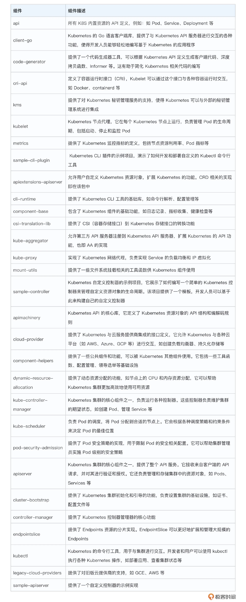

# 11 | Kubernetes代码仓库介绍

你好，我是孔令飞。

Kubernetes 源码量比较大，如果没有一个合理的仓库结构设计，维护起来会很困难。这节课咱们一起来聊聊它的代码仓库结构，以及每个源码目录的作用，看看 Kubernetes 是怎么“排兵布阵”的，让你更轻松地看懂 Kubernetes 的源码。

## Kubernetes 仓库结构介绍

Kubernetes 社区在项目迭代过程中，也在不断优化项目的目录结构以适配最新的功能代码以及代码设计方法。

在 v1.30.2 版本中，Kubernetes 源码目录结构如下：

```
├── api/ # 存放 API 定义相关文件，例如：OpenAPI 文档
├── build/ # 包含了使用容器来构建 Kubernetes 组件的脚本
├── CHANGELOG/ # 存放 Kubernetes 的 CHANGELOG。master 分支会存放所有版本的CHANGELOG。在
├── cluster/ # 存放一些脚本和工具，用于创建、更新和管理Kubernetes集群
├── cmd # 存放Kubernetes的各种命令行工具的入口文件（即main文件），包括kubelet、kube-apiser
├── docs # 存放设计、开发文档或用户文档等。为了精简 Kubernetes 仓库，docs目录下的文件已挪至h
├── hack # 包含了一些脚本，这些脚本用来管理Kubernetes项目，例如：代码生成、组件安装、代码构建
│   ├── boilerplate # 各种类型文件的版权头信息。在生成代码时，对应文件类型的版权头信息取自该目
│   ├── lib # 存放shell脚本库，包含一些通用的Shell函数
│   ├── make-rules # 存放 Makefile 文件
├── Makefile -> build/root/Makefile
├── _output # 保存一些构建产物或者其他临时文件
├── pkg # 存放大部分Kubernetes的核心代码。这里有API对象的定义、客户端库、认证/授权/审计机制、
│   ├── api # 包含了跟 API 相关的一些功能函数
│   ├── apis # 包含了 Kubernetes 中内置资源的定义、版本转换、默认值设置、参数校验等功能
│   ├── auth # 包含了授权相关的功能实现
│   ├── controller # 包含了kubernetes各类controller实现
│   ├── controlplane # 包含了kube-apiserver的核心实现
│   ├── credentialprovider
│   ├── features # 包含了Kubernetes内置的feature gate
│   ├── generated # 包含了Kubernetes中所有的生成文件。当前只包含了openapi。但是该目录目的是
│   ├── kubeapiserver # 包含了kube-apiserver相关的核心包，当前有adminssion初始化、认证、
│   ├── kubectl # kubectl 命令行工具具体实现
│   ├── kubelet # kubelet 具体实现
│   ├── kubemark # kubemark 具体实现
│   ├── printers # 实现 Kubernetes 对象的打印和显示功能
│   ├── probe # 管理 Kubernetes 的健康检查探针
│   ├── proxy # kube-proxy 具体实现
│   ├── registry # kube-apiserver核心代码实现，包含了资源的CURD、资源注册等
│   ├── scheduler # kube-scheduler 具体实现
│   ├── util # 提供一些通用的工具函数和辅助函数
│   ├── volume # 实现 Kubernetes 存储卷的管理
├── plugin # 存放Kubernetes的各种插件，包括网络插件、设备插件、调度插件、认证插件、授权插件等
├── staging # 存放些即将被移动到其它仓库的代码
├── test # 存放测试工具及测试数据
├── third_party # 存放第三方工具、代码或其他组件
└── vendor # 存放项目依赖的库代码，一般为第三方库代码
```

这里要说明的是，我只在上面列出了 Kubernetes 源码目录下的一些核心目录，至于其他没有提到的，通过文件名，不难知道它们的功能，所以我就不一一来说了。

在这些目录中，我们会重点讲解 staging 目录和 cmd 目录，以及一些易混淆的 API 包。

## Staging 目录

```
很多刚开始看 Kubernetes 源码的同学，都搞不清楚 /staging 目录的命名和作用，所以接下
来我们先介绍 /staging 目录。
staging 目录是一个暂存区，用来暂时保存未来会发布到其自己代码仓库的项目。暂存区中
```

的项目会被 publishing-bot 机器人定期同步到 k8s.io 组织中，作为 k8s.io 组织的一级项目而存

```
在，其模块名为 k8s.io/xxx，api 包的模块名可以是下面这样：
// This is a generated file. Do not edit directly.
module k8s.io/api
go 1.21.3
```

将这些项目发布为 k8s.io 组织的一级项目，可以方便其他开发者引用。要注意的是，这些代码虽然以独立项目发布，但都在 Kubernetes 主项目中维护，位于目录

```
kubernetes/staging/ 中，这里面的代码会被定期同步到各个独立项目中。
```

还需要注意，虽然 staging 目录已成为暂存区，但是目录下的项目会永久存在于 Kubernetes仓库中，未来会发布到独立代码仓库。

在 Go 项目中，我们如果要使用 api 包，引用的是其模块名：

```python
package kubelet
import (
   ...
   v1 "k8s.io/api/core/v1"
   ...
)
另外，Go 模块 k8s.io/api 对应的 GitHub 仓库是
https://github.com/kubernetes/api。在实际执行 go get 命令时，Go 工具会先访问
https://k8s.io/api，然后 k8s.io 服务器将模块下载地址转发到
https://github.com/kubernetes/api。
```

总的来说，staging 目录当前暂存了以下项目（为了方便表述，我后面会统称这些包为 staging包）：



我们要注意，staging 目录中的代码是权威的，也就是说它是代码的唯一副本，如果你要对

```
k8s.io/api 包的代码进行变更，你只能修改 kubernetes/staging/src/k8s.io/api
目录下的代码。换句话说，k8s.io/api 仓库是只读的，你不能对其进行任何代码修改。
```

### Kubernetes 代码如何导入 staging 包？

staging 目录下的包也会被 Kubernetes 仓库中的其他代码导入并使用，例如pkg/kubelet/kubelet.go：

```python
package kubelet
import (
   ...
   "k8s.io/client-go/informers"
   v1 "k8s.io/api/core/v1"
   metav1 "k8s.io/apimachinery/pkg/apis/meta/v1"
   "k8s.io/apimachinery/pkg/types"
   "k8s.io/apimachinery/pkg/util/wait"
   "k8s.io/klog/v2"
   "k8s.io/kubernetes/pkg/api/v1/resource"
   "k8s.io/kubernetes/pkg/features"
   "k8s.io/kubernetes/pkg/kubelet/cadvisor"
   ...
)
因为 staging 目录下的项目模块名为 k8s.io/xxx，所以即使 Kubernetes 代码需要用，也需
要按模块名进行导入 k8s.io/xxx。但这时候会出现一个问题，如果 Kubernetes 需要添加 A
```

功能，这个功能涉及 xxx 包的修改，那么就有两种方案：

```
先将 xxx 包发布到 k8s.io/xxx 仓库下，再升级 Kubernetes 仓库下 go.mod 文件中
k8s.io/xxx 包的版本，最后再开发 A 功能。
使用 Go 模块的包替代功能，直接将 k8s.io/xxx 替换为 staging 目录下的 xxx 模块。
方案 1 会有一个问题，先把 xxx 的变更发布到 k8s.io/xxx 仓库中，再开发 A 功能，如果在
开发过程中，发现 xxx 包需要适配，就需要频繁地将适配的内容发布到 k8s.io/xxx 仓库
中，会造成 k8s.io/xxx 仓库被频繁发布了不稳定的代码，不合理。
```

因此，Kubernetes 选择了第二种方法，因为它最便捷也最合理，例如 go.mod：

```
replace (
   k8s.io/api => ./staging/src/k8s.io/api
   k8s.io/apiextensions-apiserver => ./staging/src/k8s.io/apiextensions-apiserve
   k8s.io/apimachinery => ./staging/src/k8s.io/apimachinery
   k8s.io/apiserver => ./staging/src/k8s.io/apiserver
   k8s.io/cli-runtime => ./staging/src/k8s.io/cli-runtime
   k8s.io/client-go => ./staging/src/k8s.io/client-go
   k8s.io/cloud-provider => ./staging/src/k8s.io/cloud-provider
   k8s.io/cluster-bootstrap => ./staging/src/k8s.io/cluster-bootstrap
   k8s.io/code-generator => ./staging/src/k8s.io/code-generator
   k8s.io/component-base => ./staging/src/k8s.io/component-base
   k8s.io/component-helpers => ./staging/src/k8s.io/component-helpers
   k8s.io/controller-manager => ./staging/src/k8s.io/controller-manager
   k8s.io/cri-api => ./staging/src/k8s.io/cri-api
   k8s.io/csi-translation-lib => ./staging/src/k8s.io/csi-translation-lib
   k8s.io/dynamic-resource-allocation => ./staging/src/k8s.io/dynamic-resource-a
   k8s.io/endpointslice => ./staging/src/k8s.io/endpointslice
   k8s.io/kms => ./staging/src/k8s.io/kms
   k8s.io/kube-aggregator => ./staging/src/k8s.io/kube-aggregator
   k8s.io/kube-controller-manager => ./staging/src/k8s.io/kube-controller-manage
   k8s.io/kube-proxy => ./staging/src/k8s.io/kube-proxy
   k8s.io/kube-scheduler => ./staging/src/k8s.io/kube-scheduler
   k8s.io/kubectl => ./staging/src/k8s.io/kubectl
   k8s.io/kubelet => ./staging/src/k8s.io/kubelet
   k8s.io/legacy-cloud-providers => ./staging/src/k8s.io/legacy-cloud-providers
   k8s.io/metrics => ./staging/src/k8s.io/metrics
   k8s.io/mount-utils => ./staging/src/k8s.io/mount-utils
   k8s.io/pod-security-admission => ./staging/src/k8s.io/pod-security-admission
   k8s.io/sample-apiserver => ./staging/src/k8s.io/sample-apiserver
   k8s.io/sample-cli-plugin => ./staging/src/k8s.io/sample-cli-plugin
   k8s.io/sample-controller => ./staging/src/k8s.io/sample-controller
)
如果你使用 vendor 机制，会发现 vendor/k8s.io/api 目录也被做了软连接：
vendor/k8s.io/api -> ../../staging/src/k8s.io/api
```

### 如何根据 Kubernetes v1.30.2 查找 staging 包的版本？

在 Kubernetes 中，了解版本映射非常重要。当第三方项目需要引用 Kubernetes 包及 staging包时，必须指明对应版本。一旦 Kubernetes 包与 staging 包之间的版本出现不匹配的情况，极有可能带来很多兼容性问题。

接下来，我们就以 Kubernetes v1.30.2 为例，讲讲怎么查找 staging 包的版本。

Kubernetes 会依赖 staging 包，在 Kubernetes 包中，对 staging 包的依赖配置如下：

```
$ grep -w k8s.io/api go.mod
k8s.io/api v0.0.0
k8s.io/api => ./staging/src/k8s.io/api
可以看到，go.mod 中并没有配置 k8s.io/api 包的版本。那么，我们如何知道 Kubernetes
v1.30.2 所依赖 k8s.io/api 包的具体发布版本呢？
```

有一个不成文的约定：如果 Kubernetes 的版本号是 v1.30.2，那么对应的 staging 包的版本为

```
v0.30.2，也就是 v1.30.2 主版本号 1 减去 1。
```

## cmd/ 目录下组件介绍

```
Kubernetes cmd/ 目录下有很多组件，v1.30.2 版本下，cmd/ 目录下有 27 个组件（也即有
```

27 个 main 文件）。我们按功能将这些组件分为 4 类：

- Kubernetes 控制面组件（核心组件）：

- kube-apiserver

- kube-controller-manager

- cloud-controller-manager

- kube-scheduler

- kubelet

- kube-proxy

- Kubernetes 客户端工具：

- kubeadm

- kubectl

- 辅助工具：

- clicheck

- genkubedocs

- gendocs

- genman

- genswaggertypedocs

- genyaml

- kubectl-convert

- kubemark

- 其它

- dependencycheck

- dependencyverifier

- genutils

- fieldnamedocscheck

- prune-junit-xml

- importverifier

- preferredimports

- import-boss

- gotemplate

## 三个易混淆的 API 包

在阅读 Kubernetes 源码或者进行 Kubernetes 编程过程中，我们经常会引用以下 3 个包：

- k8s.io/api

- kubernetes/pkg/api

- kubernetes/pkg/apis

这 3 个包都与 Kubernetes API 相关，但在功能和位置上有所不同。

```
我们先来看 k8s.io/api。该包包含了 Kubernetes 内置资源对象的结构体定义，以及与这些
资源对象相关的操作和状态。该包涉及的操作主要包括针对每种资源对象的 Marshal、
Unmarshal、DeepCopy()、DeepCopyObject、DeepCopyInto、String。
```

例如，DaemonSet 资源具有以下操作：

```
generated.pb.go:func (m *DaemonSet) Reset()      { *m = DaemonSet{} }
generated.pb.go:func (*DaemonSet) ProtoMessage() {}
generated.pb.go:func (*DaemonSet) Descriptor() ([]byte, []int) {
generated.pb.go:func (m *DaemonSet) XXX_Unmarshal(b []byte) error {
generated.pb.go:func (m *DaemonSet) XXX_Marshal(b []byte, deterministic bool) ([]
generated.pb.go:func (m *DaemonSet) XXX_Merge(src proto.Message) {
generated.pb.go:func (m *DaemonSet) XXX_Size() int {
generated.pb.go:func (m *DaemonSet) XXX_DiscardUnknown() {
generated.pb.go:func (m *DaemonSet) Marshal() (dAtA []byte, err error) {
generated.pb.go:func (m *DaemonSet) MarshalTo(dAtA []byte) (int, error) {
generated.pb.go:func (m *DaemonSet) MarshalToSizedBuffer(dAtA []byte) (int, error
generated.pb.go:func (m *DaemonSet) Size() (n int) {
generated.pb.go:func (this *DaemonSet) String() string {
generated.pb.go:func (m *DaemonSet) Unmarshal(dAtA []byte) error {
zz_generated.deepcopy.go:func (in *DaemonSet) DeepCopyInto(out *DaemonSet) {
zz_generated.deepcopy.go:func (in *DaemonSet) DeepCopy() *DaemonSet {
zz_generated.deepcopy.go:func (in *DaemonSet) DeepCopyObject() runtime.Object {
zz_generated.prerelease-lifecycle.go:func (in *DaemonSet) APILifecycleIntroduced(
zz_generated.prerelease-lifecycle.go:func (in *DaemonSet) APILifecycleDeprecated(
zz_generated.prerelease-lifecycle.go:func (in *DaemonSet) APILifecycleReplacement
zz_generated.prerelease-lifecycle.go:func (in *DaemonSet) APILifecycleRemoved() (
k8s.io/api 涉及的资源状态主要是 XXXConditionType，例如 Pod 资源对象具有以下状
```

态：

```javascript
// These are built-in conditions of pod. An application may use a custom conditio
const (
   // ContainersReady indicates whether all containers in the pod are ready.
   ContainersReady PodConditionType = "ContainersReady"
   // PodInitialized means that all init containers in the pod have started succ
   PodInitialized PodConditionType = "Initialized"
   // PodReady means the pod is able to service requests and should be added to
   // load balancing pools of all matching services.
   PodReady PodConditionType = "Ready"
   // PodScheduled represents status of the scheduling process for this pod.
   PodScheduled PodConditionType = "PodScheduled"
   // DisruptionTarget indicates the pod is about to be terminated due to a
   // disruption (such as preemption, eviction API or garbage-collection).
   DisruptionTarget PodConditionType = "DisruptionTarget"
)
kubernetes/pkg/api 包含了一些核心资源对象 utill 类型的函数定义。
kubernetes/pkg/apis 与 k8s.io/api 包内容类似，也包含了 Kubernetes 内置资源对象
```

的结构体定义。但是这个项目只建议被 Kubernetes 内部引用，如果外部项目引用建议使用

```
k8s.io/api。而且 Kubernetes 内置代码也有很多引用了 k8s.io/api 下面的 api，所以后
面可能都会迁移至 k8s.io/api 项目下。
```

Kubernetes 中的 API 被组织为多个 API 组，每个 API 组都有自己的版本和资源对象。每个API 组通常对应一个子目录，每一个版本又对应一个子目录，在版本子目录下包含了该版本的

```
资源对象的结构体定义、状态定义和相关的方法。例如 kubernetes/pkg/apis/ 目录下的
```

资源组和版本的目录结构如下：

```
kubernetes/pkg/apis
├── ...
├── apps # apps 资源组
│   ├── doc.go
│   ├── fuzzer/
│   ├── install/
│   ├── register.go
│   ├── types.go
│   ├── v1/ # v1版本
│   ├── v1beta1/ # v1beta1 版本
│   ├── v1beta2/ # v1beta2 版本
│   ├── validation/
│   └── zz_generated.deepcopy.go
├── ...
├── core # core 资源组（也叫核心资源组）
│   ├── annotation_key_constants.go
│   ├── doc.go
│   ├── fuzzer/
│   ├── helper/
│   ├── install/
│   ├── json.go
│   ├── objectreference.go
│   ├── pods/
│   ├── register.go
│   ├── resource.go
│   ├── taint.go
│   ├── toleration.go
│   ├── types.go
│   ├── v1/ # v1 版本
│   ├── validation/
│   └── zz_generated.deepcopy.go
```

## Kubernetes 学习文档推荐

如果你还想更多地学习和熟悉 Kubernetes，我再给你推荐一些 Kubernetes 阅读资料。

- Kubernetes 官方文档：面向于使用者，如果你有时间，建议把官方文档阅读一遍（当然，如果你习惯看中文，也有 Kubernetes 中文文档，但我还是建议你直接阅读官方文档）。

- Kubernetes 社区文档：包含了 Kubernetes 的开发文档、开发规范、方案设计等文档，相比于官方文档，更多面向于开发者。建议过一遍社区文档，其中有很多文档，对我们的项目开发很有帮助。

- design-proposals-archive：介绍 Kubernetes 功能设计时的一些提案，对了解Kubernetes 功能设计背后的思考非常有帮助。

- Kubernetes 权威指南：从 Docker 到 Kubernetes 实践全接触（第 6 版）：学习Kubernetes 必读的一本书，分为第六版分为上下两册。

## 课程总结

本节课我们介绍了 Kubernetes 的代码仓库结构，以及核心目录的功能作用。希望通过本节课的学习，你能对 Kubernetes 源码结构有一个初步的认识。

## 课后练习

1. 你觉得 Kubernetes 源码还有哪些值得借鉴的特点？

2. 尝试从 Kubernetes 源码中找到一个文档类错误，并给 Kubernetes 贡献一个 PR。

3. 如果你有其他好的 Kubernetes 相关资料，欢迎评论区分享。

期待你的留言，如果今天的内容让你有所收获，也欢迎转发给有需要的朋友，我们下节课再见！
